# User Flows — CondomiFacil

Nov 4, 2026 · @Pedro Lemos

## 1. Objetivo e como ler

Este documento mapeia, passo a passo, cada ação principal de cada perfil do CondomiFacil, com o caminho feliz e todos os caminhos de erro, para orientar o design das telas, o desenvolvimento e os testes.

**Fontes.** Os fluxos seguem o [Visão de Produto](../01-produto/01-visao-de-produto.md), o [PRD](../01-produto/02-prd.md), as [Regras de Negócio](../01-produto/03-regras-de-negocio.md), as [Histórias de Usuário](../01-produto/04-historias-de-usuario.md) e o [Design System](01-design-system.md). As Regras de Negócio são a fonte oficial do comportamento, e o Design System é a fonte oficial da interface (componentes, nomes de estado e textos padrão). Se um fluxo daqui divergir deles, valem eles, e este documento deve ser corrigido.

**O que este documento define.** A ordem dos passos, as decisões e o que acontece em cada erro. Como cada tela fica (componentes, cores, tamanhos) está no Design System, seções 10 e 11.

**Valores padrão.** Prazos e limites aparecem com o valor padrão (ex.: 12h para cancelar com reembolso). Em condomínios com outra configuração, vale o valor configurado (Regras de Negócio, seção 13).

**Legenda dos diagramas**

| Forma ou cor | Significado |
| --- | --- |
| `([ ])` cápsula | Início ou fim do fluxo |
| `[ ]` retângulo | Tela ou ação do usuário |
| `{ }` losango | Decisão ou verificação do sistema |
| Verde | Fim com sucesso |
| Vermelho | Erro, bloqueio ou fim sem sucesso |
| Azul tracejado | Ação automática do sistema (rotina, notificação, webhook) |

**Tabelas de erro.** Cada fluxo tem uma tabela com a situação, o que o usuário vê, como ele sai do erro e a regra que define o comportamento. Os textos seguem o tom e os termos do Design System (seção 13): direto, sem culpa e sempre com o próximo passo. Os nomes de estado entre aspas são os textos exatos dos selos (Design System, 4.5).

**Princípios aplicados a todos os fluxos**

1. **Até 3 toques** a partir da tela inicial para reservar, cadastrar visitante, abrir chamado e registrar entrada; na portaria, até 2 (RNF-15). Contagem conforme o Design System, seção 2.
2. **Nenhum erro sem saída.** Toda mensagem diz o que aconteceu e o que fazer em seguida.
3. **A portaria nunca para.** Falha de internet ou do app nunca impede uma entrada; o interfone continua valendo (RN-VI-04).
4. **Privacidade por padrão.** Nenhuma mensagem de erro revela dado de outra pessoa: quem reservou, quem reclamou, quem está em atraso ou se um e-mail está cadastrado.

## 2. Mapa dos fluxos

| # | Fluxo | Perfil principal | Gatilho | Histórias |
| --- | --- | --- | --- | --- |
| 3.1 | Primeiro acesso | Todos | Convite por e-mail | US-AC-01 a US-AC-03 |
| 3.2 | Login e recuperação de senha | Todos | Abrir o app sem sessão | US-AC-04 |
| 3.3 | Novo aceite e troca de unidade | Todos | Nova versão de termos; ter várias unidades | US-AC-02, US-AC-05 |
| 4.1 | Implantação e pré-cadastro | Administradora, Suporte | Novo condomínio | US-AD-01, US-AD-04, US-AD-05, US-AD-08 |
| 4.2 | Solicitação do síndico | Síndico | Mudança em cadastro | US-AD-02 |
| 4.3 | Mudança de morador e desligamento | Administradora, Suporte | Saída de alguém | US-AD-03, US-AD-09 |
| 4.4 | Mandatos e substituição | Administradora, Síndico | Eleição, ausência ou renúncia | US-AD-06, US-AD-07 |
| 5.1 | Fazer reserva | Morador | Querer usar uma área | US-RE-01 a US-RE-03, US-RE-05 |
| 5.2 | Cancelar reserva | Morador, Condomínio | Desistência ou manutenção | US-RE-04 |
| 5.3 | Vistoria e não comparecimento | Portaria, Limpeza | Fim da reserva | US-RE-06 |
| 6.1 | Cadastrar visitante | Morador | Visita prevista | US-VI-01, US-VI-02 |
| 6.2 | Registrar entrada e saída | Portaria | Visitante na portaria | US-VI-03, US-VI-05 |
| 6.3 | Portaria sem internet e sincronização | Portaria | Queda de conexão | US-VI-04 |
| 6.4 | Modo de treinamento | Portaria | Novo porteiro | US-VI-06 |
| 7.1 | Encomendas | Portaria, Morador | Entrega na portaria | US-EN-01, US-EN-02 |
| 8.1 | Abrir chamado | Morador, Síndico, Portaria | Problema no condomínio | US-CH-01 |
| 8.2 | Atender chamado de limpeza | Limpeza | Chamado na fila | US-CH-02 |
| 8.3 | Acompanhar manutenção | Síndico | Chamado de manutenção | US-CH-03 |
| 9.1 | Registrar reclamação | Morador | Problema de convivência | US-RS-01, US-RS-04 |
| 9.2 | Julgar reclamação | Julgador | Reclamação aberta | US-RS-02, US-RS-03 |
| 9.3 | Recorrer | Quem perdeu pontos | Decisão com perda de pontos | US-RS-05 |
| 9.4 | Acompanhar score e transparência | Todos | Consulta | US-RS-06, US-RS-07 |
| 10.1 | Comunicados | Síndico | Aviso ao condomínio | US-CO-01, US-CO-02 |
| 11.1 | Convocar reunião e votar | Síndico, Morador habilitado | Assembleia | US-VO-01, US-VO-02 |
| 11.2 | Eleição de síndico e subsíndico | Síndico, Administradora, Morador | Fim de mandato | US-VO-03 |
| 12.1 | Pesquisa mensal | Morador | Mês aberto | US-PE-01, US-PE-02 |
| 13.1 | Pagar a taxa condominial | Responsável financeiro | Cobrança emitida | US-FI-02, US-FI-03 |
| 13.2 | Configurar cobrança, extras e inadimplência | Administradora, Síndico | Implantação ou atraso | US-FI-01, US-FI-04, US-FI-05 |
| 14.1 | Notificações e direitos do titular (LGPD) | Todos | Preferência ou pedido | US-NO-01, US-LG-01 |

## 3. Acesso e conta

### 3.1 Primeiro acesso

Ninguém cria conta sozinho: a pessoa já foi pré-cadastrada e só ativa o acesso com um código enviado ao e-mail (RN-CD-01, RN-CD-02).

- **Perfil:** todos.
- **Pré-condição:** pré-cadastro feito pela administradora ou pelo suporte.
- **Resultado:** conta ativa, termos aceitos e tela inicial do perfil.

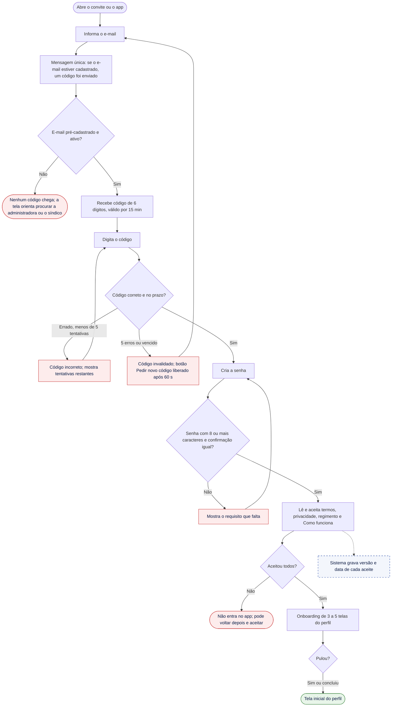

| Situação | O que o usuário vê | Como sai | Regra |
| --- | --- | --- | --- |
| E-mail não cadastrado ou desativado | A mesma mensagem de e-mail cadastrado; o código não chega. Abaixo: "Não recebeu? Confira o e-mail digitado ou procure a administradora ou o síndico." | Corrige o e-mail ou pede o pré-cadastro | RN-CD-01, RN-CD-02 |
| Código errado | "Código incorreto. Você tem mais N tentativas." | Digita de novo | RN-CD-02 |
| 5 erros ou código vencido | "Este código não vale mais. Peça um novo." | Pede novo código (após 60 s); o anterior é invalidado | RN-CD-02 |
| Senha fraca | Lista do requisito com o item pendente destacado | Ajusta a senha | RF-AC-01 |
| Não aceita os termos | "Para usar o CondomiFacil, é preciso aceitar os documentos do seu condomínio." | Aceita depois; a conta fica ativa, mas sem acesso | RN-CD-03 |
| Sem internet | "Não foi possível conectar. Verifique a internet e tente de novo." | Tenta de novo | DS 13.4 |

O proprietário não residente vê o onboarding só de cobranças e entra direto em Cobranças (RN-CD-19).

### 3.2 Login e recuperação de senha

O login usa e-mail e senha; a recuperação repete o fluxo do código do primeiro acesso.

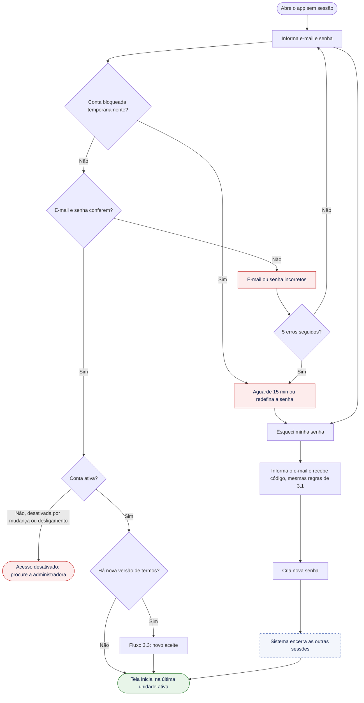

| Situação | O que o usuário vê | Como sai | Regra |
| --- | --- | --- | --- |
| E-mail ou senha errados | "E-mail ou senha incorretos." (sem dizer qual dos dois) | Tenta de novo ou redefine a senha | SEG-04 |
| 5 senhas erradas seguidas | "Por segurança, o acesso foi pausado por 15 minutos. Você pode redefinir a senha agora." | Espera ou redefine | SEG-04 |
| Conta desativada | "Seu acesso a este condomínio foi encerrado. Se for um engano, fale com a administradora." | Contato com a administradora | RN-CD-07 |
| Vínculo com outro condomínio ainda ativo | Entra normalmente, só com as unidades ativas | — | RN-CD-05 |

### 3.3 Novo aceite e troca de unidade

- **Novo aceite.** Ao abrir o app depois que termos, política, regimento ou "Como funciona" mudaram, o usuário vê só o que mudou e aceita antes de continuar (RN-CD-03). Quem tem vínculo com dois condomínios aceita o regimento de cada um ao entrar nele. Recusar mantém a sessão, mas bloqueia o uso até o aceite.
- **Troca de unidade.** Quem tem duas ou mais unidades vê o seletor no topo da tela inicial (RF-AC-04). Ao trocar, reservas, visitantes, reuniões, cobranças e métricas recarregam só para a unidade escolhida. Se a unidade foi desvinculada enquanto o app estava aberto, ela some do seletor e o app abre a próxima unidade ativa, com o aviso "Você não tem mais acesso à unidade X."

## 4. Administração do condomínio

Nesta seção, "administradora" inclui a equipe de suporte da plataforma nos condomínios do plano Gestão + Suporte, conforme a regra de leitura das Regras de Negócio (seção 1).

### 4.1 Implantação e pré-cadastro

A implantação segue uma ordem fixa, porque cada etapa depende da anterior: estrutura, conta bancária, pessoas e, por fim, regras.

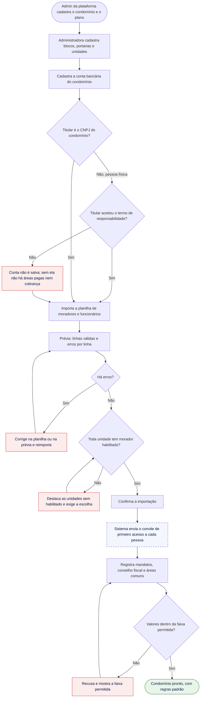

| Situação | O que o usuário vê | Como sai | Regra |
| --- | --- | --- | --- |
| Planilha fora do modelo | "O arquivo não segue o modelo. Baixe o modelo e preencha de novo." | Baixa o modelo | RF-AD-01 |
| Linha com e-mail repetido, unidade inexistente ou campo obrigatório vazio | Linha em vermelho com o motivo | Corrige e reimporta; linhas válidas não são perdidas | RF-AD-01 |
| Unidade sem morador habilitado | "Escolha o morador habilitado da unidade X." | Escolhe | RN-CD-04 |
| Síndico e subsíndico da mesma unidade | "Síndico e subsíndico precisam ser de unidades diferentes." | Escolhe outra pessoa | RN-CD-10 |
| Condomínio sem subsíndico nem conselho fiscal | Alerta pendente no painel até cadastrar um membro do conselho | Cadastra o conselho | RN-VO-09 |
| Área paga sem conta bancária | "Cadastre a conta bancária do condomínio antes de criar áreas pagas." | Cadastra a conta | RN-PG-03 |
| Parâmetro fora da faixa | "Informe um valor entre [mínimo] e [máximo]." | Ajusta | RN 13, DS 13.4 |
| Importação inicial no plano Gestão + Suporte | — (não conta na franquia) | — | RN-PL-03 |

### 4.2 Solicitação do síndico

O síndico nunca cadastra diretamente; ele envia uma solicitação, que a administradora atende ou recusa com motivo (RN-CD-06).

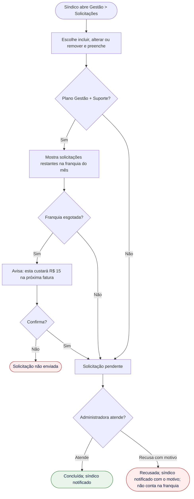

| Situação | O que o usuário vê | Como sai | Regra |
| --- | --- | --- | --- |
| Franquia esgotada | "Você já usou as N solicitações do mês. Esta custará R$ 15 na próxima fatura." | Confirma ou espera o próximo mês | RN-PL-05 |
| Solicitação recusada | Notificação com o motivo | Corrige e envia de novo | RN-CD-06 |
| Dados incompletos | Campo obrigatório destacado | Preenche | RF-AD-02 |

### 4.3 Mudança de morador e desligamento de funcionário

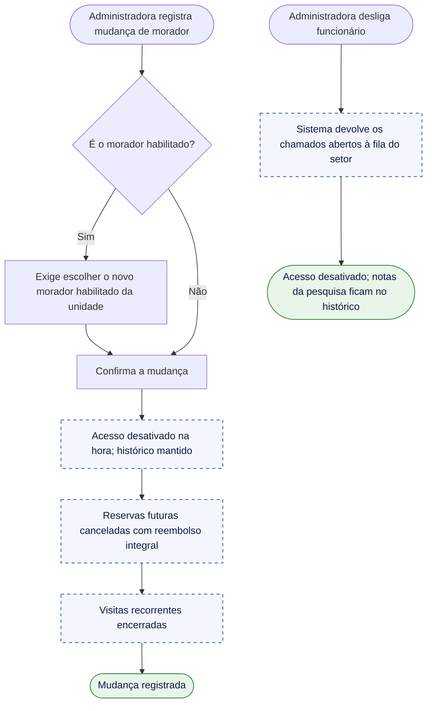

| Situação | O que o usuário vê | Como sai | Regra |
| --- | --- | --- | --- |
| Unidade ficaria sem morador habilitado | "Escolha quem passa a responder pela unidade." | Escolhe | RN-CD-04 |
| Morador era o responsável financeiro | "Defina o novo responsável financeiro." (padrão: novo morador habilitado) | Confirma ou escolhe | RN-FI-03 |
| Morador era síndico ou subsíndico | "Esta pessoa tem mandato ativo. Encerre o mandato antes." | Fluxo 4.4 | RN-CD-13 |

### 4.4 Mandatos e substituição do síndico

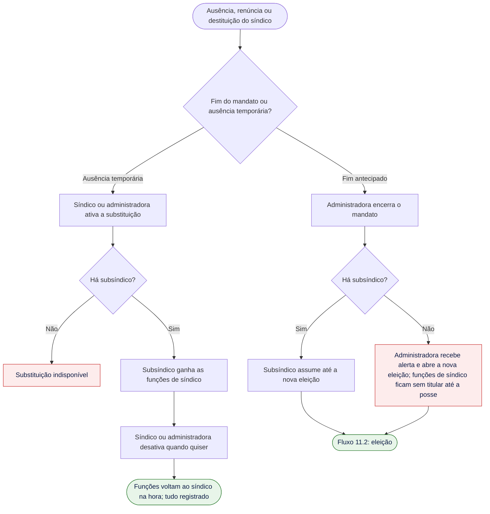

## 5. Reservas

### 5.1 Fazer reserva

A reserva gratuita é confirmada na hora; a paga segura o horário enquanto espera o pagamento (RN-RE-02, RN-RE-03).

- **Perfil:** morador, síndico morador e subsíndico.
- **Toques:** Reservas → Reservar (2), mais a escolha da área, do dia e do horário.

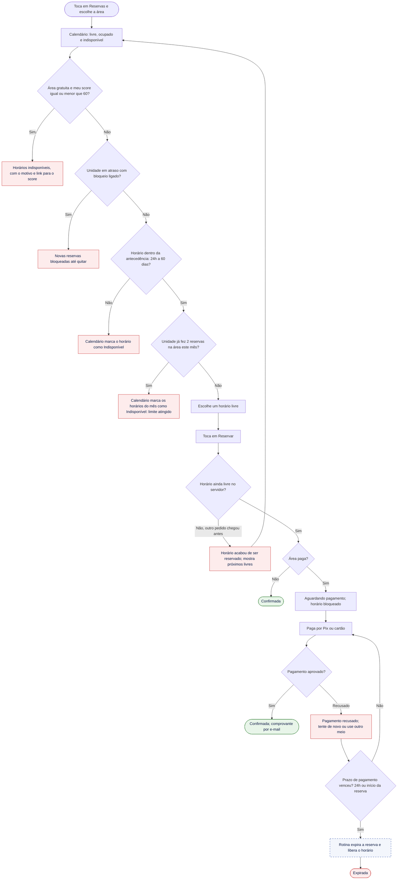

| Situação | O que o usuário vê | Como sai | Regra |
| --- | --- | --- | --- |
| Score igual ou menor que 60 em área gratuita | Aviso fixo no topo do calendário: "Seu score está em 58. Reservas gratuitas voltam quando ele passar de 60. Áreas pagas continuam liberadas." Horários com o estado "Indisponível" e ícone de cadeado (DS 4.6) | Reserva área paga ou espera recuperar; outros moradores da unidade reservam normalmente | RN-SC-09, RN-SC-10 |
| Unidade em atraso, com bloqueio ligado | "Novas reservas estão bloqueadas enquanto houver cobrança em atraso." (só para quem pode ver a situação financeira da unidade; os demais moradores veem "Reservas indisponíveis para esta unidade no momento") | Paga a cobrança | RN-RE-11, RN-FI-10 |
| Fora da antecedência | Horário "Indisponível" (DS 4.6); ao tocar: "Reservas desta área: de 24h a 60 dias antes." | Escolhe outra data | RN-RE-06 |
| Limite mensal atingido | "Sua unidade já usou as 2 reservas deste mês nesta área." | Escolhe outro mês ou cancela outra reserva | RN-RE-07 |
| Corrida pelo mesmo horário | "Este horário acabou de ser reservado." + sugestões | Escolhe outro horário | RN-RE-04 |
| Pagamento recusado | "O pagamento não foi aprovado. Seu horário fica guardado até [hora]." | Tenta de novo ou troca o meio | RN-RE-03 |
| Prazo de pagamento vencido | Push: "Sua reserva expirou porque o pagamento não foi concluído." | Faz nova reserva, se o horário seguir livre | RN-RE-03 |
| Gateway fora do ar | "O pagamento está indisponível agora. Seu horário fica guardado até [hora]." | Tenta de novo depois | RN-RE-03 |

### 5.2 Cancelar reserva

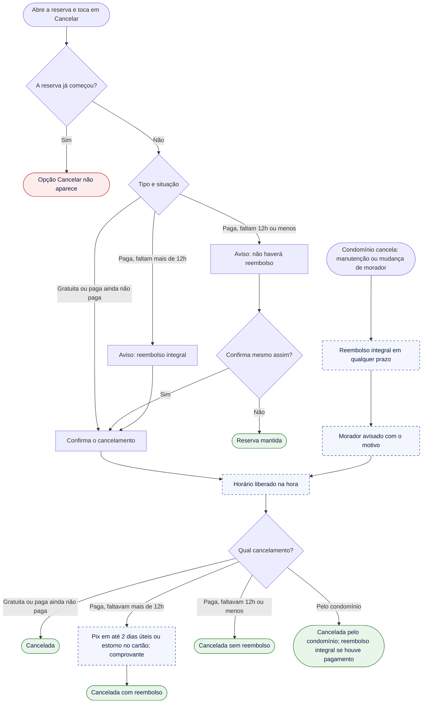

| Situação | O que o usuário vê | Como sai | Regra |
| --- | --- | --- | --- |
| Cancelar depois do prazo de reembolso | "Faltam menos de 12h. Se cancelar, o valor não será devolvido." | Confirma ou mantém | RN-CA-03 |
| Reembolso falhou no gateway | Push: "Seu reembolso está atrasado. Já estamos resolvendo." A administradora recebe alerta | Acompanha no histórico | RN-CA-04, SEG-17 |
| Reserva já começou | Sem botão de cancelar | — | RN-CA-01 |

### 5.3 Vistoria e não comparecimento

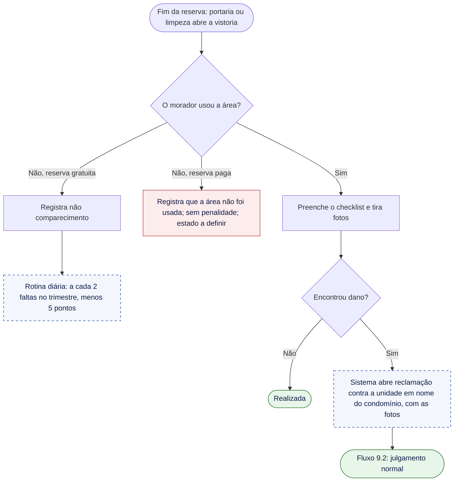

| Situação | O que o usuário vê | Como sai | Regra |
| --- | --- | --- | --- |
| Checklist incompleto | Itens obrigatórios destacados | Completa | RF-RE-08 |
| Foto não enviada por falta de internet | "A foto será enviada quando a conexão voltar." | Automático | RNF-08 |
| Reclamação de vistoria negada | Nenhuma penalidade a ninguém, porque não há reclamante pessoa | — | RN-RC-12 |

**Estados da reserva:** "Aguardando pagamento" → "Confirmada", "Expirada" ou "Cancelada"; "Confirmada" → "Cancelada", "Cancelada com reembolso", "Cancelada sem reembolso", "Cancelada pelo condomínio", "Realizada" ou "Não comparecimento". Detalhes nas Regras de Negócio, 7.4.

## 6. Visitantes e portaria

### 6.1 Cadastrar visitante

- **Perfil:** morador, síndico morador e subsíndico.
- **Toques:** Visitantes → Novo → Salvar (3) (digitar o nome não conta).

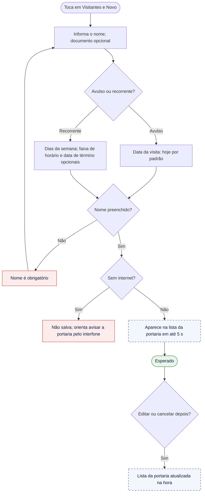

| Situação | O que o usuário vê | Como sai | Regra |
| --- | --- | --- | --- |
| Nome em branco | "Informe o nome do visitante." | Preenche | RN-VI-02 |
| Data no passado | Datas anteriores a hoje desabilitadas | Escolhe outra data | RN-VI-02 |
| Morador sem internet | "Sem internet. Seu visitante ainda pode entrar: a portaria vai confirmar com você pelo interfone." | Tenta de novo ou autoriza pelo interfone | RN-VI-04 |
| Visitante avulso não veio | Às 23h59 do dia previsto, a visita fica "Não compareceu" | Cadastra de novo se a visita mudar de data | RN-VI-09 |
| Morador mudou de unidade | Visitas recorrentes dele são encerradas | — | RN-VI-08 |

### 6.2 Registrar entrada e saída

A portaria encontra o visitante e registra a entrada em até 2 toques; o cadastro agiliza, mas o interfone continua valendo (RN-VI-04).

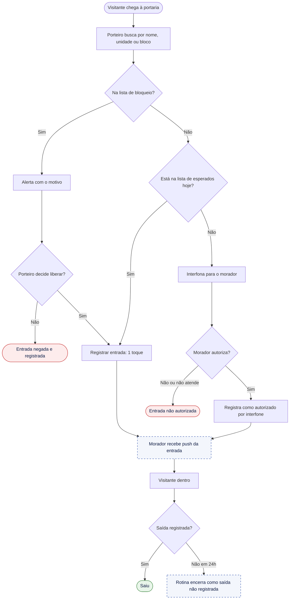

| Situação | O que o usuário vê | Como sai | Regra |
| --- | --- | --- | --- |
| Pessoa na lista de bloqueio | Diálogo bloqueante com o motivo; botões "Não liberar" (principal) e "Liberar mesmo assim", que pede o motivo | Porteiro decide; a decisão fica registrada | RN-VI-05, DS 11.1 |
| Não encontrado na lista | Botão flutuante "Entrada sem cadastro": nome, unidade e marcação "Autorizado por interfone" | Interfona e registra | RN-VI-04, DS 11.1 |
| Entrada registrada por engano | Mensagem rápida com "Desfazer" por 10 s, no lugar de um diálogo de confirmação | Toca em "Desfazer" | DS 11.1 |
| Visitante de outro bloco, fora desta portaria | Sem resultado, com o aviso "Esta portaria atende os blocos X e Y." | Orienta o visitante ou interfona | RN-CD-17 |
| Visitante recorrente fora do dia ou do horário | Alerta "Fora do horário cadastrado" | Interfona | RN-VI-03 |
| Sem internet | Fluxo 6.3 | — | RN-OF-02 |

### 6.3 Portaria sem internet e sincronização

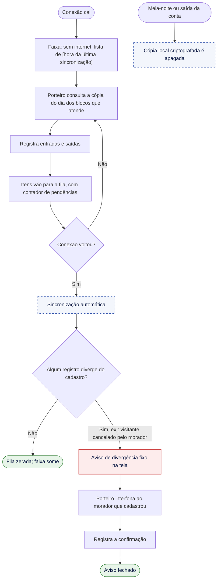

| Situação | O que o usuário vê | Como sai | Regra |
| --- | --- | --- | --- |
| Sem internet | Faixa "Sem internet" fixa, com a hora da última sincronização e o indicador de pendências (DS 10.10 e 10.23) | Segue trabalhando sem internet | RN-OF-02 |
| Divergência ao sincronizar | Diálogo sem botão de fechar: "Carlos Souza entrou às 14h10, mas a visita tinha sido cancelada pelo morador. Ligue para Bloco A · Apto 101 pelo interfone." | Interfona e toca em "Confirmei com o morador" | RN-OF-04, DS 11.1 |
| Falha ao enviar um item da fila | O item continua pendente, e o app tenta de novo sozinho | Automático | RNF-08 |
| Saída da conta com itens pendentes | "Há N registros ainda não enviados. Conecte-se antes de sair." | Espera a sincronização | RN-OF-06 |
| Registrar encomenda offline | Botão desabilitado: "Encomendas precisam de internet. Anote e registre quando a conexão voltar." | Registra depois | RNF-06 |

### 6.4 Modo de treinamento

O porteiro liga o modo pelo menu. Com o modo ativo, a faixa "MODO TREINAMENTO · Nada aqui é real" fica sempre visível (DS 10.10), a lista mostra visitantes e encomendas fictícios, e nada é gravado nos dados reais nem notifica moradores (RF-VI-12). Ao sair, a lista real volta. Se um visitante real chegar durante o treinamento, o botão "Sair do treinamento" fica fixo na faixa, a um toque.

## 7. Encomendas

### 7.1 Registrar e retirar encomenda

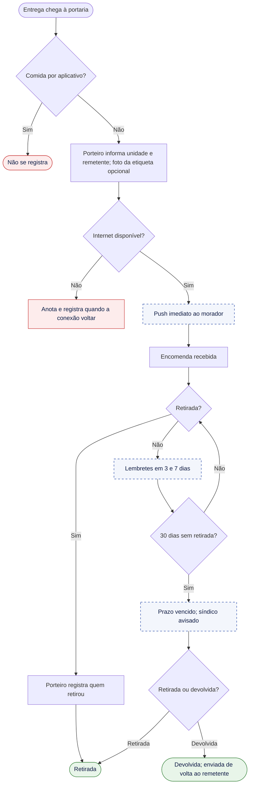

| Situação | O que o usuário vê | Como sai | Regra |
| --- | --- | --- | --- |
| Unidade errada no registro | Porteiro corrige antes da retirada; a unidade antiga recebe "O aviso de encomenda foi enviado por engano." | Corrige | RN-EN-06 |
| Quem retira não mora na unidade | A lista de quem pode retirar mostra só os moradores da unidade | Morador autoriza pelo interfone, e a portaria registra o nome de quem retirou | RN-EN-02 |
| Prazo de guarda vencido | Síndico recebe alerta | Combina retirada ou devolução | RN-EN-04 |

## 8. Chamados

### 8.1 Abrir chamado

- **Perfil:** morador, síndico, subsíndico e portaria.
- **Toques:** Chamados → Novo → Enviar (3) (escolher o tipo e a categoria e digitar não contam).

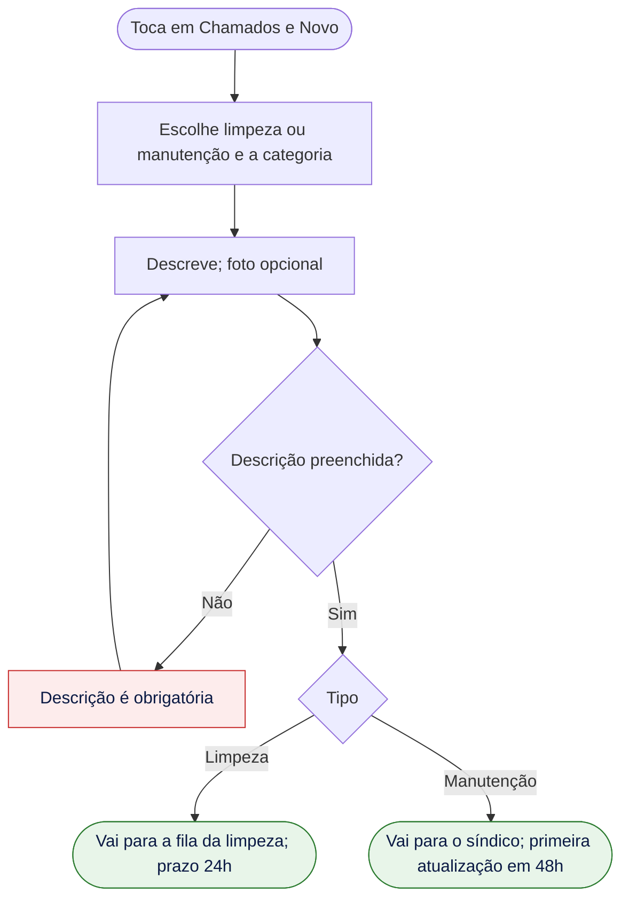

| Situação | O que o usuário vê | Como sai | Regra |
| --- | --- | --- | --- |
| Foto grande demais ou formato inválido | "Não foi possível anexar a foto. Tente outra." (fotos são comprimidas no aparelho) | Troca a foto ou envia sem | RN-CH-03 |
| Sem internet (morador ou portaria) | "Sem internet. Seu chamado não foi enviado." O texto fica salvo como rascunho | Envia quando voltar | RNF-07 |

### 8.2 Atender chamado de limpeza

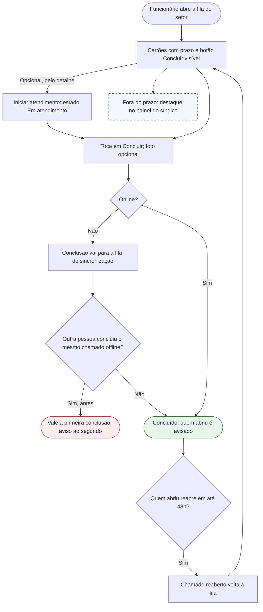

| Situação | O que o usuário vê | Como sai | Regra |
| --- | --- | --- | --- |
| Conclusão duplicada offline | "Este chamado já tinha sido concluído por [colega]." | Nenhuma ação | RN-CH-04 |
| Reabrir depois de 48h | Botão "Reabrir" some; aparece "Abrir novo chamado" | Abre um chamado novo | RN-CH-07 |

### 8.3 Acompanhar manutenção

O síndico (ou o subsíndico em substituição) escolhe a empresa cadastrada e avança o status: aberto → orçamento → agendado → concluído (RN-CH-05). Sem primeira atualização em 48h, o chamado fica em destaque no painel. Se a empresa não estiver cadastrada, o síndico a cadastra ali mesmo, com nome, serviço e telefone (RF-AD-14). Quem abriu é avisado na conclusão e pode reabrir em até 48h.

## 9. Reclamações e score

### 9.1 Registrar reclamação

Toda reclamação tem um único alvo do mesmo condomínio: um funcionário, uma unidade, o síndico ou o subsíndico (RN-RC-02). O alvo nunca sabe quem reclamou.

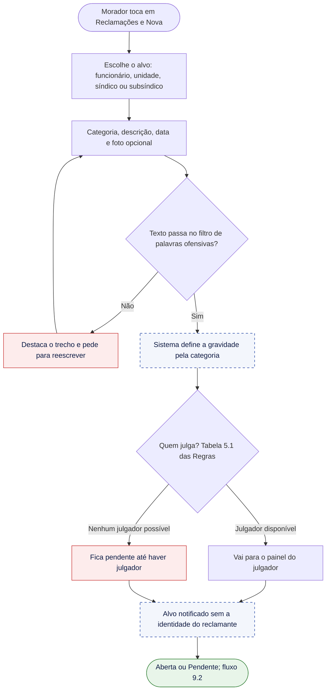

**Quem julga (resumo da tabela 5.1 das Regras de Negócio)**

| Alvo | Julgador |
| --- | --- |
| Funcionário ou unidade comum | Síndico; em substituição, subsíndico |
| Síndico ou a unidade dele | Subsíndico; sem ele, administradora; sem ela, conselho fiscal |
| Subsíndico ou a unidade dele | Síndico; com a substituição ativa, administradora; sem ela, pendente até o fim da substituição |
| Reclamação feita pelo próprio julgador | Quem julgaria uma reclamação contra ele (RN-RC-11) |

| Situação | O que o usuário vê | Como sai | Regra |
| --- | --- | --- | --- |
| Tentar dois alvos | O seletor aceita um só; aviso: "Para reclamar de outra pessoa, abra outra reclamação." | Abre outra | RN-RC-02 |
| Alvo de outro condomínio | Não aparece na busca | — | RN-RC-02 |
| Texto ofensivo | "Reescreva o trecho destacado. Reclamações com ofensas não são enviadas." | Reescreve | RN-RC-13 |
| Reclamação pendente sem julgador | "Sua reclamação aguarda um julgador disponível." | Automático quando houver julgador | Tabela 5.1 |

### 9.2 Julgar reclamação

O julgador só decide depois de ouvir o alvo; se o alvo não responder em 5 dias, a decisão é liberada com o registro "alvo não respondeu" (RN-RC-04).

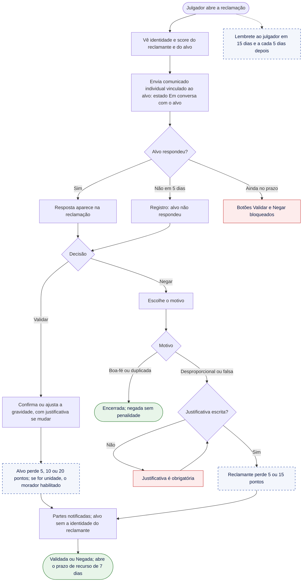

| Situação | O que o usuário vê | Como sai | Regra |
| --- | --- | --- | --- |
| Tentar decidir antes de ouvir o alvo | Botões bloqueados: "Converse com o alvo antes de decidir. Liberado em [data] se não houver resposta." | Envia a conversa ou espera o prazo | RN-RC-04 |
| Negar com penalidade sem justificativa | "Explique por que esta reclamação foi considerada [desproporcional/falsa]." | Escreve | RN-RC-05 |
| Mudar a gravidade sem justificativa | "Explique por que a gravidade mudou." | Escreve | RN-RC-09 |
| Prazo de decisão vencido | Lembrete ao julgador; destaque no painel | Decide | RN-RC-06 |
| Reclamação de vistoria negada | Sem penalidade, porque o reclamante é o condomínio | — | RN-RC-12 |
| Reclamação contra uma unidade cujo morador habilitado mudou | Os pontos vão para o habilitado na data da decisão | — | RN-SC-04 |

### 9.3 Recorrer

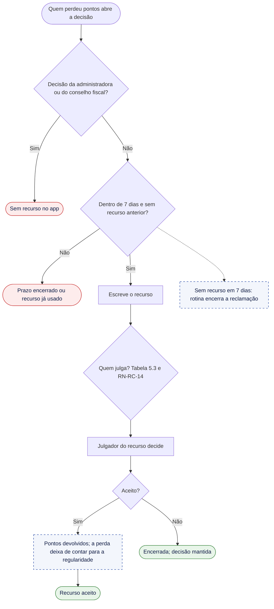

**Quem julga o recurso**

| Decisão tomada por | Recurso julgado por |
| --- | --- |
| Síndico | Subsíndico; sem ele, administradora; sem ela, conselho fiscal |
| Subsíndico | Síndico; se o síndico for parte da reclamação ou estiver em substituição, administradora; sem ela, conselho fiscal |
| Administradora ou conselho fiscal | Sem recurso no app |

Quem é parte da reclamação (reclamante ou alvo) nunca julga o recurso; sem nenhum julgador possível, o recurso fica pendente e a administradora recebe alerta para cadastrar o conselho fiscal (RN-RC-14).

### 9.4 Acompanhar score e transparência

- **Meu score:** número grande, histórico de ganhos e perdas com data e motivo, e a data da próxima recuperação. Nenhum item do histórico mostra quem reclamou (RN-SC-12). Com score igual ou menor que 60, um aviso explica o que está pausado e quando o score pode voltar a passar de 60.
- **Transparência:** score do síndico e nota de cada setor com 2 ou mais funcionários avaliados. Setor com menos avaliados mostra "Nota não publicada este mês: poucas avaliações." (RN-PE-08).
- **Denunciar conteúdo:** em qualquer texto, o menu "Denunciar" envia a denúncia ao síndico; se o conteúdo for do síndico, vai a quem julgaria uma reclamação contra ele (RN-RC-13).

## 10. Comunicação

### 10.1 Comunicados

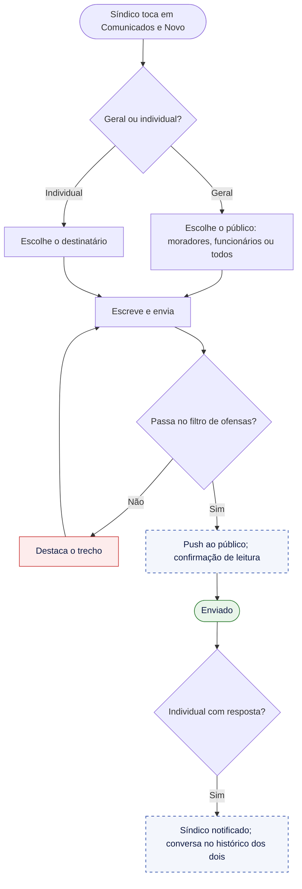

Só o síndico, ou o subsíndico em substituição, envia comunicados (RN-CO-01). A única exceção é a conversa com o alvo de uma reclamação, que qualquer julgador inicia de dentro da reclamação (RN-CO-04).

## 11. Reuniões, votações e eleições

### 11.1 Convocar reunião e votar

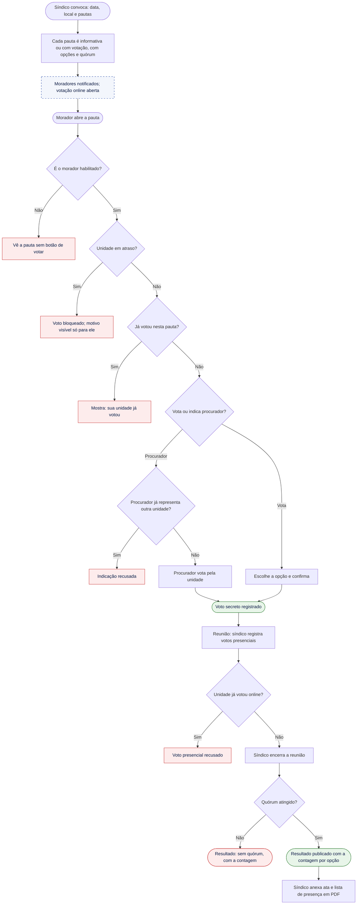

| Situação | O que o usuário vê | Como sai | Regra |
| --- | --- | --- | --- |
| Não é o morador habilitado | "Quem vota pela unidade é [nome do habilitado]." | — | RN-VO-01 |
| Unidade em atraso | Só para o habilitado: "Sua unidade tem cobrança em atraso e não pode votar (Código Civil, art. 1.335, III). Pague para votar nas próximas pautas." | Paga | RN-VO-16 |
| Procurador já representa outra unidade | "[Nome] já representa outra unidade. Escolha outra pessoa." | Escolhe outra | RN-VO-08 |
| Voto presencial de quem votou online | "Esta unidade já votou pelo app." | — | RN-VO-11 |
| Ver o resultado antes do fim | "O resultado aparece quando a reunião for encerrada." | Espera | RN-VO-03 |
| Quórum não atingido ou empate em pauta | Resultado com a contagem e o rótulo "sem quórum" ou "empate" | Decisão segue a convenção, fora do app | RN-VO-17 |

### 11.2 Eleição de síndico e subsíndico

```mermaid
flowchart TD
    A(["Síndico ou administradora abre a eleição com prazo de candidaturas"]) --> B["Morador se candidata a síndico ou subsíndico"]
    B --> C{"Elegível?"}
    C -->|"Não: reeleição desligada ou mesma unidade do outro cargo"| E1["Candidatura bloqueada, com o motivo"]
    C -->|"Sim"| D["Candidatura aceita"]
    D --> F["Prazo encerra; votação como em 11.1"]
    F --> G{"Empate?"}
    G -->|"Sim"| H["Segundo turno entre os empatados em até 7 dias"]
    H --> F
    G -->|"Não"| I{"Síndico e subsíndico eleitos da mesma unidade?"}
    I -->|"Sim"| J["Assume o próximo mais votado para subsíndico"]
    I -->|"Não"| K
    J --> K["Administradora registra início e fim dos mandatos"]
    K --> Z(["Novos mandatos ativos"])
    classDef ok fill:#E8F5E9,stroke:#2E7D32,color:#0B1A44
    classDef erro fill:#FDECEC,stroke:#C62828,color:#0B1A44
    class Z ok
    class E1 erro
```

| Situação | O que o usuário vê | Como sai | Regra |
| --- | --- | --- | --- |
| Candidatura fora do prazo | Botão "Candidatar-se" desabilitado: "Candidaturas encerradas em [data]." | — | RN-VO-13 |
| Reeleição desligada | "O regimento deste condomínio não permite reeleição." | — | RN-VO-05 |
| Nenhum candidato | A administradora recebe alerta e pode reabrir o prazo | Reabre | RN-VO-13 |

## 12. Pesquisa mensal

### 12.1 Avaliar funcionários

```mermaid
flowchart TD
    A(["Dia 1: pesquisa abre"]) --> B{"Perfil pode avaliar?"}
    B -->|"Síndico profissional ou funcionário"| E1(["Pesquisa não aparece"])
    B -->|"Morador, síndico morador ou subsíndico"| C["Funcionários ativos por setor"]
    C --> D["Dá de 1 a 5 estrelas ou pula; comentário opcional"]
    D --> F{"Já avaliou este funcionário no mês?"}
    F -->|"Sim"| G["Edita a nota anterior"]
    F -->|"Não"| H["Salva a nota"]
    G --> I
    H --> I(["Avaliação salva; pode mudar até o fechamento"])
    I --> S1["Último dia, 23h59: médias, ajuste de score e nota dos setores"]
    classDef ok fill:#E8F5E9,stroke:#2E7D32,color:#0B1A44
    classDef erro fill:#FDECEC,stroke:#C62828,color:#0B1A44
    classDef sis fill:#F3F6FC,stroke:#0E359D,stroke-dasharray:5 5,color:#0B1A44
    class I ok
    class E1 erro
    class S1 sis
```

No fechamento: média abaixo de 3 tira 5 pontos; de 3 até menos de 4,5 mantém; 4,5 ou mais dá 5 pontos. Funcionário sem avaliação não muda. A nota do setor só é publicada com 2 ou mais funcionários avaliados (RN-PE-05 a RN-PE-08).

## 13. Cobrança condominial

### 13.1 Pagar a taxa condominial

- **Perfil:** responsável financeiro (por padrão, o morador habilitado; pode ser o proprietário não residente (RN-CD-19)).
- **Pré-condição:** módulo de cobrança ativo no condomínio.

```mermaid
flowchart TD
    S0["15 dias antes do vencimento: cobrança gerada"] --> A(["Responsável abre Cobranças"])
    A --> B{"Cobrança vencida?"}
    B -->|"Sim"| C["Segunda via com multa de 2% e juros de 1% ao mês, proporcionais aos dias de atraso"]
    B -->|"Não"| D["Valor original, com desconto se houver"]
    C --> F["Escolhe boleto, Pix ou cartão, entre as formas ativas"]
    D --> F
    F --> G{"Pagamento aprovado?"}
    G -->|"Cartão recusado"| E1["Recusa; tente outro cartão ou outra forma"]
    E1 --> F
    G -->|"Boleto ou Pix gerado"| H["Aguardando confirmação do gateway"]
    H --> S1["Webhook confirma; baixa automática"]
    G -->|"Cartão aprovado"| S1
    S1 --> I{"Pago em duplicidade?"}
    I -->|"Sim"| S2["Alerta à administradora: devolve ou vira crédito"]
    I -->|"Não"| Z(["Paga ou Paga com atraso; comprovante disponível"])
    S2 --> Z
    S3["Lembretes: 5 dias antes, no dia, 1 e 7 dias depois"]
    S0 -.-> S3
    S4["Dia seguinte ao vencimento sem pagamento: em atraso"]
    S0 -.-> S4
    classDef ok fill:#E8F5E9,stroke:#2E7D32,color:#0B1A44
    classDef erro fill:#FDECEC,stroke:#C62828,color:#0B1A44
    classDef sis fill:#F3F6FC,stroke:#0E359D,stroke-dasharray:5 5,color:#0B1A44
    class Z ok
    class E1 erro
    class S0,S1,S2,S3,S4 sis
```

| Situação | O que o usuário vê | Como sai | Regra |
| --- | --- | --- | --- |
| Cartão recusado | "O cartão não foi aprovado. Tente outro cartão, Pix ou boleto." | Troca a forma | RN-FI-02 |
| Boleto vencido | O app gera a segunda via sozinho: "Valor atualizado com multa e juros até hoje." | Paga a segunda via | RN-FI-08 |
| Pagamento ainda não confirmado | "Pagamento em processamento. Boleto pode levar até 3 dias úteis." | Espera; a baixa é automática | RN-FI-13 |
| Pagamento em duplicidade | "Identificamos dois pagamentos desta cobrança. A administradora vai devolver um deles ou abatê-lo na próxima." | Automático | RN-FI-19 |
| Pagou fora do app | A administradora registra com comprovante; a cobrança fica paga | Envia o comprovante à administradora | RN-FI-13 |
| Gateway fora do ar, cobrança no prazo | "Pagamento indisponível agora. Tente de novo mais tarde; o vencimento continua em [data]." | Tenta depois | RN-FI-04 |
| Gateway fora do ar, cobrança vencida | "Pagamento indisponível agora. Quando você pagar, o valor será atualizado com multa e juros até o dia do pagamento." | Tenta depois | RN-FI-06, RN-FI-08 |

### 13.2 Configurar cobrança, cobranças extras e inadimplência

```mermaid
flowchart TD
    A(["Administradora ativa o módulo"]) --> B{"Conta bancária cadastrada?"}
    B -->|"Não"| E1["Módulo não ativa; leva ao cadastro da conta"]
    B -->|"Sim"| C["Escolhe formas de pagamento, valores e vencimento"]
    C --> D{"Ao menos uma forma ativa e multa até 2%?"}
    D -->|"Não"| E2["Recusa e mostra o limite"]
    E2 --> C
    D -->|"Sim"| Z1(["Cobrança ativa"])
    X(["Síndico solicita cobrança extra"]) --> X1["Administradora lança: descrição, valor, unidades e vencimento"]
    X1 --> Z2(["Emitida; cobrança extra"])
    P(["Painel de inadimplência"]) --> P1["Unidades em atraso, valor e dias"]
    P1 --> P2["Exporta CSV para a contabilidade"]
    classDef ok fill:#E8F5E9,stroke:#2E7D32,color:#0B1A44
    classDef erro fill:#FDECEC,stroke:#C62828,color:#0B1A44
    class Z1,Z2 ok
    class E1,E2 erro
```

| Situação | O que o usuário vê | Como sai | Regra |
| --- | --- | --- | --- |
| Multa acima de 2% | "A multa por atraso não pode passar de 2% (Código Civil, art. 1.336, §1º)." | Ajusta | RN-FI-06 |
| Nenhuma forma de pagamento | "Escolha pelo menos uma forma de pagamento." | Escolhe | RN-FI-02 |
| Síndico tenta lançar cobrança | Só vê "Solicitar cobrança extra" | Envia a solicitação | RN-FI-14 |
| Cancelar cobrança | Exige o motivo; fica na auditoria | Informa o motivo | RN-FI-15 |
| Morador comum procura a situação de outra unidade | Nenhuma tela mostra esse dado | — | RN-FI-10 |

## 14. Notificações e LGPD

### 14.1 Preferências e direitos do titular

```mermaid
flowchart TD
    A(["Usuário abre Configurações"]) --> B{"O que deseja?"}
    B -->|"Notificações"| C["Liga ou desliga cada tipo"]
    C --> D{"Tipo obrigatório?"}
    D -->|"Sim"| E1["Interruptor travado, com o motivo"]
    D -->|"Não"| Z1(["Preferência salva"])
    B -->|"Cópia dos meus dados"| F["Confirma o pedido"]
    F --> Z2(["Arquivo por e-mail em até 15 dias"])
    B -->|"Excluir conta"| G["Aviso: histórico anonimizado; votos e reclamações continuam sem identificação"]
    G --> H{"É morador habilitado ou responsável financeiro?"}
    H -->|"Sim"| S1["Administradora avisada para definir substituto; até lá a unidade não vota"]
    H -->|"Não"| I
    S1 --> I["Confirma com a senha"]
    I --> Z3(["Acesso encerrado; dados anonimizados"])
    classDef ok fill:#E8F5E9,stroke:#2E7D32,color:#0B1A44
    classDef erro fill:#FDECEC,stroke:#C62828,color:#0B1A44
    classDef sis fill:#F3F6FC,stroke:#0E359D,stroke-dasharray:5 5,color:#0B1A44
    class Z1,Z2,Z3 ok
    class E1 erro
    class S1 sis
```

Notificações obrigatórias: decisão de reclamação contra a pessoa e divergência de sincronização para o porteiro (US-NO-01).

## 15. Mensagens de erro transversais

Estas situações podem acontecer em qualquer fluxo e têm um tratamento único. Os textos são os padrões do Design System (13.4).

| Situação | O que o usuário vê | Comportamento |
| --- | --- | --- |
| Sem internet (fora da portaria e da limpeza) | Faixa "Sem internet" no topo; ao tentar enviar: "Não foi possível conectar. Verifique a internet e tente de novo." | Ações de envio ficam desabilitadas; textos digitados viram rascunho |
| Sessão expirada | "Por segurança, entre de novo na sua conta." | Volta para o login e, depois, para a tela onde estava |
| Sem permissão para a ação | A ação não aparece na tela; se a permissão mudar com o app aberto: "Esta área é só para [perfil]." | Volta à tela inicial |
| Erro do servidor | "Algo deu errado do nosso lado. Tente de novo em alguns minutos." | Botão "Tentar de novo"; erro enviado ao monitoramento |
| Dado alterado por outra pessoa | "Estas informações mudaram. Atualizamos a tela." | Recarrega sem perder o que foi digitado |
| Nova versão obrigatória do app | "Atualize o app para continuar." | Link para a loja |

## 16. Decisões desta revisão

Ao mapear os fluxos, surgiram contradições e lacunas entre os documentos de produto. Cada uma foi resolvida como abaixo, e os documentos de produto foram atualizados para refletir a decisão.

| # | Problema encontrado | Decisão | Onde foi ajustado |
| --- | --- | --- | --- |
| D-01 | O alvo de uma reclamação era "funcionário ou unidade", mas a tabela de julgadores trata o síndico e o subsíndico como alvos, e o síndico profissional não tem unidade | O alvo pode ser um funcionário, uma unidade, o síndico ou o subsíndico | RN glossário, RN-RC-02, RF-RS-01, US-RS-01 |
| D-02 | O suporte "tem as permissões da administradora", o que o faria julgar reclamações e ver scores, contradizendo "sem administradora, conselho fiscal" | O suporte age como administradora em cadastros, configurações e cobrança, mas não julga nem consulta reclamações e scores | RN 1, PRD perfis e notas da matriz |
| D-03 | O recurso de uma decisão do subsíndico ia ao síndico mesmo quando o síndico era o alvo | Quem é parte da reclamação nunca julga o recurso (nova RN-RC-14) | RN 5.3, US-RS-05 |
| D-04 | A decisão só era liberada depois da conversa, mas nada dizia o que fazer se o alvo não respondesse; a administradora e o conselho fiscal não podiam enviar comunicados | Decisão liberada com a resposta do alvo ou após 5 dias sem resposta (novo parâmetro); qualquer julgador inicia a conversa | RN-RC-04, RN-CO-04, RN 13, RF-RS-05, US-RS-02 |
| D-05 | Reclamação de vistoria negada como falsa não tinha a quem penalizar | Sem penalidade, porque o reclamante é o condomínio | RN-RC-12 |
| D-06 | O visitante avulso não tinha data, então não havia como montar "esperados hoje" nem encerrá-lo | Data da visita (padrão: hoje); sem entrada até o fim do dia, "não compareceu" (nova RN-VI-09) | RN-VI-02, RN 8.3, RN 14, RF-VI-01, US-VI-01 |
| D-07 | Não estava definido o que acontece com pagamento de reserva recusado | Pode tentar de novo dentro do prazo de pagamento | RN-RE-03 |
| D-08 | A conta bancária era "de reservas" no PRD, mas recebe também a taxa condominial; o módulo de cobrança não exigia conta | Conta única para reservas e taxa; o módulo só ativa com a conta cadastrada | RN-PG-01, RN-FI-01, RF-AD-08, US-AD-05 |
| D-09 | A história do primeiro acesso mandava "procurar a administradora" para e-mail não cadastrado, o que revela se o e-mail existe; faltavam regras de senha, reenvio e login | Mensagem igual para os dois casos; reenvio após 60 s invalida o anterior; senha com 8 ou mais caracteres; 5 senhas erradas pausam o login por 15 min | RN-CD-02, RF-AC-01, SEG-04, US-AC-01 |
| D-10 | "Todo usuário tem score" incluía administradora, suporte e admin da plataforma | Têm score moradores, síndicos (inclusive profissional), subsíndico e funcionários | RN 4, RN-SC-01 |
| D-11 | Faltas em reservas: a história dizia "perde 5 pontos quando é registrada", e as rotinas diziam "rotina diária"; a terceira falta não tinha regra | −5 a cada 2 faltas no trimestre, aplicado pela rotina diária | RN-RE-10, US-RE-06 |
| D-12 | Encomenda registrada na unidade errada não tinha correção | A portaria corrige antes da retirada (nova RN-EN-06) | RN 9.1 |
| D-13 | Votação sem quórum e empate em pauta não tinham resultado definido; a regra do empate parecia valer para pautas; o procurador era indicado "antes da votação", que já está aberta desde a convocação | Nova RN-VO-17 para quórum e empate; RN-VO-07 só para eleições; procurador indicado antes de a unidade votar | RN 10.2, RN 10.3, RF-VO-03 |
| D-14 | Pagamento em duplicidade da taxa não tinha tratamento | Alerta à administradora, que devolve ou abate na próxima cobrança (nova RN-FI-19) | RN 12.1 |
| D-15 | O responsável financeiro podia ser o proprietário não residente, mas não havia perfil para ele entrar no app | Novo perfil "Proprietário não residente", só com as cobranças da unidade (nova RN-CD-19); o PRD passa a ter 11 perfis | PRD 3, RN glossário, RN-SC-01 |
| D-16 | A exclusão de conta do morador habilitado deixaria a unidade sem habilitado, o que RN-CD-04 proíbe | A administradora é avisada para definir o substituto; até lá, a unidade não vota (nova RN-CD-18) | RN 3 |
| D-17 | Fim antecipado do mandato do síndico sem subsíndico não tinha regra | A administradora recebe alerta e abre a eleição; as funções de síndico ficam sem titular até a posse | RN-CD-13 |
| D-18 | A denúncia de conteúdo ia sempre ao síndico, mesmo se o conteúdo fosse dele | Vai a quem julgaria uma reclamação contra o síndico | RN-RC-13 |
| D-19 | Não estava claro se solicitação recusada contava na franquia | Não conta | RN-PL-03 |
| D-20 | Os diagramas de estados e o fluxo da reclamação estavam como conteúdo incorporado quebrado | Estados viraram tabelas nas Regras, com os mesmos nomes do Design System (4.5), que ganhou "Cancelada" (reserva) e "Não compareceu" (visita); o PRD aponta para este documento | RN 5.5, RN 7.4, PRD 6, DS 4.5 e 18 |
| D-21 | Pequenas divergências de texto | "Autorizado por interfone" com a mesma grafia em todos os documentos; RN-CD-03 inclui "Como funciona"; aviso sobre IDs não reaproveitados; parâmetros de cobrança formatados como código; reclamação decidida sem recurso encerrada pela rotina (nova RN-RC-15); painel de reclamações aberto a todo julgador (RF-RS-03). O escopo do MVP sem acordos de parcelamento e a métrica de cobrança no PRD foram corrigidos junto com o Design System | PRD 1, 2 e 4, RN 1, RN-CD-03, RN-VI-04, RN 13, RN 14 |
| D-22 | O estado "Em atendimento" da limpeza não tinha gatilho | Botão opcional "Iniciar atendimento" no detalhe; "Concluir" no cartão vai de "Aberto" direto para "Concluído" | DS 11.2 |
| D-23 | Finais de diagrama com texto diferente dos selos, e o cancelamento de reserva terminando sempre em "Cancelada" | Finais começam pelo texto exato do selo; o fluxo 5.2 termina em quatro estados, conforme a RN 7.4 | Fluxos 5.1, 5.2, 5.3, 6.1, 7.1, 9.1, 9.2, 9.3, 13.1 e 13.2 |

## 17. Pendências

Estes pontos não puderam ser resolvidos só com os documentos e dependem de uma decisão do negócio ou de terceiros.

| Pendência | Por que importa | Quem decide |
| --- | --- | --- |
| Parecer jurídico (SEG-16) | Pode mudar os fluxos 9.1 a 9.4, os prazos e os textos das mensagens de reclamação | Advogado |
| Escolha do gateway de pagamento | Define os prazos reais de confirmação de boleto e Pix e os erros possíveis nos fluxos 5.1 e 13.1 | Produto e engenharia |
| Prazo de 5 dias para resposta do alvo | Valor novo, sem dado de uso; validar no piloto | Produto, após o piloto |
| Reserva paga não usada | A RN 7.4 não define o estado nem se há vistoria; hoje ela ficaria "Confirmada" para sempre | Produto |
| Cobrança em atraso como notificação obrigatória | Proposta da revisão de fluxos; não está nas RN nem no US-NO-01 | Produto |
