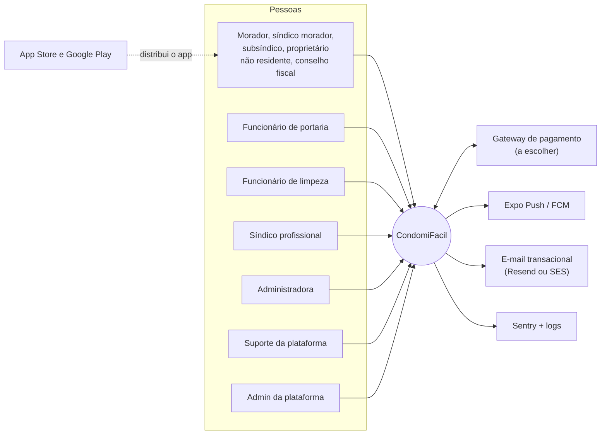
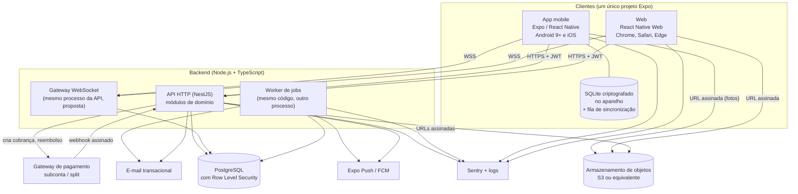
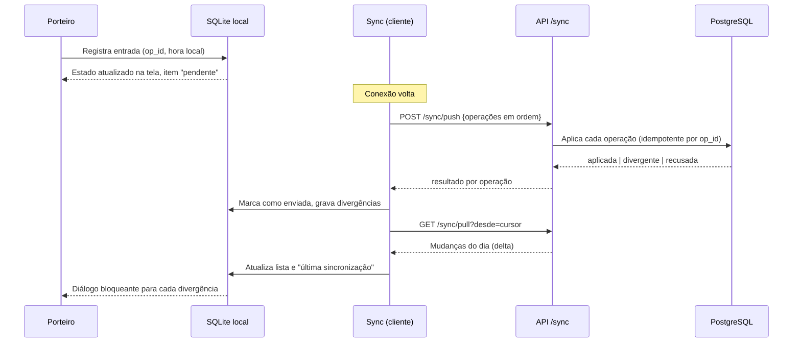
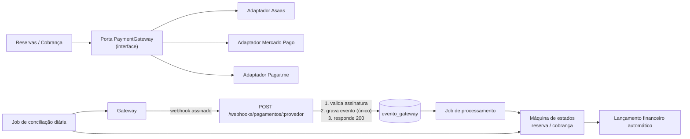
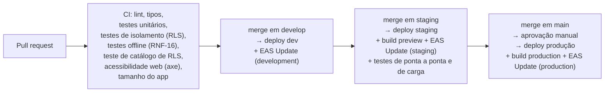

# Arquitetura — CondomiFacil

Nov 6, 2026 · @Pedro Lemos

**Resumo:** arquitetura de referência do MVP: um app Expo (Android, iOS e web) falando com uma API NestJS modular sobre PostgreSQL compartilhado com Row Level Security, com tempo real por WebSocket, rotinas agendadas por condomínio, pagamentos por gateway com webhooks idempotentes e um modo offline restrito à portaria e à limpeza.

## 1. Objetivo e como ler

Este documento traduz o produto (PRD, regras de negócio, histórias, design) em uma arquitetura técnica que a equipe possa construir, e separa com clareza o que já está decidido nos docs do que é proposta minha ainda sem decisão.

**Convenções de leitura**

- **Decidido** = vem dos docs (principalmente PRD seção 10) e aparece com o ID de origem (RF, RN, RNF, SEG, DS, UF).
- **Proposta** = sugestão deste documento, nunca decidida. Está marcada como "Proposta" ou "Proposta, a decidir". Nada marcado assim deve ser tratado como requisito.
- **Lacuna** = o docs não define e este documento só aponta (seção 9).
- Datas em dd/mm/aaaa, termos de interface conforme Design System seção 13.

**Relação com os outros documentos**

| Documento | O que fornece à arquitetura |
| --- | --- |
| PRD (`docs/01-produto/02-prd.md`) | Seção 10 é a **fonte da stack**; seção 3 (perfis e permissões); seção 7 (RNF); seção 8 (SEG) |
| Regras de Negócio (`03-regras-de-negocio.md`) | Regras RN-* que viram invariantes de domínio; seção 13 (35 parâmetros configuráveis); seção 14 (20 rotinas automáticas) |
| Histórias de Usuário (`04-historias-de-usuario.md`) | Critérios de aceite que viram testes |
| Design System e User Flows (`docs/02-design/`) | Tokens, componentes, mensagens de erro transversais (UF 15), pendências (UF 17) |
| Protótipo (`prototipo/`) | Referência de comportamento, não de código |

**Fora do escopo deste documento:** modelo de dados detalhado (`docs/04-banco-de-dados`), contrato da API (`05-backend`), estrutura do app (`06-frontend`), detalhamento de segurança (`07-seguranca`), estratégia de testes (`08-qualidade`) e infraestrutura como código (`09-infra`). Aqui ficam as decisões estruturais que esses documentos vão detalhar.

**Estado do projeto:** fase de Design, sem código. Marco 1 (protótipo validado) e marco 2 (parecer jurídico, SEG-16) ainda precisam acontecer antes do MVP (Visão de Produto, roadmap).

## 2. Visão geral

**Resumo:** um backend único atende todos os clientes; o que muda entre perfis é o cliente usado e as permissões, não o sistema.

### 2.1 Diagrama de contexto



Visitantes, hóspedes de temporada e empresas de manutenção não têm login: são cadastros (RF-AD-14; RN 3). O condomínio é o controlador dos dados e a plataforma é a operadora (SEG-14).

### 2.2 Diagrama de containers



### 2.3 Responsabilidade de cada componente

| Componente | Responsabilidade | Origem |
| --- | --- | --- |
| App mobile (Expo) | Interface dos perfis de campo e de moradia; offline da portaria e da limpeza; câmera e compressão de fotos; push; armazenamento seguro de tokens | PRD 10; RF-AC-06 |
| Web (React Native Web) | Painel da administradora, do suporte, do admin da plataforma e do síndico; mesmo código do app | PRD 10; RF-AC-06; DS 11.9 |
| API (NestJS) | Regras de negócio, autenticação, autorização, orquestração de pagamentos, auditoria; única porta de acesso aos dados | PRD 10 |
| WebSocket | Lista da portaria em até 5 s (RNF-05) e edição de entrega esperada na hora (RN-EN-09) | PRD 10; RNF-05 |
| Worker / jobs agendados | As 20 rotinas da RN seção 14, processamento assíncrono de webhooks, envio de push e e-mail | PRD 10; RN 14 |
| PostgreSQL | Fonte da verdade; isolamento por condomínio e por unidade com RLS | PRD 10; SEG-05 |
| Armazenamento de objetos | Fotos, comprovantes, atas, listas de presença | PRD 10 |
| Gateway de pagamento | Subconta, boleto com QR Code Pix, Pix, cartão, reembolso, webhooks | PRD 10; RF-PG; RF-FI |
| Expo Push / FCM | Entrega de notificações | PRD 10; RF-NO-01 |
| E-mail transacional | Código de acesso, comprovantes, cópia de dados LGPD | PRD 10; RF-AC-01; RF-PG-04; RF-LG-01 |
| Sentry + logs | Erros de cliente e servidor; erro do servidor com "Tentar de novo" é enviado ao monitoramento (UF 15) | PRD 10 |

### 2.4 Quem usa qual cliente

| Perfil | Cliente | Origem |
| --- | --- | --- |
| Morador, síndico morador, subsíndico | App (e web para o síndico) | DS 12; RF-AC-06 |
| Síndico profissional | App (aba Gestão) e web | DS 12; RF-AC-06 |
| Funcionário de portaria | App (offline) | RNF-06 |
| Funcionário de limpeza | App (offline) | RNF-07 |
| Conselho fiscal | App (finanças em leitura; julgamento de reclamações) | DS 12; RN-RC-03 |
| Proprietário não residente | App | DS 12; RN-CD-19 |
| Administradora | Web | RF-AC-06 |
| Suporte da plataforma | Web | RF-AC-06 |
| Admin da plataforma | Web ("Painel da plataforma") | PRD 3 |

## 3. Componentes em detalhe

**Resumo:** cada componente é descrito com o que já está decidido, a proposta de como construir e os riscos.

### 3.1 App mobile

**Estrutura por módulos (Proposta).** Uma pasta por módulo de produto, espelhando os épicos das histórias de usuário, mais camadas compartilhadas:

```
apps/mobile/src/
  design/          tokens.ts, ThemeProvider, components/ (DS 17)
  core/            api client, auth, sessão, tenant (condomínio e unidade ativos), erros transversais (UF 15)
  offline/         banco local, fila (outbox), sincronização, divergências
  modulos/         acesso, reservas, visitantes, encomendas, chamados, reclamacoes,
                   comunicados, votacoes, pesquisa, cobranca, financas, perfil/lgpd
  navegacao/       abas por perfil (DS 12)
```

- **Tokens do Design System (decidido, DS 17):** `src/design/tokens.ts` único (palette, light, dark, space, radius, motion) consumido por `ThemeProvider`; componentes base em `src/design/components`. Hex solto ou tamanho solto é apontado no code review. No monorepo proposto, esse arquivo vira o pacote `packages/design-tokens` (seção 5.3), o que preserva a regra "um único arquivo de tokens".
- **Unidade ativa:** o `UnitSwitcher` no topo define condomínio e unidade ativos (RN-CD-05, RF-AC-04). Toda chamada à API leva esses dois valores (seção 4.3).
- **Erros transversais (UF 15):** "Sem internet" (faixa, envio desabilitado, texto digitado vira rascunho), sessão expirada (volta ao login e depois à tela), erro do servidor (Tentar de novo + monitoramento), "Estas informações mudaram. Atualizamos a tela.", versão obrigatória ("Atualize o app para continuar."). Tratados em um interceptor único do cliente de API.
- **Versão mínima do cliente (Proposta):** o app envia `X-App-Version`; a API responde 426 abaixo da versão mínima, o que dispara a tela de atualização obrigatória. Política de versões mínimas é lacuna.
- **Tamanho (RNF-04, DS 16):** download abaixo de 30 MB: Hermes, ícones Lucide importados um a um, 4 pesos da Inter, imagens WebP sob demanda (expo-image com cache), nada de bibliotecas de UI pesadas. Acompanhar o tamanho no CI (seção 6.7).
- **Abertura (RNF-02):** tela utilizável em 3 s no 4G em aparelho de 3 GB de RAM: esqueletos estáticos, sem trabalho pesado na inicialização, dados da tela inicial em uma chamada agregada (proposta).

#### 3.1.1 Offline (portaria e limpeza)

Escopo decidido: **só** a portaria (lista do dia e entradas/saídas) e a limpeza (chamados do setor e conclusões) funcionam offline (PRD 7; RN-OF-01 a RN-OF-06; RN-CH-04). Os demais perfis são online-only, com rascunho de texto (UF 15).

**Banco local.** PRD 10 deixa em aberto "SQLite ou WatermelonDB". Critérios e recomendação estão na seção 5.2 (Proposta, a decidir: `expo-sqlite` com SQLCipher e uma fila própria).

**Dados guardados no aparelho (RN-OF-01, RN-CH-04, RNF-06, RNF-07):**

| Perfil | Guarda | Não guarda |
| --- | --- | --- |
| Portaria | Visitantes esperados do dia, só dos blocos que a portaria atende; lista de bloqueio necessária à portaria; encomendas pendentes para consulta (Proposta) | Histórico; dados financeiros; qualquer dado de outro condomínio |
| Limpeza | Chamados abertos do setor | Avaliações, scores, reclamações |

**Fila de sincronização (outbox) (Proposta).**



- Cada operação tem `op_id` (UUID gerado no aparelho), tipo, carga, `registrado_em` (relógio do aparelho) e ordem sequencial. O servidor guarda `op_id` com restrição de unicidade: reenvio nunca duplica (idempotência).
- O envio é em lote e em ordem; uma operação recusada não derruba as demais.
- O `pull` é incremental por cursor (`atualizado_em` + id) e traz só o dia da portaria. A hora da última sincronização bem-sucedida fica sempre visível (RNF-06, SyncIndicator DS 10.10 e 10.23). Pendências aparecem no mesmo indicador (RNF-08).
- Fotos de conclusão (até 5, RN-CH-14) ficam em arquivos locais referenciados pela operação; sobem por URL assinada antes de a conclusão ser aplicada (seção 3.8).
- Quando o app volta ao primeiro plano com conexão, dispara sincronização; enquanto aberto, tenta de novo com recuo exponencial (Proposta).

**Resolução de conflitos e "divergência" da portaria (decidido nos casos abaixo; o resto é proposta).**

| Caso | Regra de origem | Tratamento |
| --- | --- | --- |
| Entrada registrada offline de visitante que o morador cancelou (ou editou) antes da sincronização | RN-OF-04, RF-VI-11 | O servidor **aplica** o registro (a decisão de deixar entrar foi da portaria e não é bloqueada) e cria uma `divergencia_sincronizacao` ligada à operação. O cliente mostra o diálogo bloqueante sem botão de fechar (DS 11.1), que só fecha quando o porteiro confirma por interfone com o morador que cadastrou. A confirmação é enviada à API e registrada (quem, quando). |
| Divergência e síndico | RN-OF-05 | Divergência **não** gera notificação nem tela para o síndico. A divergência é notificação obrigatória apenas para o porteiro (US-NO-01). |
| Duas pessoas da limpeza concluem o mesmo chamado offline | RN-CH-04, RN-CH-15 | Vale a primeira conclusão; a segunda é recusada com aviso. A avaliação do atendimento vale para o funcionário da primeira (RN-CH-15). |
| Saída offline de visita já encerrada pela rotina "saída não registrada" | Proposta | Operação aplicada como no-op com aviso informativo, sem diálogo bloqueante. |
| Registro offline de visitante inexistente no servidor (removido) | Proposta | Tratado como divergência (mesmo fluxo de RN-OF-04). |

**Lacuna de "primeira conclusão":** a RN-CH-04 não diz se "primeira" é pela hora em que cada pessoa concluiu (relógio do aparelho) ou pela ordem de chegada ao servidor. Proposta: usar `registrado_em` do aparelho, com desempate pela chegada ao servidor, e limitar o desvio de relógio aceito (rejeitar horas no futuro). Decidir com o Pedro (seção 9).

**Segurança do dado offline (SEG-09, RN-OF-06).**

- Banco criptografado (SQLCipher); a chave é gerada no aparelho e fica no `expo-secure-store` (Keychain/Keystore), nunca no código.
- Apagado ao sair da conta, ao trocar de condomínio e ao fim do dia. A rotina 13 "Limpeza de dados offline" manda os aparelhos apagarem (RN 14), mas aparelho offline não recebe a ordem; por isso o app também **apaga sozinho na primeira abertura de um novo dia** se a data do cache for anterior à de hoje (Proposta, complementa a rotina).
- Um arquivo de banco por combinação usuário + condomínio (seção 4.8).

**Testes (RNF-16).** Suíte automatizada a cada versão cobrindo: queda de conexão no meio do envio, reenvio idempotente, ordem da fila, divergência, primeira conclusão, limpeza do cache. Detalhe em `08-qualidade`.

#### 3.1.2 Armazenamento seguro de tokens e fotos

- Tokens de acesso e de renovação ficam no `expo-secure-store` (PRD 10: "tokens JWT no armazenamento seguro do aparelho").
- **Compressão de fotos (PRD 10, DS 16):** `expo-image-manipulator` reduz antes do envio (Proposta: lado maior 1.280 px, qualidade ~70%, meta abaixo de 500 KB; fotos de áreas do condomínio em WebP até 200 KB conforme DS 16). Isso protege a fila offline e o plano de dados do usuário.
- Aparelho nunca guarda dados de cartão (SEG-12): o pagamento usa o fluxo hospedado ou a tokenização do gateway.

### 3.2 Web

- **Mesmo projeto Expo**, exportado como site estático (`expo export -p web`) e servido por CDN (Proposta). Painel lateral por perfil (DS 11.9): Visão geral, Unidades e moradores, Funcionários, Áreas e regras, Reclamações, Cobrança, Finanças, Comunicados, Reuniões, Solicitações, Configurações.
- **Telas densas:** tabelas com cabeçalhos marcados, formulários de uma coluna (máx. 640), importação por planilha com prévia de erros, navegação só por teclado com anel de foco e "Pular para o conteúdo" (DS 11.9, RNF-12). O componente `DataTable` precisa de implementação específica para web (arquivo `.web.tsx`, com HTML semântico `<table>`), porque React Native puro não gera tabela semântica. Risco: é o ponto em que React Native Web mais "briga" com acessibilidade; incluir axe no CI da web (DS 14).
- **Sessão na web (Proposta):** o refresh token vai em cookie `httpOnly`, `Secure`, `SameSite=Lax`, e o access token fica só em memória, porque a web não tem armazenamento seguro equivalente ao do aparelho. Evita roubo de token por XSS.
- **Painel da plataforma:** mesmo cliente web, acessível só ao admin da plataforma, que não acessa dados de condomínios (seção 4.4). Detalhes do painel além de "condomínios, planos, suporte" são lacuna.
- Navegadores suportados: Chrome, Safari e Edge atuais (RNF-03).

### 3.3 API (NestJS)

**Estilo (Proposta).** Monólito modular: um único deploy, módulos com fronteiras claras, comunicação interna por serviços e por eventos de domínio. Microsserviços não se justificam para a equipe pequena do roadmap nem para a escala de RNF-10 (seção 4.10).

**Módulos de domínio alinhados aos épicos (Proposta).**

| Módulo | Cobre | Origem |
| --- | --- | --- |
| `acesso` | Pré-cadastro, primeiro acesso, login, recuperação, aceite de termos, sessões | RF-AC; SEG-03/04 |
| `condominio` | Condomínio, plano, blocos, portarias, unidades, vínculos, mandatos, substituição, solicitações de cadastro, locação | RF-AD; RN-CD; RN-PL |
| `configuracao` | Parâmetros (plataforma, condomínio, área), histórico, vigência futura | RN 13; RN-GE |
| `reservas` | Áreas, regras, reservas, vistoria | RF-RE; RN-RE |
| `pagamentos` | Gateway (porta/adaptador), subconta, cobranças de reserva, reembolso, webhooks | RF-PG; RN-PG; RN-CA |
| `visitantes` | Avulsos, recorrentes, listas, bloqueio, registro de portaria, divergência | RF-VI; RN-VI |
| `encomendas` | Encomendas e entregas esperadas | RF-EN; RN-EN |
| `chamados` | Limpeza e manutenção, urgência, avaliação | RF-CH; RN-CH |
| `convivencia` | Reclamações, recursos, score, pesquisa mensal | RF-RC, RF-SC, RF-PE; RN-RC, RN-SC, RN-PE |
| `comunicados` | Gerais e individuais, sugestões | RF-CO; RN-CO |
| `governanca` | Reuniões, pautas, votações, eleições, atas | RF-VO; RN-VO |
| `cobranca` | Taxa condominial, inadimplência, lembretes | RF-FI-01 a 16; RN-FI |
| `financas` | Lançamentos, categorias, fechamento de mês, estorno, exportação | RF-FI-17 a 24; RN-FI-21 a 32 |
| `notificacoes` | Preferências, push, e-mail | RF-NO; US-NO-01 |
| `arquivos` | Upload e URLs assinadas | PRD 10 |
| `lgpd` | Cópia e exclusão de dados | RF-LG; SEG-11 |
| `auditoria` | Trilha append-only | SEG-08 |
| `plataforma` | Painel do admin: condomínios, planos, acessos de suporte | PRD 3 |
| `tempo-real` | Gateway WebSocket | RNF-05 |
| `rotinas` | Agendador e jobs | RN 14 |

Nomes dos módulos são proposta; a lista exata de prefixos RF por épico está em `04-historias-de-usuario.md`.

**Regras transversais (Proposta).**

- Validação de entrada com esquemas compartilhados (Zod em `packages/shared-types`), os mesmos no app e na API.
- Todo acesso a dados passa por um `TenantContext` que abre uma transação com o contexto da sessão (seção 4.3). Não há acesso ao banco fora dele.
- Eventos de domínio (ex.: `visitante.cadastrado`, `pagamento.confirmado`) são gravados numa tabela `evento_saida` na mesma transação da mudança (padrão outbox transacional) e despachados pelo worker para tempo real, push e e-mail. Isso evita perder notificação se o processo cair.
- Limites de taxa e anti-abuso: lacuna; proposta de partida: limite por IP e por e-mail nos endpoints de acesso (SEG-04) e por usuário nos demais.
- Desempenho (RNF-01): 95% das requisições abaixo de 500 ms. Consultas sempre com `condominio_id` como primeira coluna dos índices (seção 4.10).

#### 3.3.1 Autenticação: e-mail + código + senha

**Decidido:** ninguém se cadastra sozinho; pré-cadastro pela administradora ou suporte (RF-AD-01, RN-CD-01). Primeiro acesso por **código de 6 dígitos** enviado ao e-mail, válido 15 min, 5 tentativas, reenvio após 60 s (o novo invalida o anterior), mesma resposta para e-mail cadastrado ou não, senha com no mínimo 8 caracteres, login pausado por 15 min após 5 senhas erradas (RF-AC-01, RN-CD-02, SEG-04). Senha com Argon2 ou bcrypt (SEG-04).

```mermaid
sequenceDiagram
    participant U as Usuário
    participant C as Cliente
    participant A as API
    participant M as E-mail
    U->>C: Informa e-mail
    C->>A: POST /acesso/codigo
    A-->>C: 202 (mesma resposta exista ou não)
    A->>M: Envia código (se pré-cadastrado)
    U->>C: Código e nova senha
    C->>A: POST /acesso/ativar
    A-->>C: access token + refresh token
    C->>C: Guarda tokens no armazenamento seguro
    U->>C: Aceita termos e regimento (versão)
    C->>A: POST /acesso/aceites
```



**Sessão (Proposta).**

| Item | Proposta |
| --- | --- |
| Access token | JWT assinado, curto (15 min), com `sub` (usuário) e `sid` (sessão). **Sem** papéis nem condomínios dentro do token |
| Refresh token | Opaco, aleatório, guardado como hash no banco, rotativo (cada uso gera outro; reuso do antigo revoga a sessão), ligado a aparelho |
| Por que sem papéis no JWT | Papéis mudam (substituição do síndico, fim de mandato, troca de morador) e o usuário tem vários vínculos; resolver no servidor a cada requisição evita permissão velha. Custo: uma consulta por requisição, mitigada por cache em processo de poucos segundos |
| Sessão expirada | A API responde 401; o cliente volta ao login e depois à tela (UF 15) |
| Revogação | Tabela de sessões; sair da conta, troca de senha e LGPD (exclusão) revogam |

**Autorização em camadas (Proposta; matriz decidida em PRD 3).**

1. **Contexto:** a requisição declara condomínio e unidade ativos (`X-Condominio-Id`, `X-Unidade-Id`); a API valida que o usuário tem vínculo válido com ambos.
2. **Perfil e papel por mandato:** guards do NestJS consultam o papel efetivo do usuário **naquele condomínio, hoje**: morador, síndico, subsíndico, conselho fiscal, administradora etc. A substituição do síndico (RN-CD-12, RN-CD-28) é dado (tabela de substituição), não código; o subsíndico em substituição ganha as permissões de síndico exceto ativar/desativar a substituição.
3. **Unidade:** regras de dono do dado (situação financeira da unidade só ao responsável financeiro, à administradora e ao síndico, SEG-17).
4. **RLS:** última barreira no banco (seção 4).

A ação sem permissão "nem aparece" no cliente (UF 15), mas a API valida sempre; esconder botão nunca é controle de acesso.

### 3.4 Tempo real

**Decidido:** WebSockets para a lista da portaria (PRD 10); visitante cadastrado, editado ou cancelado aparece em até 5 s (RNF-05); portaria só vê os blocos que atende (RF-VI-03/04); edição de entrega esperada aparece na hora, sem push (RN-EN-09).

**Proposta.**

- Gateway WebSocket do NestJS (Socket.IO, que traz reconexão e fallback; alternativa: `ws` puro) no mesmo processo da API.
- Autenticação no handshake com o access token; renovação de token tratada na reconexão.
- **Salas por condomínio e portaria:** `c:{condominio_id}:portaria:{portaria_id}`. Entrada na sala é autorizada pelo servidor (o funcionário pertence àquela portaria e àquele condomínio). O cliente **não escolhe** sala livremente. Eventos levam só dados mínimos e o cliente refaz a leitura pela API quando precisa de detalhe (a RLS continua valendo).
- Distribuição entre instâncias: eventos do outbox viram `NOTIFY` no PostgreSQL e cada instância repassa aos seus sockets (Proposta de partida; evolução para Redis pub/sub se a escala exigir, seção 5.2).
- Se o socket cair, o cliente faz `pull` incremental ao reconectar (mesmo mecanismo do offline), então nenhum evento se perde. Fallback para consulta periódica da lista (Proposta) garante RNF-05 mesmo sem WebSocket.
- Agrupamento: lista de visitantes aparece agrupada; aviso da primeira chegada ao morador e resumo a cada 15 min (RN-VI-17) é feito no `notificacoes`, não no socket.
- Escala: 5.000 unidades e 10 portarias simultâneas mantendo RNF-05 (RNF-17). Número de conexões por instância é lacuna; medir no teste de carga.

### 3.5 Rotinas agendadas (jobs)

**Decidido:** jobs no backend (PRD 10); 20 rotinas (RN seção 14); cada execução registrada em log (RN 14).

**Proposta de mecanismo.**

- **Worker** é o mesmo código da API com outro ponto de entrada (sem HTTP), escalável separadamente.
- **Fila e agendador:** `pg-boss` (fila e cron sobre o próprio PostgreSQL, com enfileiramento transacional) como partida; alternativa BullMQ + Redis (seção 5.2).
- **Um job por condomínio (fan-out):** um agendador leve enumera condomínios ativos e enfileira um job `rotina:condominio_id`. Assim cada execução abre o contexto de **um** condomínio (RLS vale também nos jobs), falha e repete isoladamente, e um condomínio grande não atrasa os outros.
- **Idempotência:** cada rotina escreve só o que falta (ex.: "gerar cobrança do mês X para a unidade Y" tem chave única); rodar duas vezes não duplica.
- **Fuso horário (lacuna, proposta):** as rotinas "à meia-noite" assumem fuso por condomínio (`America/Sao_Paulo` por padrão). Um disparo horário verifica quais condomínios entraram em "00:00 local" naquela hora.
- **Registro:** tabela `execucao_rotina` (rotina, condomínio, início, fim, resultado, contagens). Falhas repetidas geram alerta no Sentry.

| # | Rotina (RN 14) | Frequência | Fan-out | Origem |
| --- | --- | --- | --- | --- |
| 1 | Expirar reservas não pagas | A cada 5 min | Global, filtra por prazo | RN-RE-03 |
| 2 | Saída não registrada (visitas com mais de 24 h) | A cada hora | Por condomínio | RN-VI-07 |
| 3 | Visitantes que não vieram ("não compareceu") | Diária, meia-noite | Por condomínio (fuso) | RN-VI-09 |
| 4 | Recuperação de score (+5 após 2 meses de regularidade) | Diária | Por condomínio | RN-SC-08 |
| 5 | Bloqueio de reservas gratuitas | A cada alteração de score | Disparado por evento, não por cron | RN-SC-09 |
| 6 | Fechamento da pesquisa (médias, ajuste de scores, notas dos setores) | Último dia do mês, 23h59 | Por condomínio (fuso) | RN-PE-05 a 08 |
| 7 | Faltas em reservas (-5 a cada 2 faltas gratuitas no trimestre) | Diária | Por condomínio | RN-RE-10 |
| 8 | Lembretes de encomenda (3 e 7 dias; aviso ao síndico no fim do prazo) | Diária | Por condomínio | RN-EN-03/04 |
| 9 | Entregas esperadas que não chegaram | Diária, meia-noite | Por condomínio (fuso) | RN-EN-12/13 |
| 10 | Prazos de reclamação e chamado | Diária | Por condomínio | RN-RC-04, RN-RC-06, RN-CH-06 |
| 11 | Lembrete de avaliação de chamado | Diária | Por condomínio | RN-CH-17 |
| 12 | Encerrar reclamações sem recurso (decididas há mais de 7 dias) | Diária | Por condomínio | RN-RC-15 |
| 13 | Limpeza de dados offline | Diária, meia-noite | Por condomínio (fuso); complementada pela limpeza local | RN-OF-06; SEG-09 |
| 14 | Anonimização de visitantes | Diária | Por condomínio (usa `visitante.retencao_meses`) | RN 8.4; SEG-10 |
| 15 | Gerar cobranças mensais (15 dias antes do vencimento) | Diária | Por condomínio | RN-FI-05 |
| 16 | Marcar cobranças em atraso (multa e juros) | Diária | Por condomínio | RN-FI-06, RN-FI-09 |
| 17 | Lembretes de cobrança (5 dias antes, no dia, 1 e 7 depois) | Diária | Por condomínio | RN-FI-16 |
| 18 | Lançamentos recorrentes | Diária | Por condomínio | RN-FI-26 |
| 19 | Fechar o mês financeiro | Diária (fecha no dia configurado) | Por condomínio | RN-FI-28 |
| 20 | Fim de contrato de locação (aviso 30 dias antes; desativa após carência) | Diária | Por condomínio | RN-CD-21 |

Também são temporais e fora da tabela: contagem mensal de solicitações de suporte (RF-AD-16), alerta de conselho fiscal ausente (RN-VO-09), segundo turno em até 7 dias (RN-VO-07), reabertura de chamado em 48 h (RN-CH-07), janela de avaliação de 7 dias (RN-CH-17), prazo de recurso de 7 dias (RN-RC-07). Proposta: tratá-los como jobs com atraso programado (`delay`) criados no momento do evento, em vez de varreduras.

### 3.6 Pagamentos

**Decidido:** gateway brasileiro com subconta ou split; boleto registrado com QR Code Pix, Pix e cartão; confirmação por webhook (PRD 10). O dinheiro vai direto para a conta do condomínio, a plataforma não retém (RN-PG-04). Conta única do condomínio para reservas e taxa (RN-PG-01); sem conta cadastrada, sem cobrança nem áreas pagas (RN-FI-01, RN-PG-03). Titular pessoa física exige o termo SEG-15 (RN-PG-02, RF-AD-08). Taxas do gateway saem do valor recebido e viram despesa "Administração" (RN-PG-05, RN-FI-17, RN-FI-23). **A escolha do gateway está pendente (UF 17).**

**Proposta de estrutura.**



- **Porta e adaptadores:** o domínio fala com uma interface (`criarSubconta`, `criarCobranca`, `consultar`, `reembolsar`, `validarWebhook`). A decisão do gateway fica isolada em um adaptador; trocar de provedor não toca regra de negócio. Só um adaptador será implementado.
- **Subconta:** criada no cadastro da conta bancária do condomínio (RF-AD-08); o estado da subconta (pendente de verificação, ativa, recusada) é guardado e bloqueia a ativação do módulo de cobrança enquanto não estiver ativa. O processo de verificação cadastral do provedor (KYC) é lacuna.
- **Webhook idempotente (SEG-17):**
  1. Endpoint recebe o corpo **bruto** e valida a assinatura do provedor antes de qualquer outra coisa.
  2. Grava o evento em `evento_gateway` com unicidade `(provedor, id_do_evento)`; se já existe, responde 200 sem reprocessar.
  3. Responde 200 rápido e processa em job. O processamento não tem sessão de usuário: resolve o condomínio a partir da cobrança referenciada e abre o contexto desse condomínio (RLS vale).
  4. Transições de estado são monotônicas (um evento atrasado de "pendente" não desfaz um "pago").
  5. Pagamento confirmado atualiza cobrança ou reserva, gera comprovante por e-mail (RF-PG-04) e cria o lançamento financeiro automático (RN-FI-13, RN-FI-23).
- **Conciliação diária (SEG-17):** job compara o que o gateway diz ter recebido com o que o sistema marcou como pago e abre alerta para a administradora nas diferenças. Cobre webhooks perdidos.
- **Pagamento fora do app:** baixa manual pela administradora com comprovante e motivo, auditada (RF-FI-10).
- **Pagamento em duplicidade:** alerta à administradora, que devolve pelo gateway ou abate na próxima cobrança, auditado (RN-FI-19).
- **Reembolso:** integral se cancelado até 12 h antes (parâmetro 0 a 168 h); cancelamento pelo condomínio é sempre integral; Pix em até 2 dias úteis, cartão estornado pela operadora (RN-CA-01 a RN-CA-06, RN-PG-07, RF-PG-03/04). Estados: solicitado, em processamento, concluído, falhou. Falha: push ao morador e alerta à administradora (UF 5.2). Estorno financeiro automático na mesma categoria (RN-FI-23).
- **Reserva e concorrência:** o primeiro pedido bloqueia o horário (RN-RE-04). No banco, restrição de exclusão (`EXCLUDE USING gist` sobre área e intervalo de tempo, para reservas ativas) garante meta de 0 conflitos independentemente de corrida entre requisições. A rotina 1 expira reservas não pagas (RN-RE-03).
- **Valores:** inteiros em centavos, nunca ponto flutuante. Multa e juros calculados no servidor, segunda via sempre atualizada (RN 12).
- **Gateway fora do ar:** reserva mantém o horário até o fim do prazo; cobrança mantém o vencimento (UF 5.1, 13.1). Chamadas ao gateway com tempo limite, nova tentativa com recuo e disjuntor (Proposta).
- **Cartão (SEG-12):** dados de cartão nunca passam pela API nem pelo banco; uso de checkout hospedado ou tokenização do gateway no cliente.
- **Lacunas:** chargeback, regras de repasse e taxas por provedor, prazos reais de confirmação de boleto e Pix (dependem da escolha, UF 17).

### 3.7 Notificações

**Decidido:** Expo Push / FCM (PRD 10); tipos visitante, encomenda, reserva, chamado, comunicado, votação, reclamação; usuário escolhe quais receber, exceto as obrigatórias: decisão de reclamação contra a pessoa e divergência de sincronização para o porteiro (RF-NO-01, US-NO-01). Notificação na tela bloqueada não expõe situação financeira (DS 15). Alvo da reclamação é notificado sem identidade do reclamante (RN-RC-10). Aviso de avaliação baixa de chamado vai ao síndico, nunca ao funcionário (RN-CH-18).

**Proposta.**

- Serviço `notificacoes` consome eventos do outbox, aplica preferências (com lista de tipos obrigatórios fixa em código), monta o texto **sem dados sensíveis** e enfileira o envio.
- Tabela de dispositivos (usuário, token Expo, plataforma, última atividade). Recibos do Expo são consultados e tokens inválidos (`DeviceNotRegistered`) são removidos. Logout remove o token do aparelho.
- Agrupamento da lista de visitantes (primeira chegada e resumo a cada 15 min, RN-VI-17) por debounce em job com atraso.
- Mensagens usam texto genérico quando o conteúdo é sensível ("Você tem uma atualização"), e o detalhe só aparece dentro do app autenticado.
- Cobrança em atraso como notificação obrigatória é proposta de produto fora das RN (pendência em UF 17); a arquitetura comporta, mas não decide.
- E-mail transacional por uma porta `Mailer` com adaptador do provedor escolhido (seção 5.2): código de acesso, comprovantes, cópia LGPD (RF-AC-01, RF-PG-04, RF-LG-01). Lembretes de cobrança: canal não especificado em RF-FI-11 (push e e-mail propostos).

### 3.8 Arquivos

**Decidido:** armazenamento de objetos (S3 ou equivalente), fotos comprimidas no aparelho (PRD 10). Usos: etiqueta de encomenda, foto de chamado, até 5 fotos de conclusão (RN-CH-14), checklist de vistoria (RF-RE-08), comprovante de lançamento financeiro (foto ou PDF até 10 MB, RN-FI-24), ata e lista de presença (RF-VO-09), comprovante de pagamento externo (RF-FI-10), fotos de áreas (DS 16).

**Proposta.**

- **Bucket privado**, sem acesso público. Chave do objeto: `c/{condominio_id}/{modulo}/{uuid}`; o prefixo por condomínio facilita política, auditoria e migração de um tenant (seção 4.10).
- **Upload:** o cliente pede à API um **URL assinado de envio** (PUT, expira em minutos, com limites de tipo e tamanho). A API só emite depois de autorizar a ação (ex.: "este usuário pode anexar foto neste chamado?"). Depois do envio, o cliente confirma e a API registra o arquivo (`arquivo`: condomínio, dono, módulo, tamanho, tipo, hash), com RLS.
- **Download:** nunca por URL permanente; a API checa permissão e devolve URL assinado de leitura de curta duração. Documento do visitante só à portaria e ao morador que cadastrou, nunca em notificação (RN 8.4).
- Validação de tipo por conteúdo (não só extensão), limite de tamanho e **verificação de vírus** (lacuna; proposta: avaliar para PDFs e fotos da web).
- Fotos da fila offline sobem antes da conclusão ser aplicada, com o mesmo `op_id` como chave de idempotência.
- Exclusão LGPD e anonimização removem ou desvinculam arquivos (seção 7). Retenção de arquivos é lacuna.

### 3.9 Auditoria e anonimato

#### 3.9.1 Auditoria (SEG-08)

**Decidido:** registrar julgamentos, recursos, alterações de score, regras, mandatos, substituições, conta bancária, lançamentos financeiros (criação, edição, exclusão, estorno) e fechamentos de mês (SEG-08); também cada acesso do suporte (SEG-13), registro de votos presenciais (RN-VO-11), ajuste de urgência (RN-CH-11), troca de morador habilitado (RN-CD-04), mudanças de parâmetro com valor antigo e novo (RN-GE-01) e execução de rotinas (RN 14).

**Proposta.**

- Tabela `auditoria` **append-only**: ator, papel efetivo, condomínio, entidade, ação, valor antes e depois (JSON), motivo, momento, id da requisição. Gravada **na mesma transação** da mudança, para não existir mudança sem registro.
- Imutabilidade técnica: o papel de banco da aplicação tem `INSERT` e `SELECT`, sem `UPDATE` nem `DELETE`, reforçado por gatilho que rejeita alteração. Opcional: encadeamento de hash entre linhas para detectar adulteração por quem tenha acesso de dono do banco.
- Quem lê a auditoria: administradora e perfis previstos nas RN; a auditoria de reclamações respeita as mesmas barreiras de identidade (seção 3.9.2).
- Formato e retenção da auditoria: lacuna.

#### 3.9.2 Anonimato: reclamações, pesquisa e avaliações

O requisito é que **a identidade não possa vazar nem por bug de tela**. A estratégia é separar o dado da identidade no esquema do banco e na API, e não confiar só em "esconder campo".

| Dado | Quem pode ver a identidade | Mecanismo (Proposta) | Origem |
| --- | --- | --- | --- |
| Reclamante de uma reclamação | Julgador e administradora (não o suporte da plataforma) | Identidade em tabela própria `reclamacao_identidade` com RLS restrita ao julgador da reclamação e à administradora; a tabela de reclamação lida pelo alvo **não tem** coluna de autor; a API do alvo usa um DTO sem o campo e a consulta do alvo nunca faz junção com a tabela de identidade | RN-RC-01, RN-RC-10, SEG-07 |
| Proprietário não residente | Só categoria, data, decisão e multa | Visão (view) específica | RN-RC-16 |
| Semáforo do prazo | Não é visto pelo alvo | Campo calculado só no DTO do julgador | RN-RC-19 |
| Score individual | Só o dono, com exceções (síndico: todos; julgador e administradora dentro da reclamação; administradora sobre funcionários; síndico e subsíndico sobre funcionários, sem administradora) | Endpoint único de score com tabela de regras de visibilidade; nenhum outro endpoint devolve score; suporte da plataforma sem permissão de banco nas tabelas de score e reclamação | RN-SC-02, SEG-07, RN-CD-16 |
| Reclamação gerada por vistoria | Reclamante é o condomínio | Identidade da reclamação aponta para o condomínio, nunca para quem fez a vistoria | RN-RC-12 |
| Pesquisa mensal | Notas e comentários individuais só ao próprio funcionário, sem autor | Tabela de respostas **sem** `avaliador_id`; a unicidade "um avaliador, uma resposta por funcionário e mês" é garantida por um **identificador derivado** (HMAC com chave só do servidor sobre avaliador + funcionário + mês), que impede duplicar sem revelar quem é | RN-PE-08, RN-PE-09, RF-PE-04 |
| Nota do setor | Só publicada com 2 ou mais funcionários avaliados | Regra aplicada no cálculo do fechamento (rotina 6), antes de gravar o que será exibido | RN-PE-08 |
| Avaliação do atendimento de chamado | Funcionário vê média e comentários anônimos só com 3 ou mais avaliações, sem unidade, morador, chamado ou local, com mês no lugar da data; administradora só vê agregado; síndico e subsíndico veem nota, comentário e base no detalhe do chamado | Consulta do funcionário feita sobre uma visão agregada com `HAVING count >= 3`, com data truncada ao mês; síndico lê pela rota do chamado | RN-CH-19 a RN-CH-21 |
| Calendário de reservas | "Ocupado" sem unidade | DTO sem identificação | RN-RE-05 |
| Finanças | Receitas de cobrança agregadas, sem unidade nem responsável; folha só pelo total | Receitas de cobrança gravadas **só agregadas por categoria e mês** no lançamento automático; o vínculo com cobrança individual fica em tabela separada, inacessível a síndico e conselho | RN-FI-30, SEG-18 |

Cuidados adicionais (Proposta):

- **Correlação por tempo ou volume:** com poucos avaliadores, o conjunto pode identificar alguém. Os limites mínimos das RN (2 funcionários, 3 avaliações) são aplicados no servidor e em testes. Evitar devolver contagens exatas quando estiverem abaixo do mínimo.
- **Logs:** nunca registrar corpo de requisição de reclamação, avaliação ou voto em log de aplicação nem em Sentry (filtro de dados sensíveis no SDK).
- **Cópia LGPD e exclusão:** a exclusão anonimiza o histórico mantendo votos e reclamações sem identificação (RF-LG-02); a cópia de dados do titular não inclui identidade de quem reclamou dele.
- **Teste automatizado de vazamento:** para cada DTO e visão sensível, teste que garante a ausência de campos de identidade para cada perfil (seção 4.11).

### 3.10 Votações auditáveis

**Decidido:** um voto por unidade, do proprietário (ou procurador do mesmo condomínio, no máximo 1 unidade além da sua); voto secreto com resultado só após o encerramento; SEG-06 exige o registro de que a unidade votou **separado** do conteúdo do voto; votos presenciais registrados por unidade com histórico de quem registrou; unidade em atraso não vota (RN-FI-11); quórum e empate publicados como tal (RN-VO-17); ata e lista de presença em PDF (RF-VO-09).

**Proposta.**

| Elemento | Mecanismo |
| --- | --- |
| "A unidade votou" | Tabela `voto_registro` (votação, unidade, quem votou, canal online ou presencial, momento) com unicidade `(votacao_id, unidade_id)`: garante um voto por unidade, inclusive em corrida |
| Conteúdo do voto | Tabela `voto_conteudo` (votação, opção) **sem** coluna de unidade, usuário nem horário preciso; sem chave estrangeira para `voto_registro` |
| Gravação | As duas inserções na mesma transação. Para reduzir correlação por ordem de inserção, `voto_conteudo` usa identificador aleatório e a leitura é sempre agregada |
| Resultado | Calculado e publicado só após o encerramento (consulta bloqueada antes, também em RLS) por contagem sobre `voto_conteudo` |
| Voto presencial | Registro de quem lançou (RN-VO-11); a unidade que já votou online não vota de novo, exceto o proprietário substituindo o voto do inquilino em pauta sem despesa extraordinária (RN-VO-18) |
| Regras aplicadas | A votação guarda cópia das regras vigentes na criação (RN-GE-03): quórum, quem vota, elegibilidade |
| Auditabilidade | Quem votou (registro), quantas opções e o resultado são verificáveis; o conteúdo individual não. Auditoria registra abertura, encerramento, votos presenciais e inelegibilidades aplicadas |
| Atraso | O impedimento de votar por inadimplência é checado no servidor e o motivo aparece só a quem vota e aos responsáveis financeiros (RN-FI-11, DS 15) |

Limite assumido (seção 9): com a unidade votando em momento próximo ao de outro voto, quem tem acesso direto ao banco (DBA) poderia correlacionar. O desenho reduz esse risco, mas **não** oferece prova criptográfica de sigilo; o parecer jurídico (SEG-16) deve dizer se isso basta.

### 3.11 Finanças do condomínio

**Decidido (RN 12.3 e 12.4, RF-FI-17 a 24, SEG-18).** Controle gerencial, não contabilidade formal; regime de caixa; receitas de cobrança e reservas entram sozinhas e não se editam; despesas e "Outras receitas" lançadas pela administradora ou suporte; mês fecha sozinho no dia configurado (padrão 10) ou antes pela administradora; **mês fechado não edita, não exclui e não reabre**: correção só por estorno (lançamento de valor oposto, mesma categoria, ligado ao original, data no mês corrente, motivo obrigatório; original vira "Estornado"; estorno não se estorna). Data não futura nem em mês fechado; despesa exige fornecedor; valor maior que zero.

**Proposta.**

- Tabelas `lancamento` e `mes_financeiro` (condomínio, mês, estado aberto ou fechado, quem e quando fechou).
- **Defesa em profundidade no banco:** gatilho `BEFORE UPDATE OR DELETE` em `lancamento` rejeita qualquer alteração quando o mês do lançamento está fechado, salvo a mudança de estado para "Estornado" feita pelo procedimento de estorno; `INSERT` com data em mês fechado ou futura é rejeitado por `CHECK`/gatilho. O código da aplicação também valida (mensagens claras), mas o banco impede o bypass.
- **Estorno** é uma função única (`estornar_lancamento`) que, em uma transação, cria o lançamento oposto, liga ao original, marca o original, exige motivo, e grava auditoria. Não existe outro caminho para alterar.
- **Fechamento** (job 19 ou ação manual) é idempotente e grava auditoria (SEG-08).
- Pagamentos confirmados depois do fechamento entram no mês do pagamento, não no mês fechado (RN 12.4).
- Valores em centavos. Taxa do gateway vira despesa automática; devolução e reembolso geram estorno automático (RN-FI-23).
- Comentários de lançamento ou mês são imutáveis e avisam a administradora.
- Exportação CSV/PDF por job assíncrono para meses grandes (formato é lacuna). Todo gráfico tem tabela equivalente (DS), o que simplifica a exportação.
- Visibilidade (SEG-18): só administradora, síndico (ou subsíndico em substituição) e conselho fiscal, via RLS por papel; moradores, proprietário não residente e funcionários não veem.

## 4. Estratégia multi-tenant

**Resumo:** recomenda-se um banco PostgreSQL compartilhado com `condominio_id` em todas as tabelas de tenant e Row Level Security aplicada por um papel de banco sem privilégios de contornar a política, com contexto da sessão definido por transação.

O tenant é o **condomínio**. Isolamento obrigatório: RNF-11 ("dados de um condomínio nunca visíveis a outro") e SEG-05 (RLS no PostgreSQL). Dentro do condomínio há um segundo nível de isolamento por **unidade** e por **papel** (SEG-17, SEG-18, SEG-07).

### 4.1 Opções comparadas

| Critério | Banco por tenant | Schema por tenant | Banco compartilhado com `condominio_id` + RLS |
| --- | --- | --- | --- |
| Isolamento | Mais forte (físico) | Forte (lógico por schema) | Forte se a RLS for bem feita e testada; erro de política é o risco |
| Meta de 100 condomínios no lançamento (RNF-10) | 100 bancos para operar | 100 schemas | 1 banco |
| Migrações de esquema | Rodar em N bancos | Rodar em N schemas (lento, risco de divergência) | Uma só vez |
| Conexões | Pool por banco: explode | Pool compartilhado possível, com `search_path` | Pool único, simples |
| Usuário em vários condomínios, administradora com vários | Consultas entre bancos impossíveis sem camada extra | Entre schemas, possível mas desajeitado | Natural: uma consulta com filtro |
| Painel da plataforma, relatórios agregados | Difícil | Difícil | Fácil (papel de plataforma) |
| Custo | Alto (meta de R$ 17 a 28 por condomínio, Visão de Produto) | Médio | Baixo (RNF-18) |
| Backup e restauração de um tenant | Fácil | Média | Difícil (exige extração) |
| Condomínio gigante | Pode migrar de máquina fácil | Pode migrar com esforço | Exige plano de evolução (seção 4.10) |
| Complexidade para equipe pequena | Alta | Média | Baixa, mas exige disciplina de testes |
| Aderência aos docs | Contraria PRD 10 | Contraria PRD 10 | **É o que o PRD já indica** |

**Recomendação (Proposta alinhada a PRD 10 e SEG-05): banco compartilhado, `condominio_id` + RLS.** Razões: (1) já é a decisão do PRD; (2) custo e operação cabem na equipe e na meta de custo por condomínio; (3) o modelo de vínculos (usuário em vários condomínios e unidades, administradora com vários condomínios) pede consultas que atravessam tenants de forma controlada; (4) migrações uma única vez. Mitigações do risco de vazamento: papel sem `BYPASSRLS`, `FORCE ROW LEVEL SECURITY`, chave estrangeira composta, testes de isolamento obrigatórios no CI (seção 4.11) e caminho de evolução para banco dedicado (seção 4.9).

### 4.2 Modelo de dados para isolamento

- **Toda tabela de tenant** tem `condominio_id uuid not null` e índice começando por ele. Chaves primárias UUID (v7, ordenável, Proposta).
- **Chaves estrangeiras compostas** incluindo `condominio_id` (ex.: `reserva(condominio_id, unidade_id)` referencia `unidade(condominio_id, id)`). Impede, no banco, que uma linha de um condomínio aponte para registro de outro, mesmo com bug de aplicação.
- **Tabelas de plataforma** (sem tenant): `plano`, `condominio`, `administradora`, `usuario` (identidade), `sessao`, `parametro_definicao`, valores padrão de plataforma.
- **Tabelas de vínculo** (ponte): `vinculo_usuario_unidade` (usuário, condomínio, unidade, tipo: proprietário, inquilino, dependente, representante), `mandato` (síndico, subsíndico, síndico profissional, conselho fiscal; início e fim), `substituicao`, `administradora_condominio`, `acesso_suporte` (condomínio, plano, motivo).
- Nomes de tabela são ilustrativos; o esquema real vem em `docs/04-banco-de-dados`.

### 4.3 Como o `condominio_id` entra na sessão

```mermaid
sequenceDiagram
    participant C as Cliente
    participant A as API (guard + TenantContext)
    participant P as Pool de conexões
    participant D as PostgreSQL (papel app_user)

    C->>A: Requisição + JWT + X-Condominio-Id + X-Unidade-Id
    A->>A: Valida JWT e sessão
    A->>A: Valida vínculo do usuário com condomínio e unidade; resolve papel efetivo
    A->>P: Obtém conexão
    A->>D: BEGIN
    A->>D: SELECT set_config('app.condominio_id', $1, true), set_config('app.usuario_id', ..., true), set_config('app.unidade_id', ..., true), set_config('app.papel', ..., true)
    A->>D: Consultas de negócio (RLS filtra)
    A->>D: COMMIT (variáveis locais somem)
    A-->>C: Resposta
```

- `set_config(..., true)` é o equivalente parametrizável de `SET LOCAL`: vale **só até o fim da transação**. Isso é essencial com pool de conexões: a conexão volta ao pool limpa. Nunca usar `SET` de sessão.
- O `TenantContext` é o **único** caminho de acesso ao banco na API e nos jobs. Consulta fora de transação com contexto não deve ser possível por construção (cliente de banco encapsulado; regra de lint proíbe usar o pool diretamente).
- Papel de banco da aplicação (`app_user`): sem `BYPASSRLS`, **não** é dono das tabelas, e as tabelas usam `ALTER TABLE ... FORCE ROW LEVEL SECURITY`. Migrações rodam com outro papel (dono) em etapa separada do deploy (seção 6.6).
- Se `app.condominio_id` não estiver definido, a política resolve para "nenhuma linha" (`current_setting('app.condominio_id', true)` nulo falha o `=`): **falha fechada**.
- Política-padrão (ilustrativa):

```sql
-- Proposta, ilustrativa
ALTER TABLE visita ENABLE ROW LEVEL SECURITY;
ALTER TABLE visita FORCE ROW LEVEL SECURITY;
CREATE POLICY tenant ON visita
  USING (condominio_id = nullif(current_setting('app.condominio_id', true), '')::uuid)
  WITH CHECK (condominio_id = nullif(current_setting('app.condominio_id', true), '')::uuid);
```

- **Segundo nível (unidade e papel):** políticas adicionais usam `app.unidade_id`, `app.usuario_id` e `app.papel` (ex.: `cobranca` visível ao responsável financeiro da unidade, à administradora e ao síndico; `lancamento` só aos papéis de SEG-18). A API **também** aplica a regra (primeira camada); a RLS é a rede de segurança.
- Desempenho: funções usadas nas políticas devem ser `STABLE` e as colunas de política indexadas; medir no teste de carga (RNF-17), pois RLS ruim degrada RNF-01.

### 4.4 Quem atravessa a fronteira do tenant

| Caso | Como funciona (Proposta) | Origem |
| --- | --- | --- |
| **Usuário em vários condomínios e várias unidades** | Identidade única (`usuario`); vínculos em `vinculo_usuario_unidade`. O app mostra **uma unidade ativa** por vez (seletor no topo). O cliente envia condomínio e unidade ativos; a API valida o vínculo e abre a transação com **um** condomínio. Trocar de unidade ou condomínio troca o contexto; cada unidade tem painel e métricas próprios. O regimento é aceito por condomínio (RF-AC-02). Dados offline são por usuário + condomínio (seção 4.8) | RN-CD-05, RF-AC-04 |
| **Administradora com vários condomínios** | A administradora entra num painel web que lista seus condomínios (`administradora_condominio`). Ao abrir um, o contexto é daquele condomínio, como qualquer usuário. Telas que **agregam** vários condomínios (ex.: visão geral) fazem uma consulta por condomínio ou usam uma **visão `SECURITY DEFINER`** que recebe a lista de condomínios autorizados e valida cada um contra `administradora_condominio`; sem `BYPASSRLS` geral | RN 3; PRD 3 |
| **Suporte da plataforma** | Papel de banco/perfil distinto. Só abre contexto em condomínios do plano **Gestão + Suporte** (verificado na tabela `acesso_suporte`/plano **na hora de abrir o contexto**). **Cada acesso é registrado** (quem, condomínio, quando, tela). Sem permissão nas tabelas de **reclamação e score** (privilégio `SELECT` não concedido ao papel e política que nega): o suporte "não julga nem consulta reclamações e não vê scores". Perde acesso quando o condomínio contrata administradora e passa ao Essencial (RN-PL-06) | RN-CD-16, SEG-13 |
| **Admin da plataforma** | Atua só no painel da plataforma: papel com acesso às tabelas de plataforma (condomínio, plano, vínculo de suporte, parâmetros-padrão) e **sem acesso às tabelas de tenant**. Para suporte ao cliente, quem acessa dados do condomínio é o suporte da plataforma, com registro | PRD 3 |
| **Jobs** | Cada job abre o contexto de um condomínio (fan-out). Jobs globais (ex.: expirar reservas) usam o papel de job com políticas explícitas que só enxergam o necessário, ou enumeram condomínios e processam um a um | seção 3.5 |
| **Webhooks** | Endpoint grava só `evento_gateway` (papel mínimo); o processamento resolve o condomínio pela cobrança | seção 3.6 |
| **Migrações** | Papel dono, fora da aplicação | seção 6.6 |

**Princípio:** nenhum papel usado em caminho de requisição de usuário tem `BYPASSRLS`. O que precisa atravessar tenant o faz por funções ou visões revisadas, pequenas e testadas.

### 4.5 Isolamento no armazenamento de arquivos

- Prefixo por condomínio na chave do objeto (`c/{condominio_id}/...`) e tabela `arquivo` com RLS: a API só emite URL assinado para arquivos cujo registro o usuário enxerga.
- Política do bucket: sem listagem pública; credenciais da API com acesso restrito ao bucket do ambiente. (Evolução: política por prefixo ou bucket separado para tenant que contrate isolamento maior.)
- URLs assinados de curta duração e não adivinháveis (UUID). Nunca expor a chave bruta.

### 4.6 Isolamento de canais WebSocket

- Sala por condomínio e portaria; **o servidor** inscreve o socket nas salas a que o usuário tem direito (derivadas dos vínculos), não o cliente.
- Evento carrega `condominio_id`; o emissor só publica na sala do condomínio do evento.
- Troca de condomínio ou de unidade ativa no app: sai das salas antigas e entra nas novas (a API valida de novo).
- Portaria recebe só os blocos que atende (filtro no servidor, RF-VI-03).
- Teste: tentativa de entrar em sala de outro condomínio é recusada e registrada.

### 4.7 Isolamento de filas, jobs e cache

- **Filas/jobs:** o payload leva `condominio_id`; o worker abre `TenantContext` antes de qualquer acesso; fila única com prioridade, e uma fila dedicada para condomínio muito grande se necessário. Job sem `condominio_id` só é permitido para os jobs de plataforma listados.
- **Cache:** no MVP não há cache compartilhado de dados de tenant (menos superfície de vazamento). Cache em processo (ex.: parâmetros resolvidos) tem chave `condominio_id:chave` e invalidação por evento de mudança. Se Redis for adotado (seção 5.2), prefixo obrigatório `c:{condominio_id}:` por módulo de acesso que não deixa montar chave sem tenant. Cache HTTP no cliente (ex.: TanStack Query) tem chave com condomínio e unidade ativos e é **limpo ao trocar de condomínio ou sair da conta**.
- **Idempotência:** chaves de idempotência (`op_id`, id de evento do gateway) são únicas por tenant ou globalmente por UUID.

### 4.8 Isolamento de dados offline no aparelho

- Um arquivo de banco por `(usuario_id, condominio_id)`, cifrado, com chave no armazenamento seguro (SEG-09).
- Troca de condomínio ou unidade: fecha o banco anterior; sair da conta apaga tudo (inclusive fila **não enviada**: antes de apagar, avisar o usuário que há pendências e exigir confirmação, Proposta).
- Apagado ao fim do dia (rotina 13 + verificação local, seção 3.1.1).
- Aparelho compartilhado por porteiros de turnos diferentes: cada login tem seu banco; ao sair, apaga.

### 4.9 Parâmetros configuráveis por condomínio

**Decidido (RN 13):** 35 parâmetros, resolvidos do mais geral ao mais específico: Plataforma, Condomínio, Área comum (só reservas); o mais específico preenchido vence; valores fora da faixa são recusados com a faixa na mensagem; alterações guardam autor, data, valor antigo e novo (RN-GE-01); podem ter data de início futura (RN-GE-02); processos em andamento guardam cópia das regras aplicadas (RN-GE-03). A tela mostra padrão da plataforma, valor do condomínio, faixa e origem (DS 11.9).

**Proposta.**

| Tabela | Conteúdo |
| --- | --- |
| `parametro_definicao` | Chave (`score.limite_bloqueio_gratuitas`), tipo, padrão da plataforma, faixa mínima e máxima, níveis em que pode ser definido (plataforma, condomínio, área), texto de ajuda. Carregada por migração a partir do catálogo da RN seção 13 |
| `parametro_valor` | Chave, nível, `condominio_id` (nulo no nível plataforma), `area_id` (nulo fora de reservas), valor, vigência inicial, autor, momento. **Nunca atualiza**: cada alteração é uma linha nova (histórico e vigência futura de graça) |

- Um serviço `ParametrosService.resolver(chave, {condominio, area, em})` aplica a regra "mais específico vence" e a vigência; resultado em cache em processo por condomínio com invalidação via `NOTIFY` na alteração.
- Validação de faixa no servidor com a definição (a UI só reflete).
- **Regra congelada (RN-GE-03):** reservas, reclamações e votações em andamento gravam um instantâneo (`regras_aplicadas jsonb`) dos parâmetros usados na criação; as regras mudam sem afetar o que já está em curso.
- Também por condomínio (não são parâmetros da RN 13, mas são configuração): módulo de cobrança ativo (RF-FI-01), blocos, portarias, plano, fuso (proposta).

### 4.10 Condomínios grandes e caminho de evolução

**Meta decidida (RNF-10, RNF-17):** um condomínio com até 5.000 unidades e 10 portarias sem perda de desempenho, e 100 condomínios com 15.000 usuários no lançamento sem mudar a arquitetura.

**Dimensionamento qualitativo (Proposta).** 5.000 unidades significam algumas dezenas de milhares de moradores e centenas de visitantes e encomendas por dia: é um volume pequeno para PostgreSQL. Os riscos reais não são o volume, e sim (a) consultas sem índice por tenant, (b) listas sem paginação, (c) políticas de RLS caras, (d) rajadas de WebSocket e push (ex.: comunicado geral para milhares de pessoas, rotinas de meia-noite) e (e) rotinas por condomínio.

**Medidas desde o início:** índices com `condominio_id` na frente; paginação por cursor em toda listagem; comunicados gerais e push em lote por job (não na requisição); `EXPLAIN` das consultas críticas no teste de carga; estatísticas do planejador por `condominio_id` revisadas se houver distorção; limites de tamanho (ex.: lista de visitantes máx. 100 a 300 pessoas, parâmetro `visitante.lista_max_pessoas`).

**Caminho de evolução se um tenant crescer demais (Proposta, em ordem de custo):**

1. **Escalar o que já existe:** réplica de leitura para relatórios e exportações; mais instâncias de API/worker; ajustes de índice.
2. **Particionar tabelas grandes** (visita, notificação, auditoria, evento_gateway) por faixa de tempo, e eventualmente por hash de `condominio_id`.
3. **Fila e canal dedicados** para o tenant (isola ruído de vizinho).
4. **Tenant em banco dedicado ("célula"):** como toda tabela tem `condominio_id`, chaves estrangeiras compostas e nenhuma junção entre tenants nos caminhos de requisição, o condomínio pode ser copiado (replicação lógica filtrada por `condominio_id`) para outro banco ou cluster. Uma tabela `condominio.celula` mapeia cada condomínio ao banco, e o `TenantContext` escolhe a conexão. Esta é a razão de proibir, desde já, junções entre tenants em caminho de usuário. O custo é migrar o painel da administradora (que atravessa condomínios) para consultar por célula.

Schema-por-tenant **não** é o caminho de evolução: soma a complexidade de migração de N schemas sem o ganho de isolamento físico.

### 4.11 Testes de isolamento

Obrigatórios no CI, bloqueiam o merge (reforçam RNF-11 e SEG-05; detalhe em `08-qualidade`).

| Teste | O que verifica |
| --- | --- |
| **Catálogo de RLS** | Todas as tabelas com `condominio_id` têm RLS **habilitada e forçada** e ao menos uma política; tabela nova sem política quebra o build. Inventário das tabelas "de plataforma" é uma lista explícita revisada |
| **Papel de banco** | `app_user` não é superusuário, não tem `BYPASSRLS` nem é dono das tabelas |
| **Dois tenants, leitura** | Com dados de A e B, a sessão de A não lê nenhuma linha de B em nenhuma tabela (teste gerado a partir do catálogo) |
| **Dois tenants, escrita** | `INSERT/UPDATE/DELETE` de A mirando linhas de B falha ou afeta zero linhas; `WITH CHECK` impede inserir com `condominio_id` de B |
| **Sem contexto** | Sem `app.condominio_id`, nenhuma linha é visível |
| **Vazamento de contexto no pool** | Duas requisições em sequência na mesma conexão: a segunda não herda o contexto da primeira |
| **API ponta a ponta** | Usuário de A acessa ID de recurso de B: resposta indistinguível de "não existe" (404), nunca 403 que confirme existência |
| **Vínculos** | Usuário com vínculo em dois condomínios: cada contexto vê só o seu; cabeçalho de condomínio sem vínculo é recusado |
| **Papéis** | Suporte sem plano Gestão + Suporte não abre contexto; suporte nunca lê reclamação ou score; admin da plataforma não lê tabela de tenant; conselho fiscal só lê finanças |
| **Anonimato** | Para cada DTO sensível e para cada perfil, ausência dos campos de identidade (seção 3.9.2); limites mínimos (2 e 3) |
| **WebSocket** | Entrada em sala de outro condomínio ou portaria é recusada; evento de A não chega a B |
| **Arquivos** | URL assinado só para arquivo do próprio tenant; chave de outro tenant é recusada |
| **Jobs** | Job de A não processa dado de B; job sem `condominio_id` fora da lista é rejeitado |
| **Offline** | Sair da conta apaga o banco local; troca de condomínio fecha o anterior; no dia seguinte o cache é descartado |
| **Carga com tenant grande** | 5.000 unidades e 10 portarias com RLS ativa mantendo RNF-01 e RNF-05 (RNF-17) |
| **Revisão periódica** | Teste de penetração focado em tenant antes do lançamento (Proposta) |

## 5. Stacks escolhidas e justificativas

**Resumo:** a base vem do PRD seção 10 e é tratada como decidida; os pontos que o PRD deixa abertos aparecem com critérios e recomendação marcada como proposta.

### 5.1 Stack decidida (PRD 10)

| Tecnologia | Papel | Por quê | Alternativas consideradas | Risco |
| --- | --- | --- | --- | --- |
| React Native + TypeScript + **Expo** | App Android e iOS | Um código para as lojas e a web; atualização OTA; EAS cuida de build; equipe pequena (PRD 10) | Flutter; nativo duplo; PWA | Módulos nativos exigem *dev build* (o Expo Go não basta para SQLCipher, por exemplo); dependência do ecossistema Expo |
| **React Native Web** (mesmo projeto Expo) | Painel web (administradora, suporte, plataforma, síndico) | Mesmo código e componentes; tokens e regras compartilhados (PRD 10; RF-AC-06) | Painel separado em Next.js/React | UI densa (tabelas, formulários, teclado) pede componentes específicos para web; acessibilidade a vigiar (RNF-12) |
| **Node.js + TypeScript + NestJS** | API, jobs, WebSocket | Estrutura modular, injeção de dependência, ecossistema; TypeScript compartilha tipos com o app (PRD 10) | Fastify puro; Go; Django | Opinionado; boilerplate; é preciso disciplina de módulos |
| **PostgreSQL com RLS** | Banco principal e isolamento | Relacional, transações fortes, RLS nativa, restrição de exclusão para reservas (PRD 10; SEG-05) | MySQL (sem RLS nativa); banco por tenant | RLS mal escrita vaza dados ou degrada desempenho; mitigado por testes (seção 4.11) |
| **WebSockets** | Tempo real da portaria | Latência baixa, RNF-05 (PRD 10) | SSE; *polling* | Escala de conexões e reconexão em rede móvel instável |
| **SQLite ou WatermelonDB** | Offline | Ver 5.2 | Ver 5.2 | Ver 5.2 |
| **JWT no armazenamento seguro** | Autenticação | PRD 10 | Sessões de servidor por cookie | Tokens revogáveis só com tabela de sessões (proposta na seção 3.3.1) |
| **Gateway brasileiro com subconta ou split** | Pagamentos | Boleto + Pix + cartão e dinheiro direto ao condomínio (PRD 10; RN-PG-04) | Pagar direto em banco; maquininha | Escolha pendente, prazos e erros dependem dele (UF 17) |
| **Expo Push / FCM** | Notificações | Integra com Expo; FCM no Android (PRD 10) | OneSignal; Pusher | Entrega não garantida; iOS depende do APNs |
| **Armazenamento de objetos (S3 ou equivalente)** | Fotos, atas | Barato, durável, URLs assinadas (PRD 10) | Arquivos no banco | Uploads exigem validação e vírus (lacuna) |
| **Resend ou Amazon SES** | E-mail transacional | PRD 10 | SendGrid; Mailgun | Entregabilidade (SPF, DKIM, DMARC); decisão em 5.2 |
| **Sentry + logs** | Monitoramento | PRD 10 | Datadog; Grafana | Ver 5.3 (observabilidade além de Sentry é lacuna) |
| **EAS (Expo Application Services)** | Build e atualização OTA | Parte do ecossistema Expo (Proposta de uso, não citada no PRD) | Fastlane; GitHub Actions + builds locais | Custo por build; limites do plano |

### 5.2 Decisões em aberto: critérios e recomendação

**Todas as recomendações abaixo são "proposta, a decidir". Nenhuma foi decidida.** Cada uma deveria virar um ADR (seção 9).

#### Banco local do aparelho (SQLite x WatermelonDB)

| Critério | `expo-sqlite` (+ SQLCipher) com fila própria | WatermelonDB |
| --- | --- | --- |
| Escopo necessário | Pequeno: lista do dia e chamados do setor, mais fila de operações | Pensado para apps grandes com muitos dados e sincronização completa |
| Criptografia (SEG-09) | SQLCipher via configuração do Expo | Sobre SQLite; criptografia depende de build com SQLCipher |
| Sincronização | Protocolo próprio, simples e sob nosso controle (outbox + delta por cursor, seção 3.1.1) | Protocolo `pull/push` pronto, pensado para sincronizar tabelas inteiras; adaptar à divergência de RN-OF-04 exige código seu de qualquer forma |
| Desempenho | Suficiente para centenas de linhas | Excelente para milhares; observável, reativo |
| Complexidade e dependências | Menor; API do Expo | Maior; módulo nativo e esquema de modelos |
| Testes (RNF-16) | Fácil de simular fila e queda | Também possível |

**Proposta, a decidir:** `expo-sqlite` com SQLCipher e fila própria, porque o escopo offline é restrito a dois perfis e poucos dados, e a lógica difícil (divergência, primeira conclusão) é nossa nos dois casos. Reavaliar WatermelonDB se o offline crescer para outros perfis. Validar com uma **prova de conceito** de criptografia e de 10.000 operações na fila em aparelho de 3 GB de RAM (RNF-02, RNF-07).

#### Gateway de pagamento (Asaas, Mercado Pago, Pagar.me)

Critérios, a medir em prova de conceito antes de decidir:

| Critério | Pergunta |
| --- | --- |
| Subcontas / split | Cria subconta por condomínio por API? Qual o processo de verificação (KYC), prazo e documentos? Aceita conta de pessoa física (SEG-15)? |
| Meios | Boleto registrado com QR Code Pix, Pix e cartão por API (RN-FI-02, RN-PG-06) |
| Webhooks | Assinatura verificável, reenvio, id de evento estável, ambiente de testes (sandbox) |
| Reembolso | Pix e cartão por API, prazos reais (RN-CA-*), estorno parcial |
| Taxas | Custo por boleto, Pix, cartão; encaixe no preço por faixa e no custo pago pelo condomínio (RN-PG-05) |
| Conciliação | API de listagem de recebimentos e repasses |
| Cobrança recorrente | Geração de boletos mensais, multa e juros (embora o cálculo seja nosso) |
| Qualidade | Documentação, suporte, estabilidade, SDK para Node |
| Certificação | Gateway certificado (SEG-12) |

**Proposta, a decidir:** candidato inicial **Asaas**, por ser um provedor brasileiro focado em boleto e Pix com subcontas, o que casa com o modelo (sem reter dinheiro). Não é decisão: confirmar nos critérios acima com uma prova de conceito no sandbox (subconta, boleto com Pix, webhook, reembolso). A **porta `PaymentGateway`** (seção 3.6) torna a decisão reversível. Mercado Pago e Pagar.me permanecem alternativas válidas e devem passar pelos mesmos critérios.

#### E-mail transacional (Resend x Amazon SES)

| Critério | Resend | Amazon SES |
| --- | --- | --- |
| Custo | Plano gratuito e pagos simples | Muito barato por volume |
| Integração | API simples, boa experiência de desenvolvimento | API/SDK AWS; mais configuração |
| Entregabilidade | Boa; domínio verificado | Boa, exige cuidado com reputação e saída do *sandbox* |
| Coerência com a nuvem | Independente | Natural se a nuvem for AWS |
| Região e LGPD | Provedor internacional | Região escolhida |

**Proposta, a decidir:** SES se a nuvem for AWS (menos um fornecedor, custo mínimo); Resend se a nuvem for outra e a equipe quiser simplicidade. Atrás de uma porta `Mailer`, a troca é de adaptador.

#### Provedor de nuvem e região

| Critério | Peso |
| --- | --- |
| Custo (meta: infra consome 10 a 15% da receita; R$ 300 a 470/mês no lançamento, até 20 condomínios; RNF-18) | Alto |
| Região no Brasil (latência RNF-01/02/05; LGPD) | Alto |
| PostgreSQL gerenciado com backup diário e restauração a qualquer ponto (RNF-13) | Alto |
| Armazenamento de objetos compatível com S3 (PRD 10) | Alto |
| Operação simples para equipe pequena | Alto |
| Suporte a processo de longa duração (WebSocket, worker) | Médio |
| Teto de gasto e alertas (RNF-18) | Obrigatório |

Opções: (A) AWS em São Paulo (RDS PostgreSQL, ECS Fargate ou App Runner, S3, SES, CloudFront); (B) PaaS (Render, Fly.io, Railway) com PostgreSQL gerenciado e S3 compatível (ex.: Cloudflare R2), menor operação e custo inicial, menos opções de região no Brasil; (C) outro provedor de nuvem com região no Brasil.

**Proposta, a decidir:** começar por **A com poucos serviços gerenciados** se a região no Brasil e o S3 nativo pesarem mais, ou por **B** se o custo inicial e a operação enxuta pesarem mais. A decisão pede uma **estimativa de custo real** comparada ao orçamento da Visão de Produto (R$ 300 a 470/mês até 20 condomínios). Região e residência de dados são lacuna (seção 9).

#### Itens menores (propostas, a decidir)

| Item | Proposta | Critério / observação |
| --- | --- | --- |
| ORM e migrações | Query builder tipado (Kysely ou Drizzle) com migrações SQL versionadas | Precisa de controle total da transação para `set_config` e RLS; ORMs que escondem a conexão complicam o contexto de tenant |
| Fila e agendador | `pg-boss` (sobre PostgreSQL) no MVP; BullMQ + Redis se a carga pedir | Menos componentes, enfileiramento transacional com o outbox; Redis só se necessário |
| Distribuição de eventos entre instâncias | `LISTEN/NOTIFY` no MVP; Redis pub/sub depois | Mesma lógica |
| Biblioteca WebSocket | Socket.IO (reconexão, fallback) | Alternativa `ws` com menos peso |
| Estado e cache no cliente | TanStack Query | Chave por condomínio e unidade |
| Validação | Zod nos dois lados | Tipos compartilhados |
| Monorepo | pnpm + Turborepo | Seção 5.3 |
| Testes | Jest/Vitest; Testcontainers para PostgreSQL (RLS real); Playwright na web; Maestro ou Detox no app | Detalhe em `08-qualidade` |
| Carga | k6 | RNF-17 |

### 5.3 Monorepo sugerido

**Proposta.** Um único repositório, gerenciado com pnpm e Turborepo, para compartilhar tipos e tokens:

```
condomifacil/
  apps/
    mobile/              Expo: app Android, iOS e web (React Native Web)
    api/                 NestJS: API, WebSocket e worker (dois pontos de entrada)
  packages/
    design-tokens/       tokens.ts (palette, light, dark, space, radius, motion), fontes
    ui/                  componentes base do Design System (Button, DataTable, SyncIndicator...)
    shared-types/        esquemas Zod, DTOs, enums de estados (StatusBadge), erros
    config/              ESLint, TypeScript, Prettier compartilhados
  infra/                 IaC e scripts (docs/09-infra)
  docs/                  documentação (já existe hoje na raiz)
```

Regras: `apps/*` dependem de `packages/*`, nunca o contrário; `packages/design-tokens` é a única fonte de tokens (DS 17); `shared-types` não importa NestJS nem React Native. Aqui "web" fica em `apps/mobile` porque o PRD diz "pelo mesmo projeto Expo".

## 6. Ambientes

**Resumo:** quatro ambientes (local, dev, staging, produção), com a regra de ouro de que dados reais só existem em produção.

### 6.1 Visão dos ambientes

| | Local | Dev | Staging | Produção |
| --- | --- | --- | --- | --- |
| Branch git | qualquer | `develop` | `staging` | `main` |
| Para quê | Desenvolvimento | Integração contínua do time, testes manuais cedo | Ensaio idêntico à produção; testes de carga e restauração; pilotos de validação interna | Usuários reais |
| API e worker | Processos locais | Implantação automática a cada merge | Implantação automática; promoção da `develop` | Implantação com aprovação manual |
| Banco | PostgreSQL em contêiner | Instância pequena | Mesma versão e configuração que produção, tamanho menor | Gerenciado, com backup e PITR |
| Objetos | Emulador S3 compatível (MinIO) | Bucket próprio | Bucket próprio | Bucket próprio |
| E-mail | Captura local (ex.: Mailpit) | Domínio de teste, **caixa de saída falsa** | Caixa de saída falsa (nada sai) | Provedor real |
| Push | Desligado ou aparelho de teste | Só aparelhos de teste cadastrados | Só aparelhos de teste cadastrados | Real |
| Gateway | **Sandbox** | **Sandbox** | **Sandbox** | **Produção** |
| Dados | Fictícios (semente) | Fictícios | Fictícios (gerador de carga com 5.000 unidades) | Reais |
| Sentry | Desligado | Projeto dev | Projeto staging | Projeto produção |

### 6.2 Dados e LGPD

- **Nunca dados reais fora de produção** (regra desta arquitetura; coerente com SEG-01 e com a Lei Geral de Proteção de Dados). Não copiar dump de produção para dev nem staging, **nem mesmo "anonimizado"**: anonimização de base real é difícil de provar e arriscada (Proposta).
- Dados de teste vêm de uma **semente determinística** (condomínios fictícios com perfis, unidades, visitantes, reclamações) e de um **gerador de carga** (RNF-17). O protótipo (`prototipo/js/data.js`) é ponto de partida para a semente.
- E-mails de teste usam domínio reservado e caixa de saída falsa; nenhum envio real em dev e staging.
- Push em dev e staging só para aparelhos de teste cadastrados.
- Acesso a produção restrito, com registro; depuração em produção por logs e Sentry, **sem** dados pessoais nos logs (seção 7).

### 6.3 Gateway: sandbox x produção

- Dev, staging e local usam **apenas** credenciais de sandbox do provedor; a produção usa credenciais de produção guardadas no cofre de segredos e fora do alcance de outros ambientes.
- Webhooks de sandbox apontam para os endpoints de dev e staging; os de produção só para a produção. O adaptador valida o ambiente da credencial na inicialização e se recusa a iniciar em staging com chave de produção (proteção contra erro humano, Proposta).
- Fluxos de erro (gateway fora do ar, boleto não pago, reembolso que falha) são simulados em staging com o sandbox e com um **simulador do adaptador** (dublê) nos testes automáticos.

### 6.4 Builds Expo (EAS) e atualizações OTA

**Proposta.**

| Perfil EAS | Uso | Distribuição | API apontada | Canal OTA |
| --- | --- | --- | --- | --- |
| `development` | *Dev build* com cliente de desenvolvimento (módulos nativos como SQLCipher) | Interna (aparelhos da equipe) | local ou dev | `development` |
| `preview` | Teste de aceitação, validação com síndicos e porteiros, pilotos internos | Interna (TestFlight/Play interno) | staging | `staging` |
| `production` | Lojas (App Store, Google Play) | Lojas | produção | `production` |

- **OTA (EAS Update) por canal:** cada canal só recebe atualizações do seu ambiente. A `runtimeVersion` segue uma política que amarra a atualização à versão nativa compatível (ex.: política de impressão digital do projeto), de modo que OTA nunca chega a um binário incompatível.
- OTA só para **JavaScript e assets**; qualquer mudança de código nativo exige novo build e envio às lojas. Atualizações OTA respeitam as políticas das lojas (não mudar o propósito do app).
- **Versão mínima obrigatória** (UF 15): a API pode exigir versão mínima do cliente; OTA reduz a necessidade, mas não elimina.
- Variáveis `EXPO_PUBLIC_*` são **públicas** (embutidas no bundle): só URLs e identificadores públicos; segredos nunca (SEG-02).
- A web é exportada por pipeline próprio e publicada em CDN por ambiente.
- Tamanho do app (RNF-04) medido a cada build `production` no CI.

### 6.5 Segredos

- Segredos (chaves do gateway, chave JWT/HMAC, banco, e-mail, Sentry auth) só no servidor, em variáveis de ambiente injetadas por um **cofre de segredos** do provedor; nunca no repositório nem no app (SEG-02).
- Um conjunto por ambiente; produção inacessível aos outros ambientes e à maioria da equipe.
- Rotação planejada (chaves de assinatura com identificador de chave para rotação sem derrubar sessões).
- Varredura de segredos no CI (Proposta).

### 6.6 Migrações de banco

- Migrações SQL versionadas no repositório, **somente para frente** (corrigir com nova migração), executadas por um papel **dono** distinto do `app_user`.
- Padrão **expandir e contrair** para evitar indisponibilidade: adicionar coluna e tabela nova primeiro, mudar o código, remover o antigo em outro deploy. Compatível com duas instâncias da API de versões diferentes durante o deploy.
- Toda migração que cria tabela de tenant inclui `condominio_id`, RLS e política; o teste de catálogo (seção 4.11) quebra o build se faltar.
- Em produção: backup/ponto de restauração imediatamente antes; migração com tempo limite; evitar travas longas em tabelas grandes (criar índices em modo concorrente).
- Migrações rodam primeiro em dev, depois staging (com volume de carga), depois produção.

### 6.7 CI/CD em alto nível



- **Mapeamento com as branches existentes:** `develop` → dev; `staging` → staging; `main` → produção. A branch `docs/design-system-e-user-flows` é de **documentação**: não faz deploy; mudanças só de `docs/` e `prototipo/` não acionam pipeline de aplicação (Proposta de filtro por caminho). Hoje as quatro branches existem (CLAUDE.md), mas ainda não há aplicação para publicar.
- **Regra do projeto:** nenhum commit vai para uma branch sem validação do Pedro (CLAUDE.md); o CI/CD respeita isso com proteção de branch (revisão obrigatória, CI verde) em `develop`, `staging` e `main` (Proposta).
- Teste de carga (RNF-17) em staging antes do lançamento e a cada versão principal; gating manual.
- Reverter: *rollback* da API para a imagem anterior (migrações expandir-contrair permitem), e *rollback* de OTA republicando o anterior no canal.
- **Ambiente de preview por PR (Proposta, opcional):** só para a web e para OTA (canal de preview) no início; ambiente de API efêmero por PR só se o custo (RNF-18) e a necessidade justificarem. Não recomendado no MVP.

### 6.8 Observabilidade

**Decidido:** Sentry + logs (PRD 10). Erro do servidor com "Tentar de novo" é enviado ao monitoramento (UF 15). Observabilidade além disso é lacuna.

**Proposta.**

- Logs estruturados (JSON) com `request_id`, `condominio_id`, `usuario_id` (identificadores, nunca nome, e-mail, documento, conteúdo de reclamação, voto ou avaliação), perfil, rota, duração.
- Métricas essenciais: latência p95 por rota (RNF-01), tempo do evento ao socket (RNF-05), filas (atraso e falhas), webhooks (erro e atraso), diferenças de conciliação, execuções de rotina (RN 14), tamanho da fila offline reportado pelo app (anônimo).
- Monitoramento externo de disponibilidade (RNF-09: 99,5% ao mês, ~3,6 h de indisponibilidade tolerada) com alerta.
- **Alertas de custo em 80% e 100% do orçamento** em todo serviço pago (RNF-18), configurados por ambiente.
- Sentry com filtro de dados sensíveis no cliente e no servidor.
- Retenção de logs e auditoria: lacuna.

### 6.9 Backup e recuperação

**Decidido (RNF-13):** backup diário, retenção de 7 dias, teste de restauração mensal. Disponibilidade 99,5% ao mês (RNF-09). **RPO e RTO não estão definidos.**

**Proposta.**

- Backup diário automático do PostgreSQL (gerenciado), 7 dias de retenção, **mais** recuperação a qualquer ponto no tempo (PITR) se o custo permitir, porque com só backup diário a perda aceitável (RPO) seria de até 24 h de pagamentos, votos e finanças. Sugerir RPO ≤ 15 min e RTO ≤ 4 h como **metas a validar**, não como compromisso.
- **Teste de restauração mensal** (RNF-13) em ambiente isolado: restaurar, subir a API e rodar a suíte de isolamento e de integridade (ex.: soma de lançamentos, cobranças x pagamentos).
- Objetos: versionamento do bucket e replicação opcional; arquivos são parte da restauração.
- Ao restaurar um backup, **reaplicar exclusões LGPD** feitas desde o backup (registro de pedidos de exclusão e anonimizações), para que o titular excluído não "volte" (Proposta; ver seção 7). A retenção de 7 dias dos backups deve constar na política de privacidade.
- Alta disponibilidade: pelo menos duas instâncias de API (e réplica do banco em zona diferente) para sustentar 99,5% durante deploys e falhas (Proposta; custo a validar contra RNF-18).

## 7. Segurança e LGPD na arquitetura

**Resumo:** cada requisito SEG-* ganha um mecanismo concreto; o detalhamento fica em `docs/07-seguranca`.

| SEG | Requisito | Mecanismo na arquitetura | Seção |
| --- | --- | --- | --- |
| SEG-01 | HTTPS; dados sensíveis criptografados no banco | TLS em tudo (API, WebSocket, objetos, banco); HSTS na web; criptografia em repouso do banco e do bucket (do provedor); **campos de alto risco** (ex.: documento do visitante, dados bancários) com criptografia em nível de coluna com chave fora do banco (Proposta; quais campos são "sensíveis" é lacuna) | 3.3, 5.1 |
| SEG-02 | Segredos só no servidor | Cofre/variáveis de ambiente; nada sensível no bundle; `EXPO_PUBLIC_*` só para dados públicos; varredura de segredos no CI | 6.5 |
| SEG-03 | Aceite versionado | Tabela `aceite` (usuário, documento, versão, momento, condomínio quando regimento); novo aceite exigido quando sobe a versão | 3.3.1 |
| SEG-04 | Senhas e códigos | Argon2id; código de 6 dígitos, 15 min, 5 tentativas, reenvio após 60 s, resposta igual para e-mail existente ou não; pausa de 15 min após 5 erros; comparação em tempo constante; limites por IP e e-mail | 3.3.1 |
| SEG-05 | Isolamento entre condomínios | RLS forçada, `app_user` sem `BYPASSRLS`, contexto por transação, chave estrangeira composta | 4 |
| SEG-06 | Sigilo do voto | `voto_registro` separado de `voto_conteudo` | 3.10 |
| SEG-07 | Sigilo do score e do reclamante | Identidade em tabela separada, DTOs sem autor, endpoint único de score com regras, suporte sem acesso | 3.9.2 |
| SEG-08 | Auditoria | Tabela append-only gravada na mesma transação; gatilhos contra alteração | 3.9.1 |
| SEG-09 | Dados offline | SQLCipher, chave no armazenamento seguro, apagado ao sair da conta, ao trocar de condomínio e ao fim do dia (rotina 13 + verificação local) | 3.1.1, 4.8 |
| SEG-10 | Retenção de visitantes | Rotina 14 (anonimização) usando `visitante.retencao_meses` (padrão 6, faixa 1 a 12); anonimiza campos pessoais mantendo contagens | 3.5 |
| SEG-11 | Direitos do titular | Módulo `lgpd`: cópia dos dados por e-mail em até 15 dias (job, entrega por link expirável); exclusão com confirmação por senha, anonimização do histórico, votos e reclamações mantidos sem identificação; aviso à administradora se o usuário é morador habilitado, proprietário ou responsável financeiro (RN-CD-18) | 3.3, 6.9 |
| SEG-12 | Pagamentos | Gateway certificado; checkout hospedado ou tokenização; nenhum dado de cartão na API, no banco ou nos logs | 3.6 |
| SEG-13 | Acesso do suporte | Verificação do plano ao abrir contexto; registro de cada acesso; sem acesso a reclamações e scores | 4.4 |
| SEG-14 | Contrato padrão | Documento jurídico; arquitetura reflete: dados sempre sob o condomínio (tenant), exportação e exclusão por condomínio | 4 |
| SEG-15 | Termo para conta de pessoa física | Aceite registrado (versão, data) no cadastro da conta; bloqueio de ativação do gateway sem o aceite | 3.6 |
| SEG-16 | Parecer jurídico antes do lançamento | Não é mecanismo técnico: é portão de lançamento (marco 2) e **pode mudar** reclamações, score e eleições; manter regras em parâmetros e dados (seção 4.9) para ajustar sem reescrever | 9 |
| SEG-17 | Dados financeiros e webhooks | Visibilidade por unidade e papel via RLS e API; webhook com assinatura validada, evento idempotente, conciliação diária | 3.6, 4.3 |
| SEG-18 | Finanças do condomínio | RLS por papel; receitas de cobrança agregadas; folha só total; mês fechado imutável por gatilho; estornos e comentários auditados | 3.11 |

**Outras práticas (Proposta):**

- **LGPD, o que o docs não fecha:** base legal por tratamento, encarregado (DPO), registro de operações, lista de subprocessadores (nuvem, gateway, e-mail, Sentry, Expo/FCM) e residência de dados (seção 9). Subprocessadores internacionais (Expo, Sentry, Resend) pedem avaliação de transferência internacional.
- **Minimização:** logs e Sentry sem dados pessoais; notificações sem conteúdo sensível na tela bloqueada (DS 15); "Indisponível" sem revelar motivo a terceiros (DS 15).
- **Anonimização x backup:** ver seção 6.9.
- Cabeçalhos de segurança na web, CORS restrito às origens conhecidas, proteção contra CSRF para o cookie de refresh, limite de tamanho de corpo, validação estrita de entrada.
- Dependências: verificação automática de vulnerabilidades e travamento de versões.

## 8. Requisitos não funcionais

**Resumo:** cada RNF aponta para a decisão arquitetural que o atende e para como será verificado.

| RNF | Meta | Decisão arquitetural | Verificação |
| --- | --- | --- | --- |
| RNF-01 | 95% das requisições abaixo de 500 ms | Índices por tenant, paginação por cursor, tarefas pesadas em jobs, cache em processo de parâmetros, RLS com funções `STABLE` | Teste de carga (RNF-17), métrica p95 por rota |
| RNF-02 | Tela utilizável em 3 s no 4G, 3 GB de RAM | Hermes, esqueletos estáticos, chamada agregada na tela inicial, sem trabalho pesado na abertura | Medição em aparelho de entrada a cada versão |
| RNF-03 | Android 9+, iOS (duas últimas), Chrome/Safari/Edge | Versão do SDK do Expo compatível; matriz de testes | Testes em dispositivos e navegadores |
| RNF-04 | App abaixo de 30 MB | Importação seletiva de ícones, 4 pesos de fonte, imagens WebP sob demanda, sem bibliotecas pesadas | Verificação de tamanho no CI |
| RNF-05 | Novo visitante em até 5 s na portaria | WebSocket com eventos do outbox; fallback de `pull` ao reconectar e consulta periódica | Teste de carga (5.000 unidades, 10 portarias), métrica evento-a-socket |
| RNF-06 | Offline da portaria | SQLite cifrado, lista do dia por blocos, fila de operações, indicador de sincronização | Testes RNF-16 |
| RNF-07 | Offline da limpeza | Chamados do setor no banco local, conclusões na fila, fotos em arquivos locais | Testes RNF-16 |
| RNF-08 | Sincronização automática com pendências visíveis | Outbox idempotente, envio ao reconectar, `SyncIndicator` | Testes RNF-16 |
| RNF-09 | 99,5% ao mês | Duas instâncias de API, banco gerenciado com réplica em outra zona (proposta), deploys sem indisponibilidade (expandir-contrair), monitor externo | Monitor de disponibilidade e relatório mensal |
| RNF-10 | 100 condomínios, 15.000 usuários; 1 condomínio com 5.000 unidades e 10 portarias | Banco compartilhado com RLS, fan-out de jobs por condomínio, caminho de evolução em 4 etapas | Teste de carga; revisão antes do lançamento |
| RNF-11 | Dados de um condomínio nunca visíveis a outro | RLS forçada, contexto por transação, chave estrangeira composta, isolamento de storage, sockets, jobs, cache e offline | Testes de isolamento obrigatórios no CI (4.11) |
| RNF-12 | WCAG 2.2 AA nos dois temas, toque 48 dp (56 na portaria), fonte até 200%, TalkBack/VoiceOver | Tokens e componentes do Design System como única fonte; `DataTable` semântico na web; regiões vivas; revisão de hex solto | axe na web, teste manual TalkBack/VoiceOver por versão (DS 14) |
| RNF-13 | Backup diário, 7 dias, restauração testada por mês | Backup gerenciado + PITR (proposta); procedimento de teste mensal com suíte de integridade | Registro mensal do teste |
| RNF-14 | Português do Brasil | Textos em arquivo único de mensagens (sem i18n multilíngue no MVP); datas e moeda em pt-BR; erros da API com código estável e texto no cliente | Revisão de texto; lint de cadeias soltas |
| RNF-15 | Tarefas comuns em até 3 toques | Navegação por perfil (DS 12), portaria em 2 toques sem diálogo (Desfazer de 10 s); a arquitetura permite pré-carregar dados da tela seguinte | Contagem de toques no DS e testes de ponta a ponta |
| RNF-16 | Testes automatizados do modo offline a cada versão | Camada offline isolada com relógio e rede injetáveis para simular quedas; suíte no CI | Execução a cada versão |
| RNF-17 | Teste de carga: 5.000 unidades, 10 portarias, mantendo RNF-01 e RNF-05 | Gerador de dados e cenários k6 em staging; RLS ativa durante o teste | Antes do lançamento e a cada versão principal |
| RNF-18 | Limite de gasto e alertas em 80% e 100% | Orçamentos e alertas por serviço e ambiente na nuvem; desligamento de ambientes de dev fora do horário (Proposta); sem ambiente por PR no MVP | Revisão mensal de custo |

## 9. Decisões em aberto e riscos

**Resumo:** a maior parte do que falta decidir é escolha de fornecedor, parecer jurídico e política operacional; sugiro registrar cada decisão como ADR em `docs/03-arquitetura/adr/` (não criados neste documento).

### 9.1 Decisões a registrar como ADR (Proposta)

| ADR sugerido | Decisão | Estado | Depende de |
| --- | --- | --- | --- |
| ADR-001 | Multi-tenant: banco compartilhado, `condominio_id` + RLS, contexto por transação | Proposta nesta arquitetura, alinhada a PRD 10 e SEG-05 | Prova de conceito de RLS com carga |
| ADR-002 | Gateway de pagamento (Asaas, Mercado Pago, Pagar.me) | **Em aberto (UF 17)**; candidato inicial Asaas, não decidido | Prova de conceito; marco 2 do roadmap |
| ADR-003 | Banco local do aparelho e sincronização offline (SQLite + SQLCipher x WatermelonDB) | Proposta, a decidir | Prova de conceito de criptografia e fila |
| ADR-004 | Provedor de nuvem, região e residência de dados | Em aberto | Estimativa de custo (Visão de Produto), exigências LGPD |
| ADR-005 | E-mail transacional (Resend x SES) | Em aberto | ADR-004 |
| ADR-006 | Fila e agendador (pg-boss x BullMQ/Redis) e distribuição de eventos | Proposta, a decidir | Carga esperada |
| ADR-007 | Modelo de autorização: papéis resolvidos no servidor, JWT sem papéis, refresh rotativo | Proposta | Revisão de segurança |
| ADR-008 | ORM / query builder e migrações | Proposta (Kysely ou Drizzle) | Necessidade de controle de transação |
| ADR-009 | Votação: separação de registro e conteúdo, e limite de sigilo aceito | Proposta | Parecer jurídico (SEG-16) |
| ADR-010 | Anonimato: identidade em tabelas separadas, HMAC para unicidade, limites mínimos | Proposta | Parecer jurídico |
| ADR-011 | Ambientes, branches e fluxo de promoção (`develop` → `staging` → `main`), EAS e OTA | Proposta | Equipe |
| ADR-012 | Fuso horário por condomínio para rotinas "à meia-noite" | Proposta | Produto |
| ADR-013 | Objetivos de recuperação (RPO e RTO) e política de backup/PITR | Proposta; RNF-13 só define backup diário | Custo (RNF-18) |
| ADR-014 | Estratégia de sincronização: "primeira conclusão" por relógio do aparelho x chegada | Proposta | Produto |

### 9.2 Pendências de produto que bloqueiam partes do desenho (UF 17, CLAUDE.md)

| Pendência | Efeito na arquitetura |
| --- | --- |
| **Parecer jurídico (SEG-16, marco 2)** sobre score, reclamações, penalidades, eleições e termos | Pode alterar fluxos e prazos de reclamação (UF 9.1 a 9.4); por isso regras e prazos ficam em parâmetros e dados. Pode exigir mais rigor de sigilo do voto (ADR-009) |
| **Escolha do gateway** | Define prazos reais de confirmação e erros dos fluxos 5.1 e 13.1; webhooks, subconta e conciliação ficam atrás de porta até a decisão |
| Revisão jurídica das regras de locação (Lei 8.245/1991) | Regras de voto do inquilino e divisão de despesas |
| Reserva paga não usada (RN 7.4 não define estado nem vistoria) | Hoje fica "Confirmada" para sempre; afeta máquina de estados da reserva |
| Prazo de 5 dias para resposta do alvo da reclamação | Validar no piloto; parâmetro `reclamacao.prazo_resposta_alvo_dias` |
| Finanças: orçamento anual, transparência a moradores, fundo de reserva, plano de contas por administradora | Podem alterar o modelo de `lancamento` e visibilidade (SEG-18) |
| Cobrança em atraso como notificação obrigatória | Lista de notificações obrigatórias é fixa em código (US-NO-01); decidir antes |
| Perfil Manutenção (só no protótipo) | Afeta papéis e acesso |

### 9.3 Lacunas técnicas (seção 11 do contexto do projeto)

Provedor de nuvem e região; CI/CD e IaC; ORM e migrações; fila e agendador concretos; estratégia de cache; escala horizontal de WebSockets (número de conexões por instância); modelo de dados e esquema final de RLS por unidade; como o JWT carrega vínculos (esta proposta: não carrega); estratégia detalhada de sincronização além de RN-OF-04 e RN-CH-04; **fuso horário** das rotinas à meia-noite; RPO/RTO e retenção de auditoria e logs; política de versões mínimas do cliente; observabilidade além de Sentry; segurança de uploads (vírus, URL assinado); subprocessadores e residência de dados; formato das exportações CSV/PDF; limites de taxa e anti-abuso; detalhes do painel da plataforma; estratégia de testes (`08-qualidade` vazio); KYC da subconta, chargeback, tratamento de repasses.

### 9.4 Riscos principais

| Risco | Impacto | Mitigação |
| --- | --- | --- |
| Política de RLS errada ou ausente em tabela nova | Vazamento entre condomínios (RNF-11) | Papel sem `BYPASSRLS`, `FORCE RLS`, teste de catálogo e dois-tenants no CI |
| Cobrança é o módulo de maior peso no prazo do MVP (Visão) e depende de gateway indefinido | Atraso do MVP | Decidir gateway cedo (prova de conceito); porta `PaymentGateway`; começar por acesso, portaria offline e cobrança |
| Complexidade do offline (divergência, relógio do aparelho, criptografia) | Falhas na portaria, que "nunca para" | Escopo restrito, testes RNF-16, prova de conceito antecipada |
| React Native Web em telas densas e acessibilidade | Painel pouco usável ou fora de WCAG | Componentes específicos de web; axe no CI; validar com administradoras no piloto |
| Anonimato por desenho com poucas respostas | Reidentificação por correlação | Limites mínimos aplicados no servidor; testes de DTO |
| Sigilo do voto sem prova criptográfica | Questionamento jurídico | Registrar limite (ADR-009); parecer (SEG-16) |
| Custo de infraestrutura acima de 10 a 15% da receita | Margem | Poucos serviços gerenciados no início; alertas 80%/100% (RNF-18); estimativa antes de ADR-004 |
| Disponibilidade de 99,5% com equipe pequena | Quebra de meta | Duas instâncias, deploy sem indisponibilidade, monitor externo, runbooks |
| Rotinas à meia-noite com fuso indefinido | Efeitos fora de hora (ex.: visitantes marcados "não compareceu" cedo) | ADR-012 |
| Dependência do ecossistema Expo (versões, limites de build) | Bloqueio de entregas | Fixar versões do SDK; manter o código de domínio fora da camada de UI |
| LGPD: subprocessadores internacionais e backup que retém dado excluído | Não conformidade | Mapear subprocessadores; política de 7 dias e reaplicação de exclusões ao restaurar |

## 10. Rastreabilidade

**Resumo:** cada seção deste documento aponta para o que a originou, de modo que mudança em uma regra mostre quais decisões de arquitetura revisar.

| Seção deste documento | RF | RN | RNF | SEG | Outras fontes |
| --- | --- | --- | --- | --- | --- |
| 1 Objetivo e como ler | — | — | — | — | PRD 10; CLAUDE.md |
| 2 Visão geral (contexto, containers, perfis) | RF-AC-06, RF-AD-14 | RN 3 | RNF-03 | SEG-14 | PRD 3 e 10; DS 12 |
| 3.1 App mobile | RF-AC-04, RF-AC-05 | RN-CD-05 | RNF-02, RNF-04, RNF-12, RNF-15 | SEG-09 | DS 4 a 9, 12, 14, 16, 17; UF 15 |
| 3.1.1 Offline | RF-VI-05, RF-VI-06, RF-VI-11, RF-CH-03 | RN-OF-01 a 06, RN-CH-04, RN-CH-14, RN-CH-15 | RNF-06, RNF-07, RNF-08, RNF-16 | SEG-09 | US-NO-01; DS 10.10, 10.23, 11.1; UF 6.3, 15 |
| 3.2 Web | RF-AC-06 | — | RNF-03, RNF-12 | — | DS 11.9, 14 |
| 3.3 API e módulos | RF-* por épico | RN-GE-01 a 03 | RNF-01 | SEG-02, SEG-05 | PRD 10; `04-historias-de-usuario.md` |
| 3.3.1 Autenticação e autorização | RF-AC-01, RF-AC-02, RF-AC-03, RF-AD-01, RF-AD-13 | RN-CD-01, RN-CD-02, RN-CD-10 a 13, RN-CD-27, RN-CD-28 | — | SEG-03, SEG-04, SEG-17 | PRD 3; UF 3.1 a 3.3, 15 |
| 3.4 Tempo real | RF-VI-01, RF-VI-03, RF-VI-04, RF-VI-10 | RN-VI-01, RN-VI-17, RN-EN-09 | RNF-05, RNF-10, RNF-17 | — | DS 14 |
| 3.5 Rotinas | RF-RS-10, RF-VI-08, RF-EN-08, RF-AD-16, RF-AD-20, RF-FI-05, RF-FI-11, RF-FI-20, RF-FI-23 | RN seção 14 (20 rotinas) e as RN citadas na tabela | RNF-09 | SEG-10 | PRD 10 |
| 3.6 Pagamentos | RF-PG-01 a 04, RF-FI-07, RF-FI-09, RF-FI-10, RF-AD-08 | RN-PG-01 a 07, RN-CA-01 a 06, RN-RE-03, RN-RE-04, RN-FI-01, RN-FI-02, RN-FI-13, RN-FI-17, RN-FI-19, RN-FI-23 | RNF-01 | SEG-12, SEG-15, SEG-17 | UF 5.1, 5.2, 13.1, 13.2, 17 |
| 3.7 Notificações | RF-NO-01, RF-EN-02, RF-EN-04, RF-FI-11 | RN-VI-17, RN-RC-10, RN-CH-18 | — | — | US-NO-01; DS 15 |
| 3.8 Arquivos | RF-RE-08, RF-VO-09, RF-FI-10 | RN-CH-14, RN-FI-24, RN 8.4 | RNF-04 | SEG-01 | PRD 10; DS 16 |
| 3.9.1 Auditoria | RF-AD-13 | RN-GE-01, RN-FI-15, RN-FI-19, RN-FI-27, RN-FI-28, RN-VO-11, RN-CH-11, RN-CD-04, RN-CD-12, RN-CD-16 | — | SEG-08, SEG-13 | RN 14 |
| 3.9.2 Anonimato | RF-PE-04 | RN-RC-01, RN-RC-10, RN-RC-12, RN-RC-16, RN-RC-19, RN-SC-02, RN-SC-12, RN-PE-08, RN-PE-09, RN-CH-19 a 21, RN-RE-05, RN-FI-30 | — | SEG-07, SEG-18 | DS 15 |
| 3.10 Votações | RF-VO-01 a 11 | RN-VO-01 a 19, RN-FI-11, RN-GE-03 | — | SEG-06 | — |
| 3.11 Finanças | RF-FI-17 a 24 | RN-FI-21 a 32 (12.3 e 12.4) | — | SEG-08, SEG-18 | UF 13.3, 13.4 |
| 4 Multi-tenant (4.1 a 4.11) | RF-AD-07, RF-AD-17, RF-AC-04 | RN-CD-05, RN-CD-16, RN-CD-17, RN-PL-06, RN-GE-01 a 03, RN 13 | RNF-01, RNF-10, RNF-11, RNF-17 | SEG-05, SEG-09, SEG-13, SEG-14, SEG-17, SEG-18 | CLAUDE.md (RLS por condomínio e unidade) |
| 5 Stacks | RF-AC-06 | — | RNF-02, RNF-04, RNF-16, RNF-18 | SEG-12 | PRD 10; UF 17 |
| 6 Ambientes | — | — | RNF-09, RNF-13, RNF-16, RNF-17, RNF-18 | SEG-01, SEG-02 | CLAUDE.md (branches, regra de commit); UF 15 |
| 7 Segurança e LGPD | RF-LG-01, RF-LG-02 | RN 8.4, RN-CD-18, RN-OF-06 | — | SEG-01 a SEG-18 | PRD 8 |
| 8 Requisitos não funcionais | — | — | RNF-01 a RNF-18 | — | PRD 7 |
| 9 Decisões em aberto e riscos | — | — | — | SEG-16, SEG-15 | UF 17; CLAUDE.md |

Observação: as listas de RF por épico são resumidas aqui; a cobertura completa RF → US está em `docs/01-produto/04-historias-de-usuario.md`. Ao adicionar ou mudar uma regra (RN), atualizar na mesma alteração as linhas desta tabela que citam essa regra, conforme a convenção de rastreabilidade do projeto.
