# CondomiFacil: diagramas de arquitetura (C4)

08/11/2026 · @Pedro Lemos

**Resumo:** diagramas da arquitetura de referência do MVP em três níveis do modelo C4 (contexto, containers e componentes do backend), todos em Mermaid. Eles refinam os diagramas 2.1 e 2.2 de [`01-arquitetura.md`](01-arquitetura.md) e não mudam nenhuma decisão de lá. Tudo o que não foi decidido aparece como **(Proposta)**.

## Índice

1. [Objetivo, escopo e como ler](#1-objetivo-escopo-e-como-ler)
2. [Nível 1: Contexto](#2-nível-1-contexto)
3. [Nível 2: Containers](#3-nível-2-containers)
4. [Nível 3: Componentes do backend](#4-nível-3-componentes-do-backend)
5. [Decisões deste documento e pontos em aberto](#5-decisões-deste-documento-e-pontos-em-aberto)
6. [Rastreabilidade](#6-rastreabilidade)

## 1. Objetivo, escopo e como ler

**Objetivo.** Dar à equipe uma visão desenhada do sistema, do mais amplo ao mais detalhado, para orientar os próximos documentos (`04-banco-de-dados`, `05-backend`, `06-frontend`, `09-infra`).

**Escopo.** Só o que `01-arquitetura.md`, os ADRs, o PRD e as Regras de Negócio sustentam. O que os docs não definem aparece como "não definido nos docs". Nomes de módulos, tabelas e rotas são ilustrativos; o esquema real vem em `docs/04-banco-de-dados`.

**Status do documento.** Proposta, em 08/11/2026, atualizada em 10/11/2026. O documento em si não foi aceito pelo Pedro. Dos 14 ADRs, 002 (Asaas), 004 (Supabase + Render, só para construir o MVP) e 005 (Resend) foram aceitos, com ressalvas, em 10/11/2026; os demais continuam Propostos.

### 1.1 O modelo C4 em cinco linhas

1. O C4 descreve um sistema em níveis de zoom, cada um com um público.
2. Nível 1 (Contexto): o sistema como uma caixa, quem o usa e com quais sistemas externos conversa.
3. Nível 2 (Containers): as partes que rodam ou guardam dados separadamente (app, web, API, worker, bancos).
4. Nível 3 (Componentes): os módulos dentro de um container, aqui o backend NestJS.
5. O nível 4 (código) fica de fora: não existe código nesta fase.

### 1.2 Legenda de estilos

Estado nunca é mostrado só por cor. Os diagramas usam forma, estilo de linha e rótulo.

| Elemento | Significado |
| --- | --- |
| Seta contínua | Chamada síncrona prevista nos docs (rótulo diz protocolo ou ação) |
| Seta tracejada | Assíncrona, opcional ou proposta. O rótulo sempre diz qual: "assíncrono", "opcional" ou "(Proposta)" |
| Caixa com borda tracejada | Elemento **(Proposta)**: não decidido. O rótulo também traz "(Proposta)" |
| Cilindro | Armazenamento de dados |
| Círculo | O sistema CondomiFacil visto de fora (só no nível 1) |
| "a escolher" | Fornecedor ainda não decidido (hoje nenhum rótulo usa: gateway e e-mail foram decididos em 10/11/2026; a nuvem de produção segue a definir na revisão do ADR-004) |
| Números nos rótulos (1., 2., ...) | Ordem dos passos em diagramas de fluxo |

Os diagramas não usam cor para indicar estado. A borda tracejada é definida em `classDef proposta` (só `stroke-dasharray`, sem cor).

### 1.3 Lista de diagramas

| # | Diagrama | Nível | Seção |
| --- | --- | --- | --- |
| D1 | Contexto | 1 | 2.1 |
| D2 | Containers | 2 | 3.1 |
| D3 | Fluxo offline da portaria | 2 | 3.3 |
| D4 | Fluxo de pagamento e webhook | 2 | 3.4 |
| D5 | Implantação por ambiente | 2 | 3.5 |
| D6 | Visão geral dos módulos | 3 | 4.1 |
| D7 | Acesso e tenant | 3 | 4.2 |
| D8 | Portaria, áreas comuns e convivência | 3 | 4.3 |
| D9 | Dinheiro e governança | 3 | 4.4 |
| D10 | Transversais e tempo real | 3 | 4.5 |
| D11 | Camadas internas de uma requisição | 3 | 4.7 |
| D12 | Fluxo de jobs no worker | 3 | 4.8 |

## 2. Nível 1: Contexto

**Resumo:** um backend único atende todos os perfis; o que muda é o cliente usado (app ou web) e as permissões (arq. 2).

### 2.1 Diagrama de contexto (D1)

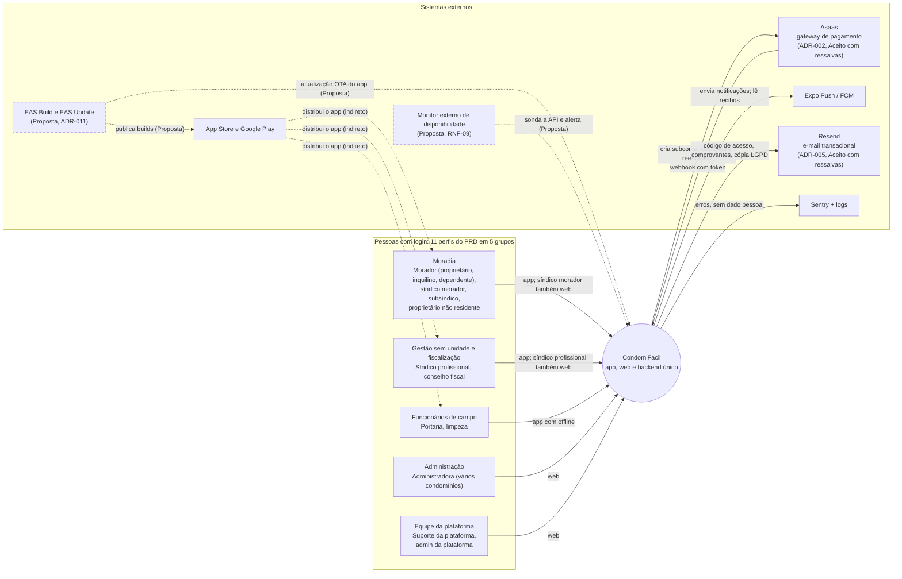

**Nota de agrupamento.** O PRD (seção 3) define 11 perfis. O diagrama os agrupa em 5 caixas para ficar legível: Moradia (morador, síndico morador, subsíndico, proprietário não residente), Gestão (síndico profissional, conselho fiscal), Campo (portaria, limpeza), Administração (administradora) e Plataforma (suporte, admin da plataforma). O subsíndico fica em Moradia porque é morador eleito. O diagrama 2.1 de `01-arquitetura.md` agrupa de outro jeito (7 nós); a informação é a mesma.

**Sem login.** Visitantes, hóspedes de temporada e empresas de manutenção são cadastros, não atores (RF-AD-14; RN 3). O perfil "Manutenção" existe só no protótipo e não aparece aqui. O condomínio é o controlador dos dados e a plataforma é a operadora (SEG-14).

**CDN e cofre de segredos** (ambos Proposta) são infraestrutura do provedor e aparecem no nível 2.

Fontes: arq. 2.1, 2.4, 3.6 a 3.8, 5.1, 6.4, 6.8; PRD 3 e 10; RF-AC-06, RF-AD-14; RN 3; RNF-09; SEG-14; ADR-002, ADR-005, ADR-011.

### 2.2 Atores

| Grupo | Perfis (PRD 3) | O que fazem no sistema | Cliente | Status |
| --- | --- | --- | --- | --- |
| Moradia | Morador (proprietário, inquilino ou dependente), síndico morador, subsíndico, proprietário não residente | Reservam áreas, cadastram visitantes, acompanham encomendas, abrem chamados e reclamações, votam e pagam cobranças. Quem vota pela unidade é sempre o proprietário (RN-VO-01, RN-CD-19). Uma unidade ocupada tem um único morador habilitado | App; síndico morador também web (opcional) | Decidido |
| Gestão | Síndico profissional, conselho fiscal | Síndico profissional faz a gestão sem unidade. Conselho fiscal lê e comenta as finanças e julga reclamações contra o síndico nos casos de RN-RC-03 e RN-RC-07 | Síndico profissional: app (aba Gestão) e web. Conselho fiscal: app | Decidido |
| Campo | Funcionário de portaria, funcionário de limpeza | Portaria: entradas e saídas, encomendas, abertura de chamados. Limpeza: chamados do setor. Os dois funcionam offline | App (offline) | Decidido |
| Administração | Administradora | Cadastros, unidades, áreas, conta bancária, cobrança, finanças (edita), julgamentos previstos nas RN | Web | Decidido |
| Plataforma | Suporte da plataforma, admin da plataforma | Suporte faz o papel da administradora no plano Gestão + Suporte, sem ver reclamações nem scores (RN-CD-16, SEG-13). Admin cadastra condomínios, planos e acessos de suporte, sem acessar dados de condomínio | Web | Decidido (detalhes do painel da plataforma não definidos nos docs) |

### 2.3 Sistemas externos

| Sistema | Relação | Status | Origem |
| --- | --- | --- | --- |
| Asaas (gateway de pagamento) | Bidirecional: a plataforma cria subconta, cobrança (boleto com QR Code Pix, Pix, cartão) e reembolso; o Asaas envia webhook autenticado por token | **Decidido** (ADR-002, Aceito com ressalvas em 10/11/2026). Pendentes: KYC, chargeback, prazos reais | PRD 10; arq. 3.6 |
| Expo Push / FCM | Saída: envio de notificações; consulta de recibos | Decidido | PRD 10; arq. 3.7 |
| Resend (e-mail transacional) | Saída: código de acesso, comprovantes, cópia LGPD | **Decidido** (ADR-005, Aceito com ressalvas em 10/11/2026). Dados de e-mail saem do Brasil (LGPD) | PRD 10; arq. 3.7, 5.2 |
| Sentry + logs | Saída: erros de app, web, API e worker, com filtro de dados sensíveis | Decidido | PRD 10; arq. 6.8 |
| App Store e Google Play | Distribuem o app | Decidido | arq. 2.1, 6.4 |
| Armazenamento de objetos (compatível com S3) | Tratado como container de infraestrutura no nível 2 | Tecnologia decidida; provedor para o MVP: Supabase Storage (ADR-004, Aceito com ressalvas em 10/11/2026; revisão antes do piloto) | PRD 10; arq. 3.8 |
| EAS Build e EAS Update (OTA) | Builds e atualizações JavaScript do app | Proposta (ADR-011); não citado no PRD | arq. 5.1, 6.4 |
| Monitor externo de disponibilidade | Sonda a API e alerta | Proposta (RNF-09) | arq. 6.8 |
| CDN da web | Serve a web estática | Proposta | arq. 3.2 |
| Cofre de segredos do provedor | Injeta segredos na API e no worker | Proposta (SEG-02) | arq. 6.5 |
| SMS, WhatsApp, antivírus, mapas, OCR | Nenhuma | Não definido nos docs | — |

## 3. Nível 2: Containers

**Resumo:** um projeto Expo gera app e web; um código NestJS roda em dois pontos de entrada (API com WebSocket, e worker); o PostgreSQL é a fonte da verdade e também guarda fila e outbox.

### 3.1 Diagrama de containers (D2)

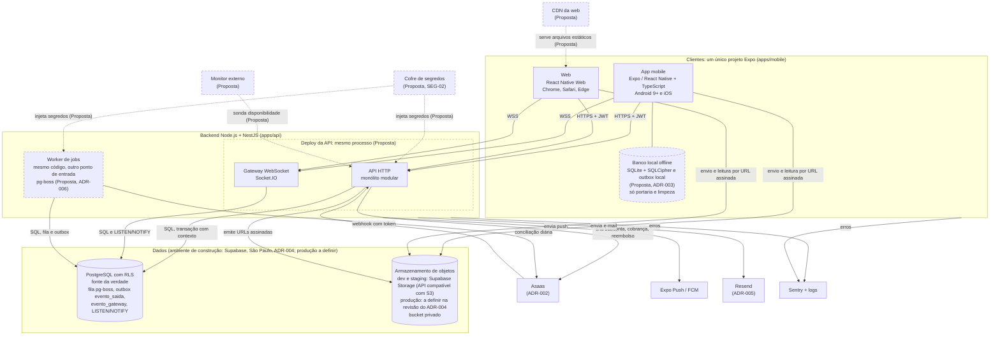

Setas que saem da caixa "Backend" valem para a API e para o worker (como no diagrama 2.2); o envio normal de push e e-mail passa pelo despacho do outbox no worker. Setas que saem da caixa "Clientes" valem para app e web.

O worker e o agrupamento "API + WebSocket no mesmo processo" estão com borda tracejada porque o **mecanismo** é Proposta (pg-boss, ADR-006; mesmo processo, arq. 3.4). Ter jobs no backend e WebSocket para a portaria é decidido (PRD 10).

**Redis (nota de evolução).** Redis não é container do MVP. Se a carga pedir, BullMQ + Redis substitui o pg-boss e Redis pub/sub substitui o `LISTEN/NOTIFY` (ADR-006, arq. 5.2). No MVP o cache é em processo.

Fontes: arq. 2.2, 2.3, 3.1 a 3.8, 4.5 a 4.8, 5.1 a 5.3, 6.5, 6.8; PRD 10; RNF-05, RNF-06, RNF-07, RNF-09; SEG-02, SEG-05, SEG-09; ADR-001, ADR-002, ADR-003, ADR-004, ADR-005, ADR-006.

### 3.2 Containers e comunicação

**Responsabilidade de cada container**

| Container | Tecnologia | Responsabilidade | Status |
| --- | --- | --- | --- |
| App mobile | Expo / React Native + TypeScript | Perfis de campo e de moradia; offline; câmera e compressão de fotos; push; tokens no `expo-secure-store` | Decidido (PRD 10) |
| Web | React Native Web, mesmo projeto Expo | Painéis da administradora, suporte, admin da plataforma e síndico | Decidido (PRD 10); CDN e sessão por cookie são Proposta |
| Banco local offline | SQLite + SQLCipher com outbox (alternativa WatermelonDB) | Lista do dia da portaria e chamados do setor da limpeza. Um arquivo por usuário + condomínio, apagado ao sair, ao trocar de condomínio e ao fim do dia | "SQLite ou WatermelonDB" decidido no PRD 10; escolha Proposta (ADR-003) |
| API HTTP | Node.js + NestJS, monólito modular | Regras de negócio, autenticação, autorização, pagamentos, auditoria; única porta de acesso aos dados | Decidido (PRD 10); monólito modular é Proposta |
| Gateway WebSocket | Socket.IO no NestJS | Lista da portaria em até 5 s (RNF-05); edição de entrega esperada na hora (RN-EN-09) | WebSocket decidido; mesmo processo da API e Socket.IO são Proposta |
| Worker de jobs | Mesmo código da API, outro ponto de entrada, pg-boss | 21 rotinas (RN 14), webhooks, push, e-mail, exportações | Jobs decididos; mecanismo Proposta (ADR-006) |
| PostgreSQL | PostgreSQL com RLS | Fonte da verdade; fila, outbox e `LISTEN/NOTIFY` | Decidido (PRD 10, SEG-05); fila e outbox são Proposta |
| Armazenamento de objetos | Compatível com S3; em dev e staging, Supabase Storage (produção a definir na revisão do ADR-004) | Fotos, comprovantes, atas, listas de presença. Chave `c/{condominio_id}/{modulo}/{uuid}` | Tecnologia decidida (PRD 10); provedor do ambiente de construção decidido (ADR-004), produção depende da revisão antes do piloto; prefixo é Proposta |

**Comunicação entre containers**

| Origem | Destino | Protocolo | Autenticação e isolamento | Status |
| --- | --- | --- | --- | --- |
| App, web | API | HTTPS, JSON | JWT de acesso (15 min, sem papéis); cabeçalhos `X-Condominio-Id`, `X-Unidade-Id`, `X-App-Version` (426 se versão mínima não atendida) | HTTPS + JWT decidido; detalhes Proposta (ADR-007) |
| Web | API (renovação) | HTTPS | Refresh token em cookie `httpOnly`, `Secure`, `SameSite=Lax`; access token só em memória | Proposta |
| App, web | WebSocket | WSS | Token no handshake; salas `c:{condominio_id}:portaria:{portaria_id}` atribuídas pelo servidor | Proposta |
| App, web | Armazenamento | HTTPS | URL assinada de envio e de leitura, curta, emitida pela API só após autorizar | Proposta |
| App (offline) | API `/sync` | HTTPS | Mesmo JWT; `POST /sync/push` em lote ordenado e idempotente por `op_id`; `GET /sync/pull?desde=cursor` | Proposta (ADR-003) |
| API, WebSocket, worker | PostgreSQL | SQL (pool) | Papel `app_user` sem `BYPASSRLS`; transação com `set_config(..., true)` | Proposta alinhada a SEG-05 (ADR-001) |
| API | Worker | Fila e outbox no PostgreSQL | Payload com `condominio_id`; outbox gravado na mesma transação | Proposta (ADR-006) |
| Worker | WebSocket | `NOTIFY` do PostgreSQL | Evento mínimo por condomínio; cliente relê pela API | Proposta |
| API | Gateway | HTTPS | Credencial do Asaas no cofre; tempo limite, nova tentativa com recuo, disjuntor | Asaas decidido (ADR-002); resiliência Proposta |
| Gateway | API | HTTPS (`POST /webhooks/pagamentos/:provedor`) | Token do Asaas validado (cabeçalho `asaas-access-token`) antes de qualquer processamento; corpo bruto preservado | Decidido (webhook, PRD 10; Asaas, ADR-002); detalhes Proposta |
| App, web | Gateway | HTTPS | Checkout hospedado ou tokenização no cliente; cartão nunca passa pela API (SEG-12) | Forma exata não definida nos docs (a definir com o checkout hospedado do Asaas, na prova de conceito) |
| API, worker | Expo Push / FCM, e-mail | HTTPS | Credenciais no servidor; texto sem dado sensível | Push decidido; e-mail: Resend (ADR-005) |
| App, web, API, worker | Sentry | HTTPS | Filtro de dados sensíveis no SDK | Decidido |

O cliente trata os erros transversais (401, 403, 426, falha de rede) num interceptor único (UF 15).

### 3.3 Fluxo offline da portaria (D3)

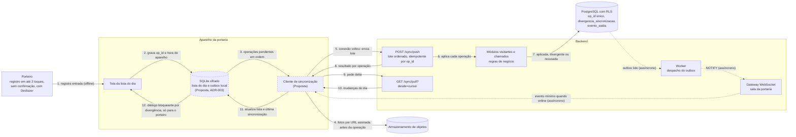

- Passos 1 a 3 funcionam sem conexão. Passos 4 a 12 rodam quando a conexão volta (o app tenta de novo com recuo exponencial, Proposta).
- Uma operação recusada não derruba o lote. Reenvio nunca duplica, porque `op_id` é único no servidor.
- Entrada offline de visitante cancelado pelo morador é **aplicada** e gera divergência (RN-OF-04). A divergência não gera notificação nem tela para o síndico (RN-OF-05).
- Na limpeza, duas conclusões do mesmo ciclo: vale o menor horário registrado pelo celular, mesmo recebido depois (RN-CH-04; decisão de Pedro em 08/11/2026). Preservar operações e corrigir a conclusão efetiva com aviso; reenvio não cria novo ciclo. Desempate exato e relógio incorreto continuam propostas técnicas (ADR-014).
- Fotos de conclusão (até 5, RN-CH-14) sobem antes, com o mesmo `op_id` como chave de idempotência.
- Online, a lista se atualiza pelo WebSocket. Se o socket cair, o cliente faz `pull` ao reconectar, e há fallback de consulta periódica (Proposta).
- O banco local é apagado ao sair, ao trocar de condomínio e na primeira abertura de um novo dia (Proposta, complementa a rotina 13).

Fontes: arq. 3.1.1, 3.4, 3.8, 4.6, 4.8; RF-VI-05, RF-VI-06, RF-VI-11, RF-CH-03; RN-OF-01 a 06, RN-CH-04, RN-CH-14, RN-CH-15; RNF-05 a 08, RNF-16; SEG-09; US-NO-01; ADR-003, ADR-014.

### 3.4 Fluxo de pagamento e webhook (D4)

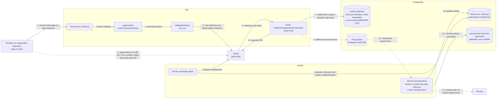

- A seta 5 é tracejada porque a forma de pagamento no cliente (checkout hospedado ou tokenização) depende do gateway escolhido.
- O dinheiro vai direto à conta do condomínio pela subconta; a plataforma não retém (RN-PG-04). Sem conta bancária cadastrada não há cobrança nem área paga (RN-FI-01, RN-PG-03).
- Um evento atrasado de "pendente" não desfaz um "pago". Valores em centavos inteiros.
- A taxa do gateway vira despesa "Administração"; reembolso e devolução geram estorno automático (RN-PG-05, RN-FI-23).
- Pagamento confirmado depois do fechamento do mês entra no mês do pagamento (RN 12.4).
- A conciliação cobre webhooks perdidos (SEG-17).
- Prazos reais de confirmação de boleto e Pix, KYC da subconta e chargeback dependem do gateway (não definidos nos docs).

Fontes: arq. 3.6, 3.11, 4.4; RF-PG-01 a 04, RF-FI-07, RF-FI-09, RF-FI-10, RF-AD-08; RN-PG-01 a 07, RN-CA-01 a 06, RN-FI-01, RN-FI-13, RN-FI-23; SEG-12, SEG-15, SEG-17; UF 5.1, 13.1, 17; ADR-002, ADR-006.

### 3.5 Implantação por ambiente (D5)

Mostra só o que a seção 6 de `01-arquitetura.md` sustenta. Para construir o MVP, dev e staging usam Supabase (PostgreSQL e Storage, São Paulo) e Render (API, WebSocket e worker; no plano gratuito o worker roda no mesmo serviço web da API e as rotinas param quando o serviço dorme), planos gratuitos (ADR-004, decisão de Pedro em 10/11/2026). A infraestrutura de produção com dados reais está a definir na revisão do ADR-004 antes do piloto; por isso o bloco de produção não leva nome de serviço.

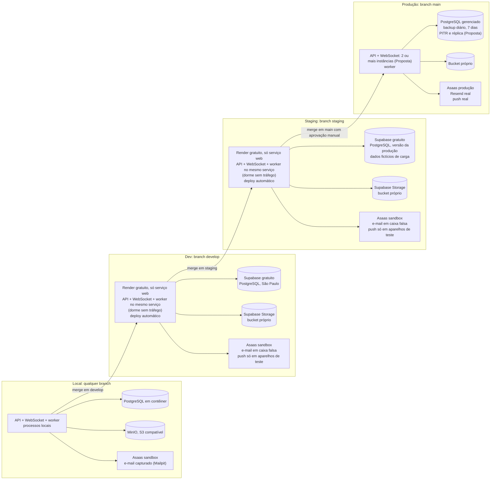

- Dados reais só em produção. Cada ambiente tem seu conjunto de segredos (cofre, Proposta) e seu projeto Sentry; o Sentry fica desligado no local.
- Com mais de uma instância de API, o `NOTIFY` do PostgreSQL leva cada evento a todas as instâncias, e cada uma repassa aos seus sockets (arq. 3.4).
- Builds EAS por perfil (`development`, `preview`, `production`) e canais OTA por ambiente são Proposta (ADR-011).
- A branch `docs/design-system-e-user-flows` é de documentação e não faz deploy.
- Promoção entre branches segue a regra do projeto: nenhum commit sem validação do Pedro (AGENTS.md).

Fontes: arq. 6.1 a 6.9; RNF-09, RNF-13, RNF-17, RNF-18; SEG-01, SEG-02; ADR-004, ADR-011, ADR-013; AGENTS.md.

## 4. Nível 3: Componentes do backend

**Resumo:** o backend é um monólito modular (Proposta). Dezenove módulos de domínio, entre eles `sync` (Proposta deste documento), usam uma camada interna comum (`TenantContext`, guards, outbox, portas de gateway e e-mail). `tempo-real` e `rotinas` são mecanismos de processo, não módulos de domínio. Todos os nomes são Proposta (arq. 3.3).

**Regras comuns a todos os módulos (Proposta):** acesso a dados só pelo `TenantContext`; validação com Zod em `shared-types`; eventos de domínio no outbox `evento_saida`; auditoria na mesma transação; papéis resolvidos no servidor a cada requisição (JWT sem papéis, ADR-007).

### 4.1 Visão geral dos módulos (D6)

Visão por grupo. As setas ligam grupos, não módulos; o detalhe de cada grupo está nos diagramas D7 a D10.

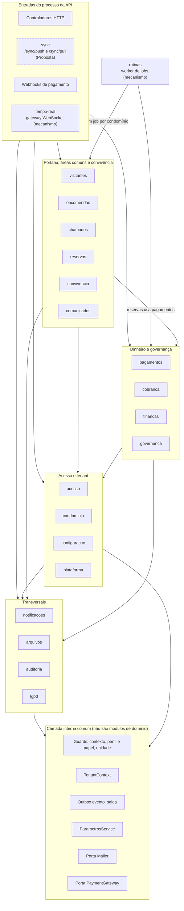

Leitura: setas apontam de quem usa para quem é usado. Grupos de domínio também usam a camada interna (a seta foi omitida em alguns grupos para não poluir o desenho; a regra vale para todos).

Fontes: arq. 3.3, 3.4, 3.5, 5.3; PRD 10; ADR-001, ADR-006, ADR-007.

### 4.2 Acesso e tenant (D7)

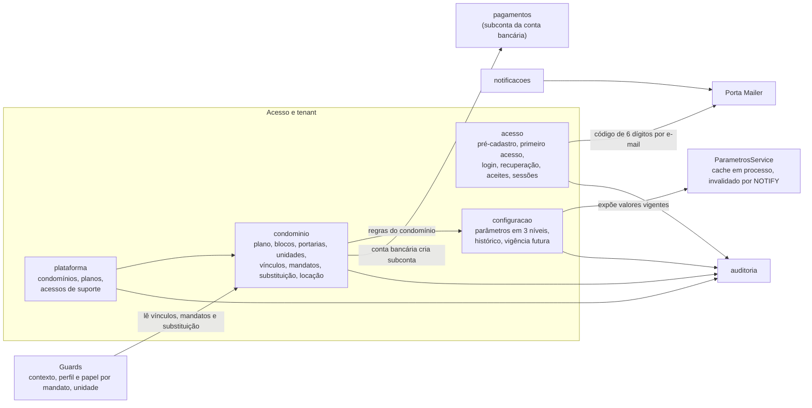

- Ninguém se cadastra sozinho: pré-cadastro pela administradora ou suporte (RN-CD-01). Senha com Argon2id; refresh token rotativo (Proposta, ADR-007).
- Uma unidade ocupada tem um único morador habilitado (RN-CD-19). Substituição do síndico é dado, não código (RN-CD-12, RN-CD-28).
- `parametro_valor` nunca é atualizado, só versionado; a regra vigente é copiada como `regras_aplicadas` quando necessário (RN-GE-01 a 03).
- O papel `plataforma` não tem acesso às tabelas de tenant (arq. 4.4).

Fontes: arq. 3.3, 3.3.1, 4.2 a 4.4, 4.9; RF-AC, RF-AD; RN-CD-01, RN-CD-05, RN-CD-12, RN-CD-19, RN-CD-28, RN-PL, RN-GE-01 a 03, RN 13; SEG-03, SEG-04, SEG-13; ADR-001, ADR-007.

### 4.3 Portaria, áreas comuns e convivência (D8)

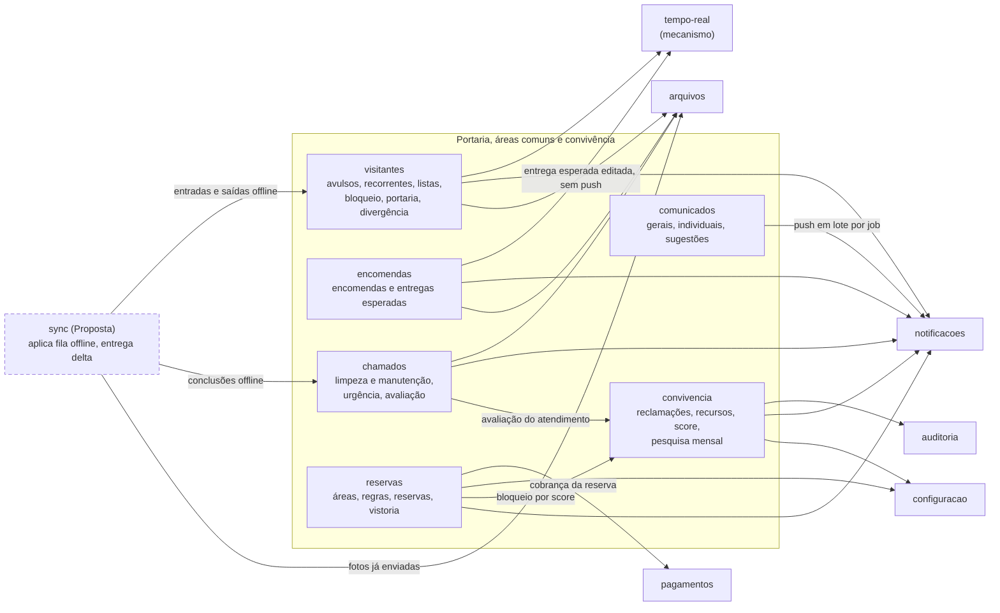

- Portaria só vê os blocos que atende (RF-VI-03/04). Anonimização de visitantes pela rotina 14 (SEG-10).
- `reservas` evita conflito de horário no banco com `EXCLUDE USING gist` (RN-RE-04).
- `convivencia` guarda a identidade do reclamante em tabela separada, com RLS só para julgador e administradora; o alvo recebe DTO sem autor; score só por um endpoint; suporte sem acesso; pesquisa sem `avaliador_id` (HMAC) (SEG-07, ADR-010). Estas regras podem mudar com o parecer SEG-16.
- Agrupamento de avisos da portaria (RN-VI-17) fica em `notificacoes`, não no socket.

Fontes: arq. 3.1.1, 3.3, 3.4, 3.9.2; RF-VI, RF-EN, RF-CH, RF-RE, RF-RC, RF-SC, RF-PE, RF-CO; RN-VI, RN-OF-01 a 06, RN-EN-09, RN-CH-04, RN-CH-14, RN-CH-19 a 21, RN-RE-04, RN-RC, RN-SC, RN-PE, RN-CO; RNF-05; SEG-07, SEG-10; ADR-003, ADR-010, ADR-014.

### 4.4 Dinheiro e governança (D9)

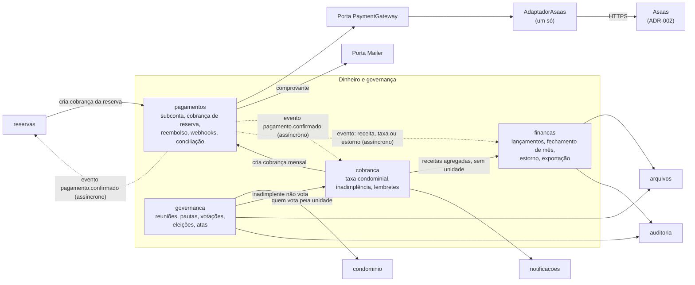

- As setas tracejadas de `pagamentos` são eventos de domínio pelo outbox. Assim `pagamentos` não chama `reservas`, `cobranca` nem `financas` diretamente, e não há ciclo (decisão deste documento, seção 5.1).
- `financas`: mês fechado só muda por estorno, pela função `estornar_lancamento`, com gatilho no banco. A administradora edita; síndico e conselho fiscal leem e comentam (SEG-18). Não é contabilidade formal.
- `cobranca`: multa e juros calculados no servidor; situação financeira só ao responsável, à administradora e ao síndico (SEG-17).
- `governanca`: `voto_registro` separado de `voto_conteudo`; resultado só após o encerramento; regras congeladas na criação (SEG-06, RN-GE-03, ADR-009).

Fontes: arq. 3.3, 3.6, 3.10, 3.11; RF-PG, RF-FI-01 a 24, RF-VO; RN-PG, RN-CA, RN-FI, RN-FI-11, RN-VO-01, RN-GE-03; SEG-06, SEG-12, SEG-15, SEG-17, SEG-18; ADR-002, ADR-009.

### 4.5 Transversais e tempo real (D10)

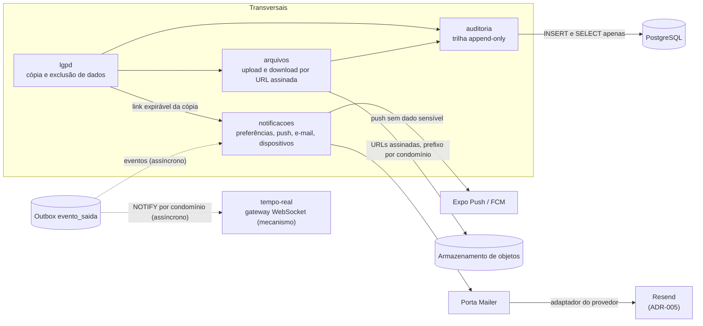

- Notificações obrigatórias são fixas em código: decisão de reclamação contra a pessoa e divergência de sincronização para o porteiro (US-NO-01). "Cobrança em atraso" como obrigatória é pendência de produto.
- `tempo-real` só distribui eventos mínimos em salas atribuídas pelo servidor; não decide regra de negócio.
- Verificação de vírus em uploads e retenção da auditoria não estão definidas nos docs.

Fontes: arq. 3.4, 3.7, 3.8, 3.9.1, 4.5, 4.6, 7; RF-NO-01, RF-LG-01, RF-LG-02; RN-RC-10, RN-VI-17, RN-CH-18; RNF-05, RNF-17; SEG-08, SEG-11, SEG-13; US-NO-01; DS 15.

### 4.6 Tabela de módulos

Todos os módulos são Proposta (arq. 3.3). "Depende de" segue as setas de D7 a D10.

| Módulo | Responsabilidade | Depende de | IDs principais |
| --- | --- | --- | --- |
| `acesso` | Pré-cadastro, primeiro acesso, login, recuperação, aceites, sessões | Porta Mailer, `auditoria` | RF-AC; RN-CD-01, RN-CD-02; SEG-03, SEG-04; ADR-007 |
| `condominio` | Condomínio, plano, blocos, portarias, unidades, vínculos, mandatos, substituição, locação | `configuracao`, `pagamentos` (subconta), `auditoria` | RF-AD; RN-CD, RN-PL; RN-CD-05, RN-CD-12, RN-CD-19, RN-CD-28; ADR-001 |
| `configuracao` | Parâmetros em 3 níveis, histórico, vigência futura | `auditoria` | RN 13; RN-GE-01 a 03 |
| `plataforma` | Painel do admin: condomínios, planos, acessos de suporte | `condominio`, `auditoria` | PRD 3; arq. 4.4 |
| `visitantes` | Avulsos, recorrentes, listas, bloqueio, registro de portaria, divergência | `tempo-real`, `notificacoes`, `arquivos` | RF-VI; RN-VI, RN-OF-01 a 06; SEG-10; ADR-003, ADR-014 |
| `sync` (Proposta deste documento) | Aplicar a fila offline e entregar delta ao aparelho | `visitantes`, `chamados`, `arquivos` | RN-OF-01 a 06, RN-CH-04; RNF-06 a 08, RNF-16; ADR-003, ADR-014 |
| `encomendas` | Encomendas e entregas esperadas | `notificacoes`, `arquivos`, `tempo-real` | RF-EN; RN-EN; RN-EN-09 |
| `chamados` | Limpeza e manutenção, urgência, avaliação | `arquivos`, `notificacoes`, `convivencia` | RF-CH; RN-CH; RN-CH-04, RN-CH-14, RN-CH-19 a 21; ADR-014 |
| `reservas` | Áreas, regras, reservas, vistoria | `pagamentos`, `configuracao`, `convivencia`, `notificacoes` | RF-RE; RN-RE; RN-RE-04 |
| `convivencia` | Reclamações, recursos, score, pesquisa mensal de funcionários | `auditoria`, `notificacoes`, `configuracao` | RF-RC, RF-SC, RF-PE; RN-RC, RN-SC, RN-PE; SEG-07; ADR-010 |
| `comunicados` | Gerais e individuais, sugestões | `notificacoes` | RF-CO; RN-CO |
| `pagamentos` | Porta PaymentGateway, subconta, cobrança de reserva, reembolso, webhooks, conciliação | Porta PaymentGateway (Asaas), Porta Mailer (Resend); emite eventos para `reservas`, `cobranca`, `financas` | RF-PG; RN-PG, RN-CA; RN-PG-04; SEG-12, SEG-15, SEG-17; ADR-002 |
| `cobranca` | Taxa condominial, inadimplência, lembretes | `pagamentos`, `financas`, `notificacoes` | RF-FI-01 a 16; RN-FI; RN-FI-01; SEG-17 |
| `financas` | Lançamentos, categorias, fechamento de mês, estorno, exportação | `arquivos`, `auditoria`; recebe lançamentos de `cobranca` e eventos de `pagamentos` | RF-FI-17 a 24; RN-FI-21 a 32; SEG-18 |
| `governanca` | Reuniões, pautas, votações, eleições, atas | `condominio`, `cobranca`, `arquivos`, `auditoria` | RF-VO; RN-VO; RN-VO-01, RN-FI-11, RN-GE-03; SEG-06; ADR-009 |
| `notificacoes` | Preferências, push, e-mail, dispositivos | Expo Push / FCM, Porta Mailer, outbox | RF-NO-01; US-NO-01; RN-RC-10, RN-VI-17; DS 15 |
| `arquivos` | Upload e download por URL assinada | Armazenamento de objetos, `auditoria` | PRD 10; RN-CH-14, RN-FI-24; arq. 3.8 |
| `lgpd` | Cópia e exclusão de dados | `arquivos`, `notificacoes`, `auditoria` | RF-LG-01, RF-LG-02; SEG-11 |
| `auditoria` | Trilha append-only | PostgreSQL | SEG-08, SEG-13 |
| `tempo-real` (mecanismo) | Gateway WebSocket, salas autorizadas pelo servidor | Outbox (via `NOTIFY`) | RNF-05, RNF-17; arq. 3.4, 4.6 |
| `rotinas` (mecanismo) | Agendador e jobs no worker | Quase todos os módulos | RN 14; ADR-006, ADR-012 |

**Camada interna comum** (citada nos docs fora da tabela de módulos): guards NestJS (contexto, perfil e papel por mandato, unidade), `TenantContext`, outbox `evento_saida`, `evento_gateway`, `execucao_rotina`, `ParametrosService`, porta `Mailer` e porta `PaymentGateway` (só um adaptador será implementado).

### 4.7 Camadas internas de uma requisição (D11)

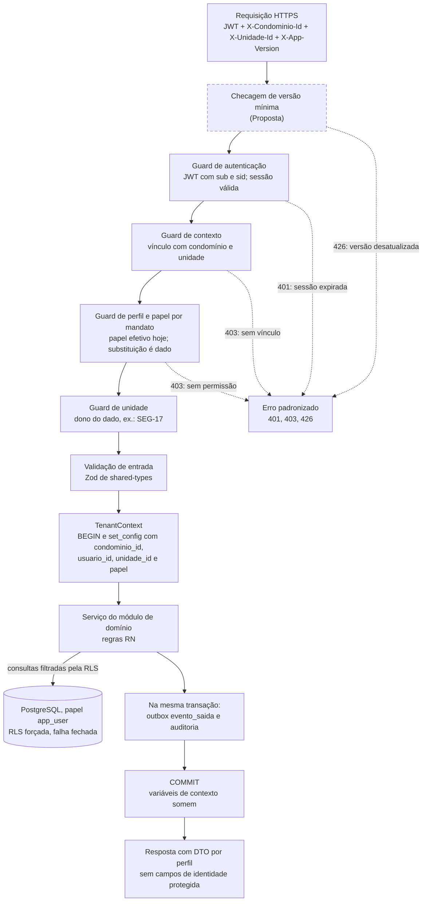

- Quatro barreiras: contexto, papel, unidade e RLS. A API aplica a regra; a RLS é a última barreira (arq. 3.3.1, 4.3).
- `set_config(..., true)` vale só até o fim da transação; a conexão volta limpa ao pool. Sem contexto, a política devolve nenhuma linha.
- O `TenantContext` é o único caminho até o banco, na API e nos jobs. Webhooks e jobs não passam pelos guards de usuário: abrem o contexto a partir do condomínio da cobrança ou do payload do job (arq. 4.4).
- Esconder um botão no cliente não é controle de acesso: a API valida sempre (UF 15).
- Nenhum papel usado em requisição de usuário tem `BYPASSRLS`.

Fontes: arq. 3.3, 3.3.1, 3.9, 4.3, 4.4; RF-AC-04; RN-CD-05, RN-CD-12, RN-CD-28; RNF-01, RNF-11; SEG-05, SEG-07, SEG-08, SEG-17; UF 15; ADR-001, ADR-007, ADR-008.

### 4.8 Fluxo de jobs no worker (D12)

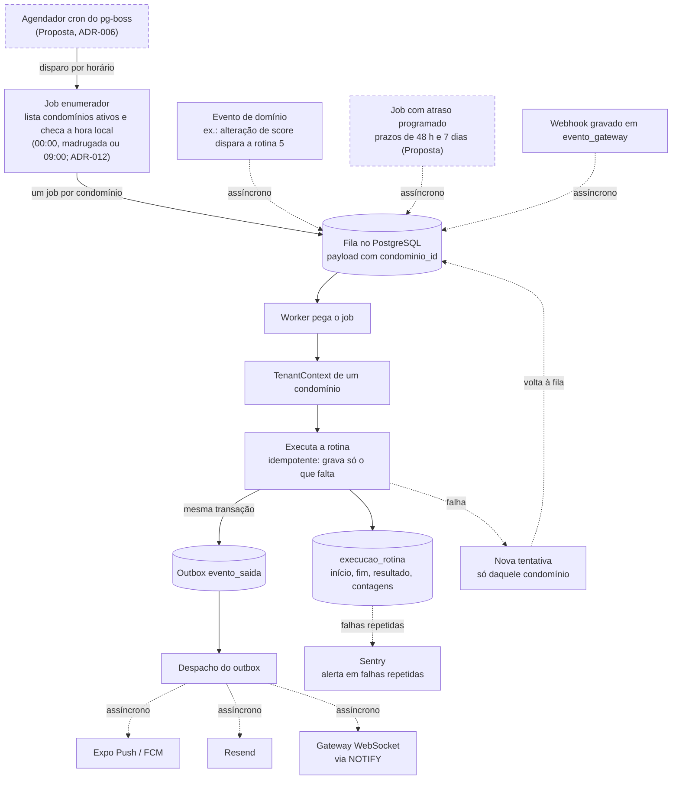

- Um job por condomínio: cada execução abre o contexto de um só condomínio, falha e repete isolada, e um condomínio grande não atrasa os outros (arq. 3.5).
- A rotina 1 (expirar reservas não pagas) é global e filtra por prazo, com papel de job de políticas explícitas (arq. 4.4).
- Job sem `condominio_id` só é permitido para os jobs de plataforma listados (arq. 4.7).

**Rotinas e módulo responsável.** Frequências vêm de arq. 3.5 e RN 14. A coluna "Módulo responsável" é Proposta deste documento.

| # | Rotina (RN 14) | Frequência | Módulo responsável (Proposta) |
| --- | --- | --- | --- |
| 1 | Expirar reservas não pagas | A cada 5 min, global | `reservas` |
| 2 | Saída não registrada | A cada hora | `visitantes` |
| 3 | Visitantes que não vieram | Diária, meia-noite local | `visitantes` |
| 4 | Recuperação de score | Diária, madrugada (00:00 a 06:00 local) | `convivencia` |
| 5 | Bloqueio de reservas gratuitas | Por evento de alteração de score | `convivencia` (efeito em `reservas`) |
| 6 | Fechamento da pesquisa | Último dia do mês, 23h59 local | `convivencia` |
| 7 | Faltas em reservas | Diária, madrugada (00:00 a 06:00 local) | `reservas` |
| 8 | Lembretes de encomenda | Diária, 09:00 local | `encomendas` |
| 9 | Entregas esperadas que não chegaram | Diária, meia-noite local | `encomendas` |
| 10 | Prazos de reclamação e chamado | Diária, duas etapas: efeito na madrugada (00:00 a 06:00 local), aviso às 09:00 local | `convivencia` e `chamados` |
| 11 | Lembrete de avaliação de chamado | Diária, 09:00 local | `chamados` |
| 12 | Encerrar reclamações sem recurso | Diária, madrugada (00:00 a 06:00 local) | `convivencia` |
| 13 | Limpeza de dados offline | Diária, meia-noite local | `sync` |
| 14 | Anonimização de visitantes | Diária, madrugada (00:00 a 06:00 local) | `visitantes` |
| 15 | Gerar cobranças mensais | Diária, madrugada (00:00 a 06:00 local) | `cobranca` |
| 16 | Marcar cobranças em atraso | Diária, madrugada (00:00 a 06:00 local) | `cobranca` |
| 17 | Lembretes de cobrança | Diária, 09:00 local | `cobranca` (canal não definido em RF-FI-11) |
| 18 | Lançamentos recorrentes | Diária, madrugada (00:00 a 06:00 local) | `financas` |
| 19 | Fechar o mês financeiro | Diária, madrugada (00:00 a 06:00 local); fecha no dia configurado | `financas` |
| 20 | Fim de contrato de locação | Diária, duas etapas: desativação na madrugada (00:00 a 06:00 local), aviso às 09:00 local | `condominio` |
| 21 | Lembrete de reserva (push antecipado para as 21:00 da noite anterior quando o horário de 24h antes cai entre 00:00 e 08:59 locais) | A cada 5 min | `reservas` (envio pelo `notificacoes`) |

Também são jobs: processamento de webhook e conciliação diária (`pagamentos`), exportações (`financas`), envio de push e e-mail (`notificacoes`) e os prazos com atraso programado (reabertura de chamado em 48 h, janela de avaliação de 7 dias, prazo de recurso de 7 dias, segundo turno em 7 dias).

**Horário local das rotinas diárias (decisão de Pedro em 09/11/2026, RN 14).** As diárias sem horário próprio rodam na faixa de madrugada (00:00 a 06:00 no fuso do condomínio), em sequência; as que enviam lembrete ou aviso a pessoas (8, 11 e 17) rodam às 09:00 locais; as rotinas 10 e 20 têm duas etapas, com o efeito na madrugada e o aviso às 09:00. O push gerado por rotina da madrugada fica na fila e sai às 09:00 locais; push de evento disparado por pessoa não muda. As rotinas 3, 9 e 13 (00:00) e a 6 (23:59 do último dia do mês) mantêm o horário; 1, 2, 5 e 21 não são diárias. A 21 roda a cada 5 min e antecipa o push para as 21:00 da noite anterior quando o horário calculado cai entre 00:00 e 08:59 locais (RN-RE-14, decisão de Pedro em 09/11/2026), sem passar pela fila das 09:00.

Fontes: arq. 3.5, 3.6, 3.7, 4.4, 4.7, 6.8; RN 14 (21 rotinas); RF-FI-11; RNF-09; SEG-10; ADR-006, ADR-012.

## 5. Decisões deste documento e pontos em aberto

### 5.1 Decisões deste documento

Todas são Proposta: valem para os diagramas e esperam validação do Pedro. Nenhuma muda regra de negócio.

| Decisão | Motivo | O que muda se for outra |
| --- | --- | --- |
| `sync` é um componente próprio (Proposta), com as rotas `/sync/push` e `/sync/pull`, e depende de `visitantes`, `chamados` e `arquivos` | As rotas existem (arq. 3.1.1), mas a tabela de módulos (arq. 3.3) não diz onde ficam. Lote ordenado, idempotência por `op_id` e cursor são comuns à portaria e à limpeza. Separar evita duplicar essa lógica e evita ciclo com `visitantes` | Se as rotas ficarem dentro de `visitantes` e `chamados`: some o nó `sync` em D6, D8 e D3; a lógica de lote e `op_id` fica duplicada ou vira biblioteca interna; a rotina 13 passa a `visitantes` e `chamados` |
| WebSocket roda no mesmo deploy da API (Proposta, arq. 3.4 e 5.3) | Menos peças para a equipe pequena; o `apps/api` tem dois pontos de entrada (API com WebSocket, e worker) | Se for deploy separado: D2 e D5 ganham um container "WebSocket" próprio; o `NOTIFY` continua levando eventos; a escala de conexões fica independente da API |
| `tempo-real` e `rotinas` são mecanismos de processo, não módulos de domínio | Não têm regra de negócio própria: um distribui eventos, o outro executa jobs. As regras ficam nos módulos de domínio | Se forem tratados como módulos: só muda o desenho (eles entram nos grupos de domínio); o comportamento é o mesmo |
| Fila e outbox ficam no PostgreSQL, com pg-boss (Proposta, ADR-006) | Enfileiramento na mesma transação do outbox; um componente a menos no MVP | Se for BullMQ + Redis: D2 ganha o container Redis; o outbox continua no PostgreSQL; `NOTIFY` vira Redis pub/sub; o despacho do outbox passa a publicar no Redis |
| `pagamentos` avisa `reservas`, `cobranca` e `financas` por evento de domínio (outbox), não por chamada direta | A tabela de módulos de `01-arquitetura.md` (3.3) dá a entender dependência nos dois sentidos entre `reservas` e `pagamentos`, o que seria um ciclo. Arq. 3.3 prevê comunicação "por serviços e por eventos de domínio" e cita `pagamento.confirmado` | Se forem chamadas diretas: há dependência circular entre módulos, o que exige interfaces invertidas no NestJS |
| Guards, `TenantContext`, outbox, `ParametrosService` e as portas `Mailer` e `PaymentGateway` formam uma camada interna comum, fora da lista de módulos | São citados nos docs fora da tabela de módulos e servem a todos | Se virarem módulos: só muda o desenho de D6 |
| Os 11 perfis aparecem em 5 grupos no nível 1; subsíndico fica em Moradia | Legibilidade; subsíndico é morador eleito (PRD 3) | Se cada perfil for um nó: D1 fica com 11 atores e as mesmas setas |
| Pagamento no cliente direto ao gateway aparece tracejado | Arq. 3.1.2 e 3.6 citam checkout hospedado ou tokenização, sem dizer qual | Definido o gateway, a seta vira contínua ou some (se o checkout for só pela API) |
| Módulo responsável por cada rotina (tabela em 4.8) | Os docs dão a rotina e a regra, não o módulo | Se mudar, só muda a tabela; o fluxo D12 é o mesmo |
| EAS e OTA, CDN, cofre de segredos e monitor externo aparecem tracejados e com "(Proposta)" | São propostas da arquitetura, fora do PRD 10 | Se forem aceitos, a borda vira contínua; se recusados, os nós saem |

### 5.2 Pontos em aberto que afetam os diagramas

| Ponto | Origem | Afeta os diagramas? | Onde |
| --- | --- | --- | --- |
| Gateway de pagamento: Asaas (decidido em 10/11/2026) | ADR-002; UF 17 | Nome já aplicado; ficam a forma do pagamento no cliente (seta 5 de D4), prazos e erros, a confirmar na prova de conceito | D1, D2, D4, D9 |
| Nuvem e região: Supabase + Render para construir o MVP (decidido em 10/11/2026) | ADR-004 | Nome já aplicado em dev e staging; produção, cofre e CDN dependem da revisão antes do piloto | D2, D5 |
| E-mail transacional: Resend (decidido em 10/11/2026) | ADR-005 | Nome já aplicado | D1, D2, D10 |
| Banco local (SQLite + SQLCipher ou WatermelonDB) | ADR-003 | Sim: rótulo do banco local e do cliente de sincronização | D2, D3 |
| Fila e Redis | ADR-006 | Sim: possível container Redis | D2, D12 |
| WebSocket no mesmo processo | arq. 3.4 | Sim | D2, D5 |
| Empate exato, relógio incorreto e correção tardia da conclusão | ADR-014; menor horário do celular já definido em RN-CH-04 | Não muda a forma, detalha a regra do passo 7 de D3 | D3 |
| Fuso horário e faixa de horário das rotinas diárias (madrugada ou 09:00) | ADR-012; RN 14 | Não muda a forma | D12 |
| Escala horizontal de WebSocket (conexões por instância) | arq. 9.3 | Pode mudar D5 (número de instâncias) | D5 |
| Vírus em uploads | arq. 3.8, 9.3 | Pode acrescentar um serviço externo | D1, D2, D10 |
| Detalhes do painel da plataforma | arq. 3.2, 9.3 | Pode detalhar o módulo `plataforma` | D7 |
| Retenção de logs e auditoria; formato das exportações; KYC da subconta; chargeback; limites de taxa; política de versões mínimas | arq. 9.3 | Não mudam a forma dos diagramas | — |
| Canal dos lembretes de cobrança | RF-FI-11 | Não muda a forma | D12 |

### 5.3 Pendências de produto

| Pendência (UF 17, arq. 9.2) | Afeta os diagramas? | Como |
| --- | --- | --- |
| Parecer jurídico SEG-16 (marco 2) | Talvez | Pode mudar `convivencia` (reclamações, score) e `governanca` (sigilo do voto, ADR-009). A forma dos diagramas se mantém; regras e prazos já estão em parâmetros |
| Revisão das regras de locação | Não | Regras dentro de `condominio` e `governanca` |
| Reserva paga não usada — resolvida por Pedro em 08/11/2026 | Não | RN-RE-09/10/13: reservas do dia e estados Em andamento, Cumprida e Não comparecimento, com autoria das marcações; sem novo componente nem ampliação offline |
| Prazo de 5 dias de resposta do alvo | Não | Parâmetro de `configuracao` |
| Finanças: orçamento anual, transparência a moradores, fundo de reserva, plano de contas | Talvez | Transparência a moradores mudaria quem lê `financas` (SEG-18) |
| Cobrança em atraso como notificação obrigatória | Não | Muda a lista fixa em `notificacoes` |
| Perfil Manutenção (só no protótipo) | Sim, se entrar no PRD | Novo grupo de ator em D1 e papéis em D11 |

### 5.4 Inconsistências encontradas nos docs (sem correção aqui)

- O diagrama 2.2 de `01-arquitetura.md` mostra WebSocket como caixa separada, enquanto o texto propõe o mesmo processo da API. D2 desenha os dois dentro do mesmo deploy.
- O diagrama 2.2 não mostra fila nem outbox, embora a arquitetura dependa deles. D2 e D12 os mostram.
- A seção 9.1 de `01-arquitetura.md` usa "Proposta, a decidir" para ADR-003 e ADR-006, e o índice dos ADRs usa "Proposto". É a mesma situação.
- PRD 10 cita web para "administradora, suporte e síndico"; a arquitetura acrescenta o admin da plataforma. D1 segue a arquitetura (arq. 2.4).

## 6. Rastreabilidade

Cada diagrama aponta para o que o originou. Ao mudar uma regra, revisar as linhas que a citam.

| Diagrama | RF | RN | RNF | SEG | ADR | Seção de `01-arquitetura.md` |
| --- | --- | --- | --- | --- | --- | --- |
| D1 Contexto | RF-AC-06, RF-AD-14 | RN 3, RN-VO-01, RN-CD-16, RN-CD-19, RN-RC-03, RN-RC-07 | RNF-09 | SEG-13, SEG-14 | 002, 005, 011 | 2.1, 2.4, 3.6 a 3.8, 5.1, 6.4, 6.8 |
| D2 Containers | RF-AC-06 | RN 14, RN-EN-09 | RNF-03, RNF-05, RNF-06, RNF-07, RNF-09 | SEG-02, SEG-05, SEG-09, SEG-12 | 001, 002, 003, 004, 005, 006, 007 | 2.2, 2.3, 3.1 a 3.8, 4.5 a 4.8, 5.1 a 5.3, 6.5, 6.8 |
| D3 Fluxo offline da portaria | RF-VI-05, RF-VI-06, RF-VI-11, RF-CH-03 | RN-OF-01 a 06, RN-CH-04, RN-CH-14, RN-CH-15 | RNF-05 a 08, RNF-16 | SEG-09 | 003, 014 | 3.1.1, 3.4, 3.8, 4.6, 4.8 |
| D4 Pagamento e webhook | RF-PG-01 a 04, RF-FI-07, RF-FI-09, RF-FI-10, RF-AD-08 | RN-PG-01 a 07, RN-CA-01 a 06, RN-FI-01, RN-FI-13, RN-FI-23 | RNF-01 | SEG-12, SEG-15, SEG-17 | 002, 006 | 3.6, 3.11, 4.4 |
| D5 Implantação | — | — | RNF-09, RNF-13, RNF-17, RNF-18 | SEG-01, SEG-02 | 004, 011, 013 | 6.1 a 6.9 |
| D6 Visão geral dos módulos | RF-* por épico | RN 14 | — | — | 001, 006, 007 | 3.3, 3.4, 3.5, 5.3 |
| D7 Acesso e tenant | RF-AC, RF-AD | RN-CD-01, RN-CD-05, RN-CD-12, RN-CD-19, RN-CD-28, RN-PL, RN-GE-01 a 03, RN 13 | — | SEG-03, SEG-04, SEG-13 | 001, 007 | 3.3, 3.3.1, 4.2 a 4.4, 4.9 |
| D8 Portaria, áreas comuns e convivência | RF-VI, RF-EN, RF-CH, RF-RE, RF-RC, RF-SC, RF-PE, RF-CO | RN-VI, RN-OF-01 a 06, RN-EN-09, RN-CH, RN-RE-04, RN-RC, RN-SC, RN-PE, RN-CO | RNF-05 | SEG-07, SEG-10 | 003, 010, 014 | 3.1.1, 3.3, 3.4, 3.9.2 |
| D9 Dinheiro e governança | RF-PG, RF-FI-01 a 24, RF-VO | RN-PG, RN-CA, RN-FI, RN-VO, RN-GE-03 | — | SEG-06, SEG-12, SEG-15, SEG-17, SEG-18 | 002, 009 | 3.3, 3.6, 3.10, 3.11 |
| D10 Transversais e tempo real | RF-NO-01, RF-LG-01, RF-LG-02 | RN-RC-10, RN-VI-17, RN-CH-18 | RNF-05, RNF-17 | SEG-08, SEG-11, SEG-13 | 005 | 3.4, 3.7, 3.8, 3.9.1, 4.5, 4.6, 7 |
| D11 Camadas de uma requisição | RF-AC-04 | RN-CD-05, RN-CD-12, RN-CD-28 | RNF-01, RNF-11 | SEG-05, SEG-07, SEG-08, SEG-17 | 001, 007, 008 | 3.3, 3.3.1, 3.9, 4.3, 4.4 |
| D12 Fluxo de jobs | RF-FI-11 | RN 14 (21 rotinas) | RNF-09 | SEG-10 | 006, 012 | 3.5, 3.6, 3.7, 4.4, 4.7, 6.8 |
| Tabela de módulos (4.6) | RF-* por épico | RN citadas por módulo | — | SEG citados por módulo | 001 a 014 conforme a linha | 3.3 a 3.11 |
| Decisões e pontos em aberto (5) | — | — | — | SEG-16 | 002 a 006, 009, 012, 014 | 9.1 a 9.3 |

Observação: listas de RF por épico estão resumidas. A cobertura completa RF para US está em `docs/01-produto/04-historias-de-usuario.md`. Outras fontes usadas: PRD 3 e 10, UF 5.1, 13.1, 15 e 17, US-NO-01, DS 15, AGENTS.md.

## Atualização de autogestão e eleições — 13/11/2026

Regra aprovada por Pedro: **Essencial admite autogestão**, sem administradora e sem contratar Gestão + Suporte (RN-PL-08); não é terceiro plano nem novo perfil. Gestão e administração ficam no condomínio, concentradas nos órgãos locais aprovados por Pedro. **Distribuição conservadora proposta, a validar:** síndico executa, subsíndico em substituição assume, conselho fiscal mantém fiscalização e as atribuições específicas das RN. A exceção financeira de RN-FI-29 permite ao executor da autogestão operar finanças; não concede ao conselho edição financeira irrestrita. Leitura fiscal continua agregada e fontes individuais permanecem restritas à finalidade autorizada. Suporte não recebe acesso ao Essencial, nem a reclamações e scores em qualquer plano.

**Condução eleitoral em qualquer plano:** síndico em exercício; na ausência ou vacância, subsíndico; sem ambos, conselho fiscal; sem todos, proprietário designado com permissão temporária restrita à eleição. Administradora vinculada e suporte legitimamente autorizado também podem conduzir, sem serem pré-requisito. Autorização é contextual por condomínio, mandato, ausência/vacância e concessão; revalidar em cada leitura e ação. Proprietário designado recebe somente o escopo daquela eleição, sem gestão, finanças, reclamações ou autoconcessão. Auditoria registra ações, nunca voto individual; resultado só após encerramento. A restrição eleitoral anterior de 12/11/2026 fica substituída por RN-VO-13/RN-CD-13 atualizadas.

**Proposta técnica a revisar:** separar modalidade de gestão do plano comercial e manter histórico de vigência; políticas de autorização por ação (Strategy), reutilizando serviços de domínio (Information Expert, baixo acoplamento) nas interfaces de síndico, conselho e comum. Não atribuir o papel Administradora ao síndico para reutilizar DTOs. Persistir concessão eleitoral com condomínio, eleição, proprietário, início/fim, origem da designação e revogação, sem prazo arbitrário. Modelo físico, operação de concessão e campos ainda dependem de validação. Não há banco, migrações ou backend implementados.

**Pendências antes do MVP:** comprovar primeiro responsável sem autoridade prévia; registrar ausência/vacância sem autodeclaração privilegiada; definir qual conselheiro atua; designar/revogar proprietário e tratar perda de vínculo ou retorno do titular durante eleição; validar mandatos e mudança de modalidade; revisar a matriz completa de cadastros, cobrança, conciliação, pagamentos e finanças da autogestão. A interface comum contrata condução eleitoral; as 82 operações propostas de `/v1/sindico/gestao/` cobrem cadastros/configurações, cobrança, conciliação e finanças com DTOs específicos referenciados, sem login de administradora. Caminhos, distribuição e DTOs exigem revisão antes de implementar; mandatos/substituições e concessão inicial permanecem lacunas bloqueadoras. Critérios: titular/sub fora condição e conselho sem condição devem ser recusados; proprietário temporário não alcança finanças; suporte é recusado no Essencial; não há resultado parcial. Ver [decisões e questões detalhadas](../01-produto/06-autogestao-e-conducao-eleitoral.md). Esta atualização não aceita ADRs ou contratos inteiros.

## Relatórios gerenciais do MVP — 14/11/2026

Proposta técnica alinhada a RN-RL-01 a 08 e RF-RL-01 a 11, sem aceite automático de ADR.

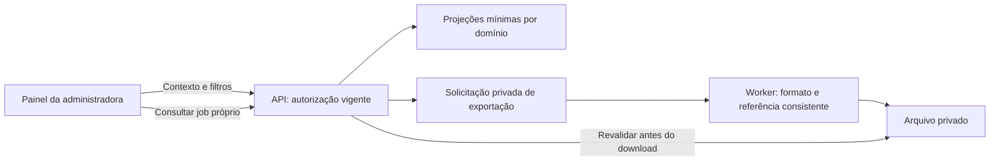

Sem novos acessos de suporte ou outros perfis. Exportação é trabalho sob demanda; limites e retenção continuam pendentes.
