# MER e DER — CondomiFacil

- **Estado:** Proposta para validação de Pedro Lemos.
- **Data:** 08/11/2026.
- **Escopo:** modelo conceitual e modelo lógico de dados do MVP; sem criação de banco, migrações ou alteração das regras de produto.
- **Limite:** os nomes, agrupamentos e mecanismos de integridade abaixo são propostas de modelagem. Nenhum ADR passa a Aceito por estar representado aqui. Os pontos da seção 9 precisam de decisão antes do modelo físico.

## Índice

1. [Objetivo e fontes](#1-objetivo-e-fontes)
2. [Convenções de leitura e integridade](#2-convenções-de-leitura-e-integridade)
3. [MER — visão conceitual](#3-mer--visão-conceitual)
4. [DER — modelo lógico e dicionário por domínio](#4-der--modelo-lógico-e-dicionário-por-domínio)
5. [Regras de integridade e operações indivisíveis](#5-regras-de-integridade-e-operações-indivisíveis)
6. [Isolamento, acesso e privacidade](#6-isolamento-acesso-e-privacidade)
7. [Ciclos de vida e dados calculados](#7-ciclos-de-vida-e-dados-calculados)
8. [Rastreabilidade](#8-rastreabilidade)
9. [Pendências e decisões necessárias](#9-pendências-e-decisões-necessárias)
10. [Critérios para evolução ao modelo físico](#10-critérios-para-evolução-ao-modelo-físico)

## 1. Objetivo e fontes

O **MER (Modelo Entidade-Relacionamento)** explica quais informações existem no negócio e como se relacionam. O **DER (Diagrama Entidade-Relacionamento)** detalha a proposta de organização dessas informações em entidades, chaves e relações. Aqui, o MER é conceitual e o DER é lógico: ainda não define todos os tamanhos de coluna, índices físicos, gatilhos ou comandos SQL.

O documento cobre acesso, pessoas, unidades, funções, locação, planos da plataforma, regras configuráveis, reservas, visitantes, encomendas, chamados, reclamações, score, pesquisa, comunicação, reuniões, eleições, cobrança, pagamentos e finanças. Inclui os registros necessários à auditoria, às notificações, aos arquivos e à sincronização.

**Ficam fora:** acordos de parcelamento e relatórios gerais da V2; contabilidade oficial; integração com catracas e interfones; registro de entrega de comida como encomenda; login para empresa de manutenção. As exportações financeiras CSV/PDF do MVP continuam incluídas. Ata e lista de presença são arquivos anexados pelo síndico, não documentos oficiais produzidos pelo sistema.

| Fonte | Uso neste modelo |
| --- | --- |
| [Regras de Negócio](../01-produto/03-regras-de-negocio.md) | Fonte das regras, estados, parâmetros e rotinas; prevalece sobre exemplos do protótipo |
| [PRD](../01-produto/02-prd.md) | Escopo, perfis, requisitos RF/RNF/SEG e stack planejada |
| [Histórias de Usuário](../01-produto/04-historias-de-usuario.md) | Casos de aceite, inclusive exceções e operações concorrentes |
| [Design System](../02-design/01-design-system.md) | Visibilidade, termos de interface e padrões de apresentação |
| [User Flows](../02-design/02-user-flows.md) | Sequências de ação, erros e pendências da seção 17 |
| [Arquitetura](../03-arquitetura/01-arquitetura.md) e [diagramas](../03-arquitetura/02-diagramas-de-arquitetura.md) | Propostas de isolamento, sincronização, pagamentos, arquivos e auditoria |
| [Índice dos ADRs](../03-arquitetura/adr/README.md) | Propostas ou questões em aberto; nenhum ADR aceito nesta versão |
| [README do protótipo](../../prototipo/README.md) | Referência de navegação e simulações, sem transformar dados fictícios em regras |

O grafo de conhecimento foi consultado para localizar as relações entre documentos. Ele foi gerado antes de parte da arquitetura e serve como índice auxiliar, não como fonte normativa.

**Classificação usada no texto:** “regra” cita requisito existente; “proposta” descreve uma escolha deste modelo ou da arquitetura; “pendente” indica algo que não foi decidido. Uma restrição lógica proposta pode implementar uma regra existente sem criar uma regra de negócio nova.

## 2. Convenções de leitura e integridade

### 2.1 Chaves, campos comuns e tipos

Todos os nomes de entidades e atributos são propostas em português, sem acentos nos identificadores. Nos diagramas usam-se nomes em maiúsculas; no dicionário, `snake_case`.

| Convenção | Significado |
| --- | --- |
| `PK` | Chave primária que identifica uma linha |
| `FK` | Referência a outra entidade; toda referência do dicionário é FK, salvo indicação expressa de referência externa ou de auditoria |
| `UQ` | Unicidade; pode ser composta ou condicionada à vigência/estado |
| `?` | Campo opcional; campo sem `?` é obrigatório, ressalvadas as condições descritas |
| `G` | Entidade global da plataforma ou da identidade |
| `C` | Entidade pertencente a um condomínio |
| `uuid`, `inteiro`, `decimal`, `texto`, `data`, `instante`, `booleano`, `json` | Tipos lógicos; PostgreSQL e tipos físicos serão detalhados na implementação |
| `\|\|`, `o\|`, `\|{`, `o{` | Exatamente um, zero ou um, um ou mais, zero ou mais, respectivamente |
| `UK` (nos diagramas) | Nos diagramas Mermaid, `UK` corresponde a `UQ` do dicionário; é limitação da sintaxe, que só aceita as chaves PK, FK e UK |

**Campos herdados do dicionário:** toda entidade tem `id uuid PK`, exceto quando indicada PK composta. Toda entidade **C** tem também `condominio_id uuid FK → condominio` obrigatório e `UQ(condominio_id, id)` quando possui `id`. Essas colunas são herdadas mesmo quando omitidas para deixar o diagrama legível. Toda FK C→C é composta: `(condominio_id, referencia_id) → destino(condominio_id, id)` para destinos com `id`; quando o destino usa PK composta sem `id`, a referência inclui sua PK completa com o tenant. Uma FK para identidade global valida também o vínculo autorizado com o condomínio na operação; a mera existência de `usuario.id` não concede acesso.

As tabelas de associação indicadas com PK composta não precisam de `id` adicional. Datas de criação/alteração são previstas quando úteis, mas não substituem eventos de negócio, histórico de vigência ou auditoria. `instante` representa momento absoluto; `data` representa o dia civil do negócio. O fuso para transformar um no outro é pendência do ADR-012.

Valores monetários usam **inteiros em centavos**, nunca ponto flutuante. Fração ideal e percentuais usam precisão decimal a definir; o critério de arredondamento monetário deve ser único e documentado no modelo físico. Documentos pessoais, dados bancários e segredos exigem proteção específica; não se presume que um campo `texto` será armazenado em claro.

### 2.2 Histórico, vigência e estados

Vínculos e responsabilidades usam vigência `[inicio, fim)`, com `fim?` para duração indeterminada. Encerrar um vínculo não exclui os registros anteriores nem desativa vínculos legítimos em outros condomínios. A regra RN-CD-07 de perda de acesso aplica-se ao vínculo encerrado; exclusão global da conta é outro processo.

Chaves históricas não devem ser substituídas pelo “responsável atual”. Cobrança registra o responsável na emissão; reserva registra quem reservou; decisão registra quem julgou; conclusão registra quem atendeu. Alterações posteriores preservam esses fatos. Qual morador responde por uma reclamação que atravessa uma mudança de habilitado ainda exige definição específica (P-11).

Estados têm os nomes oficiais nas telas. No banco, códigos sem acento podem representar esses nomes; os códigos não são novos estados. Campos calculados, como prazo esgotado, não devem se tornar estados incompatíveis com as RN.

## 3. MER — visão conceitual

Os três diagramas mostram os conceitos principais. Relações com histórico são lidas “ao longo do tempo”; as restrições de simultaneidade aparecem no DER e na seção 5.

### 3.1 Pessoas, moradia e gestão

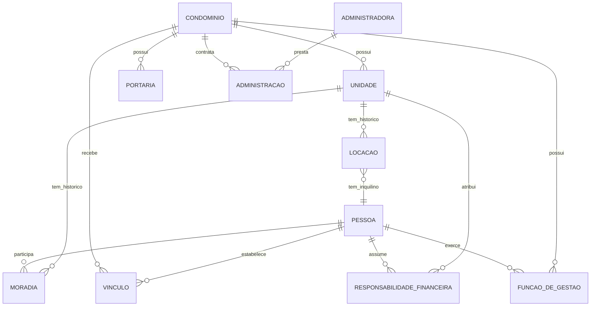

Uma pessoa pode estar em várias unidades e condomínios. Ser proprietário, morador, responsável financeiro ou síndico são relações distintas. O proprietário não residente conserva seus direitos sem receber acesso à rotina privada do inquilino. O único morador habilitado não elimina os demais moradores da unidade.

### 3.2 Rotina e convivência

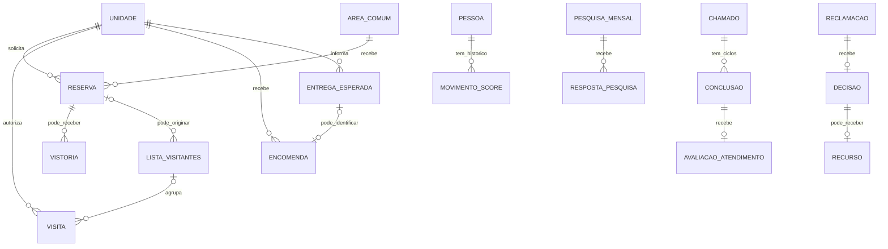

Visitante não é usuário do app. Entrega esperada é aviso, não autorização de entrada. Chamado de serviço e reclamação são processos diferentes. A avaliação de um atendimento não altera score; pesquisa mensal e reclamações seguem suas próprias regras.

### 3.3 Dinheiro e decisões coletivas

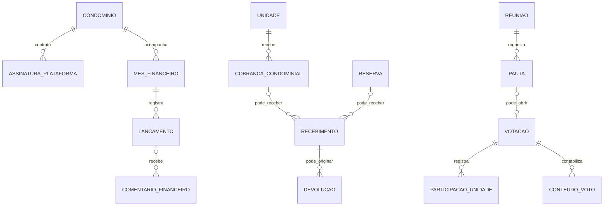

Assinatura da plataforma é receita comercial do CondomiFacil; cobrança condominial e pagamento de reserva são dinheiro do condomínio. O controle financeiro gerencial não substitui contabilidade oficial. O conteúdo do voto é separado da participação da unidade; a substituição do voto do inquilino ainda precisa de uma solução compatível com o sigilo.

### 3.4 Equivalência MER → DER

O MER mantém nomes conceituais. A tabela mostra onde cada conceito aparece no DER (seção 4). Conceitos com o mesmo nome no DER (em `snake_case`) aparecem na última linha.

| Conceito do MER | Entidades do DER | Observação |
| --- | --- | --- |
| `PESSOA` | `usuario` | Identidade global; a relação com cada condomínio vem de `vinculo_condominio` |
| `VINCULO` | `vinculo_condominio` | Vínculo base da pessoa com o condomínio |
| `MORADIA` | `vinculo_unidade` + `episodio_moradia` + `habilitacao_unidade` | Vínculo com a unidade, períodos de residência efetiva e habilitação do único morador habilitado |
| `LOCACAO` | `contrato_locacao` + `versao_locacao` | Contrato e histórico de renovações |
| `FUNCAO_DE_GESTAO` | `mandato` (+ `substituicao`) | Síndico, subsíndico e conselho fiscal; `substituicao` registra a substituição do síndico pelo subsíndico |
| `ADMINISTRACAO` | `administracao_condominio` | Contrato histórico entre administradora e condomínio |
| `VISITA` | `autorizacao_visita` + `visita` + `evento_visita` | Autorização, ocorrência diária e eventos de entrada, saída e desfazer |
| `CONCLUSAO` | `conclusao_chamado` | Uma por ciclo efetivo do chamado, com candidatas superadas preservadas |
| `DECISAO` | `decisao_reclamacao` | Decisão do julgador sobre a reclamação |
| `RECURSO` | `recurso_reclamacao` | Recurso contra a decisão |
| `ASSINATURA_PLATAFORMA` | `assinatura_condominio` (+ `preco_plano`, `fatura_plataforma`, `item_fatura_plataforma`) | Contratação, faixa de preço vigente e faturas da plataforma |
| `COBRANCA_CONDOMINIAL` | `cobranca` | Cobrança emitida à unidade, com `tentativa_pagamento` e `recebimento` nas etapas de pagamento |
| `LANCAMENTO` | `lancamento_financeiro` (+ `origem_lancamento`) | `origem_lancamento` guarda o vínculo restrito com recebimento ou devolução |
| `PARTICIPACAO_UNIDADE` | `voto_registro` | Participação da unidade, sem o conteúdo do voto |
| `CONTEUDO_VOTO` | `voto_conteudo` | Conteúdo do voto, sem ligação com o registro (ver P-03) |
| `RESPONSABILIDADE_FINANCEIRA` | `responsabilidade_financeira` | Mesmo conceito |
| `CONDOMINIO`, `UNIDADE`, `PORTARIA`, `ADMINISTRADORA`, `AREA_COMUM`, `RESERVA`, `VISTORIA`, `LISTA_VISITANTES`, `ENCOMENDA`, `ENTREGA_ESPERADA`, `CHAMADO`, `AVALIACAO_ATENDIMENTO`, `RECLAMACAO`, `MOVIMENTO_SCORE`, `PESQUISA_MENSAL`, `RESPOSTA_PESQUISA`, `RECEBIMENTO`, `DEVOLUCAO`, `MES_FINANCEIRO`, `COMENTARIO_FINANCEIRO`, `REUNIAO`, `PAUTA`, `VOTACAO` | Mesmo nome em `snake_case` (`condominio`, `unidade`, `portaria` etc.) | Equivalência direta. Em `MOVIMENTO_SCORE`, o DER liga o movimento a `perfil_score`, e não diretamente à pessoa |

## 4. DER — modelo lógico e dicionário por domínio

Os blocos abaixo pertencem a **um único modelo**. Uma entidade repetida é a mesma entidade, não uma cópia. O diagrama mostra as relações mais relevantes; o dicionário é a referência completa dos atributos e das FKs, inclusive relações omitidas visualmente. Entidades auxiliares presentes apenas no dicionário fazem parte do DER lógico.

### 4.1 Identidade, acesso e aceites

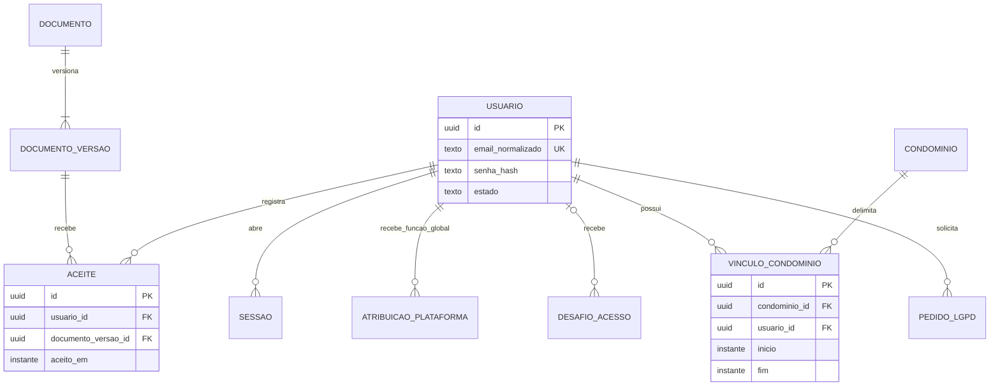

| Entidade / escopo | Atributos essenciais e FKs | Chaves e observações |
| --- | --- | --- |
| `usuario` / G | `nome`, `email_normalizado?`, `senha_hash?`, `estado`, `tema_preferido`, `anonimizado_em?` | Email único enquanto identificável; senha ausente antes da ativação e após anonimização. Identidade não contém condomínio, unidade ou score único embutido. Preservar identificador técnico sem dados pessoais após exclusão, conforme política a validar |
| `atribuicao_plataforma` / G | `usuario_id → usuario`, `papel`, `inicio`, `fim?`, `concedente_usuario_id → usuario`, `concedida_em` | Papel Admin da plataforma ou Suporte; sem sobreposição do mesmo papel/pessoa. Admin concede acessos de suporte conforme PRD; origem administrativa da primeira atribuição global será definida na implantação. Função global não concede leitura operacional nem substitui autorização C |
| `sessao` / G | `usuario_id → usuario`, `renovacao_hash`, `expira_em`, `revogada_em?`, `dispositivo_identificador?` | Segredo de renovação não armazenado puro; rotação é proposta ADR-007. Redefinir senha encerra outras sessões |
| `desafio_acesso` / G | `usuario_id? → usuario`, `destino_protegido`, `finalidade`, `codigo_hash`, `emitido_em`, `expira_em`, `tentativas`, `consumido_em?`, `invalidado_em?` | Ativação/recuperação; código 6 dígitos, 15 min, 5 tentativas, reenvio 60 s invalida anterior. Não é necessário criar usuário para email não cadastrado; resposta externa uniforme |
| `controle_login` / G | `usuario_id? → usuario`, `chave_tentativa_protegida`, `falhas`, `bloqueado_ate?` | Suporta pausa de 15 min após 5 senhas erradas; limites adicionais e retenção ainda não definidos |
| `vinculo_condominio` / C | `usuario_id → usuario`, `inicio`, `fim?`, `estado` | Um vínculo base vigente por pessoa/condomínio (UQ condicional), com funções detalhadas nas entidades seguintes. O vínculo base sozinho não concede acesso a todas as unidades |
| `documento` / G | `tipo`, `condominio_id? → condominio`, `titulo` | Termos, privacidade, regimento, Como funciona e responsabilidade de conta PF. Documento de condomínio tem escopo próprio e RLS; global não deve receber dados de tenant. Só existe com ao menos uma versão publicada, criada na mesma transação (decisão de Pedro em 08/11/2026) |
| `documento_versao` / G com escopo herdado | `documento_id → documento`, `numero`, `conteudo_texto?`, `arquivo_id? → arquivo`, `publicado_em`, `vigente_desde` | UQ `(documento_id, numero)`; exatamente um entre texto e arquivo (XOR); conteúdo imutável após publicação. Arquivo herda o escopo do documento e nunca é URL pública permanente |
| `aceite` / G com escopo herdado | `usuario_id → usuario`, `documento_versao_id → documento_versao`, `aceito_em` | UQ `(usuario_id, documento_versao_id)`; regimento aceito separadamente em cada condomínio; não guardar IP como obrigação não prevista |
| `pedido_lgpd` / G | `usuario_id → usuario`, `tipo`, `solicitado_em`, `estado`, `concluido_em?`, `arquivo_exportacao_id? → arquivo` | Cópia em até 15 dias; arquivo de exportação de identidade global tem acesso exclusivo e escopo próprio. Exportações de vários condomínios exigem autorização por origem |

Documentos, aceites e arquivos de alcance global são exceções explícitas à convenção C: sua autorização deve herdar o escopo do documento/titular. Não se usa `condominio_id = NULL` como permissão para ler todos os condomínios.

### 4.2 Unidades, locação, trabalho e gestão

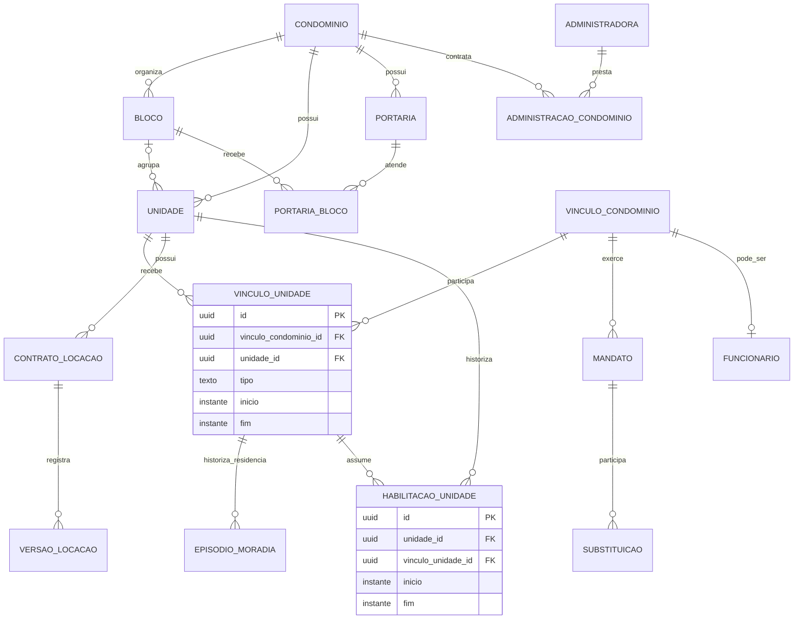

| Entidade / escopo | Atributos essenciais e FKs | Chaves e observações |
| --- | --- | --- |
| `condominio` / G, raiz de escopo | `nome`, `documento_protegido?`, `estado`, `fuso_horario?` | Fuso é proposta ADR-012; identidade do tenant não concede acesso aos seus dados |
| `bloco` / C | `nome`, `estado` | UQ `(condominio_id, nome)` proposta; uso opcional conforme estrutura do condomínio |
| `unidade` / C | `bloco_id? → bloco`, `identificacao`, `fracao_ideal?`, `situacao_ocupacao`, `regularizacao_pendente` | UQ condomínio/bloco/identificação, tratando bloco nulo explicitamente. Situação ocupacional não é inadimplência. Fração ideal positiva quando usada em cobrança |
| `portaria` / C | `nome`, `atende_todos_blocos`, `estado` | Quando atende todos, nenhuma associação de restrição é necessária; caso contrário deve existir ao menos um bloco autorizado |
| `portaria_bloco` / C | `portaria_id → portaria`, `bloco_id → bloco` | PK `(condominio_id, portaria_id, bloco_id)`; sem duplicação |
| `vinculo_unidade` / C | `vinculo_condominio_id → vinculo_condominio`, `unidade_id → unidade`, `tipo`, `inicio`, `fim?`, `contrato_locacao_id? → contrato_locacao`, `responsavel_vinculo_id? → vinculo_unidade` | Tipo: proprietário representante, inquilino ou dependente. `contrato_locacao_id` é obrigatório no tipo inquilino. O contrato é a fonte da identidade do inquilino: `vinculo_condominio_id` do vínculo inquilino deve ser igual a `contrato_locacao.inquilino_vinculo_id`, validado na transação ou por FK composta, sem divergência possível (decisão de Pedro em 08/11/2026). Dependente do inquilino aponta para vínculo responsável e contrato; sem ciclos; mesmo condomínio/unidade. Proprietário representante não é cadastro de todos os coproprietários |
| `episodio_moradia` / C | `vinculo_unidade_id → vinculo_unidade`, `inicio`, `fim?` | Cada período de residência efetiva daquela pessoa/unidade; sem sobreposição para a mesma pessoa/unidade. Permite proprietário conservar vínculo de propriedade enquanto deixa de residir. Retorno inicia episódio novo, sem alterar propriedade nem histórico anterior. Dependente e inquilino têm episódios coerentes com seus vínculos/contrato |
| `habilitacao_unidade` / C | `unidade_id → unidade`, `vinculo_unidade_id → vinculo_unidade`, `inicio`, `fim?`, `registrado_por_id → usuario` | Vínculo deve ser proprietário residente ou inquilino da mesma unidade, vigente. No máximo um habilitado simultâneo; mínimo condicionado à ocupação e exceção RN-CD-18 |
| `contrato_locacao` / C | `unidade_id → unidade`, `inquilino_vinculo_id → vinculo_condominio`, `inicio`, `estado`, `encerrado_em?` | Fonte da verdade de quem é o inquilino (`inquilino_vinculo_id`); o `vinculo_unidade` do tipo inquilino aponta para o contrato e deve coincidir com ele. `inicio` é o início da relação; as datas contratuais vigentes ficam na última `versao_locacao`, e o fim vigente vem dela (não há `fim?` no contrato). `encerrado_em?` registra o encerramento efetivo. Um contrato ativo de moradia por unidade como proposta de integridade para um habilitado. Dependência entre vínculo-unidade e contrato é inserida em transação |
| `versao_locacao` / C | `contrato_locacao_id → contrato_locacao`, `numero`, `inicio_contratual`, `fim_contratual?`, `registrado_por_id → usuario`, `registrado_em`, `motivo?` | UQ `(condominio_id, contrato_locacao_id, numero)`; a última versão fornece as datas contratuais vigentes; `fim_contratual` nulo representa prazo indeterminado; renovações não apagam a data anterior. Não se exige guardar o contrato jurídico completo em arquivo |
| `mandato` / C | `vinculo_condominio_id → vinculo_condominio`, `funcao`, `unidade_referencia_id? → unidade`, `inicio`, `fim?`, `encerramento_motivo?`, `registrado_por_id → usuario` | Síndico morador, síndico profissional, subsíndico ou conselho fiscal; profissional sem unidade. Conselho pode ter vários membros. Mandato eleitoral não é contrato de trabalho |
| `substituicao` / C | `mandato_sindico_id → mandato`, `mandato_subsindico_id → mandato`, `inicio`, `fim?`, `ativado_por_id → usuario`, `desativado_por_id? → usuario`, `motivo?` | Papéis e autorização validados na operação; um período ativo coerente com os mandatos. Subsíndico não ativa/desativa |
| `funcionario` / C | `vinculo_condominio_id → vinculo_condominio`, `setor`, `empresa_nome?`, `admitido_em`, `desligado_em?` | UQ `(condominio_id, vinculo_condominio_id)` para cadastro funcional; preserva histórico. Mudanças de setor devem ser historizadas antes de calcular pesquisa mensal |
| `lotacao_funcionario` / C | `funcionario_id → funcionario`, `setor`, `inicio`, `fim?` | Sem períodos sobrepostos por funcionário; setor atual em `funcionario` é projeção deste histórico |
| `funcionario_portaria` / C | `funcionario_id → funcionario`, `portaria_id → portaria`, `inicio`, `fim?` | Associação de autorização, não escala de trabalho; cardinalidade por turno não definida |
| `empresa_manutencao` / C | `nome`, `servico`, `telefone`, `estado` | Sem FK de login e sem score. Reutilização entre condomínios não implica compartilhamento de cadastro |
| `administradora` / G | `nome`, `documento_protegido?`, `estado` | Organização externa que atende vários condomínios |
| `usuario_administradora` / G | `usuario_id → usuario`, `administradora_id → administradora`, `inicio`, `fim?` | Autoriza funcionário da administradora somente nos contratos de administração válidos |
| `administracao_condominio` / C | `administradora_id → administradora`, `inicio`, `fim?` | N:M histórico; no máximo uma administradora operacional vigente como proposta a validar, não contrato jurídico imposto pelo modelo |

Em condomínios sem blocos, `unidade.bloco_id` fica nulo nesta proposta. Quando blocos são usados, o vínculo passa a ser obrigatório. Isso resolve a representação lógica sem inventar um bloco fictício; a ambiguidade da redação de RN-CD-17 é registrada em P-10.

### 4.3 Planos da plataforma, solicitações e parâmetros

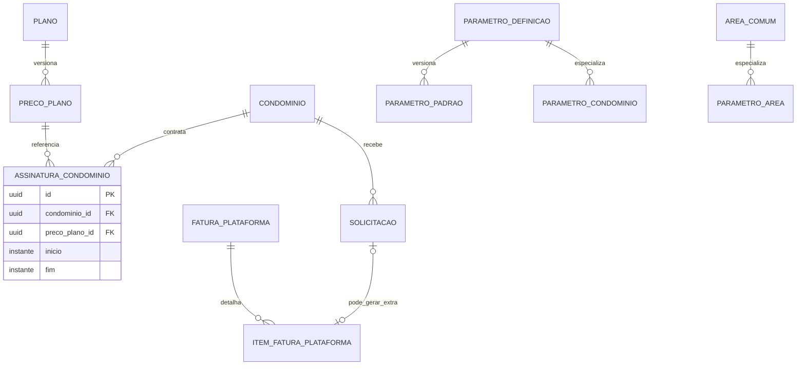

| Entidade / escopo | Atributos essenciais e FKs | Chaves e observações |
| --- | --- | --- |
| `plano` / G | `nome`, `codigo`, `estado` | Essencial e Gestão + Suporte, sem criar planos novos |
| `preco_plano` / G | `plano_id → plano`, `unidades_de`, `unidades_ate?`, `valor_centavos?`, `franquia_solicitacoes?`, `extra_centavos`, `vigente_desde`, `vigente_ate?`, `sob_consulta` | Faixas e versões sem sobreposição no mesmo plano/período. Acima de 600, valor/franquia contratados, não zero |
| `assinatura_condominio` / C | `preco_plano_id → preco_plano`, `inicio`, `fim?`, `ciclo_dia`, `valor_negociado_centavos?`, `franquia_negociada?` | Uma vigente por condomínio; alteração futura inicia no ciclo seguinte. Não recalcular fatura antiga pelo preço novo |
| `fatura_plataforma` / C | `competencia`, `ciclo_inicio`, `ciclo_fim`, `assinatura_id → assinatura_condominio`, `unidades_apuradas`, `franquia_apurada`, `total_centavos`, `estado` | UQ condomínio/ciclo_inicio; intervalo de ciclo válido; registra base comercial. Meio de cobrança da assinatura não está especificado; não confundir com cobrança de unidades |
| `item_fatura_plataforma` / C | `fatura_id → fatura_plataforma`, `tipo`, `descricao`, `quantidade`, `unitario_centavos`, `solicitacao_id? → solicitacao` | Extra por solicitação atendida no máximo uma vez; assinatura/franquia e importação inicial tratados separadamente |
| `solicitacao` / C | `solicitante_id → usuario`, `tipo`, `unidade_id? → unidade`, `descricao`, `estado`, `enviada_em`, `atendida_em?`, `executor_id? → usuario`, `motivo_recusa?`, `importacao_inicial` | Síndico e proprietário nos casos de locação; só atendidas e não implantação contam para franquia. Competência de consumo derivada da conclusão, conforme proposta comercial a validar se mudar o ciclo |
| `autorizacao_suporte` / C | `usuario_id → usuario`, `atribuicao_plataforma_id → atribuicao_plataforma`, `inicio`, `fim?`, `concedido_por_id → usuario` | Exige atribuição global vigente de Suporte da mesma pessoa e Gestão + Suporte vigente no condomínio; validar ambos em cada acesso; concessão pelo Admin da plataforma |
| `acesso_suporte` / C | `autorizacao_id → autorizacao_suporte`, `iniciado_em`, `encerrado_em?`, `finalidade`, `recurso_acessado` | Registro de cada acesso; não registrar conteúdo de reclamação/score, que são proibidos ao suporte |
| `parametro_definicao` / G | `chave`, `tipo`, `minimo?`, `maximo?`, `niveis_permitidos`, `regra_id`, `descricao` | UQ chave; catálogo dos 36 parâmetros RN 13 (inclui `reserva.lembrete_antecedencia_horas`, RN-RE-14, nível condomínio), não um editor irrestrito de regras |
| `parametro_padrao` / G | `definicao_id → parametro_definicao`, `valor_json`, `vigente_desde`, `registrado_por_id → usuario`, `registrado_em` | Histórico imutável de padrões de plataforma; sem empate de vigência para mesma definição |
| `parametro_condominio` / C | `definicao_id → parametro_definicao`, `valor_json`, `vigente_desde`, `registrado_por_id → usuario`, `registrado_em` | Histórico imutável; precede padrão de plataforma quando vigente |
| `parametro_area` / C | `definicao_id → parametro_definicao`, `area_id → area_comum`, `valor_json`, `vigente_desde`, `registrado_por_id → usuario`, `registrado_em` | Só parâmetros de reserva permitidos no nível área; precede condomínio |

O DER separa os três níveis de valor para não exigir `condominio_id` nulo em tabelas operacionais. Reservas, reclamações e votações recebem `regras_aplicadas json` imutável com os valores efetivamente resolvidos na criação, atendendo RN-GE-03. JSON não substitui FK de unidade, pessoa, pagamento ou outro relacionamento estrutural.

### 4.4 Reservas, vistorias e visitantes

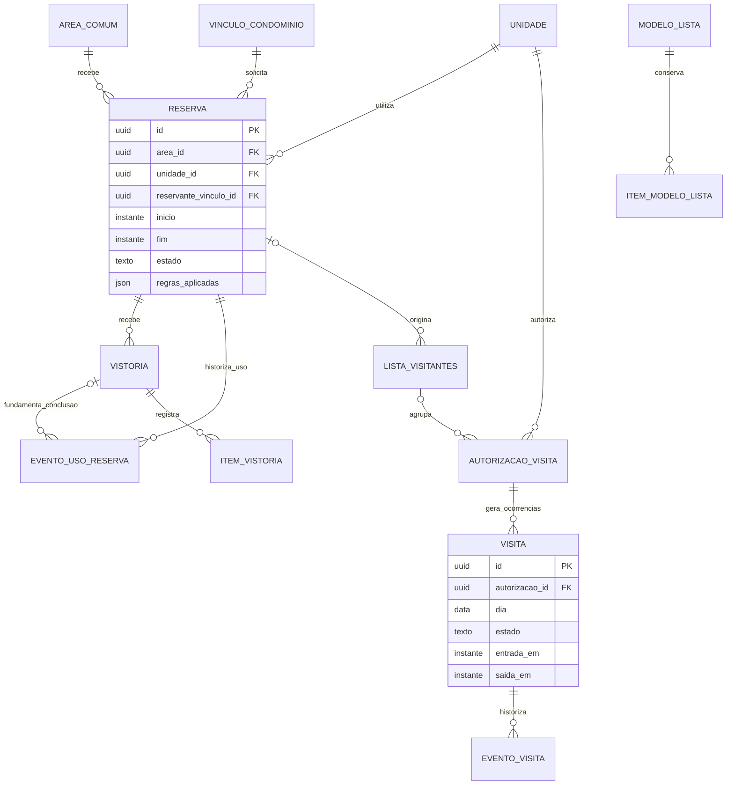

| Entidade / escopo | Atributos essenciais e FKs | Chaves e observações |
| --- | --- | --- |
| `area_comum` / C | `nome`, `tipo_reserva`, `capacidade?`, `estado`, `foto_id? → arquivo` | Paga ou gratuita; valor/regras são versionados. Área paga exige conta recebedora apta |
| `reserva` / C | `area_id → area_comum`, `unidade_id → unidade`, `reservante_vinculo_id → vinculo_condominio`, `episodio_reservante_id → episodio_moradia`, `inicio`, `fim`, `tipo`, `valor_centavos`, `estado`, `criada_em`, `pagar_ate?`, `regras_aplicadas`, `sugestao_lista_dispensa_em?` | Intervalo válido sem sobreposição da área em Aguardando pagamento, Confirmada, Em andamento e Cumprida; Cumprida antecipada conserva o intervalo original até o fim (RN-RE-13). Cancelamento/expiração libera ocupação. Gratuita com valor zero, paga positiva. Episódio vigente deve pertencer ao reservante e à unidade no pedido, preservando contexto da falta e score |
| `cancelamento_reserva` / C | `reserva_id → reserva`, `autor_id → usuario`, `cancelado_em`, `origem`, `motivo?`, `direito_reembolso`, `valor_reembolso_centavos` | UQ reserva; motivo obrigatório quando cancelamento pelo condomínio (RN-CA-05); preserva condição e regra no cancelamento; reembolso efetivo em entidade financeira separada |
| `vistoria` / C | `reserva_id → reserva`, `vistoriador_id → usuario`, `registrada_em`, `resultado`, `nao_comparecimento` | Uso concluído vira Cumprida com checklist/fotos; ausência vira Não comparecimento, inclusive paga. Só faltas gratuitas entram na penalidade. Envio exige internet; múltiplos registros preservam histórico, sem duplicar falta efetiva |
| `evento_uso_reserva` / C | `reserva_id → reserva`, `autor_vinculo_id → vinculo_condominio`, `registrado_em`, `estado_anterior`, `estado_novo`, `vistoria_id? → vistoria` | Portaria inicia Em andamento a partir do início. Cumprida após uso referencia vistoria da portaria/limpeza, sem liberar intervalo original antes do fim. Não comparecimento só de Confirmada após fim previsto; não de Em andamento. Vistoria pertence à mesma reserva. Sem horários reais inventados ou uso em reserva não confirmada |
| `item_vistoria` / C | `vistoria_id → vistoria`, `item`, `resultado`, `observacao?` | Fotos pela associação `anexo_dominio`; resultado com dano pode originar reclamação |
| `lista_visitantes` / C | `unidade_id → unidade`, `criador_vinculo_id → vinculo_condominio`, `nome`, `data`, `inicio_faixa?`, `fim_faixa?`, `local?`, `reserva_id? → reserva`, `estado` | Faixa completa ou ausente; local/motivo opcional conforme RN-VI-11; origem de reserva fixa data/faixa/local. Diagrama admite várias listas por reserva no histórico; restrição de uma ativa é proposta P-10, não regra afirmada |
| `autorizacao_visita` / C | `unidade_id → unidade`, `cadastrante_vinculo_id → vinculo_condominio`, `lista_id? → lista_visitantes`, `nome_visitante_protegido`, `documento_protegido?`, `tipo`, `data_avulsa?`, `inicio_periodo?`, `fim_periodo?`, `inicio_faixa?`, `fim_faixa?`, `estado` | Avulsa, recorrente, hóspede de temporada ou autorização por interfone. Não é identidade global reutilizada entre condomínios. Lista só aceita avulsas |
| `dia_recorrencia_visita` / C | `autorizacao_id → autorizacao_visita`, `dia_semana` | PK `(condominio_id, autorizacao_id, dia_semana)`; só autorização recorrente |
| `visita` / C | `autorizacao_id → autorizacao_visita`, `dia`, `estado`, `entrada_em?`, `saida_em?`, `portaria_entrada_id? → portaria`, `portaria_saida_id? → portaria` | UQ autorização/dia como proposta de ocorrência diária; múltiplas reentradas no mesmo dia não são definidas nas RN (P-10). “Saída não registrada” deixa saída nula |
| `evento_visita` / C | `visita_id → visita`, `tipo`, `porteiro_id → usuario`, `registrado_em`, `recebido_em`, `operacao_sync_id? → operacao_sync`, `evento_desfeito_id? → evento_visita`, `motivo?` | Registro de entrada/saída/desfazer sem apagar fato anterior; idempotência pela operação. Validação de ordem/estado na transação |
| `bloqueio_entrada` / C | `nome_protegido`, `documento_protegido?`, `motivo`, `inicio`, `fim?`, `registrado_por_id → usuario` | Nome/documento não são chaves únicas de pessoa; homônimos exigem tratamento cuidadoso |
| `decisao_bloqueio` / C | `bloqueio_id → bloqueio_entrada`, `visita_id → visita`, `porteiro_id → usuario`, `decisao`, `motivo?`, `registrada_em` | Liberar apesar do bloqueio exige motivo; não há liberação automática por nome semelhante |
| `modelo_lista` / C | `unidade_id → unidade`, `criador_vinculo_id → vinculo_condominio`, `nome`, `criado_em` | Modelo para reutilização; removido quando seu criador sai/troca de unidade, conforme RN-VI-16 |
| `item_modelo_lista` / C | `modelo_id → modelo_lista`, `ordem`, `nome_protegido`, `documento_protegido?` | UQ modelo/ordem; nomes iguais são permitidos |

Uma autorização por interfone representa entrada legítima sem cadastro prévio; ela não obriga o porteiro a preencher uma autorização completa antes de registrar a chegada. Autorização, ocorrência e evento podem ser criados juntos. A conservação de modelos não autoriza manter dados além da política de privacidade definida para esse uso.

### 4.5 Encomendas e entregas esperadas

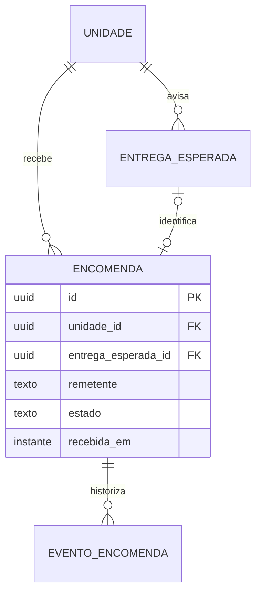

| Entidade / escopo | Atributos essenciais e FKs | Chaves e observações |
| --- | --- | --- |
| `entrega_esperada` / C | `unidade_id → unidade`, `criador_vinculo_id → vinculo_condominio`, `data_esperada`, `descricao?`, `origem?`, `origem_outra?`, `inicio_faixa?`, `fim_faixa?`, `estado` | Descrição até 60 caracteres, origem Outra até 30; faixa com início/fim juntos e fim posterior. Limite configurável de Esperadas por unidade |
| `encomenda` / C | `unidade_id → unidade`, `remetente`, `foto_etiqueta_id? → arquivo`, `porteiro_id → usuario`, `recebida_em`, `estado`, `entrega_esperada_id? → entrega_esperada`, `retirada_em?`, `retirante_vinculo_id? → vinculo_unidade`, `devolvida_em?`, `devolvida_por_id? → usuario` | UQ entrega esperada quando preenchida; unidade deve coincidir. Retirante é morador da unidade, não obrigatoriamente habilitado; devolução só gestão autorizada |
| `evento_encomenda` / C | `encomenda_id → encomenda`, `tipo`, `autor_id → usuario`, `registrado_em`, `unidade_anterior_id? → unidade`, `unidade_nova_id? → unidade`, `entrega_anterior_id? → entrega_esperada` | Histórico de recebimento, correção, retirada e devolução; correção antes de retirada desfaz vínculo da entrega e notifica unidade original |

“iFood/entregador” existe apenas em `entrega_esperada`, com função de aviso. Não pode ser ligado a encomenda, não autoriza entrada e termina em “Encerrada”. Uma encomenda sem aviso continua sendo recebida normalmente. A sugestão de vínculo não é confirmação automática.

### 4.6 Chamados, conclusões e avaliação do atendimento

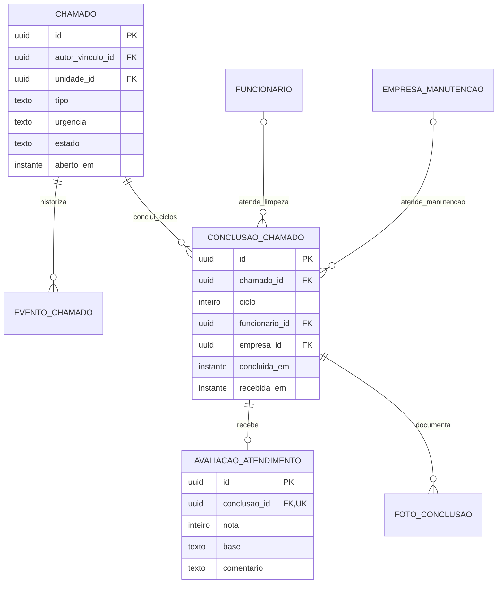

| Entidade / escopo | Atributos essenciais e FKs | Chaves e observações |
| --- | --- | --- |
| `chamado` / C | `autor_vinculo_id → vinculo_condominio`, `unidade_id? → unidade`, `local`, `tipo`, `categoria`, `descricao`, `urgencia`, `estado`, `aberto_em`, `primeira_atualizacao_em?`, `funcionario_atual_id? → funcionario`, `empresa_atual_id? → empresa_manutencao` | Autor pode não ter unidade (porteiro/síndico profissional); tipo limpeza/manutenção; urgência obrigatória sem valor implícito. Empresa atual não substitui histórico das conclusões |
| `evento_chamado` / C | `chamado_id → chamado`, `tipo`, `autor_id → usuario`, `registrado_em`, `estado_anterior?`, `estado_novo?`, `urgencia_anterior?`, `urgencia_nova?`, `empresa_id? → empresa_manutencao`, `conclusao_reaberta_id? → conclusao_chamado` | Reabertura aponta para conclusão anterior; alteração de urgência preserva antes/depois e notifica autor |
| `conclusao_chamado` / C | `chamado_id → chamado`, `ciclo`, `funcionario_id? → funcionario`, `empresa_id? → empresa_manutencao`, `concluida_por_id → usuario`, `concluida_em`, `recebida_em`, `operacao_sync_id? → operacao_sync`, `efetiva_desde?`, `superada_em?`, `janela_avaliacao_inicio`, `janela_avaliacao_fim`, `janela_encerrada_em?` | UQ chamado/ciclo condicionada à conclusão efetiva; candidatas superadas preservadas. Operação de sincronização única por candidata. Limpeza exige funcionário, manutenção exige empresa; exatamente um dos dois. Janela configurada parte da disponibilização em correção tardia |
| `foto_conclusao` / C | `conclusao_id → conclusao_chamado`, `arquivo_id → arquivo`, `ordem` | PK condomínio/conclusão/arquivo; UQ conclusão/ordem; máximo cinco em transação; zero fotos é válido |
| `avaliacao_atendimento` / C | `conclusao_id → conclusao_chamado`, `avaliador_vinculo_id → vinculo_condominio`, `nota`, `base`, `comentario?`, `avaliada_em` | UQ conclusão; nota 1..5, comentário até 500; base Vi fotos só com fotos existentes, ou Conferi pessoalmente. Avaliador deve ser autor elegível do chamado; imutável. Conclusão superada exclui nota dos agregados, preservando autoria/atendente no histórico sem transferência |

Cada reabertura inicia outro ciclo, com nova conclusão e nova janela. Operações concorrentes do mesmo ciclo são candidatas distintas, preservadas no histórico, com no máximo uma conclusão efetiva: a de menor horário do celular, mesmo recebida depois (RN-CH-04; decisão de Pedro em 08/11/2026). A unicidade chamado/ciclo é condicionada à conclusão efetiva, não elimina as candidatas superadas. Reenvio da mesma operação é idempotente. Empate exato e relógio incorreto continuam detalhes técnicos propostos no ADR-014.

Na correção tardia, registrar `efetiva_desde`, `superada_em?` e `janela_avaliacao_inicio` na conclusão; a janela final usa a duração configurada em `chamado.janela_avaliacao_dias` (padrão 7 dias), contada da disponibilização da correção, com lembrete único em 24h. A avaliação superada mantém o vínculo com sua conclusão e atendente original; sua exclusão dos agregados deriva de a conclusão não ser mais efetiva. Ela continua somente no histórico autorizado, nunca é transferida. Uma avaliação por candidata/conclusão continua válida como unicidade histórica; a nova avaliação pertence à nova conclusão efetiva do mesmo ciclo. A correção não desloca as 48h de reabertura.

### 4.7 Reclamações, recursos e score

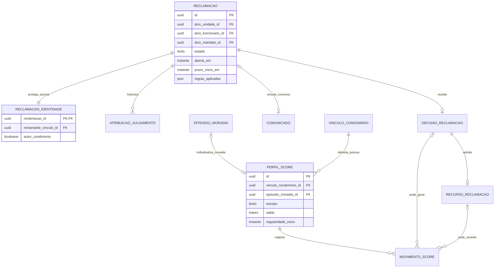

| Entidade / escopo | Atributos essenciais e FKs | Chaves e observações |
| --- | --- | --- |
| `categoria_reclamacao` / G | `nome`, `gravidade_padrao`, `estado` | Catálogo RN 5.4; valor aplicado congelado na reclamação |
| `reclamacao` / C | `categoria_id → categoria_reclamacao`, `descricao`, `data_ocorrencia`, `gravidade_inicial`, `alvo_unidade_id? → unidade`, `alvo_funcionario_id? → funcionario`, `alvo_mandato_id? → mandato`, `vistoria_id? → vistoria`, `estado`, `aberta_em`, `prazo_inicio_em?`, `regras_aplicadas` | Exatamente um alvo entre as três FKs; mandato alvo só síndico/subsíndico. Julgador da reclamação contra unidade do gestor deve considerar essa condição, não apenas tipo alvo |
| `reclamacao_identidade` / C | `reclamacao_id → reclamacao`, `reclamante_vinculo_id? → vinculo_condominio`, `episodio_reclamante_id? → episodio_moradia`, `autor_condominio` | PK `(condominio_id, reclamacao_id)`; pessoa ou condomínio, XOR. Autor humano exige episódio vigente da mesma pessoa e unidade ativa na abertura, preservado para eventual penalidade. Autor condomínio exige ambos os vínculos humanos nulos. Origem vistoria exige autor condomínio, sem atribuir reclamante humano ao vistoriador |
| `atribuicao_julgamento` / C | `reclamacao_id → reclamacao`, `julgador_vinculo_id → vinculo_condominio`, `fundamento_funcao`, `inicio`, `fim?`, `motivo?` | Um julgador vigente por reclamação com atribuição; abertura pode ficar Pendente sem julgador. Troca por término de mandato é caso operacional a definir sem perder histórico |
| `decisao_reclamacao` / C | `reclamacao_id → reclamacao`, `atribuicao_id → atribuicao_julgamento`, `decidida_em`, `resultado`, `motivo_negativa?`, `gravidade_final?`, `justificativa?`, `afetado_vinculo_id? → vinculo_condominio`, `habilitacao_referencia_id? → habilitacao_unidade`, `pontos_aplicados`, `multa_cobranca_id? → cobranca` | UQ reclamação; justifica penalidade ao reclamante e mudança de gravidade. Sem multa automática inventada: FK só quando cobrança de multa efetivamente existir |
| `recurso_reclamacao` / C | `decisao_id → decisao_reclamacao`, `recorrente_vinculo_id → vinculo_condominio`, `solicitado_em`, `justificativa`, `julgador_vinculo_id? → vinculo_condominio`, `estado`, `decidido_em?`, `fundamentacao?` | UQ decisão; recorrente é quem perdeu pontos; 7 dias; sem recurso contra decisão da administradora/conselho; julgador não pode ser parte |
| `perfil_score` / C | `vinculo_condominio_id → vinculo_condominio`, `escopo`, `episodio_moradia_id? → episodio_moradia`, `saldo`, `iniciado_em`, `regularidade_inicio`, `encerrado_em?` | Escopo Moradia exige episódio da mesma pessoa/condomínio e UQ episódio; cada novo episódio começa em 100. Escopo Funcional exige episódio nulo e elegibilidade de funcionário ou síndico profissional sem unidade; no máximo um funcional ativo por pessoa/condomínio. XOR dos escopos; não criar unidade fictícia. Saldo 0..100, históricos e regularidade independentes |
| `movimento_score` / C | `perfil_score_id → perfil_score`, `origem_tipo`, `decisao_id? → decisao_reclamacao`, `recurso_id? → recurso_reclamacao`, `resultado_pesquisa_id? → resultado_pesquisa_funcionario`, `periodo_faltas_id? → apuracao_faltas`, `movimento_revertido_id? → movimento_score`, `registrado_em`, `pontos_regra`, `pontos_efetivos`, `saldo_antes`, `saldo_depois`, `motivo`, `reinicia_regularidade`, `chave_idempotencia` | Origem tipada e compatível; UQ condomínio/chave idempotência; mantém pontos descartados pelos limites distintos dos efetivos. Reversão exige política consistente de recomposição, ver P-11 |
| `apuracao_faltas` / C | `episodio_reservante_id → episodio_moradia`, `trimestre`, `par_numero`, `vistoria_1_id → vistoria`, `vistoria_2_id → vistoria`, `apurada_em` | UQ episódio/trimestre/par; as duas vistorias são de reservas gratuitas daquele mesmo episódio e unidade, sem reusar falta em dois pares. −5 apenas no perfil desse episódio, sem reiniciar regularidade nem somar faltas de outros imóveis |

**Escopo confirmado por Pedro em 08/11/2026:** moradores têm score pessoal por unidade e episódio de moradia, começando em 100 a cada novo vínculo; não é score compartilhado da unidade. Funcionários e síndico profissional sem unidade têm score individual por condomínio (RN-SC-13, RN-SC-14). O score público do síndico morador e as reclamações de gestão usam o episódio da unidade vinculada ao mandato (RN-SC-02); `mandato.unidade_referencia_id` deve identificar esse vínculo vigente, sem selecionar outro imóvel por conveniência. Encerrar residência preserva perfil/movimentos, e o retorno cria outro perfil sem reiniciar scores de outros imóveis. A estrutura acima é proposta lógica para cumprir essas regras; P-01 está resolvida quanto ao produto. Distinguir perda por regra de perda efetiva após limite continua necessário para reversões (P-11).

### 4.8 Pesquisa mensal e comunicação

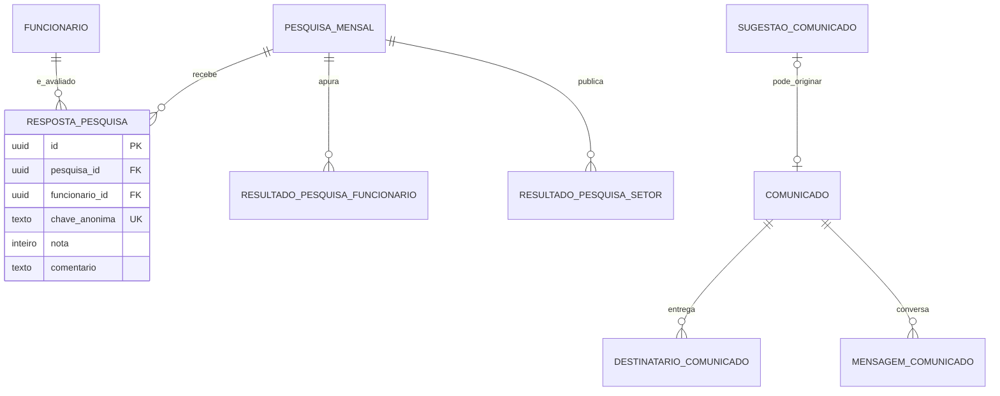

| Entidade / escopo | Atributos essenciais e FKs | Chaves e observações |
| --- | --- | --- |
| `pesquisa_mensal` / C | `competencia`, `aberta_em`, `encerra_em`, `fechada_em?`, `estado` | UQ condomínio/competência; abre primeiro dia e fecha último dia 23h59 |
| `resposta_pesquisa` / C | `pesquisa_id → pesquisa_mensal`, `funcionario_id → funcionario`, `chave_anonima`, `versao_chave`, `nota`, `comentario?` | UQ pesquisa/funcionário/chave anônima. Proposta ADR-010: chave HMAC deriva condomínio+avaliador+funcionário+competência; não contém FK direta de avaliador. Permite localizar própria resposta para editar até fechamento; rotação e LGPD pendentes |
| `resultado_pesquisa_funcionario` / C | `pesquisa_id → pesquisa_mensal`, `funcionario_id → funcionario`, `setor_no_periodo`, `quantidade_respostas`, `media`, `pontos_regra`, `apurado_em` | UQ pesquisa/funcionário; nenhum ajuste se sem respostas. Dados de apuração restritos; não expor identidade indireta por logs |
| `resultado_pesquisa_setor` / C | `pesquisa_id → pesquisa_mensal`, `setor`, `funcionarios_avaliados`, `media_das_medias?`, `publicado_em?` | UQ pesquisa/setor; publicação só com pelo menos 2 funcionários avaliados, cada um com mesmo peso |
| `comunicado` / C | `autor_vinculo_id → vinculo_condominio`, `tipo`, `publico?`, `titulo`, `reclamacao_id? → reclamacao`, `enviado_em` | Geral ou individual; UQ reclamação quando preenchida na proposta de conversa única. Apenas julgador pode iniciar individual vinculado fora da função normal de síndico |
| `destinatario_comunicado` / C | `comunicado_id → comunicado`, `destinatario_vinculo_id → vinculo_condominio`, `entregue_em?`, `lido_em?` | PK condomínio/comunicado/destinatário. Geral materializa público de envio; individual possui destinatário compatível com o alvo |
| `mensagem_comunicado` / C | `comunicado_id → comunicado`, `autor_vinculo_id → vinculo_condominio`, `texto`, `enviada_em` | Texto inicial e respostas; autor autorizado na conversa. Não reenviar nome reclamante ao alvo |
| `sugestao_comunicado` / C | `autor_mandato_id → mandato`, `tipo`, `publico?`, `destinatario_vinculo_id? → vinculo_condominio`, `titulo`, `texto`, `estado`, `enviada_em`, `revisor_vinculo_id? → vinculo_condominio`, `comunicado_resultante_id? → comunicado`, `decidida_em?` | Autoria da sugestão distinta de autoria da publicação; substituição devolve pendentes ao subsíndico |
| `denuncia_conteudo` / C | `denunciante_vinculo_id → vinculo_condominio`, `mensagem_id? → mensagem_comunicado`, `reclamacao_id? → reclamacao`, `avaliacao_id? → avaliacao_atendimento`, `resposta_pesquisa_id? → resposta_pesquisa`, `motivo`, `encaminhado_vinculo_id? → vinculo_condominio`, `estado`, `criada_em` | Exatamente uma origem tipada acessível ao denunciante; destinatário segue regra de conflito do RN-RC-13. Lista de conteúdos denunciáveis deve acompanhar novos tipos |

Separar pesquisa mensal e avaliação de atendimento impede somar duas penalidades pelo mesmo mecanismo. Em pesquisa, o funcionário vê suas notas e comentários sem autor; em atendimento, a leitura do funcionário usa projeção sem chamado/unidade/local/autor e limiar de três avaliações. Os mínimos dois e três têm finalidades diferentes.

### 4.9 Reuniões, eleições e votos

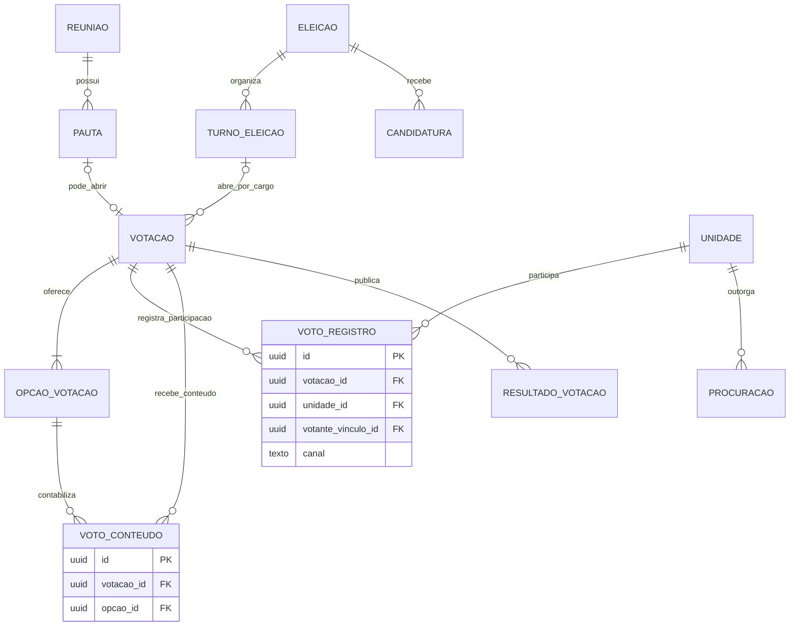

**Submodelo parcialmente bloqueado:** o diagrama separa participação e conteúdo como pede SEG-06. Ele não acrescenta ligação entre `voto_registro` e `voto_conteudo`. Portanto, a proposta ADR-009, sozinha, **não oferece operação viável para substituir um voto específico do inquilino** conforme RN-VO-18. O desenho dessa substituição não está validado; ver P-03. Não implementar o diagrama como se essa regra estivesse resolvida.

| Entidade / escopo | Atributos essenciais e FKs | Chaves e observações |
| --- | --- | --- |
| `reuniao` / C | `convocante_mandato_id → mandato`, `titulo`, `convocada_em`, `inicio_previsto`, `fim_efetivo?`, `local`, `estado`, `ata_arquivo_id? → arquivo`, `presenca_arquivo_id? → arquivo` | Arquivos PDF anexados após encerramento, sem contabilidade/documentação oficial gerada pelo app |
| `pauta` / C | `reuniao_id → reuniao`, `ordem`, `titulo`, `descricao`, `tipo`, `envolve_despesa_extraordinaria` | UQ reunião/ordem; tipo informativa ou com votação; extraordinária vem marcada por padrão |
| `eleicao` / C | `convocante_mandato_id → mandato`, `candidaturas_inicio`, `candidaturas_fim`, `estado`, `regras_aplicadas` | Eleição de síndico morador/subsíndico; não contratação de profissional |
| `candidatura` / C | `eleicao_id → eleicao`, `candidato_vinculo_id → vinculo_condominio`, `unidade_referencia_id → unidade`, `cargo`, `inscrita_em`, `estado`, `motivo_inelegibilidade?` | UQ eleição/cargo/candidato; elegibilidade registrada; inquilino pode se candidatar salvo convenção |
| `turno_eleicao` / C | `eleicao_id → eleicao`, `numero`, `turno_anterior_id? → turno_eleicao`, `abre_em`, `encerra_em?` | UQ eleição/número; empate abre segundo turno entre empatados em até 7 dias |
| `votacao` / C | `pauta_id? → pauta`, `turno_id? → turno_eleicao`, `cargo?`, `abre_em`, `encerra_em?`, `estado`, `quorum_regra`, `regras_aplicadas` | Exatamente uma origem pauta ou turno; uma votação por pauta, uma por cargo/turno. Só abre com no mínimo 2 opções, criadas na mesma transação; as opções não mudam depois de aberta (decisão de Pedro em 08/11/2026). Sem resultado parcial acessível |
| `opcao_votacao` / C | `votacao_id → votacao`, `texto`, `ordem`, `candidatura_id? → candidatura` | UQ votação/ordem; candidatura só em eleição e do cargo/turno elegível. Mínimo de 2 por votação, criadas junto com ela; imutáveis após a abertura |
| `procuracao` / C | `unidade_id → unidade`, `reuniao_id? → reuniao`, `eleicao_id? → eleicao`, `outorgante_vinculo_id → vinculo_condominio`, `procurador_vinculo_id → vinculo_condominio`, `inicio`, `fim?`, `revogada_em?` | Proposta de escopo por reunião ou eleição, XOR. Proprietário outorga antes do voto; procurador do mesmo condomínio e no máximo 1 unidade além das próprias |
| `voto_registro` / C | `votacao_id → votacao`, `unidade_id → unidade`, `votante_vinculo_id → vinculo_condominio`, `canal`, `registrador_vinculo_id? → vinculo_condominio`, `procuracao_id? → procuracao`, `qualidade_votante`, `registrado_em`, `substituido_em?` | UQ votação/unidade para participação efetiva; histórico de tentativas/substituição sem conteúdo. Registro presencial exige registrador autorizado |
| `voto_conteudo` / C | `votacao_id → votacao`, `opcao_id → opcao_votacao` | Opção deve pertencer à mesma votação (FK composta votação/opção). Sem usuário, unidade, horário preciso ou FK para registro. Identificador aleatório, como proposta ADR-009; versão UUID ordenável não adequada aqui |
| `resultado_votacao` / C | `votacao_id → votacao`, `opcao_id → opcao_votacao`, `quantidade`, `apurado_em`, `publicado_em` | UQ votação/opção; leitura só após fechamento. Estado da votação distingue Encerrada, Sem quórum e Empate conforme RN, sem inventar consequência |
| `resultado_eleicao` / C | `eleicao_id → eleicao`, `cargo`, `candidatura_id → candidatura`, `turno_id → turno_eleicao`, `classificacao`, `mandato_resultante_id? → mandato` | Guarda classificação para substituir subsíndico da mesma unidade do síndico; não registrar profissional como eleito |

Uma votação por pauta evita limitar a unidade a um voto na reunião inteira. Procurador não multiplica o voto da unidade. Qualidade do votante permite saber se a participação foi de inquilino, proprietário ou procurador, sem guardar sua opção junto. Resolver P-03 pode alterar a parte de votos; reunião, pauta, candidatura, mandato e critérios de elegibilidade permanecem úteis.

Além do mesmo condomínio, as referências de eleição devem conservar o mesmo contexto: a candidatura de uma opção pertence à eleição e ao cargo da votação, e precisa estar habilitada para aquele turno. Resultado por opção referencia a mesma votação da opção; resultado eleitoral referencia candidatura e turno da mesma eleição e cargo. A procuração usada pelo registro deve cobrir a unidade e a reunião/eleição da votação, e seu procurador deve ser o votante. Essas invariantes exigem FKs compostas adicionais ou validação transacional; o tenant, sozinho, não as garante.

### 4.10 Cobrança condominial e pagamentos

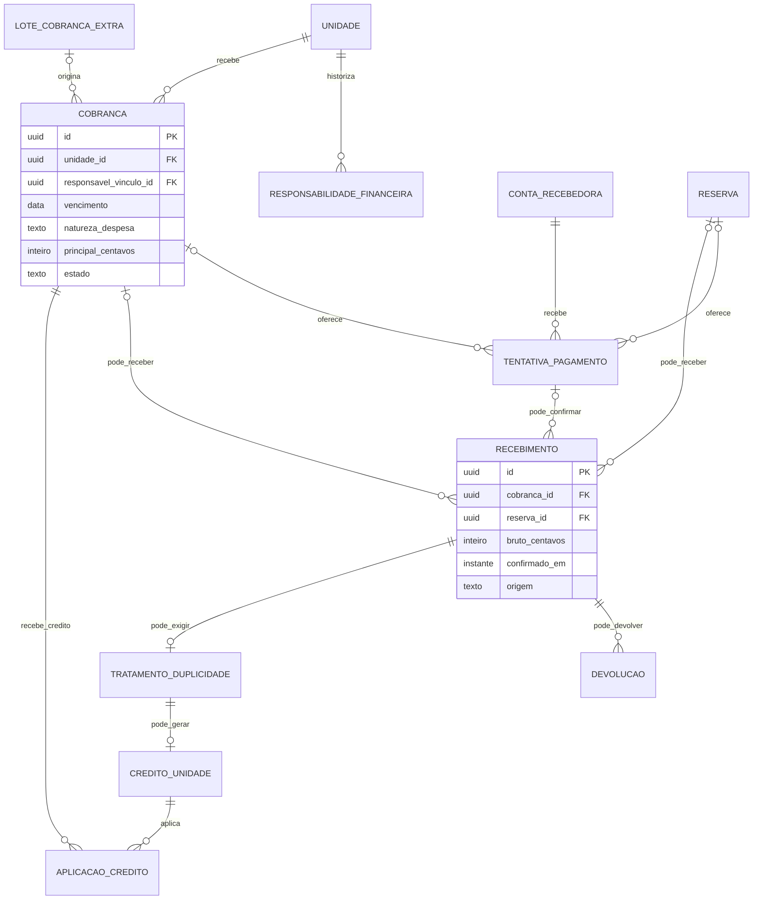

| Entidade / escopo | Atributos essenciais e FKs | Chaves e observações |
| --- | --- | --- |
| `responsabilidade_financeira` / C | `unidade_id → unidade`, `responsavel_vinculo_id → vinculo_condominio`, `natureza_despesa`, `inicio`, `fim?`, `registrado_por_id → usuario` | Sem sobreposição por unidade/natureza: ordinária ou extraordinária. Na emissão congela responsável; mudança não transfere silenciosamente dívida anterior |
| `configuracao_cobranca` / C | `ativa`, `criterio_valor`, `valor_base_centavos?`, `vigente_desde`, `vigente_ate?`, `conta_recebedora_id → conta_recebedora` | Uma versão vigente; conta necessária quando ativo. Parâmetros de vencimento/multa/juros vêm catálogo e são congelados na emissão |
| `meio_cobranca_aceito` / C | `configuracao_id → configuracao_cobranca`, `meio` | PK condomínio/configuração/meio; ao menos um quando ativo: boleto com Pix, Pix ou cartão |
| `valor_taxa_unidade` / C | `unidade_id → unidade`, `configuracao_id → configuracao_cobranca`, `valor_centavos?`, `fracao_aplicada?`, `inicio`, `fim?` | Define valor fixo ou regra por fração ideal; fórmula e arredondamento a detalhar sem substituir valor emitido |
| `conta_recebedora` / C | `titular_tipo`, `titular_nome_protegido`, `documento_protegido`, `dados_bancarios_protegidos`, `provedor?`, `referencia_subconta_externa?`, `estado_verificacao`, `inicio`, `fim?`, `aceite_pf_id? → aceite` | Uma conta vigente compartilhada por reservas e taxas; PF exige aceite do titular; estados do provedor são proposta até escolher gateway |
| `lote_cobranca_extra` / C | `solicitacao_id? → solicitacao`, `descricao`, `natureza_despesa`, `finalidade`, `valor_centavos`, `vencimento`, `criado_por_id → usuario`, `criado_em` | Unidades destinatárias geram cobranças separadas. Multa/fundo/obra não são a mesma coisa que ordinária/extraordinária |
| `cobranca` / C | `unidade_id → unidade`, `responsavel_vinculo_id → vinculo_condominio`, `responsabilidade_id? → responsabilidade_financeira`, `competencia`, `origem`, `lote_extra_id? → lote_cobranca_extra`, `cobranca_substituida_id? → cobranca`, `natureza_despesa`, `principal_centavos`, `emitida_em`, `vencimento`, `estado`, `regras_aplicadas`, `cancelada_em?`, `cancelada_por_id? → usuario`, `motivo_cancelamento?` | UQ unidade/competência para origem mensal, não para extras. Reemissão de multa ao proprietário deve ligar original, controlar cancelamento/saldo e impedir cobrar duas vezes |
| `tentativa_pagamento` / C | `cobranca_id? → cobranca`, `reserva_id? → reserva`, `conta_recebedora_id → conta_recebedora`, `meio`, `valor_centavos`, `criada_em`, `expira_em?`, `estado`, `referencia_externa?`, `chave_idempotencia` | Exatamente uma origem cobrança/reserva; várias tentativas por origem; UQ conta/chave idempotência e conta/referência externa quando preenchida. Reservas só Pix/cartão; boleto é para cobrança. Sem número completo/cartão/CVV |
| `recebimento` / C | `cobranca_id? → cobranca`, `reserva_id? → reserva`, `tentativa_id? → tentativa_pagamento`, `origem`, `conta_recebedora_id? → conta_recebedora`, `provedor?`, `referencia_transacao_externa?`, `confirmado_em`, `bruto_centavos`, `taxa_centavos`, `principal_centavos`, `multa_atraso_centavos`, `juros_centavos`, `desconto_centavos`, `comprovante_id? → arquivo`, `registrado_por_id? → usuario`, `motivo_manual?` | XOR cobrança/reserva; provedor/conta/transação obrigatórios e únicos quando externa. Manual exige comprovante/motivo/autor. Múltiplos recebimentos da mesma cobrança são possíveis para detectar duplicidade; não somar repetição de webhook como novo pagamento |
| `evento_gateway` / C após resolução confiável | `provedor`, `conta_recebedora_id → conta_recebedora`, `id_evento_externo`, `referencia_transacao`, `recebido_em`, `assinatura_verificada`, `estado_processamento`, `processado_em?`, `erro_sanitizado?`, `conteudo_restrito` | UQ provedor/conta/id evento, ou provedor/id quando garantido pelo provedor; não confiar em condomínio enviado no corpo. Recepção sem correlação válida vai para `evento_gateway_quarentena` (global), não para esta tabela |
| `evento_gateway_quarentena` / G | `provedor`, `id_evento_externo?`, `recebido_em`, `assinatura_verificada`, `motivo`, `conteudo_minimo_restrito`, `estado`, `correlacionado_em?`, `evento_gateway_id? → evento_gateway` (referência de correlação), `descartado_em?` | Motivo: assinatura inválida, conta desconhecida ou transação desconhecida. Estado: Em quarentena, Correlacionado ou Descartado. UQ `(provedor, id_evento_externo)` quando houver. Fora do RLS dos condomínios; lida só pelo backend e pelo Admin da plataforma. Guarda o mínimo necessário, nunca dados de cartão. Retenção curta, prazo a definir em P-09. Ao correlacionar, cria o `evento_gateway` no condomínio certo, sem confiar em condomínio enviado no corpo, e marca Correlacionado (decisão de Pedro em 08/11/2026). Como a referência liga tabela global a tabela de condomínio, não é FK composta de tenant; a leitura da referência segue a barreira do condomínio |
| `devolucao` / C | `recebimento_id → recebimento`, `cancelamento_reserva_id? → cancelamento_reserva`, `valor_centavos`, `motivo`, `solicitada_em`, `estado`, `concluida_em?`, `referencia_externa?`, `comprovante_id? → arquivo`, `chave_idempotencia` | Soma devolvida não supera recebido; não exige uma devolução por cobrança. Reembolso de reserva e devolução duplicada usam finalidade distinta |
| `tratamento_duplicidade` / C | `recebimento_id → recebimento`, `decidido_por_id → usuario`, `decidido_em`, `destino`, `devolucao_id? → devolucao`, `motivo` | UQ recebimento; destino Devolução ou Crédito, sem ambos. Aviso à administradora e decisão auditada |
| `credito_unidade` / C | `tratamento_id → tratamento_duplicidade`, `unidade_id → unidade`, `valor_centavos`, `criado_em`, `estado` | UQ tratamento; crédito derivado da duplicidade, não acordo de parcelamento |
| `aplicacao_credito` / C | `credito_id → credito_unidade`, `cobranca_id → cobranca`, `valor_centavos`, `aplicada_em` | Mesma unidade; soma aplicações ≤ crédito e ≤ saldo da cobrança, sem nova receita de caixa. Regra para troca de responsável antes do abatimento pendente P-11 |
| `conciliacao_pagamentos` / C | `conta_recebedora_id → conta_recebedora`, `dia`, `executada_em`, `estado` | Execução diária; idempotência por execução lógica |
| `divergencia_pagamento` / C | `conciliacao_id → conciliacao_pagamentos`, `recebimento_id? → recebimento`, `referencia_externa?`, `tipo`, `estado`, `resolvida_por_id? → usuario`, `resolvida_em?`, `motivo?` | Externa ainda não conhecida é situação legítima; não criar recebimento sem origem confiável |

Confirmação, recusa e expiração são fatos distintos. A plataforma não armazena dados de cartão e não é dona do dinheiro recebido. Um pagamento confirmado deve conciliar principal, multas/juros, desconto e taxa sem duplicar a receita: nesta proposta, bruto = principal + multa + juros − desconto, e líquido = bruto − taxa. A categoria do principal recebe seu valor efetivo após desconto, sem reconhecer o desconto como receita. Se o valor externo divergir, registrar divergência antes de forçar baixa.

Quando um recebimento referencia uma tentativa, ambos devem apontar **à mesma cobrança ou reserva e à mesma conta recebedora**; não basta cada FK pertencer ao tenant. Quando a devolução aponta para cancelamento de reserva, esse cancelamento deve ser da reserva que originou o recebimento. O tratamento de duplicidade e sua devolução ou crédito também devem derivar do mesmo recebimento, sem dupla destinação. Essas igualdades são verificadas na transação e reforçadas por chaves compostas quando couber.

### 4.11 Finanças gerenciais do condomínio

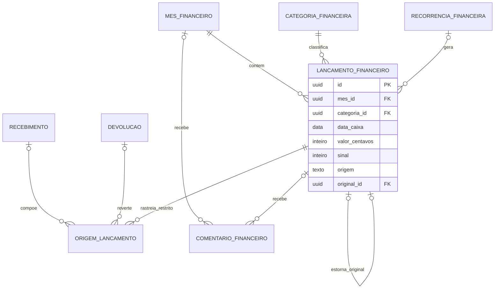

| Entidade / escopo | Atributos essenciais e FKs | Chaves e observações |
| --- | --- | --- |
| `mes_financeiro` / C | `competencia`, `estado`, `fechado_em?`, `fechado_por_id? → usuario`, `fechamento_origem` | UQ condomínio/competência; aberto/fechado, sem reabertura; fechamento automático tem autor sistema identificável, não usuário fictício |
| `categoria_financeira` / G | `codigo`, `nome`, `natureza`, `exige_subservico` | Categorias fixas RN-FI-32; sem plano de contas por administradora aprovado |
| `recorrencia_financeira` / C | `tipo`, `categoria_id → categoria_financeira`, `subservico?`, `valor_centavos`, `fornecedor_ou_origem`, `descricao?`, `dia_mes`, `inicio`, `fim?`, `criada_por_id → usuario` | Valor fixo e dia 1..31; geração usa último dia quando mês curto; fim só interrompe futuro |
| `lancamento_financeiro` / C | `mes_id → mes_financeiro`, `categoria_id → categoria_financeira`, `tipo`, `origem`, `data_caixa`, `valor_centavos`, `sinal`, `fornecedor_ou_origem?`, `subservico?`, `descricao?`, `comprovante_id? → arquivo`, `recorrencia_id? → recorrencia_financeira`, `original_id? → lancamento_financeiro`, `estado`, `motivo_estorno?`, `registrado_por_id? → usuario`, `registrado_em` | Magnitude >0; sinal +1 normal, −1 estorno, multiplicado pela natureza receita/despesa. UQ recorrência/competência para gerados; UQ original para estorno administrativo. Categoria e tipo do estorno iguais ao original, efeito oposto |
| `origem_lancamento` / C, acesso restrito | `lancamento_id → lancamento_financeiro`, `recebimento_id? → recebimento`, `devolucao_id? → devolucao`, `componente`, `valor_centavos`, `data_caixa`, `chave_evento_origem` | XOR recebimento/devolução; UQ origem/componente/efeito; impede duplicação de principal, multa, juros e taxa. Sem acesso do conselho/síndico à ligação individual |
| `comentario_financeiro` / C | `mes_id? → mes_financeiro`, `lancamento_id? → lancamento_financeiro`, `autor_vinculo_id → vinculo_condominio`, `texto`, `criado_em` | Exatamente um alvo; autor síndico/sub substituto/conselho; imutável, inclusive em mês fechado; não aprova contas |
| `exportacao_financeira` / C | `solicitante_vinculo_id → vinculo_condominio`, `filtros_json`, `formato`, `solicitada_em`, `concluida_em?`, `estado`, `arquivo_id? → arquivo` | CSV/PDF do mesmo filtro/projeção autorizada, sem unidade/responsável; exportação de cobrança individual é outro recurso, exclusivo da administradora |

**Granularidade proposta:** lançamentos avulsos são individuais. Receitas automáticas são organizadas por **dia de caixa, categoria, natureza e efeito**, com vínculos restritos em `origem_lancamento`; a leitura gerencial as agrega no período e mostra quantidade de cobranças pagas distintas. A categoria “Multas e juros por atraso” pode ter vários componentes sem contar a mesma cobrança duas vezes. Reservas pagas também são agregadas sem unidade/reservante no painel.

Essa proposta de agrupamento diário preserva data de caixa e filtros sem expor o vínculo individual. **Difere do agrupamento só por categoria/mês sugerido no ADR-010**, que ainda não foi aceito. A decisão física entre tabela agregada e projeção sobre fontes restritas fica em P-08. Se a projeção for materializada, sua atualização e o registro da origem precisam ser atômicos ou ter reconstrução idempotente verificável; não se pode perder uma receita por falha intermediária.

Reembolso confirmado gera novo efeito negativo na categoria da receita na data da devolução, inclusive quando o mês da receita já fechou. Não altera o valor da receita histórica. Isso é diferente do estorno administrativo integral de um lançamento avulso: não se oferece botão de estorno para lançamento automático, nem se marca um agregado inteiro como Estornado por uma única devolução parcial de sua composição. A origem individual mantém o vínculo necessário à conciliação.

Estorno administrativo só em mês fechado, com motivo e mês corrente aberto; o original pode mudar apenas o estado para Estornado na transação de correção. Não se estorna um estorno nem um original já estornado. O caso de devolução parcial depende dos recursos do provedor e deve continuar separado desse mecanismo integral.

### 4.12 Arquivos, notificações, auditoria e sincronização

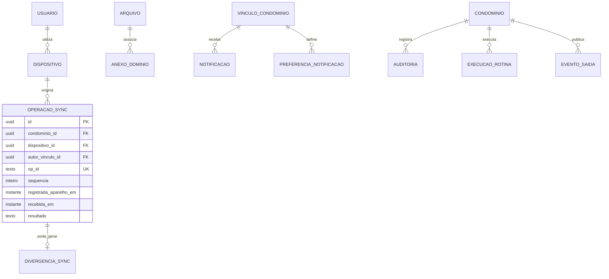

| Entidade / escopo | Atributos essenciais e FKs | Chaves e observações |
| --- | --- | --- |
| `arquivo` / C, ou G explicitamente classificado | `escopo`, `condominio_id? → condominio`, `titular_usuario_id? → usuario`, `chave_objeto`, `tipo_midia`, `tamanho_bytes`, `hash_conteudo`, `classificacao`, `criado_em`, `estado`, `anonimizado_em?` | Classificação/escopo coerentes; sem URL pública. G apenas para documentos globais ou exportação pessoal autorizada, não para contornar RLS |
| `anexo_dominio` / C | `arquivo_id → arquivo`, `reserva_id? → reserva`, `vistoria_id? → vistoria`, `reclamacao_id? → reclamacao`, `chamado_id? → chamado`, `ordem?` | Exatamente um alvo tipado; demais arquivos usam FKs específicas do dicionário. Arquivo pertence ao mesmo condomínio e herda a restrição do alvo, não só do dono do upload |
| `dispositivo` / G | `usuario_id → usuario`, `identificador_instalacao`, `plataforma`, `token_push_protegido?`, `ultima_atividade`, `revogado_em?` | Push e credencial de sessão não são a mesma coisa; logout revoga associação/token necessário; instalação em aparelho compartilhado não prova autor do registro |
| `operacao_sync` / C | `op_id`, `dispositivo_id → dispositivo`, `autor_vinculo_id → vinculo_condominio`, `sequencia`, `tipo`, `registrada_aparelho_em`, `recebida_em`, `carga_restrita`, `resultado`, `processada_em?`, `hash_carga` | UQ condomínio/op_id; reapresentação com carga diferente é recusada; sequência por fila/aparelho/autor a detalhar no protocolo. Idempotência de efeito deve permanecer durante janela de reenvio |
| `divergencia_sync` / C | `operacao_id → operacao_sync`, `visita_id → visita`, `motivo`, `estado`, `criada_em`, `confirmada_por_vinculo_id? → vinculo_condominio`, `confirmada_em?` | UQ operação; conclusão somente após confirmação do porteiro de contato por interfone; sem notificação ao síndico |
| `preferencia_notificacao` / C | `vinculo_id → vinculo_condominio`, `tipo`, `habilitada` | UQ vínculo/tipo; `tipo` inclui o lembrete de reserva (RN-RE-14, opcional, padrão ligado); decisão de reclamação e divergência do porteiro são obrigatórias; cobrança em atraso obrigatória ainda não é regra |
| `notificacao` / C | `destinatario_vinculo_id → vinculo_condominio`, `tipo`, `referencia_restrita`, `texto_seguro`, `criada_em`, `lida_em?`, `chave_agrupamento?`, `chave_idempotencia` | Referência de navegação não concede autorização; texto não expõe reclamante/inadimplência. Primeira chegada e resumo de lista a cada 15 min têm agrupamento próprio |
| `entrega_notificacao` / C | `notificacao_id → notificacao`, `dispositivo_id? → dispositivo`, `canal`, `tentativa`, `estado`, `enviada_em?`, `recibo_externo?`, `erro_sanitizado?` | UQ notificação/canal/dispositivo/tentativa; falha de push não apaga notificação interna |
| `auditoria` / C | `ator_usuario_id? → usuario`, `ator_sistema?`, `papel_efetivo`, `acao`, `entidade_tipo`, `entidade_referencia`, `antes_sanitizado?`, `depois_sanitizado?`, `motivo?`, `registrada_em`, `correlacao_operacao` | Exatamente uma origem ator humano/sistema; referência é identificador histórico, não FK polimórfica de negócio. Sem voto/reclamante/salário em carga genérica; acesso respeita domínio e retenção pendente |
| `auditoria_plataforma` / G | `ator_usuario_id → usuario`, `acao`, `entidade_tipo`, `entidade_referencia`, `antes_sanitizado?`, `depois_sanitizado?`, `registrada_em` | Só alterações globais; não replicar conteúdo operacional dos condomínios |
| `execucao_rotina` / C | `rotina`, `competencia_ou_janela`, `iniciada_em`, `concluida_em?`, `estado`, `chave_idempotencia`, `erro_sanitizado?` | Execuções das 21 rotinas RN 14; histórico de tentativas não pode repetir efeito de negócio |
| `evento_saida` / C | `tipo`, `entidade_referencia`, `carga_minima_restrita`, `criado_em`, `publicado_em?`, `chave_idempotencia` | Proposta de outbox ADR-006; inserido com mudança de domínio; consumidores idempotentes, sem pressupor entrega exatamente uma vez |

**Banco central e aparelho são diferentes.** `operacao_sync` representa recibos/processamento central; não é a própria fila local. No aparelho existem cópia criptografada do dia, fila de operações e arquivos pendentes, separados por usuário/condomínio. RN-OF-06 exige apagar a cópia no fim do dia/logout; retenção de operações ainda não enviadas precisa ser compatibilizada com essa regra (P-07). Nunca se promete que o servidor apaga imediatamente um aparelho sem conexão.

## 5. Regras de integridade e operações indivisíveis

O diagrama não basta para cumprir o produto. As seguintes invariantes precisam de validação no serviço e, onde possível, restrição/transação no banco. Mecanismos concretos como exclusão de intervalos, índices condicionais e procedimentos são propostas para o modelo físico.

| Invariante | Garantia lógica proposta | Fonte |
| --- | --- | --- |
| Nenhuma FK aponta para outro condomínio | FK composta e UQ condomínio/id, inclusive anexos, decisões, crédito e operações offline | SEG-05; RNF-11; arq. 4.2 |
| Habilitado único e coerente | Intervalos sem sobreposição por unidade; pessoa residente/proprietário ou inquilino; exatamente um em unidade ocupada regular; zero desocupada; falta transitória RN-CD-18 com bloqueios e alerta | RN-CD-04, RN-CD-18, RN-CD-24 |
| Histórico de locação preservado | Versão anterior imutável; renovação/encerramento, vínculos dependentes, cancelamentos e reembolsos gerados sem exclusão do passado | RN-CD-07, RN-CD-20 a RN-CD-25 |
| Inquilino e datas da locação sem divergência | Inquilino do `vinculo_unidade` = `contrato_locacao.inquilino_vinculo_id` (validado na transação ou por FK composta); datas contratuais vigentes = última `versao_locacao`, sem data duplicada no contrato | Decisão de Pedro em 08/11/2026; RN-CD-20 a RN-CD-25 |
| Mudança de função não muda autoria passada | Mandatos/vínculos com vigência; referência do autor em cada ato; retirada imediata da permissão corrente | RN-CD-08, RN-CD-12, RN-CD-27, RN-CD-28 |
| Reservas não colidem | Exclusão de intervalo por área para estados que bloqueiam horário, sob concorrência; cancelar/expirar libera a ocupação na mesma transação | RN-RE-03, RN-RE-04, RN-CA-06 |
| Limite mensal não sofre corrida | Apurar reservas que contam e inserir nova reserva com serialização da unidade/área/mês; canceladas não contam | RN-RE-07 |
| Score e atraso têm efeitos distintos | Bloqueio pessoal de gratuitas por score; bloqueio da unidade por atraso só se configurado; preservar reservas confirmadas | RN-SC-09, RN-SC-10, RN-RE-11 |
| Lista vinculada acompanha reserva | Cancelamento cancela autorizações futuras da lista; quem já entrou preserva histórico; nomes iguais permitidos; limite e capacidade com efeitos diferentes | RN-VI-12 a RN-VI-17 |
| Entrada offline não duplica | Recibo de operação único, processamento e evento de visita atômicos; divergência registra fato ocorrido e confirmação posterior | RN-OF-03 a RN-OF-05 |
| Entrega não autoriza acesso | iFood só aviso, vínculo encomenda/entrega opcional e coerente com unidade; correção desfaz vínculo antes de notificar | RN-EN-09 a RN-EN-13 |
| Conclusão/avaliação por ciclo | Uma conclusão aceita por ciclo; avaliação única, autor elegível, base válida, dentro da janela; reabrir encerra janela anterior sem apagar avaliação feita | RN-CH-04, RN-CH-14 a RN-CH-21 |
| Reclamação tem um alvo real | XOR das FKs; conversa com representante correto; julgador atribuído conforme conflito de interesse; só decisão libera movimento de pontos | RN-RC-02 a RN-RC-05, RN-RC-11, RN-SC-05 |
| Recurso nunca julgado pela parte | Unicidade por decisão, recorrente afetado, sete dias, julgador elegível; recurso aceito e devolução de pontos na mesma transação | RN-RC-07, RN-RC-14; RN-SC-12 |
| Saldo score limitado e reproduzível | Movimento com saldo antes/depois, limite 0..100, origem única e controle da regularidade; processamento concorrente serializado por perfil | RN-SC-01, RN-SC-08, RN-SC-12 |
| Pesquisa fecha uma vez em efeito | Uma resposta por pessoa/funcionário/mês por chave derivada; fechamento bloqueia edição, calcula média das médias e movimentos idempotentes | RN-PE-01 a RN-PE-09 |
| Documento e votação nascem completos | `documento` só existe com ao menos uma `documento_versao` publicada; `votacao` só abre com no mínimo 2 `opcao_votacao`, ambos criados na mesma transação; opções imutáveis após a abertura | Decisão de Pedro em 08/11/2026 |
| Um voto efetivo por pauta/unidade | Unicidade votação/unidade, elegibilidade atual, procurador autorizado e escopo coerente. Substituição ainda bloqueada por P-03 | RN-VO-01, RN-VO-08, RN-VO-11, RN-VO-18 |
| Cobrança conserva responsável emitido | FK e cópia de natureza/valor/regras na emissão; não consultar apenas responsabilidade atual ao exibir histórico | RN-FI-03, RN-FI-14, RF-FI-04 |
| Recebimento não é nova tentativa | Deduplicar transação externa e evento; várias transações reais na mesma cobrança permitem detectar duplicidade | RN-FI-13, RN-FI-19; SEG-17 |
| Crédito não cria dinheiro novo | Não ultrapassar saldo de crédito/cobrança; mesmo condomínio e unidade; não reconhecer receita de caixa ao aplicar abatimento | RN-FI-19; RN-FI-21 |
| Receita bruta e taxa separadas | Um efeito financeiro por recebimento/componente; devolução tem efeito negativo próprio, sem editar receita histórica | RN-FI-22, RN-FI-23 |
| Mês fechado não muda valores | Fechamento e inserção/alteração usam bloqueio consistente do mês; não inserir data futura/fechada; estorno administrativo permite só mudança de estado do original | RN-FI-25 a RN-FI-28 |
| Recorrência não duplica | UQ recorrência/competência, geração com dia ajustado ao mês, encerramento só futuro | RN-FI-26 |
| Comentário não aprova contas | Imutável, alvo único, autor autorizado e aviso à administradora; mês fechado não impede comentar | RN-FI-31 |
| Suporte não atravessa restrições | Verificar plano/autorização a cada acesso, registrar acesso e negar reclamações/scores mesmo sob papel equivalente à administradora nos demais módulos | RN-CD-16; RN-PL-06; SEG-13 |

Operações que envolvem serviço externo não cabem em uma única transação de banco: solicitar reembolso grava intenção idempotente e estado; confirmação do provedor conclui devolução e seus efeitos financeiros. Uma falha entre essas etapas não deve fingir dinheiro devolvido. Auditoria e evento de saída são gravados com o fato local correspondente; nova tentativa não repete o efeito.

**Correspondência de score com os fatos:** reserva e identidade humana da reclamação congelam o episódio de moradia. As duas faltas de um par devem vir de reservas desse mesmo episódio/unidade. Decisão e movimento apontam ao perfil da pessoa e contexto penalizado: habilitação da unidade-alvo conforme política temporal ainda pendente P-11; perfil do mandato para gestor; funcional do condomínio para funcionário. Recurso reverte o perfil original mesmo após saída/retorno, nunca o novo episódio (RN-SC-02, RN-SC-04, RN-SC-10, RN-SC-13, RN-SC-14; RN-RE-10).

## 6. Isolamento, acesso e privacidade

### 6.1 RLS por condomínio, unidade e função

PostgreSQL com RLS é planejado no PRD e em SEG-05. A forma técnica proposta por ADR-001/007 usa contexto por transação, papel sem `BYPASSRLS`, `FORCE ROW LEVEL SECURITY` e bloqueio quando o contexto está ausente. Este documento não aprova esses ADRs; especifica os resultados de isolamento que o modelo deve permitir.

Identidade global é consultada por caminhos limitados. Não se concede consulta irrestrita de `usuario` a quem conhece um UUID. O usuário autenticado escolhe um condomínio/unidade e o servidor valida seu vínculo, a função vigente e a ação. Emprego, mandato, procuração e contrato encerrados não continuam dando acesso por estarem no histórico.

Uma política apenas `condominio_id = atual` é insuficiente. As permissões abaixo precisam ser combinadas com o tenant; não devem ser políticas permissivas independentes que, por uma união lógica, ampliem o acesso indevidamente.

| Conjunto de dados | Leitura permitida | Escrita / proteção |
| --- | --- | --- |
| Dados da unidade e rotina | Moradores vinculados conforme módulo; portaria só blocos atendidos e período necessário | Sem acesso à rotina do inquilino pelo proprietário não residente |
| Cobranças individuais | Responsável nas emitidas a ele; proprietário acompanha situação da unidade; administradora e síndico/sub substituto conforme RN-FI-10 | Só administradora/suporte autorizado configura/cancela/baixa; CSV individual só administradora |
| Finanças gerenciais | Administradora/suporte, síndico/sub substituto e conselho, sempre sem identificação das unidades nas receitas | Escrita administradora/suporte; comentário síndico/sub substituto/conselho; demais perfis sem acesso |
| Reclamação e identidade | Reclamante vê as próprias; alvo vê conteúdo permitido sem reclamante; julgador e administradora veem identidade nos casos autorizados | Separar identidade, decisão, conversa e projeção para proprietário; suporte/admin plataforma sem acesso operacional |
| Score | Dono, score público do síndico e exceções RN-SC-02 | Não herdar permissão de usuário global; movimentos nunca revelam reclamante ao alvo |
| Pesquisa mensal | Próprias respostas para edição enquanto aberta; funcionário vê notas/comentários recebidos sem autor; setor publicado com mínimo de dois funcionários | Resposta sem FK direta do autor na proposta HMAC; apuração e chaves restritas |
| Avaliação atendimento | Autor no chamado; síndico/sub no detalhe; administradora só agregado; funcionário sem identidade/local/chamado e com limiar aplicável | Nenhum DTO do funcionário inclui FK de conclusão, nem metadados que permitam navegar ao autor |
| Voto | Própria participação/confirmação disponível imediatamente; resultado somente após fechamento. A leitura das participações de outras unidades depende de autorização específica, ainda a detalhar | Conteúdo sem vínculo direto à identidade; logs não registram opções; P-03 precisa de solução antes de implementação |
| Auditoria e arquivos | Mesmas barreiras do dado de origem | Anexo e “antes/depois” não podem virar atalhos para revelar identidade protegida |
| Plataforma | Admin: condomínios, planos e acessos de suporte | Não equivale a superusuário operacional com leitura de reclamações, scores e finanças |
| Quarentena de eventos do gateway (`evento_gateway_quarentena`) | Só o backend e o Admin da plataforma; fora do RLS dos condomínios, sem leitura por tenants | Conteúdo mínimo restrito, sem dados de cartão; retenção curta com prazo em P-09 |

### 6.2 Anonimização, retenção e exclusão

| Situação | Tratamento do modelo | Limite a decidir |
| --- | --- | --- |
| Visitante além da retenção | Anonimizar nome/documento e arquivos identificáveis da visita, preservando fato não identificável | Padrão seis meses configurável RN 8.4; modelos salvos e autorizações recorrentes exigem política coerente |
| Saída de morador/inquilino | Encerrar vínculos e dependentes, cancelar reservas/recorrências necessárias e apagar modelos salvos; preservar histórico autorizado | Não excluir automaticamente identidade global com vínculos em outros condomínios |
| Exclusão global da conta | Revogar sessões, anonimizar identidade e dados relacionáveis; preservar votos/reclamações contando sem identificação; alertar substituição de responsáveis | Plano de anonimização precisa cobrir todas as cópias e links, não apenas trocar nome em `usuario` |
| Pedido de cópia | Arquivo por titular e fontes autorizadas, sem identidade de quem reclamou dele nem conteúdo individual de voto | Chave derivada da pesquisa exige recuperação segura da própria resposta e política de rotação |
| Auditoria/arquivos/exportações | Classificar por domínio, minimizar carga, controlar acesso e anonimizar referências pessoais quando aplicável | Retenção não definida; não inventar prazo universal nem prometer exclusão de evidência obrigatória |
| Banco local | Cópia criptografada, separada por usuário/condomínio, apagada no fim do dia/logout | Fila pendente e aparelho desconectado tratados em P-07 |
| Restauração de backup | Reaplicar exclusões/anonimizações antes de liberar a base restaurada | Procedimento de segurança/infra ainda não escrito |

As chaves HMAC de pesquisa ficam fora do banco em cofre do servidor; a tabela guarda versão, não segredo. Hash de email, documento ou HMAC não é anonimização irreversível por si só. A mesma preocupação vale para arquivos, correlação de horários, auditoria e payloads de integração.

## 7. Ciclos de vida e dados calculados

| Informação | Persistir | Calcular / regra de leitura |
| --- | --- | --- |
| Reserva | Estado oficial, intervalo, prazo, cancelamento, regras aplicadas e eventos de uso com autor/momento | Portaria consulta o dia sem dados financeiros; Em andamento, Cumprida e Não comparecimento nas condições RN-RE-13; falta paga não gera penalidade nem reembolso automático |
| Visita | Estado, entrada e saída reais, eventos e autorização | Esperados do dia por portaria; não preencher saída ao encerrar automaticamente após 24h |
| Encomenda / entrega esperada | Estado e datas dos fatos | Lembretes e prazo vencido; iFood não recebe estado “Não chegou” |
| Chamado | Estado, urgência, abertura, eventos e ciclos | Ordenação abertos antes de concluídos, urgência e antiguidade; avaliação pendente é marcação extra, não novo estado |
| Reclamação | Estado, início efetivo do prazo, decisão e recurso | Semáforo proporcional: ceil(25% do prazo), mínimo um dia; amarelo no vencimento, vermelho depois; só reclamante/julgador nas condições RN-RC-19 |
| Score | Movimentos e saldo reconciliável | Próxima recuperação e bloqueio de gratuitas; não usar cor verde/vermelha na apresentação do score |
| Pesquisa | Respostas, fechamento e resultados | Média funcionário; setor = média das médias, sem ponderar quantidade por funcionário |
| Cobrança | Emissão, vencimento, regras, recebimentos e cancelamento | Segunda via com multa/juros/desconto do dia; situação “em atraso” não exposta a outros moradores |
| Finanças | Fatos de caixa, mês, categorias, origens e estornos | Saldo = receitas − despesas; comparação só em mês único; períodos 3/6/12 meses e quantidade de cobranças distintas nos agregados |
| Votação | Estado, opções, registros separados e resultado fechado | Elegibilidade no envio, quorum e contagem; nunca publicar resultado parcial |

Valores derivados persistidos como cache/projeção precisam de origem, versão e reconstrução verificável. As 21 rotinas da RN 14 devem registrar execução e chave de efeito: expiração de reserva, saída não registrada, não comparecimento de visita, recuperação e bloqueio de score, fechamento da pesquisa, pares de faltas, lembrete de reserva (uma vez por reserva), lembretes de encomenda, encerramento de entregas esperadas, prazos de reclamação/chamado, lembrete de avaliação, encerramento sem recurso, limpeza local, anonimização de visitantes, emissão e atraso de cobrança, lembretes, recorrência, fechamento financeiro e fim de locação.

## 8. Rastreabilidade

As referências por intervalo significam todos os requisitos daquele intervalo, sem criar novos IDs. A matriz relaciona o domínio ao resultado esperado; as tabelas anteriores detalham como preservá-lo. A cobertura física só poderá ser declarada depois de resolver as pendências bloqueantes.

| Domínio / entidades | Regras e requisitos | Histórias / fluxo / apoio |
| --- | --- | --- |
| Identidade, sessões, desafios, documentos, aceites | RN-CD-01 a RN-CD-05; RF-AC-01 a RF-AC-08; SEG-03, SEG-04 | US-AC-01 a US-AC-06; UF 3; DS 13 e 15 |
| Unidades, locação, habilitação e proprietários | RN-CD-04, RN-CD-07, RN-CD-17 a RN-CD-26; RF-AD-01, RF-AD-04, RF-AD-05, RF-AD-17 a RF-AD-21 | US-AD-01, US-AD-03, US-AD-08, US-AD-10, US-AD-11; UF 4; DS 11.10 |
| Mandatos, conselho, funcionários, substituição | RN-CD-08 a RN-CD-14, RN-CD-27, RN-CD-28; RN-VO-04 a RN-VO-06, RN-VO-09, RN-VO-15; RF-AD-06, RF-AD-09 a RF-AD-14 | US-AD-06, US-AD-07, US-AD-09, US-AD-12; DS 11.11 |
| Planos, preços, fatura plataforma, solicitações e suporte | RN-PL-01 a RN-PL-07; RN-CD-06, RN-CD-16, RN-CD-23; RF-AD-02, RF-AD-03, RF-AD-16; SEG-13 | US-PL-01, US-PL-02, US-AD-02; UF 4; PRD 2 e 3 |
| Configuração e instantâneos | RN-GE-01 a RN-GE-03; RN 13; RF-AD-07, RF-RE-07 | US-AD-04; DS 11.9; arq. 4.9 |
| Reservas, cancelamentos e vistorias | RN-RE-01 a RN-RE-14; RN-CA-01 a RN-CA-06; RF-RE-01 a RF-RE-10 | US-RE-01 a US-RE-06; UF 5.1 a 5.3; DS 11.1 e 11.4 |
| Autorizações, visitas, listas, bloqueios e modelos | RN-VI-01 a RN-VI-17; RN-OF-01 a RN-OF-06; RF-VI-01 a RF-VI-15; RF-AD-15 | US-VI-01 a US-VI-08; UF 6; DS 11.1 e 11.13 |
| Encomendas e entregas esperadas | RN-EN-01 a RN-EN-13; RF-EN-01 a RF-EN-08 | US-EN-01 a US-EN-04; UF 7.1 e 7.2; DS 11.14 |
| Chamados, ciclos, fotos e avaliações | RN-CH-01 a RN-CH-21; RF-CH-01 a RF-CH-11 | US-CH-01 a US-CH-05; UF 8.1 a 8.5; DS 11.2 e 11.12 |
| Reclamações, identidade, decisão e recurso | RN-RC-01 a RN-RC-19; RF-RS-01 a RF-RS-09, RF-RS-15, RF-RS-16; SEG-07 | US-RS-01 a US-RS-05, US-RS-08; UF 9.1 a 9.3; DS 11.5; ADR-010 proposto |
| Score, histórico e faltas | RN-SC-01 a RN-SC-05, RN-SC-08 a RN-SC-14; RN-RE-10; RF-RS-10 a RF-RS-14 | US-RS-06, US-RS-07, US-RE-05, US-RE-06; UF 9.4; DS 10.18 e 11.6 |
| Pesquisa e agregados | RN-PE-01 a RN-PE-09; RF-PE-01 a RF-PE-04 | US-PE-01, US-PE-02; UF 12; ADR-010 proposto |
| Comunicados, mensagens, leituras e sugestões | RN-CO-01 a RN-CO-05; RN-RC-13; RF-CO-01 a RF-CO-04 | US-CO-01 a US-CO-03; UF 10; DS 11.11 |
| Assembleias, procuração, eleição e votos | RN-VO-01 a RN-VO-08, RN-VO-10 a RN-VO-19; RF-VO-01 a RF-VO-11; SEG-06, SEG-16 | US-VO-01 a US-VO-03; UF 11; DS 11.7; ADR-009 proposto; P-03 bloqueante |
| Cobrança e responsabilidades financeiras | RN-FI-01 a RN-FI-17, RN-FI-19, RN-FI-20; RF-FI-01 a RF-FI-13, RF-FI-15, RF-FI-16; SEG-17 | US-FI-01 a US-FI-05; UF 13.1 e 13.2; DS 11.8 |
| Pagamentos, devoluções, conciliação e quarentena de eventos do gateway | RN-PG-01 a RN-PG-07; RN-CA-01 a RN-CA-06; RN-FI-13, RN-FI-17, RN-FI-19, RN-FI-23; RF-PG-01 a RF-PG-04; SEG-12, SEG-15, SEG-17 | US-AD-05, US-RE-03, US-RE-04, US-FI-03, US-FI-04; UF 5 e 13; ADR-002 em aberto |
| Finanças, recorrências, estornos, comentários e exportações | RN-FI-21 a RN-FI-32; RF-FI-17 a RF-FI-24; SEG-08, SEG-18 | US-FI-07 a US-FI-10; UF 13.3 e 13.4; DS 11.15 |
| Notificações, direitos do titular e auditoria | RF-NO-01, RF-LG-01, RF-LG-02; SEG-01, SEG-02, SEG-08 a SEG-11, SEG-14; RN 14 | US-NO-01, US-LG-01; UF 14 e 15; DS 15; arq. 3.7 a 3.9 |
| Isolamento e sincronização | SEG-05; RNF-06 a RNF-08, RNF-10, RNF-11, RNF-16, RNF-17; RN-OF-01 a RN-OF-06; RN-CH-04 | US-VI-04, US-CH-02; arq. 4; ADR-001, ADR-003, ADR-014 propostos |

RN-FI-18, RF-FI-14 e US-FI-06 são V2; não se modelam acordo e parcelas como parte obrigatória do MVP. O modo treinamento da portaria (RF-VI-12) usa dados fictícios separados, sem eventos/recebimentos/notificações reais; não exige duplicar cada entidade de negócio com indicador de treinamento em produção.

## 9. Pendências e decisões necessárias

Nenhum silêncio significa aprovação. O restante do modelo pode ser revisado enquanto estes pontos permanecem explícitos. A coluna impacto distingue fechamento do DER de ampliação futura de escopo.

| ID local | Pergunta / lacuna | Tratamento desta versão | Impacto e responsável |
| --- | --- | --- | --- |
| P-01 — resolvida em 08/11/2026 | Qual o escopo do score? | Pedro definiu pessoa/unidade/novo vínculo de moradia, começando em 100; funcionário e síndico profissional sem unidade por pessoa/condomínio; público do síndico morador pela unidade do mandato (RN-SC-02, RN-SC-13, RN-SC-14) | Decisão de produto incorporada em episódios e perfis separados; estrutura física ainda deve ser validada |
| P-02 — resolvida em 08/11/2026 | Reserva paga não usada e controle diário pela portaria | Decisão de Pedro: Não comparecimento na vistoria inclusive em paga; portaria acompanha reservas do dia e marca Em andamento/Cumprida/Não comparecimento. Penalidade continua só nas faltas gratuitas; sem reembolso automático por falta | RN-RE-09, RN-RE-10, RN-RE-13; `reserva`, `vistoria`, `evento_uso_reserva` |
| P-03 | Como substituir voto do inquilino mantendo o sigilo? | ADR-009 separa sem ligação e não explica localizar conteúdo anterior. Não inserir FK oculta como decisão já aceita | Engenharia/Pedro e parecer jurídico; bloqueia implementação de votos. Alternativas precisam de análise própria: custódia protegida de associação ou protocolo criptográfico, com riscos declarados; não basta trocar coluna |
| P-04 | Empate exato e relógio incorreto na conclusão offline | Pedro definiu em 08/11/2026 o menor horário do celular, mesmo enviado depois; avaliação superada fica só histórico, nova avaliação na efetiva. Guardar ambas as horas; desempate por chegada é proposta técnica, sem limite de desvio aprovado | Engenharia/Pedro; ADR-014 continua Proposto para estes detalhes; critério principal e correção tardia definidos |
| P-05 | Qual fuso vale para meia-noite, vencimentos e fechamento? | Campo fuso como proposta ADR-012; datas civis separadas dos instantes | Pedro; bloqueia execução de rotinas, não representação dos fatos |
| P-06 | Qual gateway e quais regras de KYC, chargeback, confirmação e devolução? | Referências externas genéricas, tentativas separadas de recebimentos, estados de integração propostos | Produto/engenharia; ADR-002; campos específicos e conciliação dependem da escolha |
| P-07 | Qual política para fila offline ainda não enviada no fim do dia/logout? | Distinguir cache apagável, arquivos e operações; não prometer descarte sem perda nem retenção indefinida contrária à RN | Produto/engenharia; ADR-003 e RN-OF-06; bloqueia protocolo final |
| P-08 | Aceitar fontes financeiras restritas e agregação diária/projeção em vez de apenas categoria/mês? | Proposta desta versão preserva data caixa, componentes e filtros; difere de sugestão ADR-010 | Engenharia/Pedro; validar antes de migrar e atualizar ADR se aprovada |
| P-09 | Quais prazos de retenção e anonimização para auditoria, arquivos, notificações, pesquisa e finanças? | Nenhum prazo novo fixado; manter catálogo por finalidade e política de exclusão/restauração | Jurídico/segurança/Pedro; bloqueia política física de expurgo |
| P-10 | Cardinalidades não explícitas: blocos opcionais, uma administradora vigente, uma lista ativa por reserva, reentrada de visitante no mesmo dia e escopo da procuração | Ambiguidades expostas nas tabelas; escolhas limitadas são propostas, sem mudar fontes | Pedro; revisar antes de restrições físicas que poderiam recusar caso legítimo |
| P-11 | Troca de habilitado durante reclamação; reversão de pontos já limitados; crédito após troca de responsável; reatribuição de julgador após mandato | Histórico permite identificar fatos, mas política de aplicação dessas exceções ainda não é explicitada nas RN. Retorno à moradia já foi definido em P-01: novo episódio100, outros imóveis preservados | Produto/Pedro; resolver antes de fluxos de exceção e testes de aceite |
| P-12 | Identificador anônimo da pesquisa, rotação da chave e direitos do titular | ADR-010 é proposta; sem afirmar anonimato criptográfico absoluto nem armazenamento de autor aberto | Engenharia/segurança/jurídico; validação antes de implementação |
| P-13 — resolvida em 08/11/2026 — decisão de Pedro | Onde guardar webhook sem correlação válida | Entidade global `evento_gateway_quarentena`, fora do RLS dos condomínios, lida só pelo backend e pelo Admin da plataforma; ao correlacionar, cria o `evento_gateway` no condomínio certo. Prazo de retenção segue em P-09 | Estrutura física e campos específicos ainda dependem do gateway (P-06) |
| P-14 — resolvida em 08/11/2026 — decisão de Pedro | Fonte da identidade do inquilino e das datas da locação | O contrato é a fonte: `contrato_locacao.inquilino_vinculo_id`; o `vinculo_unidade` inquilino aponta para o contrato (obrigatório) e coincide com ele. Datas vigentes na última `versao_locacao`; `contrato_locacao` guarda só `inicio`, `estado` e `encerrado_em?` | Validação por transação ou FK composta no modelo físico |
| P-15 — resolvida em 08/11/2026 — decisão de Pedro | Obrigatoriedade das relações `DOCUMENTO \|\|--\|{ DOCUMENTO_VERSAO` e `VOTACAO \|\|--\|{ OPCAO_VOTACAO` | Mantidas. Documento só existe com ao menos uma versão publicada; votação só abre com no mínimo 2 opções; ambos criados na mesma transação; opções imutáveis após a abertura | Validação transacional no modelo físico |

As pendências já listadas em UF 17 — parecer jurídico, prazo de resposta do alvo, orçamento anual, finanças para moradores, saldos de fundos/obras, plano de contas e cobrança em atraso obrigatória — continuam abertas. Não foram criadas entidades de orçamento, conta de fundo, contabilidade oficial ou permissões financeiras para moradores para antecipar decisões. O perfil Manutenção continua fora do PRD; empresas atendem pelo acompanhamento do síndico.

Quando uma resposta alterar regra de produto, atualizar na mesma mudança RN → PRD → história → fluxo → Design System → protótipo, além deste modelo e ADRs afetados. Se for apenas escolha de estrutura sem alterar comportamento, registrar a decisão técnica e sua rastreabilidade, sem simular aprovação do produto.

## 10. Critérios para evolução ao modelo físico

Antes de gerar SQL ou iniciar o banco, a revisão deve confirmar:

1. Respostas das pendências que bloqueiam cada módulo e validação do nível de sigilo pelo parecer jurídico.
2. Todas as entidades C com tenant obrigatório, FKs compostas e políticas que não ampliem acesso por combinação incorreta.
3. Chaves únicas e restrições temporais compatíveis com a exceção de regularização de RN-CD-18, dependentes e múltiplos vínculos.
4. Casos concorrentes: duas reservas, duas entradas repetidas, duas conclusões offline, duas baixas por webhook, aplicação de crédito e fechamento enquanto chega pagamento.
5. Reconstituição de saldo financeiro/score e idempotência das rotinas, com comparação entre detalhe restrito e agregados autorizados.
6. Dicionário físico com tamanhos, nulabilidade, índices e operações de exclusão definidos por domínio. Evitar `ON DELETE CASCADE` indiscriminado sobre fatos de voto, reclamação e dinheiro.
7. Verificação de privacidade também em arquivos, auditoria, notificações, exportações e logs, não apenas nas tabelas de tela.
8. Diagramas renderizados no visualizador Mermaid escolhido; esta proposta não equivale a um esquema executado ou a um banco testado.

O documento prepara a construção, mas permanece proposta revisável. A validação técnica do desenho não aceita automaticamente os ADRs nem substitui decisões de Pedro.
