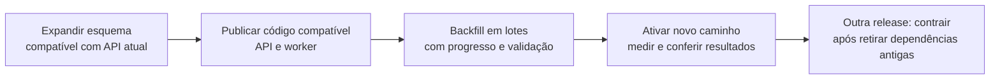
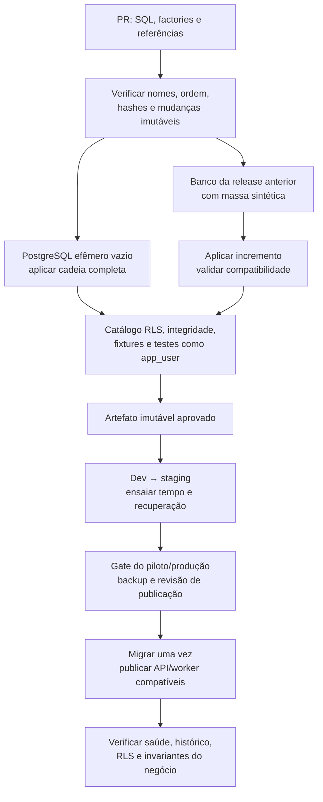

# Estratégia de migrations e seeds

**Data:** 13/11/2026. **Estado:** proposta técnica para revisão de Pedro Lemos. **Escopo:** PostgreSQL do backend e dados fictícios para desenvolvimento, integração e testes de aceitação futuros.

O projeto permanece em Design: não existe banco, backend, migration, seed ou pipeline implementado. Pedro autorizou escolher a arquitetura desta estratégia; as escolhas abaixo formam a proposta concreta deste documento, sem aceitar integralmente o MER, a política de acesso ou os ADRs relacionados. Os exemplos descrevem artefatos futuros e não foram executados.

## Índice

1. [Objetivo e referências](#1-objetivo-e-referências)
2. [Decisões de arquitetura](#2-decisões-de-arquitetura)
3. [Organização e versionamento](#3-organização-e-versionamento)
4. [Execução das migrations](#4-execução-das-migrations)
5. [Mudanças de dados e compatibilidade](#5-mudanças-de-dados-e-compatibilidade)
6. [Estratégia de seeds](#6-estratégia-de-seeds)
7. [Catálogo de cenários para testes](#7-catálogo-de-cenários-para-testes)
8. [CI, publicação e recuperação](#8-ci-publicação-e-recuperação)
9. [Procedimentos para desenvolvimento e testes](#9-procedimentos-para-desenvolvimento-e-testes)
10. [Critérios de validação e pendências](#10-critérios-de-validação-e-pendências)
11. [Rastreabilidade e fontes técnicas](#11-rastreabilidade-e-fontes-técnicas)

## 1. Objetivo e referências

Uma **migration** é uma mudança ordenada e rastreável no esquema ou em dados estruturais necessários ao funcionamento do sistema. Um **seed de teste** prepara um cenário fictício conhecido, que pode ser reconstruído. Um **backfill** preenche ou transforma dados existentes em uma mudança de versão, eventualmente em lotes. São responsabilidades diferentes e terão executores e permissões distintos.

| Referência do projeto | Restrição incorporada |
| --- | --- |
| [Arquitetura §§4.3, 4.11 e 6.6](../03-arquitetura/01-arquitetura.md) | SQL versionado, somente para frente, papel dono separado, RLS, testes de isolamento e expandir/contrair |
| [ADR-008](../03-arquitetura/adr/008-orm-query-builder-migracoes.md) | Controle explícito da conexão/transação; Kysely ou Drizzle ainda dependem de verificação; migrations precisam expressar recursos nativos do PostgreSQL |
| [MER/DER §§2, 4, 5, 6, 9 e 10](01-mer-e-der.md) | Histórico, vínculos, integridade composta, operações indivisíveis, sigilo e pendências antes do modelo físico |
| [Política de acesso §§3, 5, 6 e 8](02-politica-de-acesso-a-dados.md) | Acesso por ação, tenant, unidade, função e vigência; privilégios de banco não equivalem aos perfis do produto |
| [Backend §§3.1, 4.7, 4.9 e 6.7](../05-backend/01-backend.md) | Monólito NestJS; diretório futuro `apps/api/db/migracoes/`; outbox, auditoria e testes com PostgreSQL real |
| [ADR-004](../03-arquitetura/adr/004-nuvem-regiao-residencia-dados.md) e [ADR-013](../03-arquitetura/adr/013-rpo-rto-backup-pitr.md) | Supabase/Render gratuitos apenas para construção em dev/staging; piloto exige revisão de recuperação e custo |
| [RN §§11 a 14](../01-produto/03-regras-de-negocio.md), [PRD](../01-produto/02-prd.md) e [histórias](../01-produto/04-historias-de-usuario.md) | Planos, parâmetros, finanças, rotinas, requisitos de isolamento, backup e critérios de aceite |
| [Complementação de 12/11](../01-produto/05-decisoes-de-complementacao.md) e [autogestão de 13/11](../01-produto/06-autogestao-e-conducao-eleitoral.md) | Episódios de score, dinheiro tardio, exportação assíncrona, modalidade autogestão e condução eleitoral, preservando questões ainda abertas |

O grafo em `graphify-out/` foi consultado como mapa de relações; sua geração de 12/11/2026 antecede a autogestão. As versões atuais dos documentos acima prevalecem sobre o grafo e sobre exemplos deste documento. Esta proposta não modifica regras de negócio.

## 2. Decisões de arquitetura

| ID local | Escolha para esta proposta | Motivo e consequência |
| --- | --- | --- |
| MS-01 | **SQL como fonte da verdade do esquema; Flyway Community como executor exclusivo de migrations** | RLS, funções, gatilhos, FKs compostas e restrições de exclusão ficam explícitos. A edição Community oferece migrations SQL versionadas e os comandos necessários de execução, informação e validação; o plano não depende de geração automática, comparação paga ou undo. Há um executável adicional no desenvolvimento/CI, separado do processo Node.js |
| MS-02 | **Migrações independentes de Kysely/Drizzle** | A biblioteca dos repositórios continua pendente no ADR-008. Escolhê-la não muda o histórico SQL nem cria um segundo executor. Geração de tipos poderá consumir o esquema já migrado |
| MS-03 | **Uma sequência global por banco, compartilhada por todos os condomínios** | O modelo é banco compartilhado com `condominio_id` e RLS; não se cria histórico de esquema por tenant. Dados e backfills respeitam a fronteira de cada condomínio |
| MS-04 | **Execução somente para frente, separada da inicialização da API e do worker** | Uma correção recebe nova versão. Publicação da API anterior é recuperação de código; não desfaz automaticamente dados nem DDL |
| MS-05 | **Seeds fictícios em TypeScript, com factories e cenários declarados** | Combina com a stack planejada, permite IDs/relógio controlados e evita copiar um dump inteiro para cada caso. Testes de comportamento exercitam serviços, API e jobs reais quando implementados |
| MS-06 | **Dados estruturais obrigatórios em migrations; demonstração e testes fora delas** | Um banco de produção instala catálogos necessários, mas nunca recebe moradores, votos, cobranças ou contas humanas de demonstração |
| MS-07 | **Artefato imutável promovido entre ambientes e verificação de integridade** | Mesmo SQL, configurações por script e versões de ferramentas de dev até produção. Manifesto com SHA-256 do pacote complementa o checksum operacional da ferramenta |

A escolha de Flyway utiliza o [catálogo oficial de recursos](https://documentation.red-gate.com/flyway/learn-more-about-flyway/feature-summary) e os [comandos por edição](https://documentation.red-gate.com/flyway/reference/commands). A Redgate apresenta o [Community como gratuito](https://www.red-gate.com/products/flyway/community/). Fixar versão, distribuição, licença e imagem por digest no primeiro trabalho de implementação; revalidar esses termos ao atualizar. Não incorporar recursos Teams/Enterprise como requisitos silenciosos.

**Alternativas não adotadas:** executor do query builder acoplaria a operação à escolha ainda aberta no ADR-008; Supabase CLI como dono do histórico acrescentaria um fluxo de migração específico do provedor; scripts `psql` isolados exigiriam construir histórico, ordenação e concorrência próprios. Todos podem executar SQL, mas esta proposta prefere um executor dedicado com um único histórico. Não haverá sincronização automática de esquema por ORM, `db push` como publicação ou edição manual rotineira pelo painel do provedor. A CLI do Supabase, se utilizada para infraestrutura local no futuro, não aplicará uma segunda cadeia sobre o mesmo esquema.

Os padrões de projeto servem a responsabilidades concretas: **Factory** cria dados válidos de cada domínio; **Strategy** seleciona cenários e adaptadores fictícios; o orquestrador de seeds tem responsabilidade única e depende das portas de banco, relógio e integrações. O domínio continua sendo o **Information Expert** para comandos de negócio. Não se implementa motor próprio de migrations nem se introduzem camadas de fábrica para cada linha SQL.

## 3. Organização e versionamento

### 3.1 Estrutura futura

```text
apps/api/
  db/
    migracoes/
      V202611130001__criar_estrutura_inicial.sql
      V202611130002__adicionar_indice_de_consulta.sql
      V202611130002__adicionar_indice_de_consulta.sql.conf
    backfills/
      preencher_novo_campo.ts
    seeds/
      factories/
      cenarios/
      manifestos/
      executar.ts
    verificacoes/
      catalogo_rls.sql
      integridade.sql
    flyway.conf
    README.md
```

Árvore ilustrativa: nenhum desses diretórios ou arquivos executáveis está sendo criado por este documento. A pasta `db/` fica fora de `src`, como o backend já propõe. O futuro pacote de publicação precisa incluí-la explicitamente; não presumir que a compilação NestJS copie SQL e configurações.

### 3.2 Nome, ordem e imutabilidade

- Nome: `VAAAAMMDDNNNN__descricao_em_portugues_sem_acentos.sql`; `NNNN` é sequência técnica no dia, não horário de relógio. A descrição permanece legível e o arquivo usa UTF-8/LF. Datas no texto da documentação continuam em `dd/mm/aaaa`.
- Antes do merge, verificar colisões e versões menores que a maior já publicada. Uma migration ainda privada pode receber outra versão; uma aplicada em dev compartilhado, staging ou produção nunca é renomeada, reordenada ou reescrita.
- Flyway ordena versões numericamente. A sua tabela de histórico registra versões aplicadas e checksum; alterar SQL já aplicado exige outra migration. Não usar migrations repetíveis para regras, privilégios ou catálogos neste MVP. [Referência oficial](https://documentation.red-gate.com/flyway/flyway-concepts/migrations/versioned-migrations).
- `develop`, `staging` e `main` promovem a mesma cadeia; não há SQL específico de uma branch. A branch de documentação não executa mudanças de banco. Commits, merges e publicação continuam sujeitos às regras do AGENTS.md.
- O manifesto da release relaciona commit, imagem da API, versões mínima/máxima de esquema suportadas, migrations, configurações `.conf`, hashes, versão do PostgreSQL/extensões e suíte de seeds compatível. Nunca contém credenciais.
- Cada migration inclui objetivo, referência de regra/modelo, pré-condições, estimativa de custo, compatibilidade com código anterior, risco de lock e procedimento de recuperação. Mudança destrutiva identifica dados afetados e a release que deixou de usá-los.

Não agrupar alterações independentes em um arquivo enorme. A criação de uma entidade, seus privilégios, políticas e integridade inseparáveis fica na mesma migration transacional. Dividir por módulo não permite publicar uma tabela de tenant acessível antes de sua proteção.

### 3.3 Histórico e detecção de divergência

O histórico operacional do Flyway fica no esquema técnico proposto `infra_migracoes`, inacessível a `app_user`. O esquema proposto das entidades próprias é `condomifacil`, fora dos schemas expostos pela Data API; a API NestJS continua sendo a borda de acesso. Esses nomes são escolhas físicas desta proposta, não nomes previamente aceitos no MER. Não alterar schemas gerenciados do provedor (`auth`, `storage` e outros de sistema).

`validate` compara migrations disponíveis e aplicadas e detecta diferenças de checksum/nome/tipo. Isso não é inspeção completa do esquema real nem prova de ausência de SQL manual. O CI também compara um inventário normalizado de objetos próprios, funções, políticas e privilégios com uma reconstrução limpa. Não depender da função comercial de detecção de divergência. [Validação oficial](https://documentation.red-gate.com/flyway/reference/commands/validate).

Editar DDL por emergência exige registro de incidente e reconciliação explícita em migration reproduzível; não marcar arquivos como aplicados sem comprovar os efeitos. `baseline` não será usado para pular a cadeia de um projeto ainda sem banco. Um eventual banco legado exige plano de adoção separado.

## 4. Execução das migrations

### 4.1 Identidades, conexão e bloqueio de concorrência

| Executor | Poder e limite |
| --- | --- |
| Provisionamento inicial | Cria schemas, roles e extensões permitidas pelo provedor. Credencial administrativa fica no cofre; não integra o runtime da aplicação |
| Migrador | Login de publicação separado, que assume o papel dono dos objetos próprios. Pode executar DDL; não fica acessível à API, worker ou tester. Não precisa ser superusuário nem usar bypass para alterar o esquema |
| `app_user` | Não dono, sem superusuário, `BYPASSRLS`, criação de objetos, alteração de políticas ou `TRUNCATE`. Opera somente pelas permissões da política e pelo contexto validado |
| Executor de backfill | Função e privilégios por finalidade, transações curtas por tenant e acesso apenas ao necessário. Não herda poder de condução eleitoral ou de suporte |
| Carga de fixtures | Credencial exclusiva de banco descartável; prepara dados e encerra a sessão antes dos testes como `app_user`. Não é um perfil de produto nem é disponibilizada no ambiente com dados reais |

`FORCE ROW LEVEL SECURITY` também submete o dono à RLS nas operações de dados; não presumir que o papel de migration possa preencher todas as tabelas automaticamente. DDL e DML são analisados separadamente. Para bootstrap local/CI, as factories usam contexto explícito e caminhos de preparação restritos ao banco descartável; eventual política técnica auxiliar é temporária, não distribuída como permissão operacional e deve ser removida e verificada antes dos testes. Backfill em ambiente persistente requer caminho revisado, nunca desabilitação geral de RLS. Superusuários e roles com `BYPASSRLS` ignoram a RLS mesmo com `FORCE`; operações como `TRUNCATE` não são filtradas por linha. [Políticas de segurança do PostgreSQL](https://www.postgresql.org/docs/current/ddl-rowsecurity.html).

Uma execução por ambiente será serializada no CI, com fila exclusiva de publicação; Flyway também mantém seu lock no PostgreSQL. Para suportar índices concorrentes, esta proposta configura `flyway.postgresql.transactional.lock=false`, usando lock de sessão, e testa concorrência de dois migradores na PoC. Não usar pool em modo transação no migrador. A semântica do lock vem da [referência PostgreSQL do Flyway](https://documentation.red-gate.com/flyway/reference/database-driver-reference/postgresql-database).

No Supabase, preferir conexão direta PostgreSQL com TLS e validação do certificado; se a rede do runner não alcançar IPv6, avaliar conexão em modo sessão e comprovar as mesmas garantias de sessão e lock. Copiar a configuração do projeto, sem compor hostname por suposição. A [documentação de conexão](https://supabase.com/docs/guides/database/connecting-to-postgres) recomenda conexão direta para migrations. Não usar REST, `service_role` ou conexão do frontend para publicar SQL.

### 4.2 Configuração proposta

Exemplo sem segredos, destinado à futura configuração fixada e testada:

```properties
flyway.locations=filesystem:apps/api/db/migracoes
flyway.defaultSchema=infra_migracoes
flyway.schemas=infra_migracoes,condomifacil
flyway.createSchemas=false
flyway.validateOnMigrate=true
flyway.ignoreMigrationPatterns=
flyway.outOfOrder=false
flyway.baselineOnMigrate=false
flyway.cleanDisabled=true
flyway.group=false
flyway.mixed=false
flyway.postgresql.transactional.lock=false
```

O provisionamento cria os dois schemas antes da primeira execução. Caminhos do exemplo são relativos à raiz do futuro monorepo. URL, usuário e senha vêm de variáveis protegidas específicas da publicação; não passam na linha de comando, não entram no repositório e não aparecem em log. O migrador não compartilha a variável de conexão da aplicação.

`validateOnMigrate` será mantido ativo; `outOfOrder` será explicitamente desativado. `ignoreMigrationPatterns` vazio remove a tolerância padrão a versões futuras: a publicação não ignora banco mais adiantado que o artefato. A proposta fixa esses comportamentos mesmo se defaults mudarem. [Validação na execução](https://documentation.red-gate.com/flyway/reference/configuration/flyway-namespace/flyway-validate-on-migrate-setting), [ordenação](https://documentation.red-gate.com/flyway/reference/configuration/flyway-namespace/flyway-out-of-order-setting), [padrões ignorados](https://documentation.red-gate.com/flyway/reference/configuration/flyway-namespace/flyway-ignore-migration-patterns-setting).

### 4.3 Transações, tempo limite e índices

Por padrão, cada migration transacional confirma ou desfaz seus próprios efeitos; migrations anteriores já confirmadas permanecem. Não colocar toda a release em uma transação longa. Um erro interrompe as próximas migrations e bloqueia a publicação da API. O mecanismo está descrito em [tratamento transacional do Flyway](https://documentation.red-gate.com/flyway/flyway-concepts/migrations/migration-transaction-handling).

Cada migration define `lock_timeout` e `statement_timeout` finitos, medidos em staging e declarados no manifesto; não adotar um valor universal que trate DDL curta e criação de índice de igual forma. A PoC deve verificar que conexão e configurações são restabelecidas após erro. O timeout do job externo inclui margem para limpeza e diagnóstico.

`CREATE INDEX CONCURRENTLY` exige arquivo próprio, sem `BEGIN/COMMIT`, e não pode compartilhar transação com outras alterações. O arquivo de configuração vizinho, por exemplo `V202611130002__adicionar_indice_de_consulta.sql.conf`, contém:

```properties
executeInTransaction=false
```

É uma configuração por script disponível no Community, conforme a [referência de configuração de scripts](https://documentation.red-gate.com/flyway/reference/script-configuration). O SQL ilustrativo, condicionado aos nomes e índices do modelo físico, seria:

```sql
CREATE INDEX CONCURRENTLY idx_reserva_condominio_inicio
    ON condomifacil.reserva (condominio_id, inicio_em);
```

Esse exemplo não aprova uma coluna ou índice do DER. O PostgreSQL pode deixar índice inválido após falha concorrente; verificar validade e definição antes de recuperar. `IF NOT EXISTS` por nome não comprova que o índice existente tenha a mesma estrutura. Não supor que `CONCURRENTLY` elimina todo lock ou custo. [CREATE INDEX no PostgreSQL](https://www.postgresql.org/docs/current/sql-createindex.html).

### 4.4 Regras para alterações de segurança

Criar tabela de tenant com `condominio_id` obrigatório, chaves e FKs compostas pertinentes, RLS habilitada/forçada e políticas completas; liberar privilégios apenas no estado protegido. Testar `USING` e `WITH CHECK`, troca indevida de tenant/unidade, contextos ausentes e conexões devolvidas ao pool.

Mudanças de função, view, projeção e grant são migrations versionadas. `SECURITY DEFINER`, quando indispensável e já justificável pelas fontes, exige `search_path` controlado, nomes qualificados, `EXECUTE` restrito e teste de fronteira; não serve como correção genérica de erro de permissão. `TRUNCATE` não será dado à aplicação nem usado como limpeza de cenário por tenant. Uma migration não deve criar janela em que políticas permissivas revelem reclamações, votos, folha individual ou dinheiro de outra unidade.

## 5. Mudanças de dados e compatibilidade

### 5.1 Expandir, preencher, migrar uso e contrair



Renomear uma coluna de produção diretamente pode quebrar instâncias antigas. Preferir adicionar o novo campo, manter leitura/escrita compatíveis quando necessário, preencher, comparar e retirar o antigo em release posterior. Restrições mais fortes exigem verificar os dados existentes antes de validar ou tornar obrigatória uma coluna. A janela de compatibilidade cobre API, worker, consumidores de outbox e clientes offline, não apenas a imagem web recém-publicada.

O manifesto identifica versões de código suportadas e o limite de recuperação. Contrair só depois de confirmar ausência do uso antigo e conclusão do backfill; quantidade de releases ou prazo não serão escolhidos arbitrariamente antes da medição. Migrações do SQLite/WatermelonDB são uma cadeia separada no cliente, dependente do ADR-003 e do futuro frontend; não se aplicam arquivos PostgreSQL no celular. O contrato de sincronização precisa continuar aceitando os dados pendentes permitidos durante a transição.

### 5.2 Backfills e reparos de dados

Transformação pequena e limitada pode acompanhar a migration transacional. Preenchimento de alto volume usa script versionado separado, com lote, cursor estável, checksum/versão do procedimento, tenant, contagens, progresso durável e retomada idempotente. Não usar `OFFSET` crescente como única retomada de dados mutáveis. Concluir o processo só após comparar totais, detectar falhas e revisar amostras sem expor dados pessoais.

O lock do migrador não protege automaticamente o backfill nem a API. Backfill tem coordenação própria, transações por tenant e precondições contra atualizações concorrentes; não perde escrita legítima feita enquanto preenche. Operações com dinheiro, score, voto ou auditoria não são um `UPDATE` genérico: usar comando de domínio/rotina revisada que preserve origem, idempotência, fatos imutáveis e compensações.

Não recalcular fatos históricos com parâmetros atuais, sobrescrever preço já contratado, reabrir mês fechado, apagar auditoria nem transferir score para o próximo morador. Mudanças de significado, retenção, anonimato ou poderes da autogestão dependem das decisões do produto; migration não é autorização para resolvê-las.

## 6. Estratégia de seeds

### 6.1 Três classes de dados

| Classe | Versionamento e execução | Limites |
| --- | --- | --- |
| Catálogos necessários | SQL versionado na cadeia principal, com histórico de vigência quando o MER exige | Definições de parâmetros, categorias e plano/preço aprovados; corrigir com nova versão sem sobrescrever configuração do condomínio |
| Fixtures de teste automatizado | Factories/cenários TypeScript no Git; versão/manifesto compatíveis com o esquema | Mínimo necessário por teste; testes de comandos criam seus próprios fatos; execução apenas no banco descartável |
| Base fictícia para aceitação/manual | Pacote de cenários reproduzíveis; carga explícita em dev/staging sem dados reais | Conta/documentos/arquivos e credenciais sintéticos, integrações bloqueadas; não é bootstrap de um condomínio real |

O catálogo da RN §13 é referência, não licença para criar valores novos. `parametro_padrao` no MER requer autoria e momento; o modelo atual não define autoria técnica de bootstrap sem usuário humano. Antes da primeira carga física, revisar representação de ator técnico/sistema e histórico com Pedro: não inventar um administrador humano padrão nem senha global para satisfazer a FK. Enquanto essa lacuna não for resolvida, a migration correspondente fica bloqueada; não removê-la do modelo silenciosamente.

No cadastro real, valores iniciais por condomínio são criados pelo caso de uso autorizado, a partir da versão aplicável do catálogo. Reaplicar migrations nunca redefine o que o condomínio configurou, altera assinatura em vigor ou concede a primeira gestão. Esses casos continuam seguindo o produto e as pendências da autogestão.

### 6.2 Reprodutibilidade e factories

Cada cenário declara nome/versão, requisitos de esquema, namespace, semente pseudoaleatória quando houver, instante de referência, usuários/vínculos, IDs simbólicos estáveis, estado inicial e resultados esperados. O manifesto permite ao tester localizar a unidade e o perfil corretos. O relógio é injetado em testes; rodadas manuais de tempo controlado usam instância de API/worker dedicada ao cenário, com relógio próprio de teste, sem alterar o relógio real nem afetar a base/rodada compartilhada. Testes de calendário especificam fuso explicitamente como dado de cenário e não encerram a decisão pendente do ADR-012.

Factories compõem unidades, pessoas, contratos e vínculos válidos. Cada unidade ocupada tem exatamente um morador habilitado; proprietário e inquilino não são entidades intercambiáveis. UUIDs determinísticos são derivados do namespace do cenário e de sua chave lógica; testes paralelos recebem banco/namespace diferentes. Os exemplos de [dados do protótipo](../../prototipo/js/data.js) servem de ponto de partida para os roteiros, conforme arquitetura §6.2, sem copiar objetos JavaScript como esquema SQL nem tratar seus nomes/IDs como contrato público.

Fixtures carregam pré-condições. O teste chama a ação real para produzir a consequência: um webhook duplicado deve ser processado duas vezes pelo consumidor para provar idempotência; duas reservas devem disputar a mesma faixa em transações concorrentes para provar exclusão. Inserir o resultado final diretamente não testa esse comportamento. Casos intencionalmente inválidos são tentativas rejeitadas em testes, não linhas inválidas mantidas desabilitando constraints.

Repetir a carga sobre uma base já alterada pelo tester não deve apagar seu trabalho silenciosamente. A carga rejeita namespace existente, salvo quando constata o mesmo manifesto em estado inicial e apenas informa que ele já está pronto. Para reconstruir, criar outra base descartável; limpeza seletiva precisa preservar histórico e dependências, por isso não será o caminho padrão do MVP.

### 6.3 Identidades, dados pessoais e integrações

Não copiar produção para testes, mesmo com substituição simples de nomes. Criar pessoas fictícias, e-mails sob domínio reservado de teste, arquivos artificiais e documentos de teste aceitos apenas pelos validadores específicos do ambiente. Não usar números aleatórios que possam pertencer a pessoas reais. Identificadores ou massas oficiais de sandbox, quando necessários, ficam restritos à suíte do adaptador correspondente.

Senhas de contas de teste são individuais, geradas no preparo e armazenadas pelo mesmo mecanismo de hash do backend; o tester recebe credenciais pelo canal protegido do ambiente. Não inserir token JWT, código de recuperação, chave de gateway, token push ou senha real no Git. Esses usuários não são provisionados em produção.

Seed não chama Asaas, Resend, push, storage público nem webhook real. No teste local/CI, portas externas recebem dublês, e outbox/fila utiliza consumidor de teste sem saída de rede. Em dev/staging, respeitar caixa de saída falsa e dispositivos de teste já definidos na arquitetura. Sandbox financeiro é suíte explícita e separada: sem chamadas disparadas por simplesmente carregar um cenário.

### 6.4 Barreiras por ambiente

| Ambiente | Migrações | Seeds e recriação |
| --- | --- | --- |
| Local | Mesma cadeia e versão PostgreSQL/extensões da suíte | Banco exclusivo descartável; recriação pelo provisionador local |
| CI de integração | Banco PostgreSQL efêmero por execução/suíte | Fixtures mínimas; descarte do recurso ao fim, inclusive em falha |
| Dev compartilhado | Artefato publicado e execução serializada | Base fictícia identificada; carga explícita e janela combinada com testers |
| Staging de construção | Mesmo artefato candidato à produção | Cenários de aceitação e massa sintética dimensionada; preservar evidências da rodada antes de reconstruir |
| Piloto/produção com dados reais | Somente migrations e backfills aprovados | Nenhum seed de teste, conta demonstrativa, reset, `clean` ou limpeza por namespace |

Não confiar apenas em `NODE_ENV` ou num argumento `--force`. O executor valida ambiente registrado, identidade do banco/projeto contra lista permitida de teste, credencial de carga, manifesto e ausência de marcação de dados reais. Divergência falha antes de qualquer DML. Uma variável do operador não pode transformar produção em teste.

Recriação fica no provisionador, que só recebe IDs de recursos descartáveis criados por ele e pertencentes à execução. Não aceita URL arbitrária de banco e não oferece opção para apagar um projeto hospedado. `flyway.cleanDisabled=true` permanece inclusive nos ambientes de teste; descarte do contêiner/banco efêmero substitui limpeza genérica de schemas. Banco compartilhado com teste manual exige procedimento específico, confirmação do alvo e preservação das evidências.

## 7. Catálogo de cenários para testes

Base manual mínima: **três condomínios fictícios com pelo menos duas unidades cada**, para contemplar Essencial com administradora, Essencial com autogestão e Gestão + Suporte. A suíte de isolamento sempre usa ao menos dois tenants e duas unidades, inclusive quando o caso funcional só precisa de um. Usar também pessoa com vínculos legítimos em mais de um condomínio, sem tratá-la como vazamento permitido.

| Pacote | Preparação e verificação esperada | Fonte principal |
| --- | --- | --- |
| `acesso_e_vinculos` | Os 11 perfis do PRD, incluindo síndico profissional sem unidade fictícia, conselho e proprietário não residente; vínculos vigentes/encerrados e unidade alugada/desocupada. Negar contexto ausente, unidade alheia, tenant indevido e privilégio por token/cabeçalho | PRD §3; RN-CD; política §§2/3 |
| `isolamento_e_privacidade` | Tentativas de leitura/escrita entre tenants/unidades, empréstimo indevido de conexão, privilégios negados de suporte, DTOs/arquivos/exportações e acesso histórico restrito | SEG-05/07/17/18; política §§5/6 |
| `autogestao` | Administração local proposta, sub fora/em substituição, conselho fiscalizador e suporte negado no Essencial; nenhuma autoconcessão. Questões AG-01 a AG-12 marcadas como pendentes quando exigirem decisão | RN-PL-08; registro de 13/11 |
| `reservas` | Reserva gratuita/paga, conflito simultâneo, cancelamento com limite exato, pagamento tardio, vistoria Cumprida/Não comparecimento; falta paga sem reembolso nem perda automática de pontos | RN-RE, RN-CA; complementação de 12/11 |
| `portaria_e_offline` | Visitantes de blocos diferentes, fila pendente, reenvio da mesma operação, dados mínimos offline e revogação de vínculo antes de sincronizar. Seeds do servidor não substituem teste SQLite/WatermelonDB no aparelho | RN-VI, RN-OF; ADR-003 |
| `limpeza` | Duas conclusões do mesmo ciclo em ordem de envio diferente; vale menor horário do celular; avaliação superada só no histórico e janela da efetiva sem reiniciar reabertura. Empate/relógio incorreto permanecem casos pendentes do ADR-014 | RN-CH-04; ADR-014 |
| `score_e_reclamacoes` | Duas unidades da mesma pessoa, novo episódio começando em 100, funcionário sem unidade, julgador substituído e devolução apenas da perda efetiva. Suporte não vê identidade/conteúdo/score | RN-SC, RN-RC; MER §§4.7/9 |
| `eleicoes_e_sigilo` | Quatro degraus de condução e autorização temporária, encerramento/revogação e ausência de parcial. Não inventar ligação eleitor–voto para facilitar seed; substituição de voto e mecanismo de sigilo seguem bloqueados pela pendência P-03 | RN-VO-13; ADR-009; MER P-03 |
| `dinheiro_e_financas` | Cobrança/reserva, evento duplicado e fora de ordem, dinheiro em cancelada/expirada, Paga com atraso pelo instante efetivo, mês fechado/estorno, receita diária agregada e exportação assíncrona | RN-FI, RN-PG; SEG-17/18 |
| `pesquisa_e_comunicacao` | Projeção sem avaliador, limite de divulgação existente nas RN, conteúdo denunciado/oculto e transição sem ampliar identidade. Não fixar retenção ou anonimização ainda pendentes | RN-PE, RN-CO, RN-RC-13; ADR-010 |
| `auditoria_jobs_e_recuperacao` | Autor e contexto corretos, evento outbox idempotente, fato auditável sem conteúdo protegido, retry por tenant, restauração e reaplicação de exclusões LGPD | SEG-08/11; RNF-13; backend §§4/5 |

Cada pacote conterá roteiro em português com identificador do caso, pré-condições, conta a usar, ação, resultado visível e efeito esperado no banco. Testers não recebem credencial dona para investigar um resultado; usam projeção de diagnóstico restrita ou evidência produzida pelo CI. Não incluir Manutenção como 12º perfil aprovado: o protótipo ainda o trata como proposta.

Carga volumosa é pacote separado, parametrizado por unidades, dias, eventos e distribuição de estados. O requisito existente **RNF-17 exige condomínio simulado com 5.000 unidades e 10 portarias simultâneas**, mantendo RNF-01 e RNF-05, antes do lançamento e a cada versão principal. O pacote precisa produzir essa massa e exercitar concorrência com RLS ativa; carregar linhas sem tráfego simultâneo não comprova a meta. Medir em staging com infraestrutura planejada para o ensaio, sem prometer resultado antes da execução. Não aumentar a massa padrão dos testes rápidos nem permitir que exceda quotas do ambiente sem planejamento.

## 8. CI, publicação e recuperação

### 8.1 Pipeline futuro obrigatório



O CI cobre: construção do zero; atualização da versão anterior com dados; repetição sem reaplicar migration já concluída; alteração indevida de arquivo detectada; duas execuções concorrentes sem duplicação; falha transacional sem efeito parcial; falha não transacional diagnosticável; seeds reprodutíveis; recusa de alvo real; catálogo de RLS e grants; invariantes de dinheiro, score e imutabilidade. Validar também configurações `.conf` e hashes do pacote, não apenas o checksum SQL.

Pós-migration, executar `validate` e conferir `info` sem pendências inesperadas. Antes de migrar, `info` exibe plano/versão; `migrate` com validação ativa verifica a cadeia aplicada. Uma validação isolada antes de aplicar pode tratar migrations pendentes conforme configuração/versão: o executor futuro deverá diferenciar pendência esperada de erro, sem desativar checks de integridade para “ficar verde”.

Usar PostgreSQL real, na versão principal e com extensões compatíveis com o destino escolhido; SQLite e mocks não validam RLS, GiST, locks ou DDL. A versão de produção será confirmada antes da implementação, não escolhida pelo rótulo móvel `current` da documentação. Atualizar engine/extensões é procedimento próprio, ensaiado com a mesma suíte.

### 8.2 Publicação por ambiente

Promover o mesmo pacote dev → staging → produção, com credenciais separadas. O runner identifica banco, versão atual, destino, alterações pendentes e hash do artefato; discrepância interrompe. Execução anterior, ensaio e plano de recuperação ficam registrados no chamado/PR da release, sem conteúdo de usuários.

No Render gratuito, API e worker compartilham serviço e podem dormir; não usar sua inicialização ou cron interno como garantia de executar migration/backfill. Rodar a etapa de banco em runner externo da publicação, com acesso de rede controlado e duração compatível. Banco de CI é efêmero local ao job, sem exigir projeto pago por PR; dev e staging persistentes mantêm o isolamento já previsto no ADR-004.

Antes de piloto com dados reais, validar infraestrutura, backup restaurável imediatamente anterior, cobertura de arquivos, RPO/RTO e orçamento. O ambiente gratuito aceito para construção não comprova recuperação de produção. Sem condição de restaurar e ensaio comprovado, bloquear a publicação com dados reais; não tratar exportação SQL improvisada como PITR aceito. Não se fixam novas metas de recuperação além das decisões existentes e das propostas do ADR-013.

### 8.3 Falha e recuperação

| Situação | Procedimento |
| --- | --- |
| Divergência de checksum ou ordem | Interromper; restaurar o arquivo aprovado no artefato ou criar nova migration corretiva. Não executar `repair` para legitimar alteração sem análise |
| Falha transacional | Confirmar rollback do arquivo que falhou e estado das versões anteriores; corrigir causa e preparar reexecução controlada. API antiga continua apenas se compatível com o esquema realmente aplicado |
| Falha em índice/DDL não transacional | Inspecionar objetos parciais, locks e histórico; executar limpeza/correção específica revisada antes de repetir. `repair`, se necessário, reconcilia histórico após comprovar o estado; não corrige dados por si |
| API nova com falha após expandir | Voltar ao artefato anterior somente dentro da janela de compatibilidade; manter esquema expandido e os dados. Não acionar downgrade automático do banco |
| Erro sem perda de dados | Preferir nova migration/rotina corretiva, preservando histórico e invariantes |
| Corrupção ou perda comprovada | Parar mutações conforme incidente; restaurar em destino isolado, validar integridade/isolamento, conciliar gateway/outbox e reaplicar exclusões LGPD antes da retomada. Registrar perda e impacto; nunca prometer que restaurar backup preserva escritas posteriores |

Registro de execução contém release, executor técnico, alvo identificado, início/fim, versões, hashes, duração, status e evidências de validação. Logs não incluem senhas, conexão completa, nomes, documentos, votos, avaliações ou conteúdo de reclamação. Histórico de migrations é diferente da auditoria de negócio e não substitui sua imutabilidade.

`repair` altera o histórico e pode realinhar checksums; por isso nunca é tentativa automática após erro de publicação. Exige o mesmo conjunto de arquivos, evidência do estado e revisão do incidente. [Escopo oficial do comando repair](https://documentation.red-gate.com/flyway/reference/commands/repair).

## 9. Procedimentos para desenvolvimento e testes

### 9.1 Nova alteração de esquema

1. Localizar entidade/regra nas fontes; verificar se existe pendência que bloqueie a restrição ou dado pretendido.
2. Escrever migration SQL pequena, metadados da release e verificações, com RLS/grants na mesma mudança quando pertinente.
3. Aplicar em PostgreSQL descartável; testar tanto instalação limpa quanto atualização da release anterior.
4. Ajustar factories/cenários afetados e testar invariantes como `app_user`, com conexões independentes para concorrência.
5. Revisar plano de compatibilidade, backfill e recuperação antes do merge autorizado.
6. Promover o artefato; não reescrever migration aplicada em ambiente compartilhado.

### 9.2 Preparar rodada de teste manual

1. Provisionar banco descartável ou confirmar ambiente de teste registrado; carregar apenas catálogos necessários pelas migrations.
2. Selecionar versão de cenário compatível; validar alvo/credencial e bloquear saídas externas.
3. Carregar pré-condições, rodar verificações, encerrar a conexão privilegiada e entregar roteiro/contas ao tester.
4. Registrar evidências, versão da API/esquema e manifesto ao relatar defeito. Reconstruir a mesma versão em outra base para reproduzir.
5. Ao terminar a rodada, preservar evidências necessárias e descartar somente o recurso autorizado. Prazos de evidências e expurgo exigem política futura; não são definidos por seed.

O tester solicita ao responsável da rodada um ambiente de teste identificado e recebe roteiro, versão do dataset e credenciais pelo canal protegido. Antes de iniciar, confirma o cenário/unidade/perfil no manifesto; não usa base de piloto com dados reais nem tenta corrigir o banco diretamente. Relato de defeito segue este modelo mínimo:

| Campo | Conteúdo a registrar |
| --- | --- |
| Versão e base | Commit/imagem da API, versão do esquema, ambiente, dataset/manifesto e cenário |
| Condições | Perfil, chaves simbólicas de condomínio/unidade, estado inicial e relógio/fuso do cenário |
| Reprodução | Passos, resultado esperado e resultado observado |
| Evidência | Horário e identificador técnico permitido, captura/log com nomes, documentos, tokens e conteúdos protegidos mascarados |
| Reconstrução | Se o problema reapareceu numa base descartável com o mesmo manifesto; informar modificações manuais anteriores |

Comandos ilustrativos, **não disponíveis nem executados hoje**:

```text
flyway -configFiles=apps/api/db/flyway.conf info
flyway -configFiles=apps/api/db/flyway.conf migrate
flyway -configFiles=apps/api/db/flyway.conf validate

pnpm --filter api db:seed --cenario autogestao --manifesto rodada-001
pnpm --filter api db:verificar
```

Os scripts `pnpm` são contratos de ergonomia propostos, não definição do gerenciador de pacotes do monorepo nem comandos que já existam. A implementação escolherá o gerenciador conforme o repositório futuro. Nenhum comando de reset de banco hospedado será exposto ao tester.

## 10. Critérios de validação e pendências

### 10.1 Condições para implementar esta estratégia

- PoC do Flyway Community fixado com o PostgreSQL/extensões do destino: histórico, validação, lock de sessão, concorrência, SSL, modo de conexão e arquivo não transacional.
- Provisionamento separado de roles/schemas, grants mínimos, `FORCE RLS`, função de bootstrap e backfill sem bypass operacional.
- Instalação limpa e atualização anterior produzindo o mesmo catálogo próprio esperado; testes negativos como `app_user` sem privilégios do preparador de fixtures.
- Seeds sem dados reais e saídas externas, determinismo de relógio/IDs, isolamento de execução paralela e bloqueio de piloto/produção demonstrados.
- Pipeline separado de API/worker, pacote imutável e ensaio de falha/recuperação em staging; validação do ADR-004/013 antes de qualquer piloto real.

### 10.2 Questões ainda abertas

| Tema | Escolha já feita aqui | O que continua a validar |
| --- | --- | --- |
| Ferramenta de migrations | Flyway Community SQL-first, sem undo e sem recurso pago necessário | Fixar versão/distribuição e provar os critérios acima; se falhar, revisar a ferramenta em vez de contornar RLS |
| Acesso a dados | Separado da migration | Prova de Kysely/Drizzle do ADR-008; este documento não escolhe o query builder |
| Modelo físico | Schemas próprios e execução com dono separado propostos | Nomes/colunas/constraints, extensões e política técnica de provisionamento; validação do MER e da política de acesso |
| Autoria dos catálogos | Carga obrigatória versionada, sem administrador humano fictício | Representação do ator técnico e FKs de autoria no MER, antes da primeira migration de catálogo |
| Ambiente real | Seeds de teste proibidos | Revisão obrigatória de nuvem/backup, responsáveis de publicação/incidente, custo e RPO/RTO; não presumir cobertura do gratuito |
| Regras pendentes | Cenários identificam bloqueios em vez de inventar resultado | Sigilo/substituição de voto, fuso, empate/relógio offline, retenção e demais MER §9/UF §17 |
| Autogestão | Cenários incluem as diretrizes de 13/11 | Distribuição fina de poderes, primeira habilitação, mandatos e designação eleitoral conforme AG-01 a AG-12 |
| Expansão e recuperação | Forward-only e compatibilidade entre versões | Medir tamanho de lote, timeouts, janela de retirada do código antigo e permissões de cada backfill |

Não é necessário mudar PRD/RN/fluxo/protótipo para documentar esta estratégia técnica. Se a implementação exigir alterar comportamento do produto ou outro documento, apresentar a necessidade e obter a autorização de escopo prevista no AGENTS.md; não atualizar ADRs como aceitos por consequência desta proposta.

## 11. Rastreabilidade e fontes técnicas

| Resultado pretendido | Referências locais | Evidência futura |
| --- | --- | --- |
| Evolução rastreável e recuperável | Arquitetura §6.6; ADR-008/013; RNF-13 | Histórico validado, pacote imutável, instalação/upgrade e restauração ensaiados |
| Isolamento de dados e conexões | SEG-05; RNF-11; ADR-001/007; política §§3/6 | Catálogo RLS, grants e testes negativos multitenant, também depois de migrar |
| Preservar sigilo e finalidade | SEG-07/17/18; ADR-009/010; MER §§4/6/9 | Seeds sem associação indevida e testes de projeção, logs, exportações e arquivos |
| Manter integridade dos fatos | MER §5; RN-FI/RN-SC/RN-VO/RN-CH; backend §4.7 | Cenários com concorrência, idempotência, estorno, episódio, outbox e auditoria |
| Preparar testes reprodutíveis | Critérios de aceite das histórias; backend §4.9 | Manifesto de cenário, relógio/IDs controlados, dados sintéticos e roteiro para testers |
| Respeitar planos e poderes locais | RN-PL-08; RN-VO-13; registro de 13/11 | Cenários por modalidade e negativas de autoconcessão, preservando pendências |

As fontes externas foram consultadas em **13/11/2026** e estão vinculadas junto às escolhas que sustentam. Também foi verificado o [changelog do Supabase](https://supabase.com/changelog.md); a mudança recente de CLI não afeta a decisão de usar um único executor SQL independente. Usar documentação da versão fixada na implementação, sem adotar comandos de versões móveis por cópia.

Esta entrega é documentação: revisão de consistência, referências locais e Markdown não equivale a executar migrations, testar seeds, renderizar diagramas ou validar segurança num banco. Esses passos são critérios da implementação futura. Nenhum banco foi criado ou acessado e nenhum commit/push é autorizado por este documento.
