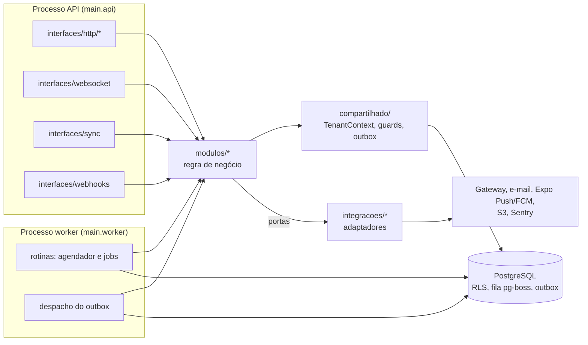
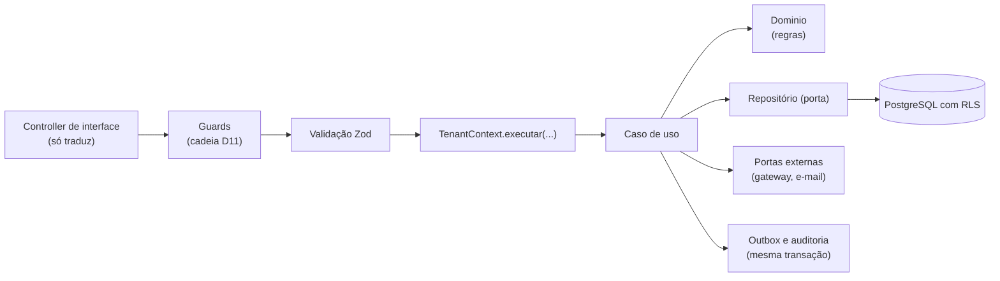
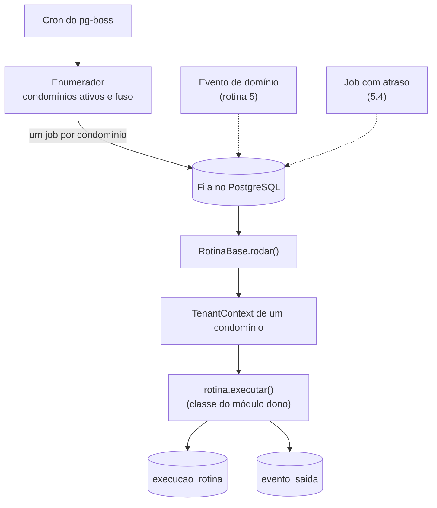

# Backend: CondomiFacil

**Status:** Proposta, em 09/11/2026. Nenhuma decisão deste documento foi aceita pelo Pedro. Onde o texto diz **Decidido**, a decisão vem de um documento de produto ou do PRD; onde diz **Proposta** ou **Proposta técnica**, é recomendação a validar, no mesmo regime dos ADRs. O que não está nas fontes aparece como Proposta técnica (fora das RN) ou como pendência na seção 7.

## Índice

1. [Objetivo, status e como ler](#1-objetivo-status-e-como-ler)
2. [Visão geral](#2-visão-geral)
3. [Estrutura de pastas (híbrida)](#3-estrutura-de-pastas-híbrida)
4. [Padrões de código](#4-padrões-de-código)
5. [Rotinas agendadas (jobs)](#5-rotinas-agendadas-jobs)
6. [Serviços externos e integrações](#6-serviços-externos-e-integrações)
7. [Pontos em aberto e pendências que afetam o backend](#7-pontos-em-aberto-e-pendências-que-afetam-o-backend)
8. [Rastreabilidade](#8-rastreabilidade)

## 1. Objetivo, status e como ler

**Objetivo.** Descrever como o backend do CondomiFacil será organizado quando o código começar (marco MVP, M3 a M6): estrutura de pastas do `apps/api`, padrões de código, rotinas agendadas e integrações com serviços externos. O documento traduz para o nível de código o que a arquitetura já propõe; não cria regra de negócio nem muda requisito.

**O que este documento não repete.** Componentes, multi-tenant, segurança e ambientes estão em [`01-arquitetura.md`](../03-arquitetura/01-arquitetura.md); diagramas C4 em [`02-diagramas-de-arquitetura.md`](../03-arquitetura/02-diagramas-de-arquitetura.md); tabelas e colunas em [`01-mer-e-der.md`](../04-banco-de-dados/01-mer-e-der.md). Aqui só entram referências a eles.

**Convenções de leitura.**

| Marca | Significado |
| --- | --- |
| **Decidido** | Vem do PRD, das RN ou do AGENTS.md; vale como requisito |
| **Proposta** | Recomendação deste documento ou da arquitetura, ainda sem validação do Pedro |
| **Proposta técnica (fora das RN)** | Mecanismo técnico que não tem regra de negócio por trás; precisa de validação antes de virar requisito |
| **Em aberto** | Depende de ADR, parecer ou decisão de produto |

Fontes citadas por ID: RF, RNF, SEG (PRD), RN (regras de negócio), ADR (adr/), arq. (`01-arquitetura.md`), D (diagramas) e MER/DER (`01-mer-e-der.md`). Nomes de módulos, pastas, tabelas auxiliares e rotas são Proposta.

## 2. Visão geral

**Decidido (PRD 10):** backend em Node.js e TypeScript com NestJS, PostgreSQL com Row Level Security, WebSockets para a lista da portaria e jobs no backend.

**Proposta (arq. 3.3, 5.3, D6):** monólito modular, um único repositório de código e um único deploy lógico. O `apps/api` tem **dois pontos de entrada** sobre o mesmo código: o processo da **API** (HTTP, WebSocket, sincronização offline e webhooks) e o processo do **worker** (jobs, despacho do outbox, sem HTTP). Escalam separadamente. Microsserviços não se justificam para a equipe e a escala previstas (RNF-10, arq. 4.10).



Leitura: a seta de `modulos` para `integracoes` passa por **portas** (interfaces); o módulo nunca importa o adaptador. Fila e outbox ficam no PostgreSQL (ADR-006, Proposta).

## 3. Estrutura de pastas (híbrida)

**Decisão do Pedro (09/11/2026): estrutura híbrida.** O código é organizado em **duas dimensões ao mesmo tempo**:

- **Por perfil de usuário**, só na borda: `src/interfaces/http/<perfil>/` guarda controllers e DTOs de resposta, uma pasta por interface. Responde "quem chama e o que vê".
- **Por domínio**, no núcleo: `src/modulos/<dominio>/` guarda regras, casos de uso, repositórios e eventos, uma pasta por módulo da arq. 3.3 e D6. Responde "onde mora a regra".

As duas se encontram em uma única direção: **interface -> módulo**. Um perfil consome vários módulos; um módulo atende vários perfis. A regra de negócio de reservas existe uma vez só, em `modulos/reservas/`, mesmo sendo chamada pelas interfaces `morador`, `portaria` e `limpeza`.

### 3.1 Árvore do `apps/api`

Dentro do monorepo da arq. 5.3 (`apps/api`, `packages/shared-types`, `packages/config`):

```
apps/api/
  src/
    main.api.ts                    ponto de entrada da API (HTTP + WebSocket)
    main.worker.ts                 ponto de entrada do worker (sem HTTP)
    api.module.ts                  monta interfaces e módulos para o processo da API
    worker.module.ts               monta rotinas, despacho do outbox e módulos para o worker

    interfaces/                    BORDA: traduz requisição em chamada a caso de uso
      http/
        comum/                     rotas usadas por vários perfis (ver 3.3)
        morador/                   inclui síndico morador, subsíndico e conselho fiscal nas funções de morador
        proprietario-nao-residente/
        portaria/
        limpeza/
        sindico/                   síndico morador, síndico profissional e subsíndico (papel por mandato)
        administradora/            também usada pelo suporte da plataforma dentro de um condomínio
        conselho-fiscal/
        plataforma/                painel do suporte e do admin da plataforma
      websocket/                   gateway de tempo real, salas c:{condominio_id}:portaria:{portaria_id}
      sync/                        /sync/push e /sync/pull (fila offline da portaria e da limpeza)
      webhooks/                    POST /webhooks/pagamentos/:provedor

    modulos/                       NÚCLEO: regra de negócio por domínio
      acesso/
      condominio/
      configuracao/
      reservas/                    exemplo expandido em 3.2
      pagamentos/
      visitantes/
      encomendas/
      chamados/
      convivencia/
      comunicados/
      governanca/
      cobranca/
      financas/
      notificacoes/
      arquivos/
      lgpd/
      auditoria/
      plataforma/
      sync/

    rotinas/                       MECANISMO de jobs: agendador, catálogo das 21 rotinas, entrada do worker
    integracoes/                   ADAPTADORES de serviços externos (implementam portas)
      pagamento/                   um adaptador por provedor; só um será implementado (ADR-002)
      email/                       adaptador do provedor escolhido (ADR-005) e caixa de saída falsa
      push/                        Expo Push / FCM
      armazenamento/               S3 (e MinIO local)
      monitoramento/               Sentry
    compartilhado/                 transversal, sem regra de domínio
      tenant/                      TenantContext (único caminho até o banco)
      autorizacao/                 guards: versão, autenticação, contexto, perfil e papel, unidade
      outbox/                      gravação de evento_saida e despachante
      portas/                      PaymentGateway, Mailer, PushSender, ArmazenamentoDeObjetos
      rotinas/                     RotinaBase e contrato de rotina (abstração usada pelos módulos)
      parametros/                  porta ParametrosService (implementada por configuracao)
      erros/                       hierarquia de erros e filtro global
      config/                      leitura e validação das variáveis de ambiente (Zod)
      logger/                      log estruturado com filtro de dados sensíveis
  test/
    isolamento/                    testes de tenant e de vazamento (arq. 4.11)
    integracao/                    banco real com RLS e papel app_user
    e2e/                           ponta a ponta por perfil
  package.json
```

Fora do `apps/api`: `packages/shared-types` (esquemas Zod, DTOs de entrada, enums de estado e códigos de erro), `packages/config` (ESLint, TypeScript, Prettier). Migrações SQL ficam fora de `src` (pasta `db/migracoes/` do `apps/api`, local exato Proposta, ADR-008 e `04-banco-de-dados`).

### 3.2 Um módulo expandido: `reservas`

Estrutura interna padrão de todo módulo. O exemplo é `reservas` por reunir porta para outro módulo, evento consumido, evento publicado e três rotinas (1, 7 e 21).

```
modulos/reservas/
  index.ts                         API pública do módulo (fachada); único arquivo que outros módulos importam
  reservas.module.ts
  dominio/                         regras puras, sem NestJS nem banco
    reserva.entidade.ts
    area-comum.entidade.ts
    estado-reserva.ts              máquina de estados (RN-RE; transições monotônicas)
    politica-de-cancelamento.ts    RN-CA-01 a RN-CA-06
    regras-de-antecedencia.ts      RN-RE-06, RN-RE-07
    erros-de-reserva.ts
  aplicacao/                       casos de uso e serviços; orquestram dominio e portas
    criar-reserva.caso-de-uso.ts
    cancelar-reserva.caso-de-uso.ts
    consultar-reservas-do-dia.caso-de-uso.ts
    marcar-uso-da-reserva.caso-de-uso.ts      Em andamento, Cumprida, Não comparecimento (RN-RE-13)
    registrar-vistoria.caso-de-uso.ts
    rotinas/
      expirar-reservas-nao-pagas.rotina.ts    rotina 1 (RN-RE-03)
      aplicar-faltas-em-reservas.rotina.ts    rotina 7 (RN-RE-10)
      lembrar-reserva.rotina.ts               rotina 21 (RN-RE-14)
  portas/                          contratos que o módulo precisa; outros lados implementam
    reserva.repositorio.ts
    cobranca-de-reserva.porta.ts   pede ao módulo pagamentos a cobrança da reserva
    parametros-de-reserva.porta.ts
  infra/                           implementações de portas do próprio módulo
    reserva.repositorio-sql.ts     SQL pelo TenantContext (Kysely ou Drizzle, ADR-008)
    mapeadores/
  eventos/
    publicados/                    reserva.confirmada, reserva.cancelada, reserva.expirada (nomes Proposta)
    consumidos/                    pagamento.confirmado -> confirma a reserva
```

Regras de dependência (Proposta, verificadas por lint de fronteiras, por exemplo `eslint-plugin-boundaries` ou `dependency-cruiser`; ferramenta a escolher):

| Regra | Motivo |
| --- | --- |
| `dominio/` não importa NestJS, banco, outros módulos nem `integracoes/` | Regra testável sem infraestrutura (SOLID: inversão de dependência) |
| `aplicacao/` importa `dominio/`, `portas/` e `compartilhado/`; nunca `infra/` | O caso de uso fala com interfaces |
| Um módulo importa outro **só pelo `index.ts`**, e só no sentido das setas de D6 e da tabela 4.6 | Evita ciclos; `reservas` usa `pagamentos` por porta, e `pagamentos` avisa de volta por evento (D, 5.1) |
| `interfaces/*` importam `modulos/*/index.ts` e `compartilhado/`; nunca `dominio/` nem `infra/` de módulo | A borda só chama casos de uso |
| `compartilhado/` não importa `modulos/` | Transversal não conhece domínio |
| `integracoes/*` implementam portas de `compartilhado/portas/`; nada importa `integracoes/` exceto a montagem em `*.module.ts` | Trocar de provedor é trocar de adaptador |

Os módulos seguem a tabela 4.6 de D (responsabilidade e dependências). `tempo-real` e `rotinas` não são pastas de `modulos/`: são mecanismos de processo (D, 5.1) e vivem em `interfaces/websocket/` e `rotinas/`. `sync` é módulo próprio por decisão proposta de D (5.1), com a rota na borda em `interfaces/sync/`.

### 3.3 Perfis, pastas de interface e módulos consumidos

O PRD 3 lista **11 perfis**. A matriz de permissões tem 7 colunas (Morador, Síndico morador, Síndico profissional, Subsíndico, Limpeza, Portaria, Administradora); os outros 4 estão em "Perfis fora da matriz" (Suporte da plataforma, Admin da plataforma, Conselho fiscal, Proprietário não residente). As 9 pastas abaixo cobrem os 11 perfis; o critério é **"o conjunto de telas e de DTOs de resposta é diferente?"**, não "o rótulo é diferente".

| Perfil (PRD 3) | Pasta de interface | Módulos que consome (via `index.ts`) | Observação de agrupamento |
| --- | --- | --- | --- |
| Morador (proprietário, inquilino ou dependente) | `morador/` | `reservas`, `visitantes`, `encomendas`, `chamados`, `convivencia`, `comunicados`, `governanca`, `cobranca`, `pagamentos`, `condominio`, `notificacoes` | Base das funções de morador |
| Síndico (morador) | `sindico/` e `morador/` | Os de `morador/`, mais `financas`, `cobranca` (painel), `governanca`, `comunicados`, `convivencia`, `chamados`, `condominio` | "Mantém todas as funções de morador" (PRD 3): usa as duas pastas |
| Síndico profissional | `sindico/` | `chamados`, `convivencia`, `comunicados`, `governanca`, `cobranca`, `financas`, `condominio`, `visitantes` (lista de bloqueio, só leitura) | Sem unidade e sem funções de morador: só `sindico/` |
| Subsíndico | `sindico/` e `morador/` | Subconjunto de `sindico/` fora da substituição; todo `sindico/` em substituição | Sem pasta própria, ver decisão abaixo |
| Funcionário de limpeza | `limpeza/` | `chamados`, `reservas` (vistoria), `convivencia` (próprio score e recurso), `sync` | Também usa `interfaces/sync/` (offline) |
| Funcionário de portaria | `portaria/` | `visitantes`, `encomendas`, `reservas` (do dia e vistoria), `chamados` (abrir), `comunicados` (responder), `condominio` (blocos e portarias), `sync` | Também usa `interfaces/websocket/` e `interfaces/sync/` |
| Administradora | `administradora/` | `condominio`, `configuracao`, `cobranca`, `pagamentos`, `financas`, `convivencia` (consulta e julgamento por RN-RC-03 e RN-RC-07), `comunicados`, `visitantes` (lista de bloqueio), `governanca` (regras de reeleição) | Painel web com vários condomínios (arq. 4.4) |
| Suporte da plataforma | `plataforma/` (abrir contexto) e `administradora/` (operar) | Os da administradora, **exceto** `convivencia` (reclamações e scores), mais `auditoria` (SEG-13) | Age como administradora em cadastros, configurações e cobrança (PRD 3, D-02) |
| Admin da plataforma | `plataforma/` | `plataforma`, `condominio` (cadastro de condomínio e plano), `configuracao` (padrões de plataforma), `auditoria` | Só o painel da plataforma, sem tabelas de tenant (arq. 4.4) |
| Conselho fiscal | `conselho-fiscal/` e `morador/` | `financas` (leitura, comentário, exportação), `convivencia` (julga nos casos do PRD 3) | "Também são moradores" (PRD 3): usa as duas pastas |
| Proprietário não residente | `proprietario-nao-residente/` | `governanca` (voto e procurador), `cobranca`, `pagamentos`, `condominio` (contrato de locação), `convivencia` (visão limitada, RN-RC-16), `comunicados` (leitura de gerais) | Ver decisão 1 |
| Manutenção | Nenhuma | Nenhum | Perfil só **proposto no protótipo**, fora do PRD; sem pasta até o Pedro decidir (AGENTS.md, próximos passos 3) |

**Decisões de agrupamento (Proposta).**

1. **`proprietario-nao-residente/` é pasta própria.** A matriz o trata à parte e com um conjunto restrito: vota, paga o que é responsável, acompanha contrato, multas e reclamações validadas contra a unidade; não reserva, não abre chamado, não reclama, não avalia (PRD 3). Dentro de `morador/` seria preciso negar quase tudo. O proprietário que mora na unidade é morador e usa só `morador/`.
2. **Não existe `subsindico/`.** O protótipo dá ao subsíndico "as mesmas abas do síndico" (prototipo/README.md), com Gestão enxuta fora da substituição. O papel por mandato é **dado** (RN-CD-12, RN-CD-28), resolvido pelos guards (arq. 3.3.1), então a mesma rota de `sindico/` responde ou recusa conforme o papel efetivo (exemplo: "Em substituição" na matriz). A única ação exclusiva, "sugerir comunicado ao síndico", fica em `sindico/` com permissão só para o subsíndico fora da substituição. Se as telas divergirem muito, criar `subsindico/` é uma mudança de organização, não de regra.
3. **Síndico morador e síndico profissional dividem `sindico/`.** Mesmas funções de gestão; a diferença (morador x sem unidade) é de `morador/`, não de `sindico/`.
4. **Suporte da plataforma divide `administradora/` com a administradora.** O PRD dá ao suporte as permissões da administradora naquele condomínio. `plataforma/` guarda só o que é do painel da plataforma: abrir contexto em condomínio do plano Gestão + Suporte e registrar o acesso (arq. 4.4, SEG-13). As restrições (sem reclamações nem scores) são aplicadas por guard e por RLS, não pela pasta.
5. **`comum/` guarda o que não tem perfil dono:** acesso e sessão (`/acesso/*`), preferências de notificação e dispositivos, URL assinado de arquivos, cópia e exclusão LGPD, o **endpoint único de score** (ADR-010) e recurso de decisão, que várias colunas da matriz usam. Critério: ação aberta a três ou mais perfis com o mesmo DTO.
6. **Interfaces transversais em pastas próprias:** `webhooks/` (sem sessão de usuário, assinatura do provedor), `websocket/` (autenticação no handshake, salas autorizadas pelo servidor, arq. 3.4) e `sync/` (lote ordenado, `op_id`, cursor, ADR-003).

### 3.4 Regra de ouro: a pasta organiza, não protege

- **Controllers de interface não têm regra de negócio.** Só leem a requisição, validam a entrada com o esquema Zod de `shared-types`, chamam **um** caso de uso do módulo e montam o DTO de resposta do perfil. Nenhum `if` sobre regra de domínio (prazo, estado, valor, quem pode julgar) mora em controller.
- **A autorização é sempre validada nos guards e na RLS, nunca pela pasta.** Estar em `morador/` não dá nem tira permissão. Todo controller, em qualquer pasta, passa pela cadeia de guards (D11) e abre o `TenantContext`; a RLS é a última barreira (arq. 3.3.1, 4.3). Mover um arquivo de pasta não pode abrir acesso.
- **O DTO de resposta é por perfil, na interface.** O caso de uso devolve dados do domínio; cada pasta de interface os converte em DTO sem campos de identidade protegida (arq. 3.9.2; exemplo: o alvo da reclamação nunca recebe o autor, ADR-010). O teste de vazamento roda por DTO e por perfil (seção 4.8).
- **Esconder botão não é controle de acesso** (UF 15); a API valida sempre.

## 4. Padrões de código

**Decidido (AGENTS.md):** o código segue SOLID, GRASP e GoF, com inversão de dependência por portas e adaptadores. Todo o resto desta seção é Proposta, salvo onde marcado.

### 4.1 Camadas e fluxo de requisição

Fluxo oficial de D11 (Proposta), com a pasta onde cada etapa vive:

| Etapa | O que faz | Onde vive |
| --- | --- | --- |
| 1. Versão mínima | Recusa cliente antigo com `426` (usa `X-App-Version`) | `compartilhado/autorizacao/` |
| 2. Autenticação | JWT com `sub` e `sid`, sessão válida; senão `401` (ADR-007) | `compartilhado/autorizacao/` |
| 3. Contexto | Vínculo com `X-Condominio-Id` e `X-Unidade-Id`; senão `403` | `compartilhado/autorizacao/` |
| 4. Perfil e papel por mandato | Papel efetivo hoje; substituição é dado; senão `403` | `compartilhado/autorizacao/` |
| 5. Unidade | Dono do dado, por exemplo SEG-17 | `compartilhado/autorizacao/` |
| 6. Validação | Esquema Zod de `shared-types` | `interfaces/http/<perfil>/` |
| 7. TenantContext | `BEGIN` e `set_config(..., true)` com condomínio, usuário, unidade e papel | `compartilhado/tenant/` |
| 8. Caso de uso | Aplica regras RN, usa repositórios e portas | `modulos/<dominio>/aplicacao/` |
| 9. Mesma transação | Grava `evento_saida` e `auditoria` junto da mudança | `compartilhado/outbox/`, `modulos/auditoria/` |
| 10. COMMIT e resposta | Variáveis de contexto somem; DTO do perfil | `interfaces/http/<perfil>/` |



Webhooks e jobs **não** passam pelos guards de usuário: abrem o `TenantContext` a partir do condomínio da cobrança referenciada ou do payload do job (arq. 4.4, D11).

### 4.2 SOLID, GRASP e GoF no projeto

Exemplos concretos, todos Proposta:

| Princípio ou padrão | Onde se aplica | Como |
| --- | --- | --- |
| **S** (responsabilidade única) | Casos de uso | Um arquivo por caso de uso (`criar-reserva.caso-de-uso.ts`); controller só traduz; repositório só persiste |
| **O** (aberto e fechado) | Formas de pagamento, regras de visibilidade de score | Nova forma ou nova regra entra como nova classe registrada, sem editar as existentes |
| **L** (substituição de Liskov) | Adaptadores do gateway | Qualquer adaptador de `PaymentGateway` (inclusive o dublê de teste) cumpre o mesmo contrato, inclusive nos erros |
| **I** (segregação de interfaces) | Portas | Portas pequenas por necessidade (`CobrancaDeReservaPorta` expõe só o que `reservas` usa, não toda a API de `pagamentos`) |
| **D** (inversão de dependência) | `PaymentGateway`, `Mailer`, `PushSender`, `ArmazenamentoDeObjetos` | Domínio depende da interface em `compartilhado/portas/`; adaptador em `integracoes/` é injetado pelo NestJS |
| **Information Expert** (GRASP) | Entidades de domínio | Quem tem o dado calcula: a reserva sabe se pode ser cancelada com reembolso; a cobrança sabe calcular multa e juros do dia (RN-FI-06, RN-FI-08) |
| **Controller** (GRASP) | Casos de uso | O caso de uso é o controlador de sistema; o controller HTTP é só adaptador de protocolo |
| **Low Coupling e High Cohesion** | Módulos | Fronteira pelo `index.ts` e regras de lint (3.2); eventos em vez de chamadas circulares (`pagamentos` avisa por `pagamento.confirmado`) |
| **Pure Fabrication** (GRASP) | `TenantContext`, outbox, `RotinaBase` | Classes sem conceito de negócio que existem para manter baixo acoplamento |
| **Protected Variations** (GRASP) | Gateway, e-mail, banco | A incerteza (ADR-002, ADR-005, ADR-008) fica atrás de porta |
| **Adapter** (GoF) | `integracoes/pagamento/<provedor>`, `integracoes/email/<provedor>`, `push/`, `armazenamento/` | Traduz a API do serviço externo para a porta (`criarSubconta`, `criarCobranca`, `consultar`, `reembolsar`, `validarWebhook`; arq. 3.6) |
| **Strategy** (GoF) | Emissão por forma de pagamento (boleto com QR Pix, Pix, cartão; RN-FI-02); quem julga a reclamação (RN-RC-03, RN-RC-07); visibilidade de score (ADR-010) | Família de algoritmos intercambiáveis escolhida por dado (`cobranca.formas_pagamento`, papel, tabela de regras). O cálculo de multa e juros é função pura de domínio com os parâmetros de RN 13; vira Strategy só se surgir mais de uma política |
| **Observer** (GoF) | Eventos de domínio via outbox | Módulo publica `evento_saida` na transação; `notificacoes`, `tempo-real` e outros módulos assinam. Entrega pelo menos uma vez, consumidores idempotentes (MER/DER 4.12) |
| **Template Method** (GoF) | `RotinaBase` | Esqueleto fixo (abrir contexto, checar idempotência, executar, registrar `execucao_rotina`, tratar falha); cada rotina implementa só `executar` (seção 5) |
| **Factory** (GoF) | `NotificacaoFactory` | Monta texto seguro e canal por tipo de notificação, com lista fixa de tipos obrigatórios (RF-NO-01, arq. 3.7) |
| **Repository** | `*.repositorio.ts` em `portas/`, implementação em `infra/` | O caso de uso não conhece SQL; testes usam repositório em memória |
| **State** (GoF) | Reserva, cobrança, lançamento, reclamação | Estados e transições em `dominio/estado-*.ts`; transições monotônicas (um evento atrasado de "pendente" não desfaz "pago", arq. 3.6) |
| **Facade** (GoF) | `index.ts` de cada módulo | Superfície pública mínima do módulo |
| **Chain of Responsibility** (GoF) | Guards do NestJS | Cadeia 1 a 5 da tabela 4.1; cada guard decide ou recusa |
| **Circuit Breaker** (padrão de resiliência) | Chamadas ao gateway | Tempo limite, nova tentativa com recuo e disjuntor (arq. 3.6, Proposta) |

### 4.3 Convenções de nomes

| Item | Convenção (Proposta) |
| --- | --- |
| Idioma | Domínio em **português** (`reserva`, `cobranca`, `vinculo`), coerente com as RN e o MER/DER; termos técnicos já usados nos docs em inglês (`TenantContext`, `PaymentGateway`, `Mailer`, `outbox`) ficam como estão |
| Pastas e arquivos | `kebab-case`, sem acento (`conselho-fiscal`, `criar-reserva.caso-de-uso.ts`) |
| Sufixos | `.module.ts`, `.controller.ts`, `.guard.ts`, `.caso-de-uso.ts`, `.entidade.ts`, `.repositorio.ts` (porta) e `.repositorio-sql.ts` (implementação), `.porta.ts`, `.adaptador.ts`, `.rotina.ts`, `.evento.ts`, `.consumidor.ts`, `.dto.ts` (resposta por perfil), `.schema.ts` (Zod, em `shared-types`), `.spec.ts` (unidade, ao lado do arquivo) |
| Classes | `PascalCase` (`CriarReservaCasoDeUso`, `AdaptadorAsaas` só se o provedor for escolhido) |
| Eventos | `<entidade>.<fato no passado>` (`visitante.cadastrado`, `pagamento.confirmado`, nomes dos docs) |
| Parâmetros | Chaves do catálogo RN 13 exatamente como estão (`reserva.lembrete_antecedencia_horas`) |
| Tabelas e colunas | As do MER/DER; o backend não renomeia |

### 4.4 Validação de entrada

**Proposta (arq. 3.3):** esquemas Zod em `packages/shared-types`, os mesmos no app e na API. O controller valida com o esquema antes de chamar o caso de uso; valor fora da faixa de parâmetro é recusado com a faixa na mensagem (RN 13). Regras que dependem de dados (ex.: "data não futura nem em mês fechado", RN-FI) ficam no domínio e no banco, não só no esquema. Valores monetários em inteiros, centavos (arq. 3.6, RN 12).

### 4.5 Tratamento de erros padronizado

Formato único de erro (Proposta): `{ codigo, mensagem, detalhes?, request_id }`, com `codigo` definido em `shared-types` e o texto mostrado ao usuário vindo dos padrões do Design System (UF 15 e DS 13.4). O filtro global em `compartilhado/erros/` converte erros de domínio e de infraestrutura.

| Situação | HTTP | Origem |
| --- | --- | --- |
| Sessão expirada ou inválida | `401` | Guard de autenticação; UF 15 ("Por segurança, entre de novo na sua conta.") |
| Sem vínculo com o condomínio ou a unidade; sem permissão para o papel efetivo | `403` | Guards de contexto, papel e unidade; UF 15 |
| Versão do app abaixo do mínimo | `426` | Guard de versão (Proposta, D11); UF 15 ("Atualize o app para continuar.") |
| Recurso de outro condomínio | `404` | Indistinguível de "não existe", nunca `403` que confirme existência (arq. 4.11) |
| Entrada inválida | `400` | Validação Zod |
| Regra de negócio violada (ex.: horário fora da antecedência) | `422` | Erro de domínio (código HTTP da regra de negócio: Proposta) |
| Conflito (horário já reservado, dado alterado por outra pessoa, voto repetido) | `409` | RN-RE-04, `EXCLUDE` no banco, UF 15 ("Estas informações mudaram...") |
| Limite de taxa excedido | `429` | Lacuna de limites (arq. 3.3); proposta de partida por IP e e-mail |
| Erro do servidor | `500` e `503` | UF 15 ("Algo deu errado do nosso lado..."); enviado ao Sentry com dados filtrados |

Resposta de acesso (`/acesso/codigo`) é a mesma para e-mail cadastrado ou não (RN-CD-02, SEG-04). Erro nunca devolve corpo de reclamação, avaliação ou voto (ADR-010).

### 4.6 Idempotência

| Ponto | Mecanismo | Origem |
| --- | --- | --- |
| Sincronização offline | `op_id` único por condomínio; reenvio não duplica; carga diferente com o mesmo `op_id` é recusada | ADR-003, MER/DER 4.12 |
| Webhook do gateway | Unicidade em `evento_gateway` por provedor, conta recebedora e id do evento (ou só provedor e id, quando o provedor o garante único); repetição responde `200` sem reprocessar; evento sem correlação válida vai para `evento_gateway_quarentena` | arq. 3.6, MER/DER 4.10, SEG-17 |
| Jobs e rotinas | Cada rotina grava só o que falta; chave única por efeito (ex.: cobrança do mês X da unidade Y) | arq. 3.5, `execucao_rotina.chave_idempotencia` |
| Consumidores do outbox | Idempotentes, sem presumir entrega exatamente uma vez; `chave_idempotencia` em `notificacao` e `evento_saida` | MER/DER 4.12 |
| Ações do cliente que cobram ou reservam (POST) | Cabeçalho `Idempotency-Key` opcional por requisição, guardado por um tempo curto | **Proposta técnica (fora das RN)**; a reserva já tem trava por `EXCLUDE` no banco |
| Pagamento em duplicidade | Alerta à administradora, devolução ou abatimento auditados | RN-FI-19 |

### 4.7 Transações, outbox e auditoria

- **Uma requisição, uma transação, um contexto de condomínio.** O caso de uso roda dentro de `TenantContext.executar(contexto, fn)`; não existe acesso ao banco fora dele e o pool não pode ser usado direto (regra de lint, arq. 4.3).
- **Outbox transacional (Proposta, arq. 3.3 e ADR-006).** A mudança de domínio, o `evento_saida` e a linha de `auditoria` são gravados na mesma transação. O worker despacha o outbox (consulta com `FOR UPDATE SKIP LOCKED` e `NOTIFY` para o tempo real) para push, e-mail e WebSocket. Se o processo cair, nada se perde.
- **Auditoria append-only (SEG-08, arq. 3.9.1).** O papel de banco da aplicação só tem `INSERT` e `SELECT`; gatilho rejeita alteração. Cobre as ações listadas em SEG-08 e RN 14.
- **Operações indivisíveis** com função ou restrição no banco quando o MER/DER manda: estorno (`estornar_lancamento`), conflito de reserva (`EXCLUDE`), voto (duas inserções na mesma transação, `voto_registro` e `voto_conteudo`, ADR-009).

### 4.8 Logs e auditoria de execução

**Decidido:** Sentry + logs (PRD 10). **Proposta (arq. 6.8):** logs em JSON com `request_id`, `condominio_id`, `usuario_id`, perfil, rota e duração; nunca nome, e-mail, documento nem corpo de reclamação, avaliação ou voto, também no Sentry (ADR-010). O `logger` de `compartilhado/` aplica a lista de campos proibidos e os testes verificam. Cada execução de rotina vai para `execucao_rotina` (RN 14).

### 4.9 Testes

A estratégia completa será escrita em `docs/08-qualidade/`; aqui ficam os níveis esperados no backend (Proposta, reforçando arq. 4.11 e RNF-16).

| Nível | O que cobre | Observação |
| --- | --- | --- |
| Unidade por caso de uso | Regra RN com repositórios em memória e portas falsas; relógio injetável (RNF-16) | Rápido, sem banco; um `.spec.ts` ao lado de cada caso de uso |
| Dublê de adaptador | `PaymentGateway` e `Mailer` simulados, inclusive gateway fora do ar, boleto não pago e reembolso que falha | arq. 6.3 |
| Integração com RLS | PostgreSQL real em contêiner, papel `app_user`, migrações aplicadas pelo papel dono | Gatilhos de `lancamento` e `auditoria`, `EXCLUDE` de reservas |
| Isolamento de tenant | Catálogo de RLS, dois tenants (leitura e escrita), sem contexto, vazamento no pool, jobs, WebSocket, arquivos | Obrigatório no CI, bloqueia o merge (arq. 4.11) |
| Vazamento de identidade | Por DTO sensível e por perfil, ausência dos campos de identidade; limites mínimos (2 funcionários, 3 avaliações) | ADR-010 |
| Rotinas | Idempotência (duas execuções, mesmo resultado), fuso do condomínio, fan-out isolado | Seção 5 |
| Ponta a ponta | Fluxos por perfil contra staging com sandbox do gateway | arq. 6.7 |

## 5. Rotinas agendadas (jobs)

**Decidido:** jobs no backend (PRD 10); 21 rotinas (RN 14); cada execução registrada em log (RN 14).

### 5.1 Mecanismo

| Item | Proposta | Origem |
| --- | --- | --- |
| Worker | Mesmo código da API, ponto de entrada `main.worker.ts`, sem HTTP, escalável separado | arq. 3.5, D12 |
| Fila e agendador | `pg-boss` (fila e cron sobre o PostgreSQL, enfileiramento na mesma transação do outbox). Alternativa: BullMQ + Redis | ADR-006, estado Proposto |
| Fan-out | Um agendador leve enumera os condomínios ativos e enfileira **um job por condomínio**, com `condominio_id` no payload; cada execução abre o `TenantContext` de **um** condomínio; falha e repete isolada | arq. 3.5, 4.7 |
| Jobs globais | Só os de plataforma listados (ex.: rotina 1), com papel de job de políticas explícitas, ou enumerando condomínios | arq. 4.4, 4.7, D12 |
| Fuso | Campo de fuso por condomínio, padrão `America/Sao_Paulo`; disparo de hora em hora verifica quem entrou em "00:00 local" (rotinas 3, 9, 13), na faixa de madrugada de 00:00 a 06:00 local (rotinas 4, 7, 12, 14, 15, 16, 18, 19 e as etapas de efeito de 10 e 20, em sequência), em "09:00 local" (rotinas 8, 11, 17 e as etapas de aviso de 10 e 20) ou "23:59 local do último dia do mês" (rotina 6) | ADR-012 (Proposto) |
| Idempotência | Cada rotina grava só o que falta, com chave única por efeito; disparo repetido na virada não duplica | arq. 3.5, ADR-012 |
| Registro | Tabela `execucao_rotina` (rotina, janela, início, fim, estado, chave de idempotência, erro sem dado sensível); falhas repetidas geram alerta no Sentry | arq. 3.5, MER/DER 4.12 |
| Template Method | `RotinaBase` em `compartilhado/rotinas/`: o esqueleto abre o contexto, verifica a chave, chama `executar`, grava `execucao_rotina` e trata a falha; cada rotina é uma classe `*.rotina.ts` no módulo dono | Padrão GoF, AGENTS.md |
| Catálogo | `src/rotinas/catalogo.ts` liga cada rotina a frequência, tipo de fan-out e classe; o agendador lê o catálogo | Proposta |



**Proposta técnica (fora das RN):** o contrato de `RotinaBase` tem `executar(contexto, janela)` e `chaveDeIdempotencia(contexto, janela)`. A janela é o período a processar (dia local, mês, intervalo de 5 min).

### 5.2 As 21 rotinas

Frequências, fan-out e origem vêm de arq. 3.5 e RN 14. A coluna do módulo dono segue D (4.8), Proposta.

| # | Rotina | Frequência | Fan-out | Módulo dono | Origem |
| --- | --- | --- | --- | --- | --- |
| 1 | Expirar reservas não pagas | A cada 5 min | Global, filtra por prazo | `reservas` | RN-RE-03 |
| 2 | Saída não registrada (visitas com mais de 24 h) | A cada hora | Por condomínio | `visitantes` | RN-VI-07 |
| 3 | Visitantes que não vieram | Diária, meia-noite local | Por condomínio (fuso) | `visitantes` | RN-VI-09 |
| 4 | Recuperação de score (+5 após 2 meses de regularidade) | Diária, madrugada (00:00 a 06:00 local) | Por condomínio | `convivencia` | RN-SC-08 |
| 5 | Bloqueio de reservas gratuitas | A cada alteração de score | Disparado por evento, não por cron | `convivencia` (efeito em `reservas`) | RN-SC-09 |
| 6 | Fechamento da pesquisa | Último dia do mês, 23h59 local | Por condomínio (fuso) | `convivencia` | RN-PE-05 a 08 |
| 7 | Faltas em reservas | Diária, madrugada (00:00 a 06:00 local) | Por condomínio | `reservas` | RN-RE-10 |
| 8 | Lembretes de encomenda | Diária, 09:00 local | Por condomínio | `encomendas` | RN-EN-03, RN-EN-04 |
| 9 | Entregas esperadas que não chegaram | Diária, meia-noite local | Por condomínio (fuso) | `encomendas` | RN-EN-12, RN-EN-13 |
| 10 | Prazos de reclamação e chamado | Diária, duas etapas: efeito na madrugada (00:00 a 06:00 local), aviso às 09:00 local | Por condomínio | `convivencia` e `chamados` | RN-RC-04, RN-RC-06, RN-CH-06 |
| 11 | Lembrete de avaliação de chamado | Diária, 09:00 local | Por condomínio | `chamados` | RN-CH-17 |
| 12 | Encerrar reclamações sem recurso | Diária, madrugada (00:00 a 06:00 local) | Por condomínio | `convivencia` | RN-RC-15 |
| 13 | Limpeza de dados offline | Diária, meia-noite local | Por condomínio (fuso); complementada pela limpeza local no aparelho | `sync` | RN-OF-06, SEG-09 |
| 14 | Anonimização de visitantes | Diária, madrugada (00:00 a 06:00 local) | Por condomínio (`visitante.retencao_meses`) | `visitantes` | RN 8.4, SEG-10 |
| 15 | Gerar cobranças mensais | Diária, madrugada (00:00 a 06:00 local) | Por condomínio | `cobranca` | RN-FI-05 |
| 16 | Marcar cobranças em atraso (multa e juros) | Diária, madrugada (00:00 a 06:00 local) | Por condomínio | `cobranca` | RN-FI-06, RN-FI-09 |
| 17 | Lembretes de cobrança | Diária, 09:00 local | Por condomínio | `cobranca` (canal não definido em RF-FI-11) | RN-FI-16 |
| 18 | Lançamentos recorrentes | Diária, madrugada (00:00 a 06:00 local) | Por condomínio | `financas` | RN-FI-26 |
| 19 | Fechar o mês financeiro | Diária, madrugada (00:00 a 06:00 local); fecha no dia configurado | Por condomínio | `financas` | RN-FI-28 |
| 20 | Fim de contrato de locação | Diária, duas etapas: desativação na madrugada (00:00 a 06:00 local), aviso às 09:00 local | Por condomínio | `condominio` | RN-CD-21 |
| 21 | Lembrete de reserva | A cada 5 min | Por condomínio (parâmetro por condomínio); idempotente por reserva | `reservas` (envio pelo `notificacoes`) | RN-RE-14, RF-RE-10 |

**Rotina 21 em detalhe (decidido nas RN).** Envia **uma única vez** um push ao morador que fez a reserva **Confirmada**, com `reserva.lembrete_antecedencia_horas` de antecedência (padrão 24 h, faixa de 1 a 72 h, por condomínio). Ignora reserva aguardando pagamento, cancelada, cancelada pelo condomínio, expirada ou criada com menos antecedência que o parâmetro. Canal só push, opcional e ligado por padrão (preferência `lembrete de reserva`), com atalho para ver e cancelar (RN-RE-14, RF-RE-10, MER/DER 4.12). Implementação proposta: a rotina seleciona reservas confirmadas cujo início cai na janela `[agora + parâmetro, agora + parâmetro + 5 min)`, publica um `evento_saida` por reserva e o `notificacoes` aplica a preferência; a chave de idempotência é a reserva, o que garante envio único mesmo com repetição do job.

**Notas sobre a tabela.**

- A rotina 5 não é cron: é consumidor do evento de alteração de score (D12).
- Horário das rotinas diárias (decisão de Pedro em 09/11/2026, RN 14): as que não têm horário próprio (4, 7, 12, 14, 15, 16, 18, 19) rodam na faixa de madrugada, de 00:00 a 06:00 no fuso do condomínio, em sequência; as que enviam lembrete ou aviso a pessoas (8, 11, 17) rodam às 09:00 locais. As rotinas 10 e 20 têm duas etapas com horários diferentes, sem virar rotina nova (continuam 21 no total): efeito de regra na madrugada e aviso às 09:00. **Motivo (SRP):** separar a mudança de estado do envio do aviso dá a cada etapa uma única razão para mudar e permite repetir uma etapa sem repetir a outra. Na proposta, cada etapa é um método da mesma classe `*.rotina.ts`, com chave de idempotência própria no catálogo (`executarEfeito` e `executarAviso`). **Push gerado por rotina da madrugada** (4, 7, 12, 15, 16 e etapas de efeito de 10 e 20): o evento sai do outbox na hora, e o `notificacoes` agenda o envio para as 09:00 locais (ver 6.4). **Proposta técnica (fora das RN):** o catálogo guarda a faixa de cada rotina (`meia-noite`, `madrugada` ou `09:00`), o mesmo disparo horário do ADR-012 enfileira o que venceu naquela hora, e dentro da madrugada a ordem é a do catálogo, com a 15 antes da 16 e a 18 antes da 19.
- As rotinas 1 e 21 rodam a cada 5 min. Para a 21, enfileirar um job para todo condomínio a cada 5 min pode ser desperdício em condomínio sem reservas; **Proposta técnica (fora das RN):** o enumerador pode filtrar condomínios com reserva confirmada na janela antes de enfileirar.

### 5.3 Jobs fora da tabela das 21

Também são jobs (D12, arq. 3.6, 3.7, 3.11): processamento de webhook do gateway, conciliação com o gateway (arq. 3.6, SEG-17), envio de push e e-mail e debounce da lista de visitantes (RN-VI-17), exportações de finanças (CSV e PDF) e despacho do outbox. Todos abrem o `TenantContext` de um condomínio, exceto o despacho do outbox e a conciliação global, que enumeram condomínios.

### 5.4 Jobs com atraso programado

Prazos que nascem de um evento, tratados como jobs com `delay` criados no momento do evento, em vez de varredura (arq. 3.5, último parágrafo; D12). Proposta.

| Prazo | Regra | Job criado quando |
| --- | --- | --- |
| Reabertura de chamado em 48 h | RN-CH-07, RN-CH-15 | Conclusão efetiva do chamado |
| Janela de avaliação de 7 dias | RN-CH-17 (`chamado.janela_avaliacao_dias`) | Disponibilização da conclusão efetiva |
| Prazo de recurso de 7 dias | RN-RC-07 | Decisão da reclamação |
| Segundo turno em até 7 dias | RN-VO-07 | Encerramento do primeiro turno |
| Alerta de conselho fiscal ausente | RN-VO-09 | Evento que o gera (a confirmar nas RN) |
| Contagem mensal de solicitações de suporte | RF-AD-16 | Início do mês (esta é recorrente, mais próxima de cron) |

Cuidados: o job de atraso precisa ser **cancelável ou reconferido** na execução (por exemplo, a reserva cancelada antes do lembrete); a conclusão superada por correção da conclusão offline não reinicia as 48 h (ADR-014, RN-CH-15), então o job deve usar a disponibilização original, não a correção.

### 5.5 Destaques

#### a) QR Code Pix

**Mapa (o que as fontes definem).**

| Momento | O que acontece | Origem |
| --- | --- | --- |
| Cobrança da taxa condominial | A rotina 15 gera a cobrança de cada unidade 15 dias antes do vencimento pelo gateway; o **boleto registrado já traz QR Code Pix**, e Pix e cartão são as outras formas, conforme `cobranca.formas_pagamento` (ao menos uma ativa) | RF-FI-07, RN-FI-02, RN-FI-05, rotina 15, PRD 10 |
| Reserva paga | O morador paga por Pix (opção principal) ou cartão; o horário fica bloqueado até o prazo de pagamento (padrão 24 h); sem pagamento, a **rotina 1** expira a reserva e libera o horário. Pagamento recusado pode ser tentado de novo no prazo | RF-PG-01, RN-RE-03, RN-RE-04, rotina 1 |
| Segunda via | Sempre sai com o valor **atualizado**, com multa e juros do dia, calculados no servidor | RN-FI-08, RF-FI-07, arq. 3.6 (valores em centavos) |
| Confirmação | Webhook assinado grava `evento_gateway`; job processa; baixa automática, comprovante por e-mail e lançamento financeiro automático | RF-FI-09, RF-PG-04, arq. 3.6, RN-FI-13, RN-FI-23 |
| Pagamento fora do app | Baixa manual com comprovante e motivo, auditada | RF-FI-10 |

**Fluxo proposto de emissão e segunda via (Proposta).** O caso de uso (`modulos/cobranca` ou `modulos/pagamentos`) calcula o valor do dia, chama a porta `PaymentGateway.criarCobranca(...)` com a forma escolhida (Strategy por forma de pagamento) e guarda o identificador externo da cobrança. A segunda via é um caso de uso sob demanda (rota proposta na pasta `morador/` e `proprietario-nao-residente/`, para o responsável financeiro): recalcula multa e juros e pede ao gateway uma nova emissão ou uma atualização, conforme o que o provedor suportar.

**Proposta técnica (fora das RN): renovação de QR dinâmico vencido.** Um job (por condomínio, frequência a definir) encontra cobranças ainda em aberto cujo QR Pix já expirou no provedor e pede novo QR, sem alterar valor nem vencimento da cobrança. Evita que o morador abra uma cobrança válida e encontre um QR morto. Não gera cobrança nova nem notificação obrigatória. Depende do que o provedor chamar de validade do QR.

**Proposta técnica (fora das RN): conciliação por consulta.** Além da conciliação diária de arq. 3.6 (SEG-17), um job consulta o gateway sobre pagamentos pendentes além do prazo esperado de confirmação, para os quais o webhook não chegou, e aplica a mesma máquina de estados monotônica do webhook, de modo que consultar e receber o webhook juntos não duplica a baixa (`evento_gateway` com a unicidade do MER/DER 4.10). Divergências persistentes abrem alerta para a administradora.

**Pendente do ADR-002 (Em aberto):** validade do QR Pix, se o QR é estático ou dinâmico, API de consulta e listagem de recebimentos e prazos reais de confirmação de boleto e Pix. Os jobs acima ficam atrás da porta `PaymentGateway` (`consultar`) até a escolha do provedor.

#### b) Lembretes de reserva

É a **rotina 21** (seção 5.2): RN-RE-14, RF-RE-10, parâmetro `reserva.lembrete_antecedencia_horas`, a cada 5 min, só reservas confirmadas, push opcional ligado por padrão, envio único. A **rotina 1** (expirar reservas não pagas, RN-RE-03) é complementar: reserva aguardando pagamento não recebe lembrete e expira. A rotina 7 trata faltas (RN-RE-10).

#### c) Limpeza de dados antigos

**Rotinas decididas.**

| # | Rotina | O que apaga ou anonimiza | Regra | Observações |
| --- | --- | --- | --- | --- |
| 13 | Limpeza de dados offline | Manda os aparelhos da portaria e da limpeza apagarem a cópia do dia; o app também apaga sozinho na primeira abertura de um novo dia | RN-OF-06, SEG-09, ADR-003 | Servidor orienta; a limpeza é local. A forma de o aparelho receber a ordem é detalhe do protocolo de sync |
| 14 | Anonimização de visitantes | Nome, documento e arquivos identificáveis de visitas mais antigas que `visitante.retencao_meses` (padrão 6, faixa 1 a 12) | RN 8.4, SEG-10, MER/DER 6.2 | Preserva o fato não identificável |

**Proposta técnica (fora das RN): manutenção de dados técnicos.** Job de limpeza (por condomínio onde o dado é de tenant), fora da lista das 21, para dados que não têm valor de negócio nem de prova:

| Alvo | Critério (Proposta) | Observação |
| --- | --- | --- |
| Sessões e refresh tokens expirados ou revogados | Depois de um prazo curto após o vencimento | Sem afetar sessões ativas |
| Códigos de acesso vencidos | Após o prazo de validade de 15 min mais folga | RF-AC-01 |
| Outbox já despachado (`evento_saida` com `publicado_em`) | Após um intervalo de segurança | Consumidores idempotentes continuam seguros |
| Registros antigos de `execucao_rotina` | Retenção definida por política | Mantém o histórico recente para diagnóstico |
| Tokens de push inválidos (`DeviceNotRegistered`) | Remoção imediata ao receber o recibo | Já previsto em arq. 3.7 |

**O que a limpeza não toca.** A trilha de `auditoria` (append-only, SEG-08); dados que a LGPD ou as regras mandam guardar; lançamentos financeiros e cobranças (mês fechado só se altera por estorno); `evento_gateway` e comprovantes (evidência financeira); votos e reclamações já anonimizados. Os prazos de retenção de logs e auditoria são lacuna (arq. 9.3), assim como a retenção da quarentena de webhooks (MER/DER P-09) e das operações de sync não enviadas (MER/DER P-07): este documento **não inventa prazos**, só o mecanismo.

**Backup** (RNF-13: diário, 7 dias, teste de restauração mensal; ADR-013) é infraestrutura: ver `docs/09-infra/` e arq. 6.9. Atenção à relação com a LGPD: ao restaurar, reaplicar exclusões e anonimizações feitas desde o backup (arq. 6.9, MER/DER 6.2).

## 6. Serviços externos e integrações

Regras comuns (Proposta): cada serviço entra por uma **porta** em `compartilhado/portas/` e um **adaptador** em `integracoes/`; chamadas com tempo limite e nova tentativa com recuo (jobs fazem as tentativas longas); falhas externas não derrubam a transação do usuário quando há alternativa assíncrona (outbox); segredos só no servidor, em variáveis injetadas por cofre de segredos, um conjunto por ambiente, com varredura de segredos no CI e rotação com identificador de chave (arq. 6.5, SEG-02); nenhum dado sensível em log nem no Sentry.

### 6.1 Visão geral

| Serviço | Finalidade | Porta e adaptador | Estado da escolha | ADR |
| --- | --- | --- | --- | --- |
| Gateway de pagamento (Asaas, Mercado Pago ou Pagar.me) | Subconta, boleto com QR Pix, Pix, cartão, reembolso, webhook | `PaymentGateway` e `integracoes/pagamento/<provedor>` (só um adaptador) | **Em aberto** (candidato inicial Asaas, não decidido) | ADR-002 |
| Webhooks do gateway | Confirmação de pagamento | `interfaces/webhooks/` e `modulos/pagamentos` | Mecanismo Proposta; provedor em aberto | ADR-002 |
| E-mail transacional (Resend ou Amazon SES) | Código de acesso, comprovantes, cópia LGPD | `Mailer` e `integracoes/email/<provedor>` | **Em aberto** | ADR-005 |
| Push (Expo Push e FCM) | Notificações | `PushSender` e `integracoes/push/` | **Decidido** (PRD 10) | n/a |
| Armazenamento de objetos (S3 ou equivalente) | Fotos, atas, comprovantes | `ArmazenamentoDeObjetos` e `integracoes/armazenamento/` | Tipo **decidido** (PRD 10); provedor depende da nuvem | ADR-004 |
| Sentry | Erros e monitoramento | `integracoes/monitoramento/` | **Decidido** (PRD 10) | n/a |
| PostgreSQL com RLS | Dados, fila (pg-boss), outbox | Cliente encapsulado no `TenantContext` | **Decidido** (PRD 10); biblioteca de acesso Proposta | ADR-001, ADR-006, ADR-008 |
| Nuvem e região | Hospedagem de API, worker, banco, objetos, cofre | Fora do código | **Em aberto** | ADR-004 |

### 6.2 Gateway de pagamento e webhooks

- **Porta (arq. 3.6, Proposta):** `criarSubconta`, `criarCobranca`, `consultar`, `reembolsar`, `validarWebhook`. Decisão do provedor isolada no adaptador.
- **Webhook (SEG-17), Proposta:** (1) o endpoint recebe o **corpo bruto** e valida a assinatura antes de qualquer outra coisa; (2) grava `evento_gateway` com unicidade por provedor, conta recebedora e id do evento, ou só provedor e id quando o provedor o garante único (MER/DER 4.10); evento sem correlação válida (assinatura inválida, conta ou transação desconhecida) vai para `evento_gateway_quarentena`, global, fora do RLS dos condomínios, e ao correlacionar cria o `evento_gateway` no condomínio certo (decisão de Pedro em 08/11/2026); (3) responde `200` rápido; (4) o processamento em job resolve o condomínio pela cobrança referenciada e abre o `TenantContext`; (5) transições monotônicas; (6) confirmado, atualiza reserva ou cobrança, envia comprovante e cria o lançamento automático.
- **Falhas e retentativas:** gateway fora do ar mantém o horário da reserva até o fim do prazo e o vencimento da cobrança (UF 5.1, 13.1); tempo limite, nova tentativa com recuo e disjuntor; reembolso que falha vira estado "falhou" com push ao morador e alerta à administradora (arq. 3.6). O reenvio de webhook pelo provedor é coberto pela idempotência.
- **Segredos:** chave de API do gateway e segredo de assinatura do webhook no cofre; cartão nunca passa pela API, banco nem logs (SEG-12): checkout hospedado ou tokenização no cliente.
- **Sandbox x produção (arq. 6.1, 6.3):** local, dev e staging só com credenciais de **sandbox**; produção com credenciais de produção inacessíveis aos outros ambientes. O adaptador valida o ambiente da credencial ao iniciar e **se recusa a subir em staging com chave de produção** (Proposta). Fluxos de erro simulados no sandbox e no dublê.
- **Conta bancária:** titular pessoa física exige o termo SEG-15; subconta com estado (pendente, ativa, recusada) bloqueia a cobrança enquanto não estiver ativa; KYC é lacuna (arq. 3.6).

### 6.3 E-mail transacional

- **Porta `Mailer` (Proposta, ADR-005).** Usos: código de 6 dígitos (RF-AC-01), comprovantes (RF-PG-04), cópia LGPD por link expirável em até 15 dias (RF-LG-01). Lembretes de cobrança: canal não especificado em RF-FI-11.
- **Falhas e retentativas:** envio pelo despacho do outbox, com nova tentativa com recuo; falha do código de acesso não revela se o e-mail existe (mesma resposta, RN-CD-02); reenvio pelo usuário após 60 s invalida o código anterior.
- **Segredos:** chave da API do provedor no cofre.
- **Ambientes:** local com captura (por exemplo Mailpit); dev e staging com **caixa de saída falsa**, nenhum e-mail real; produção com provedor real (arq. 6.1, 6.2). Domínio com SPF, DKIM e DMARC.

### 6.4 Push (Expo Push e FCM)

- **Porta `PushSender` (Proposta).** O `notificacoes` consome o outbox, aplica preferências (tipos obrigatórios fixos em código: decisão de reclamação e divergência de sincronização, US-NO-01) e monta texto **sem dado sensível** (arq. 3.7, RN-RC-10, RN-CH-18).
- **Push de rotina da madrugada (decisão de Pedro em 09/11/2026, RN 14):** o evento sai do outbox na hora, mas o `notificacoes` agenda o envio para as 09:00 locais do condomínio (job com atraso programado ou campo de envio "não antes de"). Vale para push gerado por rotina ou por consequência direta dela; push de evento disparado por pessoa sai na hora. Proposta técnica (fora das RN).
- **Falhas e retentativas:** consulta dos recibos do Expo; `DeviceNotRegistered` remove o token; falha de push não apaga a notificação interna (`entrega_notificacao`, MER/DER 4.12); logout remove o token do aparelho.
- **Segredos:** credenciais de FCM e token de acesso do Expo, se usados, no cofre.
- **Ambientes:** local desligado ou aparelho de teste; dev e staging só aparelhos de teste cadastrados; produção real (arq. 6.1).

### 6.5 Armazenamento de objetos (S3)

- **Porta `ArmazenamentoDeObjetos` (Proposta, arq. 3.8).** Bucket privado, chave `c/{condominio_id}/{modulo}/{uuid}`, **URL assinado de envio** com tipo e tamanho limitados e **URL assinado de leitura** de curta duração, emitidos só depois de a API autorizar; nunca URL permanente (arq. 4.5).
- **Falhas e retentativas:** o cliente repete o envio com o mesmo `op_id` quando for foto da fila offline (ADR-003); arquivo órfão (enviado, mas não confirmado) é candidato à manutenção da seção 5.5 c); verificação de vírus é lacuna.
- **Segredos:** credenciais da API restritas ao bucket do ambiente (arq. 4.5).
- **Ambientes:** local com emulador compatível (MinIO); dev, staging e produção com bucket próprio (arq. 6.1).

### 6.6 Sentry

- **Decidido:** Sentry + logs (PRD 10). Erro do servidor com "Tentar de novo" vai ao monitoramento (UF 15). Falhas repetidas de rotina geram alerta (arq. 3.5).
- **Proposta:** filtro de dados sensíveis no SDK, no cliente e no servidor; nunca corpo de requisição de reclamação, avaliação ou voto (ADR-010).
- **Segredos:** token de autenticação do Sentry (mapas de fonte) no cofre; o DSN identifica o projeto e é tratado como configuração do ambiente.
- **Ambientes:** local desligado; projeto próprio em dev, staging e produção (arq. 6.1).

### 6.7 PostgreSQL com RLS e nuvem

- **PostgreSQL:** `app_user` sem `BYPASSRLS`, não dono das tabelas, `FORCE ROW LEVEL SECURITY`; migrações pelo papel dono em etapa separada do deploy, somente para frente, no padrão expandir e contrair (arq. 4.3, 6.6). Biblioteca de acesso: Kysely ou Drizzle, com SQL explícito e controle da transação (ADR-008, Proposto). Falhas: transação com tempo limite; falha fecha (sem contexto, nenhuma linha).
- **Nuvem e região (ADR-004, Em aberto):** define serviços gerenciados, cofre de segredos, CDN, bucket e a sugestão de e-mail (SES se AWS). O código do backend não deve depender dela: tudo passa por porta e por variáveis de ambiente validadas em `compartilhado/config/`.
- **Segredos do banco:** cadeia de conexão dos papéis `app_user` e dono no cofre, separadas.
- **Ambientes:** contêiner local, instância pequena em dev, mesma configuração da produção em staging, gerenciado com backup e PITR em produção (arq. 6.1, 6.9).

## 7. Pontos em aberto e pendências que afetam o backend

| Ponto | Efeito no backend | Origem |
| --- | --- | --- |
| Escolha do gateway (Asaas, Mercado Pago, Pagar.me) | Define adaptador, subconta (KYC), validade do QR Pix, API de consulta, reembolso e prazos; destrava os jobs propostos de renovação de QR e conciliação por consulta | ADR-002, UF 17 |
| Provedor de nuvem e região | Serviços gerenciados, cofre, bucket, e-mail | ADR-004 |
| E-mail transacional (Resend ou SES) | Adaptador do `Mailer` | ADR-005 |
| Fila e agendador (pg-boss ou BullMQ + Redis) e `NOTIFY` ou Redis pub/sub | Implementação de `RotinaBase`, do despacho do outbox e do tempo real | ADR-006 |
| ORM ou query builder (Kysely ou Drizzle) | Repositórios em `infra/`, migrações | ADR-008 |
| Fuso por condomínio (ADR-012) | Catálogo de rotinas; efeitos fora de hora | ADR-012 |
| Parecer jurídico SEG-16 (reclamações, score, sigilo do voto) | Pode mudar `convivencia` e `governanca` (ADR-009, ADR-010); regras e prazos já são parâmetros | UF 17, arq. 9.2 |
| Canal dos lembretes de cobrança | Rotina 17 e adaptador de e-mail ou push | RF-FI-11 |
| Cobrança em atraso como notificação obrigatória | Lista fixa de tipos obrigatórios em `notificacoes` | UF 17, US-NO-01 |
| Perfil Manutenção | Nova pasta de interface e novos papéis, se entrar no PRD | AGENTS.md (próximos passos 3) |
| Desempate exato e relógio incorreto na conclusão offline | Regra do passo de `sync` e de `chamados` | ADR-014 |
| Retenção de logs, auditoria, quarentena de webhooks e operações de sync não enviadas | Prazos da manutenção da seção 5.5 c); este documento não define prazos | arq. 9.3; MER/DER P-07, P-09 |
| Limites de taxa e anti-abuso; política de versões mínimas do cliente | Guards de versão (`426`) e limitação (`429`) | arq. 3.3, 9.3 |
| Escala de conexões WebSocket por instância | Número de instâncias e possível deploy separado | arq. 3.4, 9.3 |
| Vírus em uploads | Possível serviço externo em `arquivos` | arq. 3.8, 9.3 |
| Formato das exportações CSV e PDF (finanças) | Job assíncrono de exportação | arq. 3.11, 9.3 |
| Detalhes do painel da plataforma | Pasta `plataforma/` e módulo `plataforma` | arq. 9.3 |
| Pasta de migrações e ferramenta de lint de fronteiras | Estrutura de `db/` e regras de 3.2 | Este documento |

**Inconsistências encontradas nas fontes (sem correção aqui).**

- A arq. 3.5 e as RN 14 chamam a conciliação diária de "job" fora das 21 rotinas, enquanto SEG-17 a trata como requisito; este documento a mantém fora do catálogo de 21 (seção 5.3).

## 8. Rastreabilidade

| Seção deste documento | Fontes e IDs |
| --- | --- |
| 1. Objetivo, status e como ler | AGENTS.md (convenções); ADR (estados Proposto e Em aberto) |
| 2. Visão geral | PRD 10; arq. 3.3, 5.3; D6; ADR-006 |
| 3.1 e 3.2 Estrutura e módulo expandido | arq. 3.3, 5.3, 4.3; D6 e D (4.6, 4.7); ADR-008; Decisão do Pedro (estrutura híbrida, 09/11/2026) |
| 3.3 Perfis e pastas | PRD 3 (11 perfis, matriz, perfis fora da matriz); RN-CD-12, RN-CD-28, RN-CD-19, RN-RC-16; arq. 3.3.1, 4.4; D-02 (UF 16); prototipo/README.md |
| 3.4 Regra de ouro | arq. 3.3.1, 3.9.2, 4.3; D11; ADR-007, ADR-010; UF 15 |
| 4.1 Camadas e fluxo | D11; arq. 3.3.1, 4.3, 4.4; ADR-007 |
| 4.2 Padrões | AGENTS.md (SOLID, GRASP, GoF); arq. 3.3, 3.6, 3.7; RN-FI-02, RN-RC-03, RN-RC-07; ADR-010 |
| 4.3 a 4.4 Nomes e validação | arq. 3.3, 5.3; MER/DER; RN 13 |
| 4.5 Erros | D11; UF 15; arq. 4.11; RN-CD-02, SEG-04; RN-RE-04 |
| 4.6 Idempotência | ADR-003; arq. 3.5, 3.6; SEG-17; MER/DER 4.12; RN-FI-19 |
| 4.7 a 4.8 Transações, logs | arq. 3.3, 3.9.1, 4.3, 6.8; SEG-08; ADR-006, ADR-009, ADR-010; RN 14 |
| 4.9 Testes | arq. 4.11, 6.3, 6.7; RNF-16; ADR-010 |
| 5.1 Mecanismo | arq. 3.5, 4.4, 4.7; D12; ADR-006, ADR-012; MER/DER 4.12 |
| 5.2 As 21 rotinas | RN 14; arq. 3.5; D12 (4.8); RN-RE-14; RF-RE-10; `reserva.lembrete_antecedencia_horas` (RN 13) |
| 5.3 e 5.4 Outros jobs e atrasos | arq. 3.5 (último parágrafo), 3.6, 3.7, 3.11; D12; RN-CH-07, RN-CH-15, RN-CH-17, RN-RC-07, RN-VO-07, RN-VO-09; RF-AD-16; ADR-014 |
| 5.5 a) QR Code Pix | RF-FI-07, RF-PG-01, RF-FI-09, RF-FI-10, RN-FI-02, RN-FI-05, RN-FI-08, RN-RE-03, RN-FI-13, RN-FI-23; arq. 3.6; ADR-002 |
| 5.5 b) Lembretes de reserva | RN-RE-14, RF-RE-10, RN-RE-03, RN-RE-10; MER/DER 4.12 |
| 5.5 c) Limpeza de dados | RN-OF-06, SEG-09, RN 8.4, SEG-10, SEG-08, SEG-11; RNF-13; arq. 3.7, 6.9; ADR-003, ADR-013; MER/DER 6.2, P-07, P-09 |
| 6. Integrações | PRD 10; arq. 3.6 a 3.8, 4.5, 5.2, 6.1 a 6.6, 6.8; ADR-002, ADR-004, ADR-005, ADR-006, ADR-008; SEG-02, SEG-12, SEG-15, SEG-17; RF-AC-01, RF-PG-04, RF-LG-01 |
| 7. Pontos em aberto | arq. 9.1 a 9.3; D (5.2 a 5.4); UF 17; MER/DER 9 |
