# Diagramas de sequência e estados — CondomiFacil

**Estado:** Proposta para validação por Pedro Lemos.

**Data:** 12/11/2026.

**Escopo:** comportamento do MVP, documentado antes do código. Não existe backend, banco ou integração implementada. Este documento não aceita ADRs, altera regras ou transforma simulações do protótipo em operações reais.

## Índice

1. [Leitura e fontes](#leitura)
2. [Catálogo de sequências e estados](#catalogo)
3. [Execução transversal](#s01)
4. [Acesso e administração](#acesso)
5. [Reservas e pagamentos](#reservas)
6. [Visitantes e portaria](#visitantes)
7. [Encomendas e entregas esperadas](#encomendas)
8. [Chamados e atendimento](#chamados)
9. [Convivência e comunicação](#convivencia)
10. [Reuniões e eleições](#votacoes)
11. [Cobrança e finanças](#financas)
12. [Plataforma, LGPD e serviços transversais](#transversais)
13. [As 21 rotinas](#rotinas)
14. [Rastreabilidade e cobertura dos 14 épicos](#rastreabilidade)
15. [Pendências e critérios de validação](#pendencias)
16. [Complementação e inventário por ciclo](#complementacao)

<a id="leitura"></a>
## 1. Leitura e fontes

**Atualização de 13/11/2026:** nas sequências de cadastro, configuração, cobrança, conciliação e finanças, executor administrativo autorizado significa administradora vinculada, suporte legitimado no Gestão + Suporte, ou gestão local no Essencial autogestão (RN-PL-08/RN-FI-29). A distribuição síndico executor/substituto/conselho fiscalizador é proposta a revisar, sem poder irrestrito do conselho. O caminho por solicitações S05 continua para condomínio com administradora/Gestão + Suporte; na autogestão a gestão local executa em interface própria, sem franquia administrativa. A primeira habilitação, mudança de mandato/substituição e concessão eleitoral permanecem lacunas de autorização; não se concedem por analogia.

### 1.1 Classificação

- **Regra:** comportamento estabelecido nas RN, PRD, histórias ou decisão expressa de Pedro citada nas fontes.
- **Proposta técnica:** divisão entre API, módulos e worker, transações, filas, protocolo, códigos e adaptadores. Todas as sequências técnicas abaixo têm essa natureza, mesmo quando executam uma regra estabelecida.
- **Pendente:** decisão ausente ou divergente. Não vira transição automática, permissão adicional ou enum novo.

O grafo foi consultado como índice de relações; a fundamentação é dos arquivos atuais. O [README do protótipo][proto] foi lido antes dos arquivos JavaScript. A interface é evidência de navegação, não autoridade sobre dinheiro, autorização ou concorrência.

### 1.2 Fontes e precedência

| Referência | Uso |
| --- | --- |
| [RN][rn], [PRD][prd] e [histórias][us] | Regras, estados oficiais, permissões, requisitos e critérios de aceite |
| [User Flows][uf] e [Design System][ds] | Jornada, erros e apresentação. Divergências são registradas, não resolvidas por este documento |
| [Arquitetura][arq], [diagramas C4][c4] e [ADRs][adrs] | Componentes e mecanismos propostos; Asaas, Supabase + Render e Resend aceitos com ressalvas |
| [MER/DER][mer] e [política de acesso][acesso-dados] | Entidades, operações indivisíveis, histórico, projeções e limites por ação |
| [Backend][back] e [guia da API][guia] | Organização híbrida, portas, transação, jobs e convenções |
| [Contrato e cobertura RF → operação][api], [enums][enums], [eventos/webhooks][eventos] e [integrações][integracoes] | Nomes já propostos, estados, correlação e lacunas |
| [Protótipo][proto] | Simulações navegáveis; arquivos de tela relacionados na matriz final |

### 1.3 Convenções dos diagramas

Os IDs **S01–S38**, **E01–E11** e **C01–C03** são locais a este documento. Não são novos requisitos. O catálogo liga cada sequência à máquina de estados correspondente. **C** identifica recorte de fatos/janelas, sem criar enum de entidade; ciclos sem definição completa mantêm seus limites explícitos no inventário da seção 16.

- Os participantes são declarados em cada `sequenceDiagram`. **API** inclui a borda HTTP e o caso de uso, salvo quando há separação explícita; **DB** é PostgreSQL contextualizado, não acesso direto do app. Setas tracejadas representam retorno ou entrega assíncrona conforme o texto, sem garantia de entrega única.
- **TX local** significa uma transação no PostgreSQL: fato de domínio, auditoria mínima e outbox juntos. Falha antes do commit desfaz esse conjunto. Asaas, Resend, push, WebSocket e Storage ficam fora dela; não há ACID distribuído.
- Toda sequência de usuário herda [S01](#s01). Todo efeito assíncrono herda [S35](#s35); arquivos herdam [S36](#s36). Isso evita repetir as mesmas barreiras em cada figura.
- A API revalida vínculo, função, plano, titularidade, atribuição, prazo e estado vigentes; não usa permissões congeladas no JWT. RLS combina condomínio com o escopo da ação. Conhecer um UUID ou chamar uma pasta de perfil não concede acesso.
- Idempotência HTTP segue o [guia][guia]; offline usa `op_id`; webhook usa identidade do evento e da transação externa. Consumidores são idempotentes porque a entrega é ao menos uma vez. Repetir o mesmo evento é diferente de receber dois pagamentos reais.
- E01–E10 usam rótulos oficiais e códigos correspondentes nos [enums][enums]; E11 usa o enum já proposto no contrato de solicitação, sem o tornar regra aceita. `[*]` indica criação ou término do recorte, não exclusão física. Não se colocam saldo, semáforo, avaliação ou situação de rede como estados da entidade. C01–C03 mostram fatos e janelas em fluxogramas, não estados persistidos adicionais.
- Os textos nas setas são ações, não novos endpoints. `operationId` citado é referência ao contrato proposto. Só se usa nome de evento existente no [catálogo][eventos]; mesmo ali, 15 dos 17 nomes ainda são propostas.
- Valores monetários em centavos, datas civis e instantes separados; horários de negócio no fuso do condomínio. Mecanismo de fuso do ADR-012 continua proposto. No Render gratuito, API/worker dormem juntos; diagramas não comprovam SLA de produção.
- SOLID/GRASP: borda coordena; domínio decide; persistência mantém integridade; portas invertem dependências. GoF: Adapter para provedores, Strategy para meios de pagamento, Observer com outbox e Template Method para rotinas. São mecanismos propostos do backend, sem criar camadas apenas para a figura.

<a id="catalogo"></a>
## 2. Catálogo de sequências e estados

| Sequências | Conteúdo | Estados relacionados |
| --- | --- | --- |
| [S01](#s01) | Autorização, RLS, transação e auditoria | Todos |
| [S02](#s02), [S03](#s03), [S04](#s04) | Pré-cadastro, ativação, sessão e contexto | Ciclos incompletos, sem enum adicional |
| [S05](#s05), [S06](#s06), [S07](#s07) | Solicitação, moradia/locação e mandato | E01 como efeito da mudança |
| [S08](#s08) a [S13](#s13) | Reserva, disputa, pagamento, webhook, cancelamento, rotinas e uso | [E01](#e01) |
| [S14](#s14) a [S17](#s17) | Autorização de visita, entrada, offline e listas | [E02](#e02) |
| [S18](#s18), [S19](#s19) | Encomenda e entrega esperada | [E03](#e03), [E04](#e04) |
| [S20](#s20) a [S23](#s23) | Limpeza, concorrência tardia, avaliação e manutenção | [E05](#e05), [E06](#e06) |
| [S24](#s24), [S25](#s25) | Reclamação, recurso e score | [E07](#e07) |
| [S26](#s26), [S27](#s27) | Pesquisa mensal e comunicação | Sem ciclo completo formalizado |
| [S28](#s28), [S29](#s29) | Reunião, procuração, voto e eleição | Sem enum completo; sigilo pendente |
| [S30](#s30), [S31](#s31) | Cobrança, atraso, baixa e duplicidade | [E08](#e08) |
| [S32](#s32) | Finanças, recorrência, fechamento e exportação | [E09](#e09), [E10](#e10) |
| [S33](#s33), [S34](#s34) | Planos/plataforma e LGPD | Ciclos incompletos |
| [S35](#s35), [S36](#s36) | Worker, notificações, conciliação e arquivos | Não criam estados de negócio |
| [S37](#s37) | Renovação e reuso de refresh conforme proposta do ADR-007 | [C02](#c02), recorte de sessão |
| [S38](#s38) | Abertura mensal e corrida entre edição e fechamento | [C03](#c03), janela de pesquisa |
| [S03](#s03), [S05](#s05) | Complementos de desafio e solicitação | [C01](#c01), [E11](#e11) |

Os limites “ciclo incompleto” das linhas anteriores são qualificados por estes complementos e pelo [inventário por ciclo](#inventario-ciclos); nenhum deles aprova um novo contrato.

<a id="s01"></a>
## 3. S01 — Executar uma ação autorizada

**Objetivo:** impedir que uma ação válida na interface atravesse escopos ou grave efeitos parciais. **Pré:** sessão autenticável; nos webhooks, usar a fronteira específica de S10. **Pós:** projeção autorizada devolvida; ou nenhuma mutação de negócio. **Fontes:** SEG-05/08/13/17/18; MER §5–6; política de acesso §3; backend §4; guia §2–3/8–9.

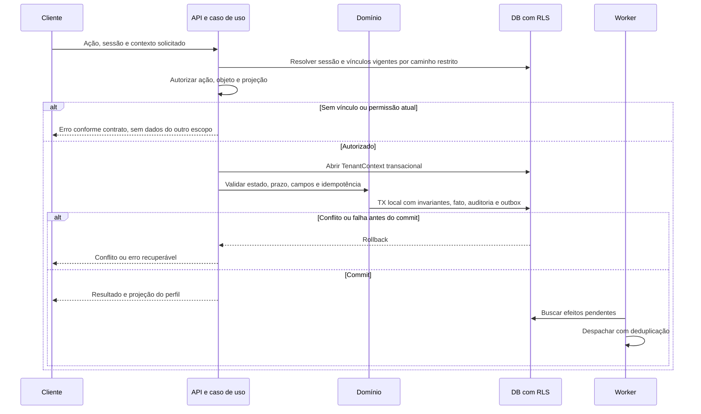

**Falhas e privacidade:** sessão inválida não abre tenant; falta de contexto falha fechada. A verificação de estado/concorrência é repetida dentro da transação. Auditoria é append-only e não copia identidade protegida, voto, senha ou cartão para logs. Suporte exige plano e autorização local vigentes e registro de acesso; nunca lê reclamações ou scores. Admin da plataforma não é superusuário operacional. Repetição HTTP com mesma chave/carga devolve resultado estável, conforme o contrato; retenção das chaves ainda pendente.

<a id="acesso"></a>
## 4. Acesso e administração

<a id="s02"></a>
### S02 — Pré-cadastro individual ou importado e convite

**Objetivo:** preparar pessoas e vínculos antes do primeiro acesso. **Pré:** condomínio/plano cadastrados e executor administrativo legitimado; estrutura de blocos, portarias e unidades disponível. **Pós:** pré-cadastro consistente e convite encaminhado; importação inicial não consome franquia. **Fontes:** RN-CD-01/04/17/20/24, RN-PL-03; RF-AD-01/04/17; US-AD-01/08/10; UF 4.1; [API administradora][oa-adm] (`administradoraPreCadastrarPessoa`, `administradoraPreCadastrarEmLote`); [tela admin][p-admin].

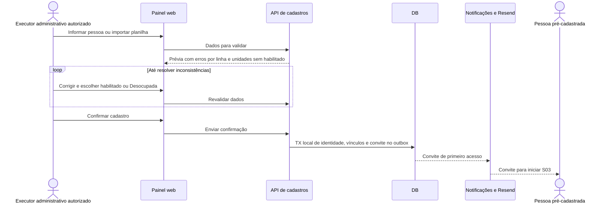

**Falhas/efeitos:** e-mail repetido, unidade inexistente e campos vazios ficam associados à linha; não perder linhas válidas durante a correção. A separação entre prévia e confirmação é de jornada, não declaração de dois endpoints: formato da planilha, limites e protocolo de importação permanecem pendentes. Convite não ativa conta nem substitui código. Falha de e-mail admite retentativa sem duplicar pessoa/vínculo. Área paga e cobrança exigem conta recebedora apta; titular PF exige termo. KYC não é validado pela simulação.

<a id="s03"></a>
### S03 — Código, senha, aceites e onboarding

**Objetivo:** completar o primeiro acesso. **Pré:** pré-cadastro ativo de S02 e conexão. **Pós:** senha definida, versões dos documentos aceitas e início do perfil após onboarding opcional. **Fontes:** RN-CD-02/03; RF-AC-01/02/07/08; US-AC-01/02/03; UF 3.1; [API comum][oa-comum] (`comumPedirCodigo`, `comumAtivar`, `comumRegistrarAceites`); [tela acesso][p-acesso].

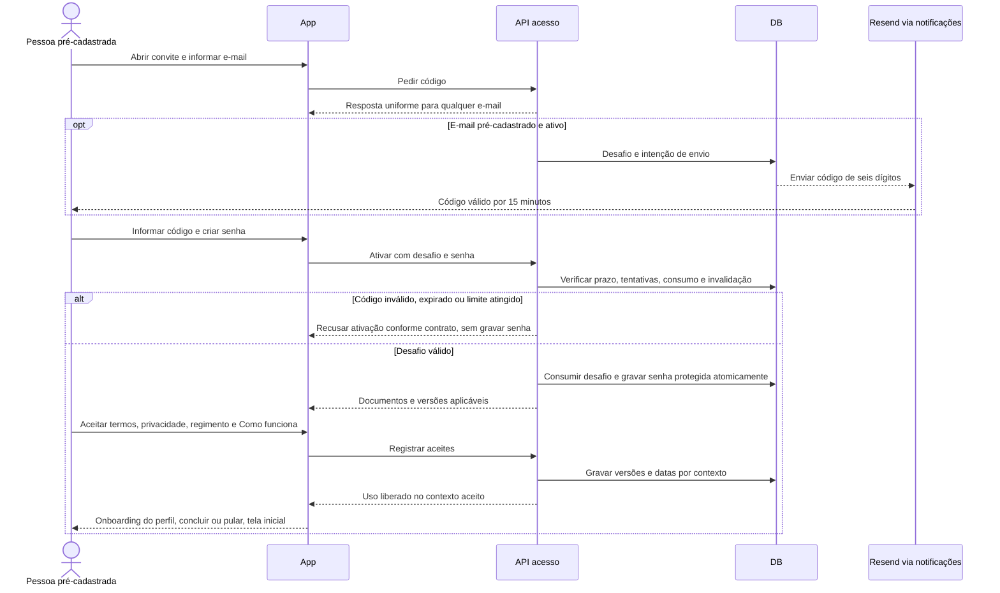

**Falhas/privacidade:** até cinco tentativas; código expirado/inválido não ativa acesso; reenvio após 60 s invalida o anterior. Senha tem pelo menos oito caracteres e confirmação igual na jornada. Sem todos os aceites, conta pode estar ativa mas uso bloqueado; regimento é por condomínio. Onboarding é UI, sem endpoint inventado. Código `123456` só existe como dica do protótipo. Cadastro e segredo não aparecem em logs nem em respostas de enumeração.

<a id="s04"></a>
### S04 — Login, recuperação, revogação e troca de contexto

**Objetivo:** manter sessão e contexto coerentes com os vínculos atuais. **Pré:** identidade existente; contexto ainda autorizado quando usado. **Pós:** sessão válida no escopo escolhido ou acesso negado/revogado. **Fontes:** RN-CD-02/03/05/07; SEG-03/04; RF-AC-03/04/05/06; US-AC-04/05/06; UF 3.2–3.3; guia §2–3; [API comum][oa-comum]; [acesso][p-acesso] e [core][p-core].

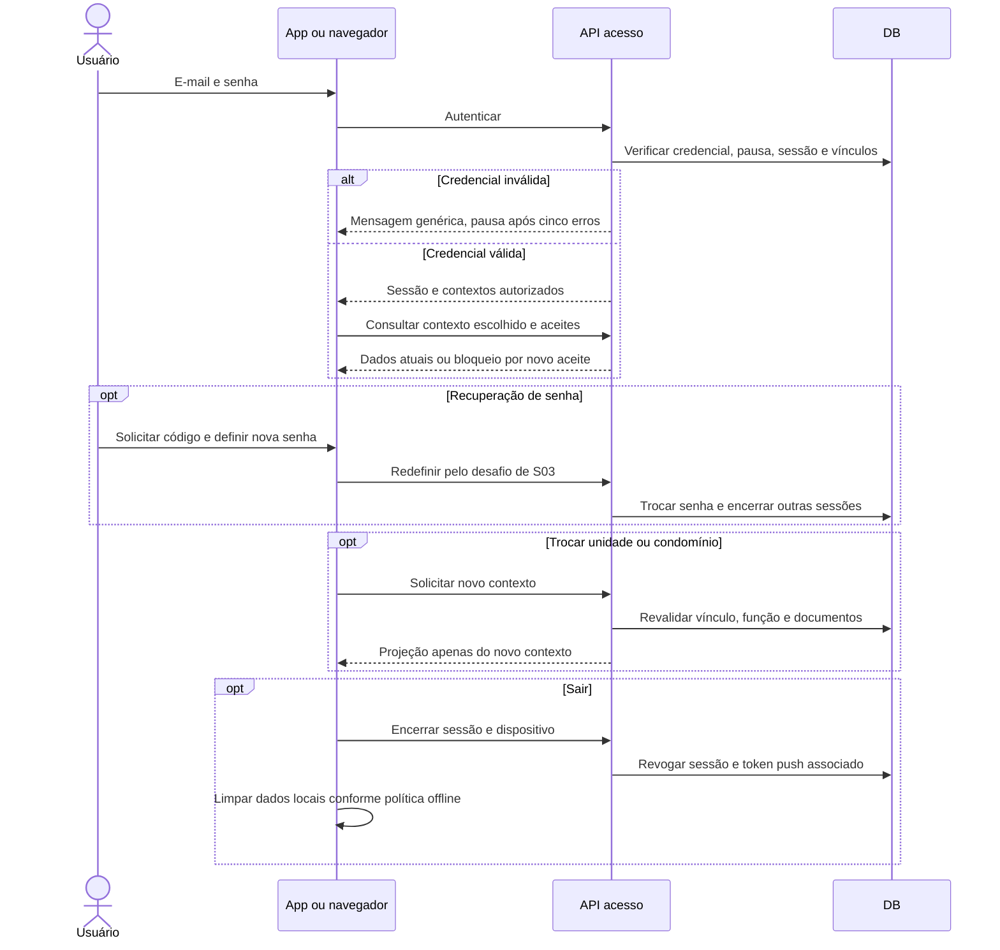

**Falhas/efeitos:** pausa de 15 min após cinco senhas erradas; redefinição disponível. Encerrar vínculo não derruba acesso legítimo em outro condomínio. Unidade removida sai do seletor; cliente recarrega contexto permitido, sem reaproveitar dados da anterior. Rotação/renovação de sessão é proposta do ADR-007; tolerância de rede pendente. Tema é preferência, web usa mesma autorização. Não definir enum de conta/sessão a partir destes passos.

<a id="s05"></a>
### S05 — Solicitação administrativa e configuração

**Objetivo:** encaminhar mudanças quando existe administradora ou Gestão + Suporte; autogestão executa diretamente com capacidade administrativa específica (RN-PL-08). **Pré:** solicitante elegível; suporte só no Gestão + Suporte. **Pós:** ação executada e contabilizada quando atendida, ou recusa motivada. **Fontes:** RN-CD-06/23/27/28, RN-PL-03/04/05, RN-GE-01 a RN-GE-03; RF-AD-02/03/07/16; US-AD-02/04, US-PL-02; UF 4.2; [síndico][oa-sind], [administradora][oa-adm], [proprietário][oa-prop]; [telas síndico][p-sind] e [admin][p-admin].

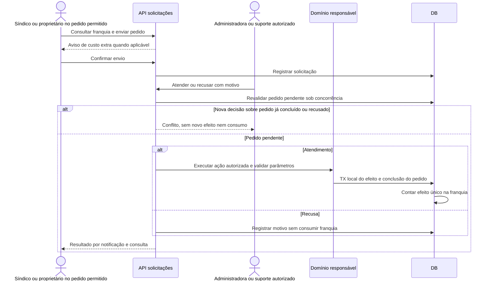

**Falhas/efeitos:** solicitante não marca o próprio pedido como atendido; sub fora da substituição não solicita como síndico. Valores configuráveis respeitam catálogo/faixas e precedência permitida; versões futuras não reescrevem instantâneos antigos. Pedido recusado e importação inicial não contam; atendimento repetido não cobra duas vezes. Reenvio HTTP com a mesma chave/carga recupera o resultado de S01; o conflito na figura é uma nova decisão incompatível com pedido já encerrado. O [E11](#e11) explicita o enum já proposto no contrato, sem acrescentar cancelamento ou reabertura. A atomicidade entre efeito e conclusão é proposta técnica: o contrato descreve concluir depois do cadastro feito, sem fechar a vinculação transacional; conferir esse alinhamento antes da implementação, em alteração própria se necessária. Formato de fatura não é definido aqui.

<a id="s06"></a>
### S06 — Moradia, locação e desligamento

**Objetivo:** mudar vigências sem herdar score ou reescrever responsabilidade passada. **Pré:** executor administrativo legitimado; resolver mandato ativo antes de remover gestor. **Pós:** vínculos coerentes, acesso anterior encerrado no escopo, efeitos futuros encaminhados. **Fontes:** RN-CD-04/07/08/18 a RN-CD-26; RN-SC-13/14; RN-FI-03; US-AD-03/09/10/11; UF 4.3/4.5; [administradora][oa-adm], [proprietário][oa-prop]; MER §2.2/5; [admin][p-admin].

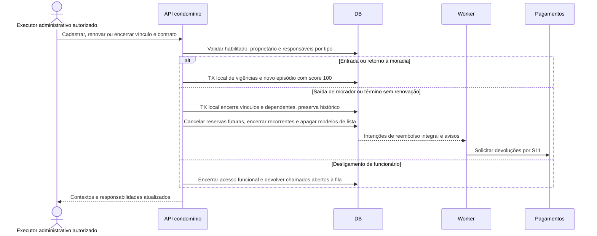

**Falhas/efeitos:** cadastro de inquilino o torna habilitado e proprietário não residente; contrato é fonte das datas. Sem fim, prazo indeterminado. Renovação estende limites de novas reservas/recorrências. Rotina 20 avisa 30 dias antes e desativa sete dias após fim sem renovação, ambos configuráveis; desocupação deixa proprietário responsável pelas duas naturezas. Cobranças emitidas mantêm responsável histórico. Notas e conclusões de funcionário não desaparecem. Sem habilitado transitório, bloquear reserva/visitante; sem proprietário com acesso, bloquear voto. Troca de habilitado no meio de reclamação é pendência, não transfere pontos automaticamente.

<a id="s07"></a>
### S07 — Mandato e substituição

**Objetivo:** atualizar poderes de gestão por vigência. **Pré:** síndico/subsíndico de unidades diferentes; ator autorizado. **Pós:** funções atuais recalculadas e autoria antiga preservada. **Fontes:** RN-CD-10 a RN-CD-14/27/28, RN-VO-04/06/09/15; RF-AD-09 a RF-AD-13; US-AD-06/07/12; UF 4.4; [síndico][oa-sind], [administradora][oa-adm]; [síndico][p-sind].

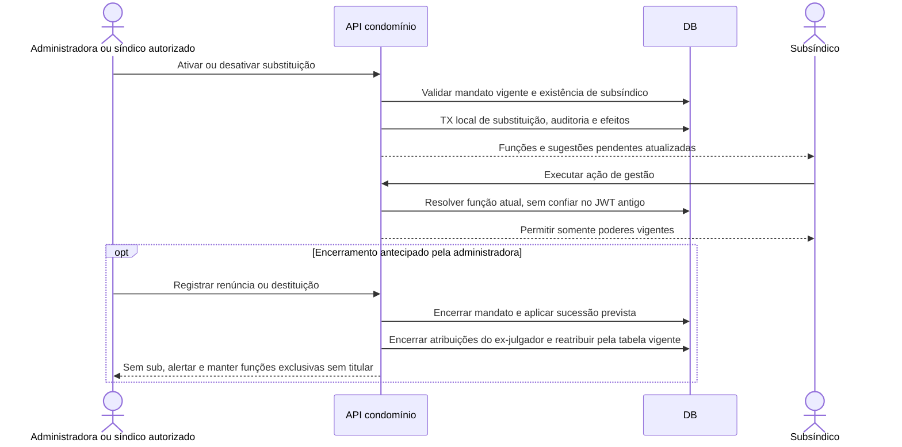

**Falhas/privacidade:** subsíndico nunca ativa/desativa a própria substituição. Fora dela mantém gestão limitada; sugestões retornam a ele ao assumir. Profissional é contratado, não eleito no app. Perda de mandato/função reatribui casos pela tabela vigente, preserva histórico e retira acesso anterior; eleição regular abre/encerra pela sequência de RN-VO-13 em qualquer plano; não conceder acesso geral a reclamações por sucessão presumida.

<a id="reservas"></a>
## 5. Reservas e pagamentos

<a id="s08"></a>
### S08 — Disponibilidade e disputa pelo mesmo horário

**Objetivo:** confirmar gratuita ou bloquear horário para pagamento sem corrida. **Pré:** morador autorizado na unidade ocupada; regras atuais da área, locação, score e atraso satisfeitas. **Pós:** somente um intervalo conflitante ocupado; paga Aguardando pagamento ou gratuita Confirmada. **Fontes:** RN-RE-01 a RN-RE-08/11/12, RN-CD-22, RN-SC-09/10; RF-RE-01/02/03/06; US-RE-01/02/03/05; UF 5.1; [morador][oa-mor] (`moradorConsultarDisponibilidadeArea`, `moradorCriarReserva`); MER §5; [morador][p-mor]. **Estado:** [E01](#e01).

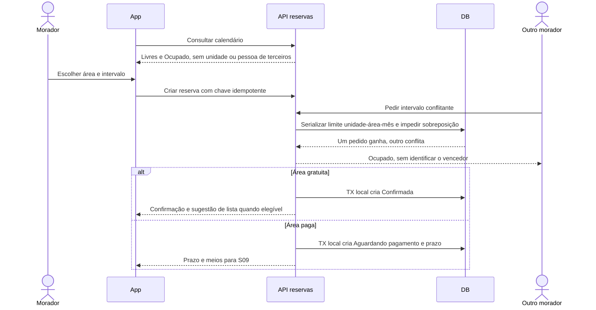

**Falhas/efeitos:** leitura do calendário não reserva. A decisão concorrente é transacional, com mecanismo físico ainda proposto. Limite mensal também precisa serialização; canceladas não contam. Paga expira no menor entre prazo configurado e início. Score bloqueia gratuitas apenas da pessoa/vínculo; atraso só bloqueia novas reservas se configurado e preserva confirmadas. Calendário oculto não substitui autorização no envio. Sugestão de lista só confirmada, depois de hoje, sem lista e não dispensada.

<a id="s09"></a>
### S09 — Iniciar pagamento de reserva

**Objetivo:** obter Pix ou checkout de crédito sem confundir tentativa com recebimento. **Pré:** reserva Aguardando pagamento ainda no prazo; conta recebedora apta. **Pós:** tentativa correlacionada ao Asaas, aguardando confirmação de S10. **Fontes:** RN-RE-03, RN-PG-01 a RN-PG-07; RF-PG-01/02; US-RE-03, US-AD-05; UF 5.1; [morador][oa-mor] (`moradorPagarReserva`); [integrações][integracoes]; [morador][p-mor]. **Estado:** [E01](#e01).

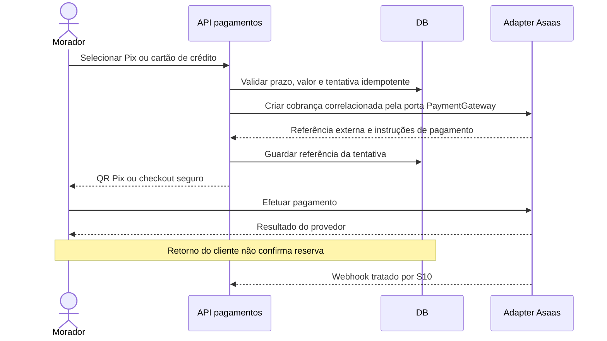

**Falhas/efeitos:** recusa permite tentar outro meio dentro do prazo; indisponibilidade não estende automaticamente o prazo. Timeout entre criação externa e persistência exige reconciliação da tentativa, não nova cobrança cega. Cartão não atravessa API/logs/banco. Dinheiro segue à conta do condomínio; taxa é despesa separada. Prazo real de confirmação, validade do QR e idempotência suportada pelo provedor exigem sandbox. Botões de pagamento do protótipo só mudam dados fictícios.

<a id="s10"></a>
### S10 — Webhook autenticado, confirmação e efeitos

**Objetivo:** reconhecer dinheiro uma vez e distribuir efeitos recuperáveis. **Pré:** evento recebido no endpoint do Asaas. **Pós:** evento durável/correlacionado ou quarentena; pagamento confirmado aplica efeitos idempotentes. **Fontes:** SEG-17; RN-FI-13/19/22/23, RN-PG-07; RF-PG-04, RF-FI-09/18; US-RE-03, US-FI-03; [webhooks][oa-webhooks] (`webhookAsaasReceberEvento`); [eventos][eventos] §5–7; MER §4.10/5. **Estados:** [E01](#e01), [E08](#e08), [E09](#e09).

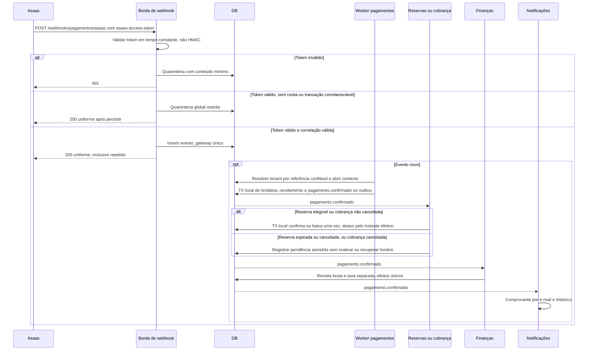

**Falhas/efeitos:** não confirmar recebimento durável antes de persistir evento. Sem correlação válida, não confiar em tenant do corpo; correlação posterior cria evento no condomínio correto. Primeiro `PAYMENT_CONFIRMED` ou `PAYMENT_RECEIVED` confirma uma vez por tentativa; o segundo completa recebimento/taxa, sem duplicar baixa. Pix normalmente chega como RECEIVED; cartão/boleto como CONFIRMED, conforme mapeamento proposto a validar no sandbox. Evento pendente atrasado não desfaz pago. Eventos de chargeback alertam sem transição automática. Consumidor que falha repete apenas seu efeito; confirmação da reserva, receita e envio não são uma transação distribuída. Pagamento tardio de reserva expirada/cancelada é registrado e encaminhado ao executor administrativo legitimado, inclusive gestão local na autogestão, para resolução assistida, sem recuperar horário, reativar nem devolver automaticamente. Conciliação: S35.

<a id="s11"></a>
### S11 — Cancelar e acompanhar reembolso

**Objetivo:** liberar horário e separar cancelamento de devolução concluída. **Pré:** reserva cancelável; ator autorizado. **Pós:** horário liberado, futuras autorizações da lista canceladas; intenção de reembolso quando devida. **Fontes:** RN-CA-01 a RN-CA-06, RN-VI-14/15, RN-PG-07, RN-FI-23; RF-RE-04/05, RF-PG-03/04; US-RE-04; UF 5.2; [morador][oa-mor] (`moradorCancelarReserva`), [eventos][eventos]; [morador][p-mor]. **Estado:** [E01](#e01).

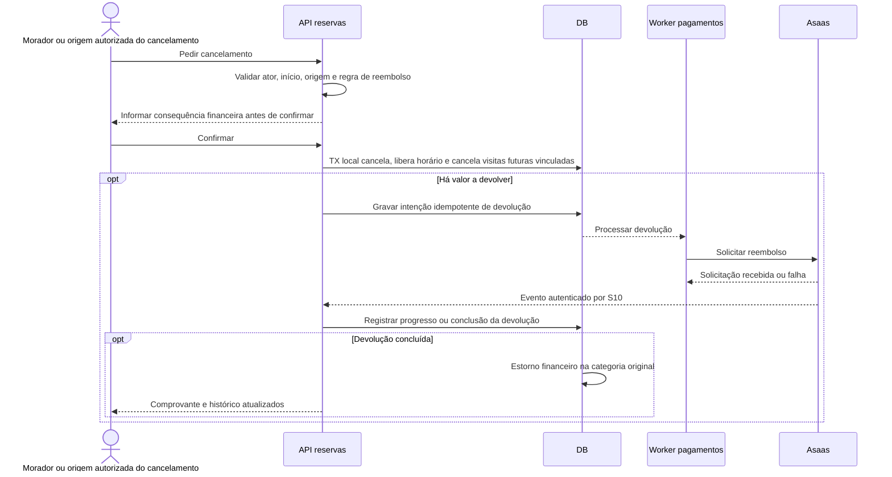

**Falhas/efeitos:** Cancelada com reembolso expressa o direito/origem do cancelamento, não prova que o dinheiro voltou. Devolução usa os rótulos propostos solicitado/em processamento/concluído/falhou, sem enum completo aprovado. Falha avisa morador e administradora; retry não duplica devolução. Paga fora do prazo de reembolso continua cancelável antes do início, com aviso de ausência de devolução; gratuita/sem valor pago fica Cancelada. Condomínio cancela com motivo e devolução integral quando houve pagamento; executor é síndico, sub em substituição, administradora ou suporte autorizado, com motivo e auditoria (12/11/2026). **Igualdade em 12 h:** Pedro confirmou em 12/11/2026 antecedência maior ou igual ao prazo configurado, inclusive igualdade exata. Quem já entrou na lista permanece no histórico.

<a id="s12"></a>
### S12 — Expirar reserva e enviar lembrete

**Objetivo:** executar prazos sem confundir expiração com lembrete. **Pré:** execução das rotinas 1 e 21; estado e instante atuais rechecados. **Pós:** não paga vencida libera horário; confirmada elegível recebe um lembrete. **Fontes:** RN-RE-03/14; RF-RE-10; US-RE-03; UF 5.1/14.1; backend §5.2; [eventos][eventos]. **Estado:** [E01](#e01).

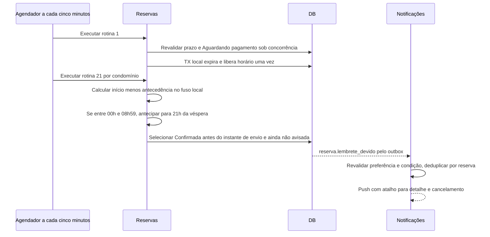

**Falhas/efeitos:** antecedência padrão 24 h, faixa 1–72 h. Confirmação posterior ao instante de envio não recebe lembrete. Cancelamento invalida pendência; aguardando/expirada não recebe. Execução atrasada ainda pode enviar antes do início conforme proposta do backend, sem alterar regra de confirmação anterior ao envio. Lembrete é só push, opcional e ligado por padrão; não entra na fila das 09h. Corrida webhook/expiração deve serializar a decisão; confirmação realmente tardia segue pendência de S10.

<a id="s13"></a>
### S13 — Uso, vistoria e falta

**Objetivo:** registrar uso real e evidência sem ampliar offline. **Pré:** internet; reserva em estado/horário elegível. **Pós:** Em andamento, Cumprida ou Não comparecimento; dano pode abrir reclamação. **Fontes:** RN-RE-09/10/13, RN-RC-12; RF-RE-08/09; US-RE-06; UF 5.3; [portaria][oa-port], [limpeza][oa-limp]; [funcionários][p-func]. **Estados:** [E01](#e01), [E07](#e07).

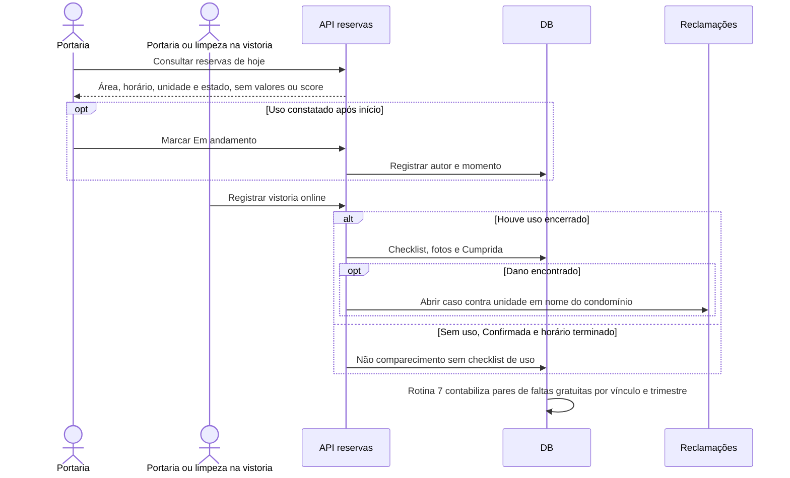

**Falhas/efeitos:** limpeza não inicia Em andamento; vistoria pode ir de Confirmada direto a Cumprida. Uso encerrado cedo não libera o intervalo original. Em andamento só segue a Cumprida, não a falta. Falta paga não causa pontos nem reembolso automático. Duas faltas gratuitas no mesmo trimestre/episódio causam −5, sem somar outros imóveis. Dano não aplica score antes do julgamento; negativa de reclamação do condomínio não penaliza pessoa reclamante inexistente.

<a id="e01"></a>
### E01 — Reserva

Fonte: RN §7.4, RN-RE-13 e [EstadoReserva][enums]. Guardas detalhadas em S08–S13; rótulo de reembolso não é estado da devolução.

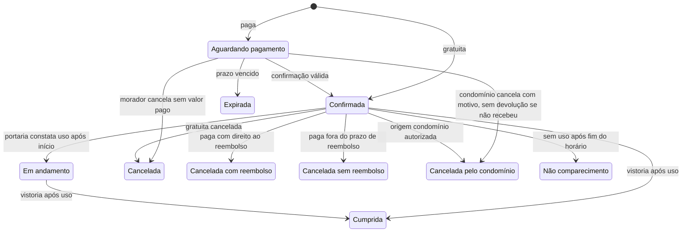

**Decisão de 12/11/2026:** Aguardando pagamento também pode ir a Cancelada pelo condomínio; sem recebimento não há devolução. Reserva expirada/cancelada que recebe dinheiro preserva o fato e abre pendência assistida, sem retomar horário/reativar ou devolver automaticamente.

<a id="visitantes"></a>
## 6. Visitantes e portaria

<a id="s14"></a>
### S14 — Autorizar visitante e atualizar a portaria em tempo real

**Objetivo:** levar autorização do morador à portaria correta. **Pré:** morador no contexto permitido, nome/data válidos; exceção de temporada só proprietário de unidade desocupada com política ativa. **Pós:** ocorrência consultável no recorte do dia/blocos e cache atualizado. **Fontes:** RN-VI-01/02/03/08/10, RN-OF-01; RF-VI-01 a RF-VI-05/13, RNF-05; US-VI-01/02; UF 6.1; [morador][oa-mor], [proprietário][oa-prop], [tempo real][async]; [morador][p-mor]. **Estado:** [E02](#e02).

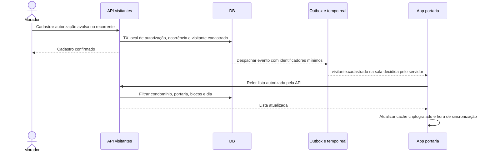

**Falhas/privacidade:** meta de atualização em até cinco segundos, não comprovada no ambiente gratuito. Socket usa token no handshake e sala definida pelo servidor; reconexão faz `syncLerAlteracoes`, com consulta periódica prevista. Eventos não transportam nome/documento. Cancelamento/edição repetem o caminho com nomes catalogados. Recorrência respeita fim da locação; saída encerra futuras recorrências. Temporada não cria login/score e não expõe rotina do inquilino.

<a id="s15"></a>
### S15 — Entrada, saída, interfone e Desfazer

**Objetivo:** registrar a passagem e avisar o morador. **Pré:** portaria lotada nos blocos atendidos; pessoa identificada na autorização ou autorizada pelo morador por interfone. **Pós:** evento de entrada/saída registrado, com opção de compensação. **Fontes:** RN-VI-04/05/06/07/17; RF-VI-06 a RF-VI-10; US-VI-03/05/08; UF 6.2; [portaria][oa-port] (`portariaRegistrarEntrada`, `portariaRegistrarEntradaPorInterfone`, `portariaRegistrarSaida`, `portariaDesfazerRegistroVisita`); [funcionários][p-func]. **Estado:** [E02](#e02).

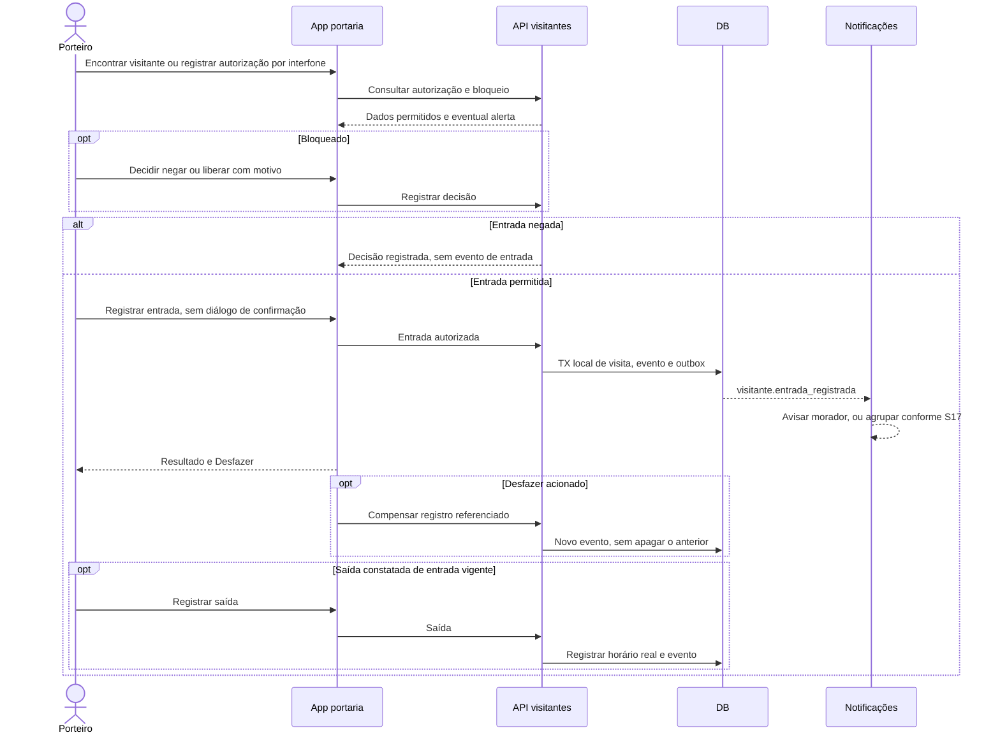

**Falhas/efeitos:** entrada em até dois toques; listas usam um toque com Desfazer. Autorizado por interfone já significa que entrou, não espera uma segunda entrada. Interfone é confirmação humana, sem integração com equipamento. Após 24 h sem saída, rotina 2 encerra sem inventar horário. Janela visual de Desfazer é 10 s no DS/UF; contrato de janela/reversão offline está pendente. Não prometer retirar push já entregue nem apagar o fato histórico.

<a id="s16"></a>
### S16 — Portaria offline, sincronização e divergência

**Objetivo:** preservar fatos locais e resolver divergência com o morador. **Pré:** cache do dia/blocos sincronizado; dispositivo e usuário conhecidos. **Pós:** resultado individual de cada operação e divergência confirmada quando exigida. **Fontes:** RN-OF-01 a RN-OF-06; RF-VI-05/06/11/12; US-VI-04/06; UF 6.3/6.4; [sync][oa-sync] (`syncEnviarOperacoes`, `syncLerAlteracoes`), [portaria][oa-port]; [funcionários][p-func]. **Estado:** [E02](#e02).

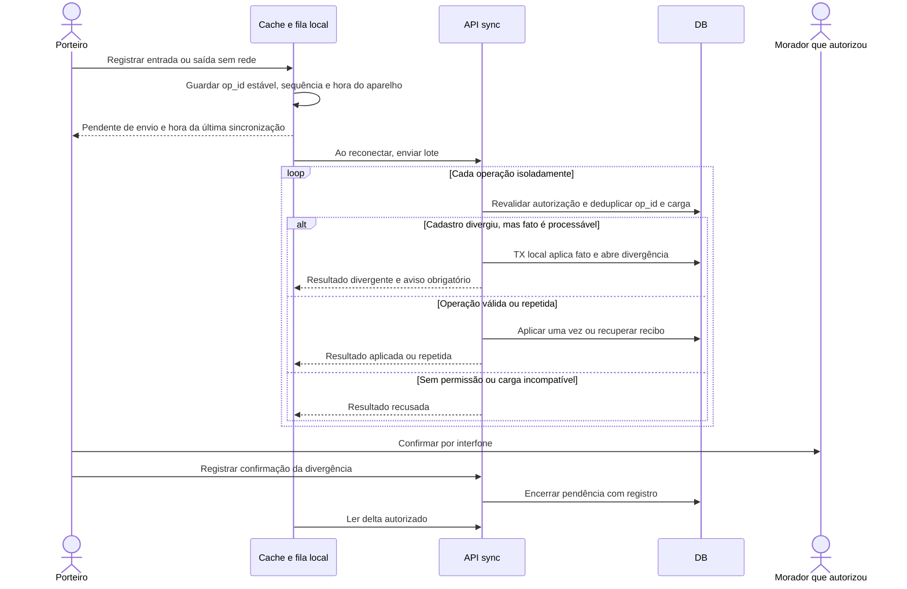

**Falhas/efeitos:** lote retorna resultado por operação; erro em uma não desfaz as demais. Divergência não vira notificação ao síndico nem some só por fechar a tela. Cache criptografado é apagado no fim do dia/logout; fila pendente separada é preservada protegida até sincronização/tratamento explícito; retenção e acesso após logout ainda exigem desenho. Contrato atual tipa entrada, saída e conclusão de chamado; interfone, negar, Desfazer, iniciar atendimento e confirmar divergência offline ainda não têm tipo definido. Treinamento usa visitantes/encomendas fictícios isolados: nenhum evento, push ou efeito financeiro real; acionamento pela API não definido.

<a id="s17"></a>
### S17 — Listas, recorrência de uso de nomes e chegadas agrupadas

**Objetivo:** autorizar várias pessoas sem entrada em lote. **Pré:** usuário pode cadastrar visitantes; data não passada; reserva de origem elegível quando vinculada. **Pós:** uma autorização avulsa por pessoa, estados independentes e contador de chegadas. **Fontes:** RN-VI-11 a RN-VI-17, RN-RE-12; RF-VI-14/15; US-VI-07/08; UF 6.5; [morador][oa-mor], [portaria][oa-port]; [morador][p-mor], [funcionários][p-func]. **Estado:** [E02](#e02), por pessoa; sem enum de lista inventado.

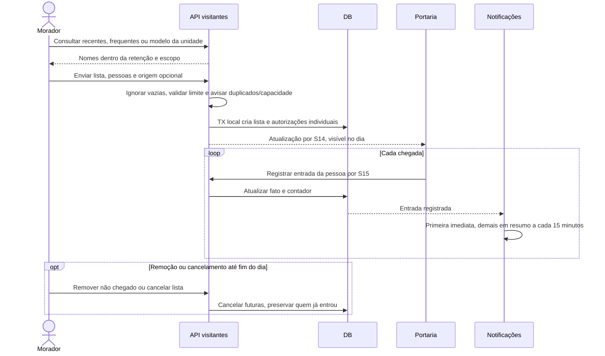

**Falhas/efeitos:** máximo padrão 100, configurável; excesso bloqueia, nome repetido/capacidade só avisam. Faixa da lista é informativa, não gera alerta de fora do horário. Reserva de origem fornece data/horário/local imutáveis. Recentes: últimos 90 dias; frequentes: três ou mais visitas, sempre respeitando retenção. Salvar modelo não cria visita recorrente. Cancelamento da reserva acompanha lista; saída do criador apaga modelo. Resumo agrupado e sua repetição são jobs idempotentes, não 21ª rotina adicional.

<a id="e02"></a>
### E02 — Visita

Fonte: RN §8.3 e [EstadoVisita][enums]. Arestas de Desfazer são compensações de eventos de S15, não novos estados; comportamento completo/reentrada depende de definição contratual.

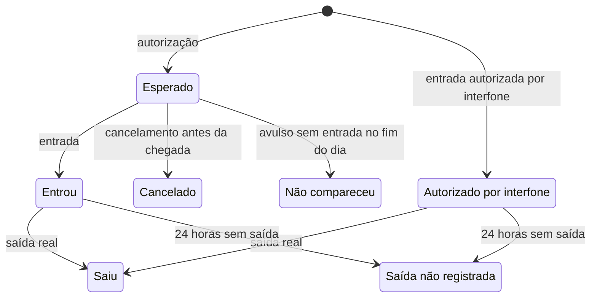

<a id="encomendas"></a>
## 7. Encomendas e entregas esperadas

<a id="s18"></a>
### S18 — Recebimento, correção, retirada e devolução

**Objetivo:** manter cadeia de recebimento e retirada por unidade. **Pré:** portaria autorizada e pacote que não seja comida de aplicativo. **Pós:** encomenda registrada/retirada ou devolvida por gestor elegível. **Fontes:** RN-EN-01 a RN-EN-06; RF-EN-01 a RF-EN-05; US-EN-01/02; UF 7.1; [portaria][oa-port], [síndico][oa-sind]; [funcionários][p-func]. **Estados:** [E03](#e03), efeito em [E04](#e04).

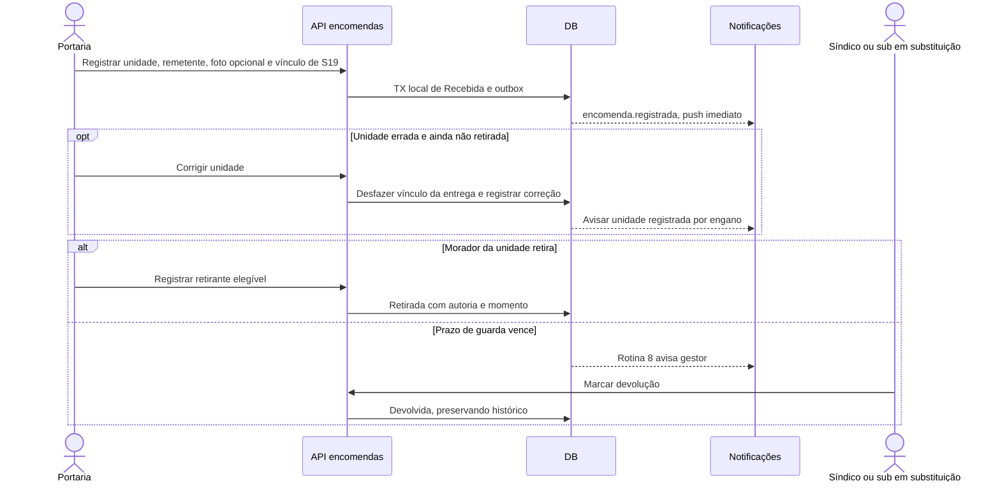

**Falhas/efeitos:** lembretes em três e sete dias; guarda padrão 30 dias. Sub normal só consulta vencidas, não devolve. Retirante deve morar na unidade; retirada por terceiro é lacuna, não permissão presumida. Correção retira acesso da unidade errada ao objeto corrigido; aviso não deve manter conteúdo indevido. Comprovante/foto usa S36. Encomendas não ganham operação offline por estarem no app da portaria.

<a id="s19"></a>
### S19 — Avisar, reagendar e vincular entrega esperada

**Objetivo:** ajudar a identificar pacote sem autorizar entrada ou retirada. **Pré:** qualquer morador da unidade, não proprietário não residente; data entre hoje e 30 dias. **Pós:** aviso atualizado; vínculo opcional transforma em Chegou. **Fontes:** RN-EN-07 a RN-EN-13; RF-EN-06/07/08; US-EN-03/04; UF 7.2; [morador][oa-mor], [portaria][oa-port], [tempo real][async]; [morador][p-mor], [funcionários][p-func]. **Estado:** [E04](#e04).

```mermaid
sequenceDiagram
    actor M as Morador
    participant A as API encomendas
    participant B as DB
    actor P as Portaria
    M->>A: Criar ou editar aviso
    A->>B: Validar data, limite de ativas e faixa completa
    A-->>P: Atualização em tempo real, sem push
    P->>A: Consultar esperadas e registrar pacote
    A-->>P: Candidata única ou de origem compatível
    P->>A: Confirmar vínculo ou Não vincular
    A->>B: TX local de encomenda e Chegou quando vinculada
    A-->>M: Apenas push normal da encomenda
    opt Data passou sem chegada
        B->>B: Rotina 9 marca Não chegou ou Encerrada se Só aviso
        M->>A: Reagendar Não chegou
        A->>B: Validar limite e voltar a Esperada
    end
```

**Falhas/efeitos:** limite padrão dez Esperadas por unidade. Sem faixa, fica ao fim da lista do dia; fora da faixa não alerta. Portaria pode vincular futura ou Não chegou dentro da tolerância padrão de três dias. Uma encomenda vincula uma entrega. iFood/entregador é Só aviso, nunca gera pacote nem vínculo. Chegou não edita/cancela pelo morador, mas correção de unidade em S18 desfaz vínculo e retorna conforme data: exceção expressa RN-EN-11 prevalece sobre tabela simplificada sem saída de Chegou. Exibição por 30 dias não define expurgo.

<a id="e03"></a>
### E03 — Encomenda

Fonte: RN §9.1 e [EstadoEncomenda][enums]. Correção de unidade é evento, não estado.

```mermaid
stateDiagram-v2
    state "Recebida" as R
    state "Prazo vencido" as PV
    state "Retirada" as RT
    state "Devolvida" as D
    [*] --> R
    R --> RT: morador retira
    R --> PV: prazo de guarda
    PV --> RT: morador retira
    PV --> D: gestor autorizado devolve
```

<a id="e04"></a>
### E04 — Entrega esperada

Fonte: RN-EN-09/11/12/13 e [EstadoEntregaEsperada][enums].

```mermaid
stateDiagram-v2
    state "Esperada" as E
    state "Não chegou" as N
    state "Chegou" as CH
    state "Cancelada" as C
    state "Encerrada" as F
    [*] --> E
    E --> N: data passou, pacote
    E --> F: data passou, iFood ou entregador
    E --> CH: vínculo confirmado
    N --> CH: vínculo dentro da tolerância
    N --> E: reagendar e validar limite
    E --> C: cancelar
    N --> C: cancelar
    CH --> E: correção desfaz vínculo, data hoje ou futura
    CH --> N: correção desfaz vínculo, data passada
```

<a id="chamados"></a>
## 8. Chamados e atendimento

<a id="s20"></a>
### S20 — Abrir e concluir limpeza online

**Objetivo:** enviar chamado à equipe correta e registrar conclusão. **Pré:** abertura online por morador, síndico/sub ou portaria; atendimento por funcionário da limpeza no setor. **Pós:** chamado Concluído com conclusão por ciclo e aviso ao autor. **Fontes:** RN-CH-01 a RN-CH-03/06/07/09 a RN-CH-14; RF-CH-01/02/05/06/07; US-CH-01/02; UF 8.1/8.2; [morador][oa-mor], [portaria][oa-port], [limpeza][oa-limp], [síndico][oa-sind]; [funcionários][p-func]. **Estado:** [E05](#e05).

```mermaid
sequenceDiagram
    actor U as Autor autorizado
    participant A as API chamados
    participant B as DB
    actor L as Funcionário de limpeza
    U->>A: Abrir com tipo, categoria, descrição e urgência explícita
    A->>B: Registrar abertura e prazo
    A-->>L: Fila ordenada por grupo, urgência e antiguidade
    opt Iniciar atendimento pelo detalhe
        L->>A: Marcar Em atendimento
        A->>B: Registrar evento
    end
    L->>A: Concluir, com até cinco fotos opcionais
    A->>B: TX local de conclusão efetiva, estado e outbox
    A-->>U: Aviso de conclusão e convite para avaliação se elegível
```

**Falhas/efeitos:** sem urgência não envia; sem rede abertura fica rascunho, não chamado confirmado. Limpeza pode concluir direto da fila sem iniciar atendimento. Prazo padrão 24 h; urgência não muda prazo/estado. Só síndico ou sub substituto ajusta urgência, com antes/depois, aviso e auditoria. Fotos inválidas podem ser substituídas ou omitidas, pois são opcionais. Prazo excedido destaca o chamado para gestão, não cria novo estado.

<a id="s21"></a>
### S21 — Conclusões offline concorrentes e correção tardia

**Objetivo:** preservar a conclusão do menor horário do celular no mesmo ciclo. **Pré:** fila local da limpeza; operações identificadas; fotos enviadas por S36 antes do lote conforme contrato. **Pós:** uma conclusão efetiva, todas preservadas e agregados corrigidos. **Fontes:** RN-CH-04/14/15/17; RF-CH-03; US-CH-02/04; UF 8.2; [sync][oa-sync], ADR-014 proposto; [funcionários][p-func]. **Estado:** [E05](#e05), permanece Concluído na correção.

```mermaid
sequenceDiagram
    participant A as Celular A
    participant B as Celular B
    participant S as API sync e chamados
    participant D as DB
    participant N as Notificações
    A->>A: Concluir offline às 10h10 com op_id A
    B->>B: Concluir mesmo ciclo às 10h05 com op_id B
    A->>S: Enviar primeiro
    S->>D: Registrar A como efetiva provisoriamente aos fatos conhecidos
    D-->>N: Disponibilizar conclusão
    Note over S,D: Pode já existir avaliação de A
    B->>S: Enviar depois com horário anterior
    S->>D: Bloquear ciclo e comparar horários dos celulares
    S->>D: TX local preserva A e torna B efetiva
    S->>D: Avaliação de A só histórica, fora das médias e sem transferência
    D-->>N: Avisar envolvidos e disponibilizar B para nova avaliação
    A->>S: Reenviar op_id A
    S-->>A: Recibo já processado, sem novo ciclo ou efeito
```

**Falhas/efeitos:** ordem de chegada não escolhe vencedor. Guardar hora do aparelho e de recebimento; menor horário enviado depois pode corrigir. Avaliação superada continua ligada ao atendente original. Nova janela configurada de avaliação começa na disponibilização da correção; lembrete próprio único. As 48 h de reabertura não reiniciam. Desempate exato e relógio incorreto seguem pendentes; não impor tolerância inventada. Identificação inequívoca do ciclo precisa ser preservada pelo protocolo, inclusive se houver reabertura entre envios.

<a id="s22"></a>
### S22 — Avaliar atendimento e reabrir

**Objetivo:** coletar avaliação definitiva e oferecer reabertura sem automatizá-la. **Pré:** autor elegível, conclusão efetiva disponível e janela aberta. **Pós:** uma avaliação por conclusão; eventual novo ciclo se autor reabrir no prazo. **Fontes:** RN-CH-07/15 a RN-CH-21; RF-CH-08 a RF-CH-11; US-CH-04/05; UF 8.4/8.5; [morador][oa-mor] (`moradorAvaliarAtendimento`, `moradorReabrirChamado`), [limpeza][oa-limp]; [morador][p-mor]. **Estados:** [E05](#e05), [E06](#e06).

```mermaid
sequenceDiagram
    actor M as Autor morador elegível
    participant A as API chamados
    participant B as DB
    participant G as Gestão
    M->>A: Enviar estrelas, comentário opcional e base explícita
    A->>B: Validar autoria, conclusão, janela e unicidade
    A->>B: TX local grava avaliação definitiva
    alt Uma ou duas estrelas
        A-->>G: Aviso com comentário
        A-->>M: Oferecer reabrir em 48h ou abrir novo chamado
    else Demais notas
        A-->>M: Avaliação registrada
    end
    opt Autor escolhe reabrir dentro do prazo
        M->>A: Reabrir
        A->>B: Reaberto, novo ciclo, fechar janela anterior não utilizada
    end
    G->>A: Consultar agregado permitido
    A-->>G: Projeção conforme perfil, não avaliação irrestrita
```

**Falhas/privacidade:** janela padrão sete dias; única e imutável. Sem fotos, base “Conferi pessoalmente” deve ser marcada; com fotos permite também “Vi as fotos do serviço”. Síndico profissional, portaria e funcionários não avaliam. Nota baixa não reabre sozinha nem avisa atendente/empresa. Administradora vê só agregado; funcionário vê sua projeção sem chamado/local/unidade/autor, mês no lugar de data, média/comentários só com três ou mais avaliações. Não altera score, reclamação ou pesquisa mensal. Rotina 11 envia um lembrete às 09h do dia seguinte ao fim das primeiras 24 h, se ainda elegível.

<a id="s23"></a>
### S23 — Manutenção acompanhada pelo síndico

**Objetivo:** acompanhar empresa terceirizada sem criar perfil de login Manutenção. **Pré:** chamado de manutenção e gestor autorizado. **Pós:** evolução até Concluído com empresa registrada. **Fontes:** RN-CH-05/06/11/14/15, RN-CD-27/28; RF-CH-04, RF-AD-14; US-CH-03; UF 8.3; [síndico][oa-sind] (`sindicoIndicarEmpresaChamado`, `sindicoAvancarEstadoChamado`, `sindicoConcluirChamado`); [síndico][p-sind]. **Estado:** [E06](#e06).

```mermaid
sequenceDiagram
    actor G as Síndico ou sub em substituição
    participant A as API chamados
    participant B as DB
    actor U as Autor do chamado
    G->>A: Consultar e escolher empresa cadastrada
    opt Empresa ainda não cadastrada
        G->>A: Cadastrar nome, serviço e telefone
        A->>B: Registrar empresa
    end
    G->>A: Avançar de Aberto para Orçamento e Agendado
    A->>B: Registrar cada avanço com autor e momento
    G->>A: Concluir com empresa e fotos opcionais
    A->>B: TX local da conclusão
    A-->>U: Avisar e oferecer avaliação/reabertura conforme S22
```

**Falhas/efeitos:** sem empresa não concluir; primeira atualização em até 48 h, prazo configurável. Sub normal só acompanha e não altera empresa/status/urgência. Empresa não tem login nem score; banner de Manutenção no protótipo continua proposta. Reabertura volta ao atendimento de manutenção; Reaberto aguarda triagem explícita do síndico/sub em substituição para Orçamento ou Agendado, com autoria e momento (decisão de 12/11/2026).

<a id="e05"></a>
### E05 — Chamado de limpeza

Fonte: RN §9.2, UF 8.2 e subconjunto de [EstadoChamado][enums]. Avaliação é marcação extra, não estado. Reenvio/correção do mesmo ciclo não cria nova transição.

```mermaid
stateDiagram-v2
    state "Aberto" as A
    state "Em atendimento" as E
    state "Concluído" as C
    state "Reaberto" as R
    [*] --> A
    A --> E: início opcional
    A --> C: conclusão direta
    E --> C: conclusão
    C --> R: autor reabre em até 48h
    R --> E: novo atendimento
    R --> C: nova conclusão direta da fila
```

<a id="e06"></a>
### E06 — Chamado de manutenção

Fonte: RN §9.2, UF 8.3 e [EstadoChamado][enums]. Caminho explícito com triagem após Reaberto para Orçamento ou Agendado (RN-CH-07, decisão de 12/11/2026).

```mermaid
stateDiagram-v2
    state "Aberto" as A
    state "Orçamento" as O
    state "Agendado" as AG
    state "Concluído" as C
    state "Reaberto" as R
    [*] --> A
    A --> O: gestor acompanha
    O --> AG: gestor agenda
    AG --> C: gestor conclui com empresa
    C --> R: autor reabre em até 48h
    R --> O: triagem explícita do gestor
    R --> AG: triagem explícita do gestor
```

<a id="convivencia"></a>
## 9. Convivência e comunicação

<a id="s24"></a>
### S24 — Reclamação, conversa e julgamento

**Objetivo:** atribuir julgador sem conflito e decidir após ouvir o alvo. **Pré:** autor elegível e alvo único do condomínio; ou origem vistoria em nome do condomínio. **Pós:** decisão registrada e pontos somente quando cabíveis. **Fontes:** RN-RC-01 a RN-RC-06/08 a RN-RC-13/16 a RN-RC-19; RN-SC-04/05; RF-RS-01 a RF-RS-08/13/15/16; US-RS-01 a US-RS-04/07/08; UF 9.1/9.2; [morador][oa-mor], [síndico][oa-sind], [conselho][oa-conselho], [administradora][oa-adm]; [morador][p-mor], [síndico][p-sind]. **Estado:** [E07](#e07).

```mermaid
sequenceDiagram
    actor U as Reclamante
    participant A as API convivência
    participant B as DB restrito
    actor J as Julgador atribuído
    actor T as Alvo ou representante
    U->>A: Abrir caso identificado com alvo e categoria
    A->>A: Aplicar tabela de julgador e conflito de interesse
    A->>B: Registrar Pendente sem julgador ou Aberta com atribuição
    A-->>T: Aviso sem identidade do reclamante
    J->>A: Iniciar conversa vinculada
    A-->>T: Conteúdo permitido da conversa
    T->>A: Responder, ou prazo de resposta vence
    J->>A: Validar ou negar com motivo e justificativa exigida
    A->>B: Revalidar atribuição e liberação da decisão
    A->>B: TX local de decisão, movimento de score e outbox
    A-->>T: Decisão sem identidade do reclamante
```

**Falhas/privacidade:** tabela RN §5.1 resolve alvo síndico/sub e ausência; autor que seria julgador é encaminhado a quem julgaria contra ele. Sem julgador fica Pendente, sem contagem de decisão. Conversa libera decisão após resposta ou cinco dias configuráveis. Prazo de decisão padrão 15 dias; lembretes e semáforo não decidem automaticamente. Gravidade alterada exige justificativa; negativa penalizante também. Suporte/admin não acessam identidade ou score. Proprietário não residente recebe apenas projeção de caso validado contra unidade: categoria/data/decisão/multa, sem conversa. Unidade desocupada não penaliza pessoa. Troca de habilitado mantém caso/score no episódio original, sem transferir ao novo ocupante; a pessoa original mantém defesa/recurso próprios restritos ao caso, com projeção sujeita à revisão de privacidade.

<a id="s25"></a>
### S25 — Recurso, reversão e recuperação de score

**Objetivo:** revisar penalidade e manter saldo por vínculo/condomínio. **Pré:** quem perdeu pontos, uma vez em até sete dias, decisão com recurso cabível. **Pós:** reversão no perfil original ou encerramento mantendo decisão; recuperação e bloqueio recalculados. **Fontes:** RN-RC-07/14/15, RN-SC-01 a RN-SC-05/08 a RN-SC-14; RF-RS-09/10/11/12; US-RS-05/06; UF 9.3/9.4; [comum][oa-comum] (`comumCriarRecurso`, `comumDecidirRecurso`, `comumObterScore`); MER §5; [morador][p-mor]. **Estado:** [E07](#e07).

```mermaid
sequenceDiagram
    actor U as Pessoa penalizada
    participant A as API convivência
    participant B as DB
    actor J as Julgador de recurso elegível
    participant R as Reservas
    U->>A: Recorrer da decisão
    A->>B: Validar prazo, unicidade e perda de pontos
    A->>A: Excluir partes do julgamento e aplicar tabela de recurso
    A->>B: Registrar recurso e pendência de atribuição se necessária
    J->>A: Aceitar ou negar recurso
    alt Aceito
        A->>B: TX local de Recurso aceito e reversão da perda efetiva no score original
    else Negado
        A->>B: Encerrar mantendo decisão
    end
    B-->>R: score.alterado, recalcular direito a gratuitas
    opt Período de regularidade completo
        A->>B: Rotina 4 aplica ganho único de até cinco pontos
        B-->>R: Reavaliar bloqueio pessoal naquela unidade
    end
```

**Falhas/efeitos:** decisão de administradora/conselho não tem recurso no app. Se partes impedem julgamento e não há administradora/conselho, aguarda atribuição e alerta cadastro de conselho sem revelar caso ao suporte. Sem recurso em sete dias, rotina 12 encerra. Score limita 0–100; ≤60 bloqueia gratuitas só da pessoa/unidade, volta ao passar de 60. Regularidade é de cada perfil, com reinício apenas nos eventos definidos. Recurso após saída reverte perfil original, nunca novo episódio 100; reversão devolve somente a perda efetivamente aplicada, vinculada à penalidade original: 3→0 por penalidade nominal10 devolve3, com teto100 (12/11/2026). Score é referência, não julgamento público; não usar verde/vermelho.

<a id="e07"></a>
### E07 — Reclamação

Fonte: RN §5.5 e [EstadoReclamacao][enums]. Guardas de prazo, julgador e perda de pontos em S24/S25. “Prazo esgotado” não é estado.

```mermaid
stateDiagram-v2
    state "Pendente" as P
    state "Aberta" as A
    state "Em conversa com o alvo" as C
    state "Validada" as V
    state "Negada" as N
    state "Em recurso" as R
    state "Recurso aceito" as RA
    state "Encerrada" as E
    [*] --> P: sem julgador possível
    [*] --> A: julgador atribuído
    P --> A: julgador disponível, começa prazo
    A --> C: iniciar conversa
    C --> V: validar após resposta ou prazo
    C --> N: negar após resposta ou prazo
    V --> R: recurso elegível
    N --> R: negativa com perda de pontos
    V --> E: sem recurso cabível ou prazo encerrado
    N --> E: sem penalidade ou prazo encerrado
    R --> RA: devolver pontos
    R --> E: recurso negado
```

<a id="s26"></a>
### S26 — Pesquisa mensal e fechamento

**Objetivo:** separar pesquisa de funcionário da avaliação de atendimento. **Pré:** morador elegível e mês aberto; funcionário ativo no mês. **Pós:** resposta editável até fechamento; apuração única e score funcional ajustado. **Fontes:** RN-PE-01 a RN-PE-09; RF-PE-01 a RF-PE-04; US-PE-01/02; UF 12.1; [morador][oa-mor], [comum][oa-comum]; MER §4.8, ADR-010 proposto; [morador][p-mor].

```mermaid
sequenceDiagram
    actor M as Morador elegível
    participant A as API convivência
    participant B as DB restrito
    participant W as Rotina 6
    M->>A: Avaliar funcionário de um a cinco, comentário opcional
    A->>B: Gravar ou substituir resposta única pessoa-funcionário-mês
    W->>B: Último dia às 23h59, fechar contra edição concorrente
    W->>B: Calcular média de cada funcionário avaliado
    W->>B: TX local aplica movimentos únicos no score funcional
    W->>B: Calcular média das médias por setor
    alt Dois ou mais funcionários avaliados no setor
        A-->>M: Publicar nota do setor
    else Menos de dois
        A-->>M: Não publicar nota do setor
    end
```

**Falhas/privacidade:** sem avaliação não ajusta score; abaixo de 3: −5; de 3 até menos de 4,5: zero; ≥4,5: +5. Cada funcionário pesa igual na nota do setor. Responder é opcional, pode pular desconhecido. Notas/comentários individuais só ao funcionário sem avaliador. HMAC/rotação e recuperação dos próprios dados continuam propostas e não garantem anonimato absoluto. “Aberta/fechada” descreve a janela; não é enum completo de pesquisa aprovado.

<a id="s27"></a>
### S27 — Comunicado, sugestão e resposta

**Objetivo:** publicar em nome do condomínio ou conversar individualmente com autorização. **Pré:** síndico/sub substituto; sub normal apenas sugere; julgador só na conversa vinculada à reclamação. **Pós:** público e autoria registrados, leituras/respostas restritas. **Fontes:** RN-CO-01 a RN-CO-05, RN-RC-13; RF-CO-01 a RF-CO-04, RF-RS-14; US-CO-01/02/03; UF 10.1; [síndico][oa-sind], [morador][oa-mor], [comum][oa-comum]; [síndico][p-sind].

```mermaid
sequenceDiagram
    actor S as Subsíndico fora da substituição
    actor G as Síndico ou gestor em substituição
    participant A as API comunicação
    participant B as DB
    actor U as Destinatário autorizado
    opt Sugestão do subsíndico
        S->>A: Sugerir comunicado
        A->>B: Guardar Aguardando o síndico
        G->>A: Editar e enviar ou descartar
        A-->>S: Avisar resultado
    end
    G->>A: Enviar geral por público ou individual
    A->>B: TX local com autoria e destinatários permitidos
    A-->>U: Disponibilizar comunicado
    U->>A: Ler, ou responder se individual
    A->>B: Registrar leitura ou mensagem no histórico permitido
    opt Conteúdo ofensivo denunciado
        U->>A: Denunciar conteúdo
        A->>A: Encaminhar conforme autor e conflito de interesse
        G->>A: Destinatário atribuído consulta projeção protegida
        A->>A: Revalidar destinatário e ocultar identidades protegidas
        G->>A: Encerrar sem ação ou ocultar conteúdo com motivo
        A->>B: TX local da decisão e histórico, sem score automático
    end
```

**Falhas/privacidade:** comunicado geral só moradores, funcionários ou todos; proprietário não residente recebe gerais aplicáveis. Substituição devolve sugestões pendentes ao sub. Não inventar nome de evento de comunicado: catálogo ainda não o define. Denúncia contra síndico segue julgador alternativo; destinatário autorizado revisa projeção protegida e encerra sem ação ou oculta com motivo/histórico, sem score automático. Projeção contra desanonimização exige revisão; divergência sobre administradora criar denúncia permanece. Ler mensagem não concede acesso a reclamação vinculada fora do recorte autorizado.

<a id="votacoes"></a>
## 10. Reuniões e eleições

<a id="s28"></a>
### S28 — Reunião, procuração, voto online/presencial e encerramento

**Objetivo:** contar um voto efetivo por pauta/unidade, com sigilo. **Pré:** convocação por gestor autorizado; opções/quórum definidos; elegibilidade vigente. **Pós:** participação registrada ou resultado agregado após encerramento. **Fontes:** RN-VO-01/02/03/08/10/11/12/16/17/18; RF-VO-01 a RF-VO-04/07/09/10/11; US-VO-01/02; UF 11.1; [morador][oa-mor], [proprietário][oa-prop], [síndico][oa-sind]; MER P-03; [morador][p-mor], [síndico][p-sind].

```mermaid
sequenceDiagram
    actor G as Síndico ou sub substituto
    actor P as Proprietário ou procurador elegível
    participant A as API votação
    participant B as DB com proteção de voto
    actor R as Registrador presencial autorizado
    G->>A: Convocar com pautas, opções, quórum e natureza de despesa
    A->>B: TX local cria votação e pelo menos duas opções imutáveis
    opt Proprietário indica procurador antes do voto
        P->>A: Nomear usuário do condomínio
        A->>B: Validar no máximo uma unidade adicional
    end
    alt Voto online
        P->>A: Enviar voto
    else Voto presencial
        R->>A: Registrar voto por unidade
    end
    A->>B: Revalidar prazo, elegibilidade e unicidade por pauta-unidade
    A->>B: Persistir participação e conteúdo com proteção proposta
    A-->>P: Confirmar participação, sem resultado parcial
    G->>A: Encerrar reunião
    A->>B: Fechar contra votos concorrentes e apurar
    A-->>P: Contagem por opção, sem quórum ou empate se aplicável
    G->>A: Anexar ata e lista de presença por S36
```

**Falhas/pendências:** votação online vai da convocação ao encerramento. Sub normal registra presenciais nas reuniões convocadas pelo síndico, não encerra nem cria pauta. Unidade já votante não vota de novo, salvo substituição prevista RN-VO-18: em pauta sem despesa extraordinária, inquilino pode votar e proprietário o substitui até encerramento, com aviso ao inquilino. **A implementação dessa substituição está bloqueada pelo sigilo do MER P-03/ADR-009**; não criar associação oculta identidade→opção. Pauta padrão envolve despesa extraordinária. Inadimplência bloqueia voto conforme regra, mas operacionalização presencial está pendente. Empate/sem quórum publica contagem, consequência fora do app. Não criar enum completo de reunião/votação a partir desses resultados.

<a id="s29"></a>
### S29 — Candidatura, eleição e mandato

**Objetivo:** eleger representantes sem transformar síndico profissional em candidato. **Pré:** eleição aberta por condutor legitimado de RN-VO-13 em qualquer plano; prazo de candidatura definido. **Pós:** resultado apurado ou segundo turno; no Essencial autogestão o registro de mandato exige executor autorizado do condomínio, com concessão inicial ainda pendente. **Fontes:** RN-VO-04 a RN-VO-07/09/13/14/15/19; RF-VO-05/06/07/08; US-VO-03; UF 11.2; [síndico][oa-sind], [morador][oa-mor], [administradora][oa-adm]; [síndico][p-sind], [morador][p-mor].

```mermaid
sequenceDiagram
    actor O as Condutor legitimado RN-VO-13
    actor C as Candidato
    participant A as API eleições
    participant B as DB
    actor D as Executor de governança autorizado
    Note over O,A: Qualquer plano: síndico, sub na ausência, conselho sem ambos, proprietário designado sem todos
    O->>A: Abrir eleição e prazo de candidatura
    C->>A: Candidatar-se
    A->>B: Verificar convenção, elegibilidade e reeleição
    A-->>C: Aceitar ou mostrar motivo de inelegibilidade
    Note over A,B: Votação usa barreiras de S28, somente proprietário ou procurador
    O->>A: Solicitar apuração no encerramento autorizado
    A->>B: Apurar votos sem resultado parcial anterior
    alt Segundo turno empatado ou sem candidato elegível
        A->>B: Registrar resultado inconclusivo sem vencedor automático
        A-->>D: Encaminhar para tratamento assistido
    else Primeiro empate eleitoral
        A->>B: Preparar segundo turno entre empatados em até sete dias
    else Resultado definido
        A->>B: Se eleitos da mesma unidade, próximo sub mais votado
        D->>A: Registrar início e fim dos mandatos
        A->>B: Persistir vigências por S07
    end
```

**Falhas/pendências:** inquilino pode se candidatar salvo convenção, mas não ganha voto eleitoral próprio por isso. Profissional é contratado/recontratado fora da eleição. A ausência factual de sub/conselho mantém alerta de composição a revisar, sem bloquear a condução eleitoral aprovada pelo proprietário designado quando não há nenhum órgão. Abertura/encerramento seguem RN-VO-13 de 13/11/2026 em qualquer plano; administradora/suporte autorizado também podem. Prova de ausência, designação inicial e concessão temporária ainda dependem de revisão. Segundo empate ou ausência de elegível é inconclusivo e encaminhado sem vencedor automático; ciclo completo de candidatura ainda não definido. Não expor voto individual em histórico ou auditoria.

<a id="financas"></a>
## 11. Cobrança e finanças

<a id="s30"></a>
### S30 — Configurar, emitir, pagar e marcar atraso

**Objetivo:** cobrar responsável correto e manter valores atualizados. **Pré:** módulo ativo, conta apta, ao menos um meio, taxas e responsáveis por natureza configurados. **Pós:** cobrança emitida, paga ou em atraso com baixa por S10. **Fontes:** RN-FI-01 a RN-FI-13/16/17/20; RF-FI-01 a RF-FI-05/07/08/09/11/12/13/16; US-FI-01/02/03/05; UF 13.1/13.2; [administradora][oa-adm], [morador][oa-mor], [proprietário][oa-prop]; [admin][p-admin], [morador][p-mor]. **Estado:** [E08](#e08).

```mermaid
sequenceDiagram
    actor A as Executor administrativo autorizado
    participant C as API cobrança
    participant B as DB
    participant G as Asaas
    actor P as Responsável financeiro
    A->>C: Configurar módulo, formas, valor e responsáveis
    C->>B: Validar e guardar vigência
    B-->>C: Rotina 15, antecedência da emissão
    C->>B: Criar cobrança única com responsável e regras congelados
    C->>G: Emitir forma habilitada, boleto com QR Pix quando escolhido
    C-->>P: Cobrança e meios disponíveis
    P->>C: Pagar ou pedir segunda via
    C->>C: Calcular valor atualizado do dia no servidor
    C->>G: Obter instruções atualizadas
    G-->>C: Confirmação autenticada por S10
    C->>B: Baixa idempotente e efeito financeiro
    opt Venceu sem pagamento
        B-->>C: Rotina 16
        C->>B: Marcar Em atraso e situação da unidade
        C-->>P: Lembretes conforme rotina 17 e canal a definir
    end
```

**Falhas/efeitos:** vencimento padrão dia 10, próximo útil quando necessário; emissão 15 dias antes. Multa padrão 2%, teto 2%; juros padrão 1% ao mês proporcionais; desconto opcional. Inquilino ordinárias/proprietário extraordinárias por padrão, alterável conforme contrato; desocupada proprietário ambas. Baixa tardia entra no mês do pagamento, não reabre finanças. Vencida ainda Emitida paga após vencimento vai a Paga com atraso pelo instante efetivo (RN-FI-13); mapeamento do instante no Asaas depende de PoC. Cobrança Cancelada recebe registro financeiro/pendência sem reativação. Canal dos lembretes e cobrança em atraso obrigatória não definidos. Segunda via não duplica dívida; evitar dupla multa entre servidor e Asaas exige PoC.

<a id="s31"></a>
### S31 — Extra, baixa manual, cancelamento e duplicidade real

**Objetivo:** tratar exceções financeiras auditadas sem confundir repetição com dinheiro novo. **Pré:** solicitação do síndico para extra; executor administrativo legitimado, inclusive gestão local na autogestão, para operação financeira. **Pós:** cobrança/baixa registrada ou divergência resolvida com trilha. **Fontes:** RN-FI-13/14/15/19/20; RF-FI-06/10/15/16; US-FI-04; UF 13.2; [administradora][oa-adm] (`administradoraLancarCobrancaExtra`, `administradoraRegistrarBaixaManual`, `administradoraResolverDivergenciaDePagamento`), [síndico][oa-sind]; [admin][p-admin]. **Estado:** [E08](#e08).

```mermaid
sequenceDiagram
    actor S as Síndico
    actor A as Administradora autorizada
    participant C as API cobrança e pagamentos
    participant B as DB
    participant G as Asaas
    S->>C: Solicitar cobrança extra com natureza e unidades
    A->>C: Lançar extra após conferir solicitação
    C->>B: Registrar emissão ao responsável da natureza
    opt Pagamento fora do app
        A->>C: Baixar com comprovante e motivo
        C->>B: TX local de baixa auditada e efeito financeiro
    end
    opt Cancelamento autorizado
        A->>C: Cancelar cobrança com motivo
        C->>B: Registrar cancelamento e auditoria
    end
    G-->>C: Segundo recebimento real para mesma cobrança
    C->>B: Registrar dinheiro e divergência sem duplicar estado Paga
    C-->>A: Alertar duplicidade
    A->>C: Escolher devolução ou abatimento seguinte
    C->>B: Registrar decisão e intenção idempotente
    opt Devolução escolhida
        C->>G: Solicitar por S11 e esperar confirmação
    end
```

**Falhas/efeitos:** extra requer descrição/tipo/valor/unidades/vencimento; valor total ou por unidade segue pendência. Multa por infração vai ao responsável ordinário e avisa proprietário; eventual reemissão segue RN-FI-20. Mesmo evento repetido não é pagamento duplicado; baixa manual seguida de confirmação deve conciliar origem, sem esconder recebimento. Abatimento não reconhece nova receita de caixa. Crédito após troca de responsável permanece pendente. Cancelar cobrança não implica devolução já concluída. CSV individual de cobranças só administradora; poderes de exportação na autogestão continuam em revisão; não é a exportação agregada de S32. Acordos de parcelamento são V2.

<a id="e08"></a>
### E08 — Cobrança do MVP

Fonte: RN §12.2 e [EstadoCobranca][enums]. O contrato contém `em_acordo` para V2; excluído deste recorte do MVP. Cancelada recebe registro financeiro/pendência sem mudar estado. Emitida paga após vencimento vai a Paga com atraso pelo instante efetivo.

```mermaid
stateDiagram-v2
    state "Emitida" as E
    state "Em atraso" as A
    state "Paga" as P
    state "Paga com atraso" as PA
    state "Cancelada" as C
    [*] --> E
    E --> P: pagamento no prazo confirmado
    E --> PA: pagamento efetivo após vencimento antes da rotina
    E --> A: vencida sem pagamento
    E --> C: cancelamento com motivo
    A --> PA: pagamento atualizado confirmado
    A --> C: cancelamento com motivo
```

<a id="s32"></a>
### S32 — Lançamentos, recorrência, fechamento, estorno e consulta

**Objetivo:** manter controle gerencial de caixa e leitura agregada. **Pré:** ator autorizado; mês/data/categoria elegíveis. **Pós:** lançamento válido ou estorno vinculado, mês fechado sem reabertura e exportação protegida. **Fontes:** RN-FI-21 a RN-FI-32; RF-FI-17 a RF-FI-24; US-FI-07 a US-FI-10; UF 13.3/13.4; [administradora][oa-adm], [síndico][oa-sind], [conselho][oa-conselho]; MER §4.11/5; [finanças][p-fin]. **Estados:** [E09](#e09), [E10](#e10).

```mermaid
sequenceDiagram
    actor A as Executor administrativo autorizado
    participant F as API finanças
    participant B as DB
    participant W as Worker
    actor L as Síndico, sub em substituição ou conselho em leitura
    A->>F: Criar avulso ou recorrência
    F->>B: Validar valor positivo, categoria, data e mês aberto
    F->>B: TX local do lançamento e auditoria
    W->>F: Rotina 18 gera competência faltante da recorrência
    F->>B: Inserir uma vez por recorrência e competência
    A->>F: Fechar após último dia do mês
    F->>B: Serializar com escritas e marcar Fechado
    Note over F,W: Rotina 19 também fecha no dia configurado
    A->>F: Corrigir lançamento fechado com motivo
    F->>B: TX local cria Estorno oposto e marca original Estornado
    L->>F: Consultar filtros, comentar ou solicitar exportação
    F->>B: Projetar receitas agregadas sem unidade ou responsável
    F-->>L: Resumo, lançamentos permitidos e comentários
    F->>W: Exportar CSV ou PDF com escopo e filtros autorizados
    W-->>L: Arquivo privado acessível por S36
```

**Falhas/efeitos:** avulso não pode ter data futura/fechada; despesa exige fornecedor. Recorrência fixa ajusta dia ao último do mês curto; encerrar só afeta futuro. Automático não edita/exclui manualmente: corrigir na origem. Receita bruta e taxa Administração separadas; folha só total, sem salários individuais. Fechamento padrão dia 10 seguinte; mês não reabre. Estorno administrativo é novo lançamento no mês corrente, mesma categoria, valor oposto; não estornar estorno. Comentário é imutável, avisa administradora, não muda valores nem aprova contas. Receitas automáticas de cobrança e reservas são apresentadas agregadas, sem unidade. Filtros/exportação preservam esse recorte; CSV de cobranças individual é outra autorização. Exportação assíncrona e agregação diária por categoria foram decididas em12/11/2026; TTL/retenção e receita avulsa Fundo de reserva seguem pendentes.

<a id="e09"></a>
### E09 — Lançamento financeiro

Fonte: RN §12.4, RN-FI-23/28 e [EstadoLancamento][enums]. Estorno é **outra linha**, não transformação do original em Estorno. A figura separa os dois nascimentos; devoluções automáticas seguem origem em S11/S31, não edição manual.

```mermaid
stateDiagram-v2
    state "Lançado" as L
    state "Estornado" as E
    state "Estorno" as ES
    [*] --> L: lançamento válido
    L --> E: estorno administrativo em mês fechado
    [*] --> ES: novo lançamento oposto ligado ao original
```

Editar/excluir avulso em mês aberto não cria enum Excluído. Original e contrapartida são gravados atomicamente; estorno não se estorna.

<a id="e10"></a>
### E10 — Mês financeiro

Fonte: RN-FI-28, MER §4.11 e [EstadoMesFinanceiro][enums].

```mermaid
stateDiagram-v2
    state "Aberto" as A
    state "Fechado" as F
    [*] --> A
    A --> F: administradora após fim do mês ou rotina 19
```

Sem seta de reabertura. Comentários posteriores são permitidos; correções usam mês corrente e não reescrevem valores do fechado.

<a id="transversais"></a>
## 12. Plataforma, LGPD e serviços transversais

<a id="s33"></a>
### S33 — Planos, acesso de suporte e parâmetros

**Objetivo:** aplicar faixa/ciclo comercial sem acesso operacional global. **Pré:** admin da plataforma autorizado; contratos e unidades cadastrados. **Pós:** plano/preço vigente correto e suporte condicionado à autorização local. **Fontes:** RN-PL-01 a RN-PL-07, RN-CD-16, RN §13; US-PL-01/02; RF-AD-16, SEG-13; [plataforma][oa-plat], [administradora][oa-adm]; política de acesso §5.3; [admin][p-admin] como simulação parcial.

```mermaid
sequenceDiagram
    actor P as Admin da plataforma
    participant A as API plataforma
    participant B as DB
    actor S as Suporte
    P->>A: Cadastrar condomínio, plano ou autorização de suporte
    A->>B: Validar atribuição e vigências
    A->>B: Registrar alterações comerciais e auditoria
    S->>A: Acessar operação de condomínio
    A->>B: Verificar Gestão + Suporte, atribuição global e autorização local
    A->>B: Registrar cada acesso autorizado
    A-->>S: Apenas ação/projeção permitida, nunca reclamação ou score
    opt Mudança de faixa ou contratação de administradora
        A->>B: Programar vigência no ciclo seguinte
        A->>B: Ao vigorar Essencial, retirar acesso do suporte
    end
    opt Revisão anual de preço
        P->>A: Registrar novo preço e aviso com 30 dias
        A->>B: Preservar preço das faturas anteriores
    end
```

**Falhas/efeitos:** franquia não acumula, só pedidos atendidos contam, excedente R$ 15 na fatura seguinte. Acima de 600 unidades é sob consulta, sem inventar preço. Cobrança da assinatura é assistida/manual no MVP e separada do dinheiro condominial; canal do aviso de preço ainda não definido; não reutilizar automaticamente pagamento condominial para a plataforma. Parâmetro padrão não concede edição livre do catálogo nem altera fatos antigos. Tela parcial não comprova contrato completo de plataforma.

<a id="s34"></a>
### S34 — Direitos do titular e retenção

**Objetivo:** entregar cópia e processar exclusão sem expor terceiros ou eliminar prova indevida. **Pré:** titular autenticado; exclusão confirmada com senha conforme jornada. **Pós:** cópia restrita ou acesso encerrado/anonimização rastreada e responsáveis alertados. **Fontes:** RF-LG-01/02, RN-CD-18, SEG-09/10/11; US-LG-01; UF 14.1; [comum][oa-comum] (`comumCriarPedidoLgpd`); MER §6.2, política de acesso §7; [morador][p-mor].

```mermaid
sequenceDiagram
    actor T as Titular
    participant A as API LGPD
    participant B as DB
    participant W as Worker LGPD
    participant N as Notificações
    T->>A: Solicitar cópia ou exclusão
    A->>B: Registrar pedido restrito ao titular
    alt Cópia
        W->>B: Reunir fontes autorizadas sem identidade protegida de terceiros
        W->>W: Gerar arquivo privado
        W->>N: lgpd.copia_pronta
        N-->>T: Link expirável por e-mail em até 15 dias
    else Exclusão confirmada
        A->>B: Revogar sessões e registrar procedimento
        W->>B: Executar etapas definidas de anonimização por finalidade
        Note over A,W: Exceção aguarda operador autorizado ainda a definir, sem permissão implícita
        W->>N: Avisar administradora de substituição necessária
        A-->>T: Acesso encerrado
    end
```

**Falhas/privacidade:** cópia não revela reclamante contra titular nem voto individual. Votos/reclamações continuam sem identificação, respeitando retenção aplicável; não prometer apagar toda evidência. Sem habilitado bloqueia reserva/visitante; sem proprietário com acesso bloqueia voto. Rotina 14 anonimiza visitantes após prazo padrão seis meses, incluindo anexos identificáveis; rotina 13 orienta limpeza do cache e app limpa na abertura de novo dia. Fila não enviada, retenção de auditoria/arquivos e anonimização de cópias/backup são pendências; restauração deve reaplicar exclusões antes de liberar base. Procedimento definido é automatizado; exceções aguardam operador autorizado cuja função/permissão ainda não foi definida. Estados completos e retenções seguem pendentes.

<a id="s35"></a>
### S35 — Worker, notificações e conciliação

**Objetivo:** recuperar efeitos externos sem repetir negócio. **Pré:** outbox/execução duráveis ou horário de conciliação devido. **Pós:** efeito despachado com resultado rastreado, ou pendência recuperável. **Fontes:** backend §4.7/5/6, RN §14, US-NO-01, RF-NO-01; [eventos][eventos], [integrações][integracoes], [comum][oa-comum]; [morador][p-mor] para preferências, sem simular infraestrutura real.

```mermaid
sequenceDiagram
    participant W as Worker
    participant B as DB
    participant N as Notificações
    participant X as Resend ou Expo Push
    participant G as Asaas
    W->>B: Buscar outbox pendente e abrir contexto do efeito
    W->>N: Entregar com chave de efeito
    N->>B: Verificar deduplicação, preferência e horário
    N->>X: Enviar mensagem mínima
    alt Falha externa
        N->>B: Registrar tentativa e reagendar com recuo
    else Provedor aceita
        N->>B: Registrar entrega sem apagar notificação interna
        N->>X: Consultar recibos quando aplicável
    end
    opt Conciliação diária
        W->>G: Consultar recebimentos por conta e referência
        G-->>W: Fatos financeiros
        W->>B: Comparar com eventos e recebimentos locais
        W->>W: Aplicar mesma lógica idempotente de S10
        W->>B: Abrir divergência persistente para administradora
    end
```

**Falhas/efeitos:** API/worker podem cair após envio e antes do recibo: entrega externa pode repetir, mas efeito de negócio não duplica. Preferências não desligam decisão de reclamação nem divergência para porteiro. Push de evento humano sai na hora; de rotina da madrugada agenda 09h, salvo regra específica do lembrete de reserva. Texto genérico e detalhe autenticado. Recibos Expo após cerca de 15 min; `DeviceNotRegistered` remove token. Conciliação cobre webhook perdido/fila pausada, sem ignorar pagamento real nem resolver automaticamente casos tardios sem regra. Fan-out abre um tenant por execução; logs sem carga sensível e registro em `execucao_rotina`. Despacho, conciliação, exportação e debounce não aumentam a lista oficial de 21 rotinas.

<a id="s36"></a>
### S36 — Arquivos privados e leitura autorizada

**Objetivo:** anexar evidência sem URL pública ou travessia por FK. **Pré:** ator pode anexar/ler no domínio e escopo; tipo/tamanho permitidos. **Pós:** arquivo confirmado e associado à origem ou upload pendente sem acesso indevido. **Fontes:** guia §11, backend §6.5, MER §4.12/6.1, SEG-07/17/18; [comum][oa-comum] (`comumPedirEnvioArquivo`); [integrações][integracoes].

```mermaid
sequenceDiagram
    participant C as Cliente
    participant A as API arquivos
    participant B as DB
    participant S as Storage privado
    C->>A: Pedir envio para finalidade e contexto
    A->>B: Autorizar domínio, titularidade, tipo e tamanho
    A-->>C: URL assinada de envio com restrições
    C->>S: Enviar arquivo
    C->>A: Confirmar arquivo enviado
    A->>S: Conferir objeto conforme contrato
    A->>B: Registrar confirmação e associação autorizada
    C->>A: Pedir leitura do anexo
    A->>B: Revalidar permissão da origem e projeção
    A-->>C: URL assinada de leitura curta
```

**Falhas/privacidade:** upload sem confirmação pode deixar órfão; manutenção técnica depende de retenção definida. Fotos offline usam referência estável/operação e sobem antes da conclusão no contrato atual, sem duplicar efeitos. Imagem de reclamação, comprovante, ata e exportação herdam a autorização da origem; conhecer chave/ID não basta. Limites específicos (como comprovante financeiro até 10 MB e cinco fotos de conclusão) vêm das RN, não de regra universal. Expiração exata das URLs, hash, antivírus e retenção seguem pendentes.

<a id="rotinas"></a>
## 13. As 21 rotinas

Fonte de numeração/frequência: [RN §14][rn] e [backend §5.2][back]. Todas precisam de log e efeito idempotente. Horários são locais do condomínio; implementação de fuso/agendador continua proposta. “Madrugada” significa 00h–06h; push decorrente espera 09h conforme S35. As duas etapas de 10 e 20 continuam sendo uma rotina cada.

| Nº | Rotina e frequência | Efeito, regra e vínculo aos diagramas |
| --- | --- | --- |
| 1 | Expirar não pagas, a cada 5 min | RN-RE-03; S12/E01: revalidar estado/prazo e liberar horário atomicamente |
| 2 | Saída não registrada, a cada hora | RN-VI-07; S15/E02: 24 h sem saída, sem fabricar horário |
| 3 | Visitantes que não vieram, meia-noite | RN-VI-09; S17/E02: avulsos do dia sem entrada viram Não compareceu |
| 4 | Recuperar score, madrugada | RN-SC-08; S25: +5 após dois meses, por perfil, limite 100 |
| 5 | Bloqueio de gratuitas, a cada alteração de score | RN-SC-09; S25/S08: evento, não cron; pessoa e unidade próprias |
| 6 | Fechar pesquisa, último dia às 23h59 | RN-PE-05 a RN-PE-08; S26: média individual, movimento e média das médias |
| 7 | Faltas em reservas, madrugada | RN-RE-10; S13/E01: pares de faltas gratuitas no trimestre/episódio, não pagas |
| 8 | Lembretes de encomenda, 09h | RN-EN-03/04; S18/E03: três/sete dias e prazo de guarda; gestor só quando cabível |
| 9 | Entregas que não chegaram, meia-noite | RN-EN-12/13; S19/E04: Não chegou ou Encerrada para Só aviso, sem push |
| 10 | Prazos de reclamação/chamado, efeito madrugada e aviso 09h | RN-RC-04/06, RN-CH-06; S20/S23/S24: liberar decisão por resposta vencida, lembretes e destaque, sem decidir reclamação |
| 11 | Lembrete de avaliação, 09h | RN-CH-17; S22/S21: único no dia seguinte ao fim das 24 h, respeitando janela/conclusão efetiva |
| 12 | Encerrar sem recurso, madrugada | RN-RC-15; S25/E07: sete dias, revalidar existência de recurso concorrente |
| 13 | Limpeza offline, meia-noite e limpeza local | RN-OF-06, SEG-09; S16/S34: cache criptografado do dia; fila não enviada ainda pendente |
| 14 | Anonimizar visitantes, madrugada | RN §8.4, SEG-10; S34/E02: identificadores e arquivos além da retenção, fato não identificável preservado |
| 15 | Gerar cobranças, madrugada | RN-FI-05; S30/E08: antecedência configurada, uma cobrança mensal devida, responsável congelado |
| 16 | Marcar atraso, madrugada | RN-FI-06/09; S30/E08: vencida sem pagamento, multa/juros e situação restrita |
| 17 | Lembretes de cobrança, 09h | RN-FI-16; S30/S35: cinco dias antes, no dia, um/sete depois; canal não definido |
| 18 | Gerar recorrentes, madrugada | RN-FI-26; S32/E09: uma por competência, último dia em mês curto |
| 19 | Fechar mês, madrugada no dia configurado | RN-FI-28; S32/E10: sem reabrir; serializar com lançamentos |
| 20 | Fim da locação, desativação madrugada e aviso 09h | RN-CD-21; S06: avisar antecipadamente e desativar após tolerância sem renovação, com efeitos da mudança |
| 21 | Lembrete de reserva, a cada 5 min | RN-RE-14, RF-RE-10; S12: confirmada antes do envio, único/opcional, antecipação para 21h quando calculado entre 00h e 08h59 |

**Execução proposta:** Template Method abre contexto, verifica chave por efeito/janela, executa, registra e trata falha. Processar 15 antes de 16 e 18 antes de 19 conforme backend. Acordar após atraso não permite pular validações de estado. Propostas de QR dinâmico, consulta de pendências, limpeza técnica, exportação, processamento de webhook e conciliação ficam fora das 21, com frequência/retenção próprias a validar.

<a id="rastreabilidade"></a>
## 14. Rastreabilidade e cobertura dos 14 épicos

A matriz cobre os **14 épicos** por comportamento; não afirma que cada RF ganhou uma figura exclusiva nem que as operações propostas do contrato atual foram implementadas. Os IDs RN/RF/US remetem às fontes vinculadas. Intervalos não incluem IDs ausentes: para score, RN-SC-06/07 não são criados. Para operações exatas de cada RF, consultar a [tabela do contrato][api]. A política de acesso limita todos os perfis citados, inclusive suporte.

| Épico das [histórias][us] | Sequências e estados | Regras e requisitos de referência | Fluxos e contrato | Protótipo / limite |
| --- | --- | --- | --- | --- |
| 1 — Acesso e conta | S02–S04 | RN-CD-01 a RN-CD-05; RF-AC-01 a RF-AC-08; US-AC-01 a US-AC-06 | [UF 3][uf]; [comum][oa-comum] | [Acesso][p-acesso], [core][p-core]; onboarding/web são UI |
| 2 — Administração | S02/S05/S06/S07/S09/S33 | RN-CD-04 a RN-CD-28; RN-PG-01/02/03; RF-AD-01 a RF-AD-21; US-AD-01 a US-AD-12 | [UF 4][uf]; [administradora][oa-adm], [síndico][oa-sind], [proprietário][oa-prop] | [Admin][p-admin], [síndico][p-sind]; conta/KYC simulados |
| 3 — Reservas e pagamentos | S08–S13; E01 | RN-RE-01 a RN-RE-14, RN-CA-01 a RN-CA-06, RN-PG-01 a RN-PG-07; RF-RE-01 a RF-RE-10, RF-PG-01 a RF-PG-04; US-RE-01 a US-RE-06 | [UF 5][uf]; [morador][oa-mor], [portaria][oa-port], [limpeza][oa-limp], [webhooks][oa-webhooks] | [Morador][p-mor], [funcionários][p-func]; pagamento fictício |
| 4 — Visitantes e portaria | S14–S17; E02 | RN-VI-01 a RN-VI-17, RN-OF-01 a RN-OF-06; RF-VI-01 a RF-VI-15; US-VI-01 a US-VI-08 | [UF 6][uf]; [morador][oa-mor], [portaria][oa-port], [sync][oa-sync], [AsyncAPI][async], [proprietário][oa-prop] | [Morador][p-mor], [funcionários][p-func]; treinamento sem efeitos reais |
| 5 — Encomendas | S18/S19; E03/E04 | RN-EN-01 a RN-EN-13; RF-EN-01 a RF-EN-08; US-EN-01 a US-EN-04 | [UF 7][uf]; [morador][oa-mor], [portaria][oa-port], [síndico][oa-sind] | [Morador][p-mor], [funcionários][p-func] |
| 6 — Chamados | S20–S23; E05/E06 | RN-CH-01 a RN-CH-21; RF-CH-01 a RF-CH-11; US-CH-01 a US-CH-05 | [UF 8][uf]; [morador][oa-mor], [síndico][oa-sind], [limpeza][oa-limp], [sync][oa-sync] | [Morador][p-mor], [funcionários][p-func], [síndico][p-sind]; Manutenção não é perfil aprovado |
| 7 — Reclamações e score | S24/S25; E07 | RN-RC-01 a RN-RC-19, RN-SC-01 a RN-SC-05 e RN-SC-08 a RN-SC-14; RF-RS-01 a RF-RS-16; US-RS-01 a US-RS-08 | [UF 9][uf]; [comum][oa-comum], [morador][oa-mor], [síndico][oa-sind], [conselho][oa-conselho], [administradora][oa-adm] | [Morador][p-mor], [síndico][p-sind]; suporte excluído |
| 8 — Pesquisa mensal | S26 | RN-PE-01 a RN-PE-09; RF-PE-01 a RF-PE-04; US-PE-01/02 | [UF 12][uf]; [morador][oa-mor], [comum][oa-comum] | [Morador][p-mor]; apuração de exemplo, anonimato técnico pendente |
| 9 — Comunicação | S27 | RN-CO-01 a RN-CO-05; RF-CO-01 a RF-CO-04; US-CO-01 a US-CO-03 | [UF 10][uf]; [síndico][oa-sind], [morador][oa-mor], [portaria][oa-port], [limpeza][oa-limp], [proprietário][oa-prop] | [Síndico][p-sind], [morador][p-mor] |
| 10 — Reuniões, votações e eleições | S28/S29 | RN-VO-01 a RN-VO-08 e RN-VO-10 a RN-VO-19; RF-VO-01 a RF-VO-11; US-VO-01 a US-VO-03 | [UF 11][uf]; [síndico][oa-sind], [morador][oa-mor], [proprietário][oa-prop] | [Síndico][p-sind], [morador][p-mor]; sigilo/substituição não implementados |
| 11 — Planos e suporte | S05/S33 | RN-PL-01 a RN-PL-07, RN-CD-16; RF-AD-16; US-PL-01/02 | [UF 4.2][uf]; [plataforma][oa-plat], [administradora][oa-adm] | [Admin][p-admin], [síndico][p-sind]; cobertura comercial parcial |
| 12 — Notificações e LGPD | S01/S34/S35/S36 | RF-NO-01, RF-LG-01/02, RN-CD-18, SEG-08 a SEG-11; US-NO-01, US-LG-01 | [UF 14/15][uf]; [comum][oa-comum], [eventos][eventos] | [Morador][p-mor]; e-mail/expurgo/arquivo reais ausentes |
| 13 — Cobrança e finanças | S09/S10/S30/S31/S32/S35; E08/E09/E10 | RN-FI-01 a RN-FI-17 e RN-FI-19 a RN-FI-32; RF-FI-01 a RF-FI-13 e RF-FI-15 a RF-FI-24; US-FI-01 a US-FI-05 e US-FI-07 a US-FI-10 | [UF 13][uf]; [administradora][oa-adm], [morador][oa-mor], [proprietário][oa-prop], [síndico][oa-sind], [conselho][oa-conselho] | [Finanças][p-fin], [admin][p-admin], [morador][p-mor]; CSV/PDF e recebimentos simulados |

| 14 — Relatórios gerenciais | Fluxo e estados da seção Relatórios e exportações — 14/11/2026 | RN-RL-01 a 08; RF-RL-01 a 11; US-RL-01 a 03 | UF 18; administradora.yaml | prototipo/js/telas/relatorios.js; geração/download simulados |

**Exclusão explícita:** RN-FI-18, RF-FI-14 e US-FI-06 tratam acordos da V2. Contabilidade oficial, equipamentos de controle de acesso e login de empresa de manutenção continuam fora do MVP. Ata/lista de presença são anexos, não geração oficial de documentos.

<a id="pendencias"></a>
## 15. Pendências e critérios de validação

### 15.1 Decisões não tomadas por este documento

Os identificadores abaixo são locais desta seção. Complementam, sem substituir, [UF §17][uf], [MER §9][mer], [API — pendências][api] e [backend §7][back].

| Tema | Limite mantido e impacto |
| --- | --- |
| Igualdade em 12 h — resolvida | Antecedência maior ou igual ao prazo configurado, inclusive12h exatas (RN-CA-02, Pedro12/11/2026) |
| Cancelamento pelo condomínio — resolvido | Síndico/sub em substituição/administradora/suporte autorizado com motivo/auditoria; Aguardando pagamento pode cancelar sem devolução se não recebeu |
| Confirmação tardia — regra resolvida, integração pendente | Registrar recebimento e pendência assistida sem recuperar horário/reativar entidade; Emitida paga após vencimento classifica Paga com atraso pelo instante efetivo |
| Asaas | KYC, conta principal CNPJ, subconta/split, prazo real de boleto/Pix, validade de QR, dupla multa, eventos/retentativas, chargeback e estados completos de tentativa/devolução exigem PoC |
| Offline | Desempate/relógio incorreto, reentrada, identificação de ciclo, validade de cursor, lote, retenção da fila e tipos de operações ausentes; janela UI de Desfazer não fecha protocolo |
| Reclamações e score | Episódio original, perda efetiva e reatribuição vigente decididos; projeção histórica e parecer SEG-16 pendentes; prazo de resposta ainda a validar no piloto |
| Voto e eleição | Sigilo com substituição de voto, elegibilidade presencial por atraso, autorização de eleição, quórum parametrizado, ciclos completos e exceções de resultado |
| Anonimato e LGPD | HMAC/rotação, própria resposta na cópia, operadores do procedimento, retenção por finalidade, backups e arquivos; não definir prazo universal |
| Finanças | Fontes restritas/projeção diária aprovadas; categoria Fundo de reserva avulsa, saldo de fundos/obras, orçamento, transparência a moradores e plano de contas ainda pendentes; sem ampliar permissões |
| Integrações técnicas | TTL de idempotência e URLs, limites de taxa, antivírus, exportações, rotação refresh, segredo de webhook e retenção da quarentena; validar sem converter propostas em regra |
| Notificações | Cobrança em atraso obrigatória, canal de lembrete de cobrança e eventos de comunicado/votação sem nome; nenhum foi criado aqui |
| Plataforma | Forma de cobrança da assinatura, canais comerciais, concessões não especificadas de administradora e faixas acima de 600; admin sem acesso operacional geral |
| Ambiente | Supabase + Render gratuitos servem à construção dev/staging; revisão do ADR-004 obrigatória antes do piloto com dados reais |

**Ciclos complementares:** a seção 16 acrescenta o ciclo proposto de solicitação e recortes fundamentados de desafio, sessão e pesquisa. Conta, contrato de locação, mandato, lista de visitantes, comunicação/denúncia, reunião/votação/eleição/candidatura, tentativa/devolução/conciliação, assinatura/fatura, exportação e pedido LGPD ainda não têm todos os caminhos formalizados. Nomes usados nas fontes são fatos ou rótulos do recorte; não se apresenta máquina completa sem origem. Quarentena possui rótulos documentados Em quarentena/Correlacionado/Descartado, mas suas ações operacionais e contrato de consulta ainda precisam de definição; S10 não concede correlação manual a qualquer perfil.

### 15.2 Critérios para aceitar e implementar

1. **Revisão de produto:** Pedro valida esta proposta e resolve as pendências que bloqueiam o fluxo a implementar. Nenhuma ausência de resposta é aprovação.
2. **Rastreabilidade:** cada transição tem RN/fluxo e cada chamada nomeada existe no contrato. Regra alterada futuramente exige RN → PRD → história → fluxo → DS → protótipo e documentos técnicos dependentes, em tarefa autorizada.
3. **Concorrência:** provar disputa de intervalo e limite mensal, webhook versus expiração, baixa manual versus recebimento, conclusão tardia versus avaliação/reabertura, voto versus encerramento e lançamento versus fechamento. Testes de implementação ainda não existem.
4. **Idempotência:** replay de HTTP, `op_id`, webhook e consumidores não duplica pessoa, entrada, conclusão, voto, pontos, receita, devolução ou lembrete; pagamento real distinto não é descartado como replay.
5. **Autorização e privacidade:** testar todos os perfis com vínculo revogado, contexto trocado, função encerrada e suporte fora do plano. Verificar DTO, arquivo, exportação, notificação e auditoria, não apenas tela/RLS de tenant.
6. **Dinheiro:** comprovar recebimento/devolução no sandbox, falha após chamada externa e retomada por conciliação. Estado do cliente e comprovante simulado não servem de confirmação.
7. **Offline:** testar chegada tardia com menor horário, avaliação superada fora de médias, nova janela desde disponibilização e 48 h sem reinício; não homologar desempate/relógio/fila sem decisões.
8. **Estados:** validar rótulos contra enums, guards e ausência de estados derivados; E08 não oferece acordo no MVP; mês fechado não reabre e estorno é outra linha.
9. **Leitura documental:** manter links locais resolvíveis e todos os blocos Mermaid analisáveis; renderizar localmente quando houver ferramenta disponível, sem enviar fontes a editor online. Validação sintática não equivale à aprovação do conteúdo.

### 15.3 Decisões aprovadas e condições de implementação

Pedro aprovou em 12/11/2026 as 19 recomendações do [registro consolidado](../01-produto/05-decisoes-de-complementacao.md). O catálogo de pendências da revisão anterior foi substituído por esse registro, preservando abaixo somente as condições ainda abertas. São regras aprovadas: igualdade no prazo de reembolso; atores/cancelamento condominial inclusive não paga; dinheiro tardio com pendência sem reativação; atraso pelo instante efetivo; triagem da manutenção; episódio original, reatribuição e perda efetiva; moderação protegida; eleição regular pela sequência RN-VO-13 atualizada em 13/11/2026 e resultado inconclusivo; LGPD com automação do definido; fila separada; direção de tolerância refresh; fontes restritas/projeção diária; exportação assíncrona; assinatura assistida/manual.

| Condição ainda aberta | Impacto que permanece bloqueado |
| --- | --- |
| PoC Asaas | Eventos/campos, instante efetivo, KYC, chargeback, prazos e estados completos de tentativa/devolução; não confundir regra financeira decidida com integração validada |
| Fila e limpeza offline | Retenção e acesso após logout; empate/desvio do relógio, identificação de ciclo, tipos de operação e reversões ainda precisam de protocolo |
| Refresh | Classificação de retry/replay, janela e implementação da tolerância controlada exigem revisão de segurança; sem número arbitrário |
| Reclamações e dados históricos | Projeção de defesa/recurso da pessoa original após saída, moderação sem desanonimização e parecer SEG-16; cinco dias de resposta ainda a validar no piloto |
| Votos/eleições | Mecanismo que preserve sigilo e substituição; quórum e ciclos completos não definidos. Atores regulares e segundo empate já foram decididos |
| LGPD e retenção | Operador de exceções, suas permissões, retenção por finalidade e backups/arquivos precisam de revisão; nenhuma concessão implícita |
| Finanças/comercial | TTL/retenção e limites da exportação; crédito após troca de responsável; canal de aviso de preço e ciclo técnico de fatura. Orçamento/fundos/transparência/plano de contas continuam fora desta ampliação |

### 15.4 Execução e critérios de conclusão

A aplicação documental das decisões atualiza RN → PRD → histórias → fluxos → DS (seção 18) → protótipo e os documentos técnicos dependentes, conforme autorização de Pedro. Isso substitui o limite anterior de editar somente este arquivo. Os desenhos continuam propostas de implementação e não aceitam ADRs inteiros.

1. Regras já decididas deixam de ser perguntas; representar caminhos e guardas correspondentes em S11/E01, S23/E06, S24/S25, S27/S29 e S30/E08.
2. Contrato propõe consultas e ações de cancelamento condominial, moderação e eleição por interface autorizada; a implementação ainda não existe.
3. Para condições externas acima, exigir decisão/evidência antes de fechar mecanismo. Não criar operador, prazo ou consequência por silêncio.
4. Conclusão documental: fontes e links coerentes, IDs existentes, fluxos sem contradições e diagramas estruturalmente verificáveis. Renderização local continua necessária quando ferramenta disponível.
5. Testes de segurança, concorrência, replay, sandbox e offline da seção 15.2 são critérios da futura implementação; não foram executados por esta alteração de documentação/protótipo.

<a id="complementacao"></a>
## 16. Complementação e inventário por ciclo

Complementação de 12/11/2026. A contagem passa a **38 sequências, 11 máquinas de estados e 3 recortes de fatos/janelas**. Não se exige uma figura por RF ou operação CRUD. O inventário avalia ciclos e exceções relevantes; uma cobertura completa no recorte não equivale a aprovação de produto ou implementação.

<a id="inventario-ciclos"></a>
### 16.1 Inventário de cobertura

**Completo no recorte:** caminho definido nas fontes está representado, sem afirmar cobertura de evoluções futuras. **Parcial:** há comportamento desenhado, mas falta parte do ciclo ou definição técnica. **Bloqueado:** a parte indicada depende de decisão/evidência; os caminhos existentes continuam documentados. As fontes abaixo usam as referências da seção 1.2 e a tabela RF → operação da API.

| Ciclo / comportamento | Cobertura atual | Classificação | Fonte e limite verificável |
| --- | --- | --- | --- |
| Execução autorizada, contexto, TX e outbox | S01/S35 | Completo no recorte transversal | SEG-05/08/13/17/18; backend §4; implementação ainda deve provar isolamento e efeitos |
| Conta: pré-cadastro, ativação, aceites e encerramento | S02–S04/S34 | Parcial | RN-CD-01/02/03/18; MER §4.1; não há enum completo de conta; importação e exclusão têm protocolos pendentes |
| Desafio de ativação/recuperação | S03/C01 | Completo no recorte de validade/consumo | RN-CD-02, MER §4.1; cinco tentativas, 15 min, reenvio 60 s; limites adicionais/retenção não definidos |
| Sessão e renovação | S04/S37/C02 | Parcial | Escolha 16A aprova direção de tolerância; mecanismo/janela e revisão ADR-007 pendentes; access expirado não encerra sessão |
| Solicitação administrativa | S05/E11 | Completo no recorte do contrato proposto | RN-CD-06/23, RN-PL-03/05; `SolicitacaoAdministradora.estado`; alinhamento transacional entre atendimento e efeito ainda necessário |
| Moradia, locação e dependentes | S06 | Parcial | RN-CD-07/18–26, MER §4.2; vigências e efeitos representados; sem máquina integral de contrato |
| Mandato e substituição | S07/S29 | Parcial | RN-CD-10–14/27/28; reatribuição vigente decidida em8A; ciclos completos e sigilo eleitoral ainda pendentes |
| Reserva e disputa de intervalo/limite mensal | S08–S13/E01 | Completo no recorte de regras; integração parcial | Escolhas 1A–4A: igualdade, atores, AP→Cancelada pelo condomínio e pendência tardia definidos; PoC/concorrência ainda exigidas |
| Tentativa de pagamento e aptidão da conta | S09/S10/S30 | Bloqueado para ciclo completo | RN-PG-01–07; MER §4.10, integrações Asaas; §15.3; retorno do cliente não confirma pagamento |
| Devolução e compensação financeira | S11/S31 | Bloqueado para ciclo completo | Arquitetura §3.6, eventos §5; rótulos propostos sem enum completo; §15.3 |
| Webhook, quarentena e conciliação | S10/S35 | Parcial | Eventos §5–7, MER §4.10; ingestão/replay representados; tratamento operacional e retenção da quarentena pendentes |
| Visita individual e entrada por interfone | S14/S15/E02 | Parcial | RN §8.3; Desfazer/reentrada não fechados; §15.3 |
| Fila offline da portaria e divergência | S16 | Bloqueado para protocolo completo | RN-OF-01–06, contrato sync; tipos de operação, retenção e reversões pendentes em §15.3 |
| Lista, modelo e recorrência de visitante | S17/S06/S11 | Parcial | RN-VI-11–17; autorização por pessoa e cancelamento representados; sem ciclo integral de lista/modelo |
| Encomenda: receber, retirar, vencer e devolver | S18/E03 | Completo no recorte de RN §9.1 | RN-EN-01–06; retirada por morador, sem presumir terceiro; correção de unidade preserva privacidade |
| Entrega esperada: vínculo, correção e reagendamento | S19/E04 | Completo no recorte de RN-EN-07–13 | Inclui exceção Chegou → Esperada/Não chegou da RN-EN-11; não define expurgo |
| Limpeza, avaliação e reabertura | S20–S22/E05 | Parcial | RN-CH-01–04/07/14–21; ciclo online representado; protocolo tardio/ciclo/relógio bloqueado em §15.3 |
| Manutenção e reabertura | S23/S22/E06 | Completo no recorte aprovado | Escolha 7A/RN-CH-07: Reaberto exige triagem do gestor para Orçamento ou Agendado, sem novo perfil |
| Reclamação, recurso e movimentos de score | S24/S25/E07 | Parcial | Escolhas 8A–10A definem reatribuição, episódio original e perda efetiva; projeção histórica e parecer SEG-16 ainda pendentes |
| Pesquisa mensal e apuração | S26/S38/C03 | Completo no recorte temporal e de cálculo; anonimato parcial | RN-PE-01–09, MER §4.8; HMAC/rotação/cópia dependem de ADR-010/§15.3 |
| Comunicado, sugestão, leitura e resposta | S27/S07 | Parcial | RN-CO-01–05, MER §4.8; fatos e autoria representados, sem enum completo de sugestão/comunicado |
| Denúncia e tratamento pelo destinatário | S27 | Parcial na proteção técnica | Escolha 11A define revisão/sem ação/ocultação com motivo e histórico; projeção sem desanonimizar ainda exige revisão |
| Reunião, pauta, procuração e voto | S28 | Bloqueado para ciclo completo | RN-VO-01/02/03/08/10–12/16–18; sigilo/substituição e presença: §15.3 |
| Candidatura, eleição e segundo turno | S29 | Parcial; mecanismo de sigilo bloqueado | Escolha 12A substituída em 13/11 por RN-VO-13 em qualquer plano; 13A preserva resultado inconclusivo; ciclo completo e sigilo/substituição pendentes |
| Cobrança, baixa manual e recebimentos distintos | S30/S31/E08 | Parcial na integração | Escolhas 5A/6A fixam recebimento em Cancelada e atraso por instante efetivo; PoC e crédito após troca de responsável continuam pendentes |
| Lançamento, recorrência e fechamento financeiro | S32/E09/E10 | Completo no recorte de estados; implementação parcial | Escolhas 17A/18A aprovam fontes restritas/projeção diária e exportação assíncrona; estrutura física/TTL/retenção ainda pendentes |
| Plano, assinatura, fatura e suporte | S05/S33 | Parcial | Escolha 19A: cobrança assistida/manual separada definida; enum/ciclo técnico de fatura e canal de preço ainda não definidos |
| Pedido LGPD e exportação pessoal | S34/S36 | Bloqueado para ciclo completo | RF-LG-01/02; `PedidoLgpdComum.estado` sem valores; operador/retenção/falhas: §15.3 |
| Notificação, arquivo e exportação financeira | S35/S36/S32 | Parcial | Escolha 18A define acompanhamento/arquivo privado; TTL, antivírus, retenção e entrega técnica ainda pendentes |
| Rotinas e recuperação de efeitos | Seção 13/S35 | Completo no inventário das 21; execução técnica parcial | RN §14/backend §5; atrasos, ordem e deduplicação documentados; nuvem gratuita não garante cumprimento de horários |

<a id="e11"></a>
### E11 — Solicitação administrativa no contrato proposto

**Fontes:** RN-CD-06/23, RN-PL-03/05, RF-AD-02/03, S05; [API administradora][oa-adm], esquema `SolicitacaoAdministradora` e operações `administradoraAtenderSolicitacaoDeCadastro` / `administradoraRecusarSolicitacaoDeCadastro`. Os rótulos abaixo correspondem a `pendente`, `concluida`, `recusada` já propostos nesse contrato; não são acréscimos ao catálogo de estados oficiais das RN.

```mermaid
stateDiagram-v2
    state "Pendente" as P
    state "Concluída" as C
    state "Recusada" as R
    [*] --> P: envio autorizado
    P --> C: executor autorizado atende e registra conclusão
    P --> R: executor autorizado recusa com motivo
```

**Guardas/efeitos:** somente pedido pendente pode receber decisão; concorrência deve impedir atender e recusar o mesmo pedido. Conclusão conta uma vez na franquia quando aplicável; recusa/importação inicial não contam. Não há aresta de reabertura/cancelamento definida. Para alinhar o cadastro feito antes da conclusão no contrato à TX local de S05, é necessária revisão contratual específica antes do código; esta figura não declara alteração de endpoint.

<a id="c01"></a>
### C01 — Fatos de validade do desafio de acesso

**Fontes:** RN-CD-02, S03, MER §4.1 (`desafio_acesso`: `emitido_em`, `expira_em`, `tentativas`, `consumido_em`, `invalidado_em`), API comum. Fluxograma de verificação para ativação/recuperação, **sem enum novo**; não é máquina completa de conta.

```mermaid
flowchart TD
    A[Desafio emitido para finalidade e destino] --> B{Consumido ou invalidado?}
    B -->|Sim| X[Recusar uso deste desafio]
    B -->|Não| C{Dentro dos 15 minutos e limite de tentativas?}
    C -->|Não| X
    C -->|Sim| D{Código confere?}
    D -->|Não| E[Registrar tentativa sem ativar ou redefinir senha]
    E --> B
    D -->|Sim| F[Consumir desafio e aplicar finalidade uma vez]
    A --> G{Novo código solicitado após 60 segundos?}
    G -->|Sim| H[Invalidar anterior e emitir novo desafio]
    H -->|Verificar novo desafio| B
```

**Limite:** ao atingir cinco tentativas ou expirar, precisa pedir novo código; reenvio não revalida o anterior. A finalidade distingue ativação de recuperação; não autoriza redefinição com desafio de outra finalidade. Requisições concorrentes de consumo/reenvio precisam revalidar dentro da transação. Resposta uniforme a e-mail desconhecido e proteção contra enumeração continuam em S03; não são resultados internos deste fluxograma.

<a id="s37"></a>
### S37 — Renovar sessão e detectar reuso de refresh

**Proposta técnica, não aceita:** [ADR-007](../03-arquitetura/adr/007-autorizacao-jwt-sem-papeis.md), guia §2 e [API comum][oa-comum], `comumRenovar`. **Pré:** sessão existente; refresh recebido pelo canal do cliente. **Pós:** par renovado ou recusa; replay indevido segue revogação; retry legítimo tem direção de tolerância controlada aprovada, sem mecanismo ou janela ainda definidos. Herda S01 na autorização das ações seguintes, sem exigir access token válido para renovar.

```mermaid
sequenceDiagram
    participant C as App ou navegador
    participant A as API acesso
    participant B as DB de sessões
    C->>A: Renovar com refresh do app ou cookie protegido na web
    A->>A: Validar canal e proteção CSRF quando cookie
    A->>B: Verificar hash, validade e revogação sob concorrência
    alt Refresh inválido, expirado ou sessão revogada
        A-->>C: 401 e retorno ao login
    else Refresh anterior reapresentado
        Note over A,B: Classificar retry legítimo versus replay exige revisão de segurança
        alt Replay indevido comprovado conforme mecanismo a validar
            A->>B: Revogar sessão
            A-->>C: 401 e novo login
        else Retry legítimo
            Note over A,C: Direção de tolerância controlada aprovada, janela e mecanismo pendentes
        end
    else Refresh atual válido
        A->>B: TX local consome refresh e guarda hash do substituto
        A-->>C: Novo access token e refresh rotativo
        Note over A,C: Se a resposta se perder, tolerância ao retry está pendente
    end
```

**Limites:** access token proposto dura 15 min; isso não define duração total da sessão/refresh. Replay indevido revoga a sessão, sem excluir vínculos nem outras sessões legítimas por inferência. Logout, troca de senha e LGPD seguem S04/S34. §15.3 bloqueia fechar resposta perdida e retries concorrentes; não acrescentar período de tolerância ou cache de credencial aqui. Token e hash não entram em log.

<a id="c02"></a>
### C02 — Fatos de sessão e permissão atual

**Fontes:** S04/S37, MER §4.1, ADR-007 proposto, RN-CD-05/07/18. Recorte de fatos, **sem enum de sessão**. Revogar sessão é distinto de encerrar vínculo e de expirar access token.

```mermaid
flowchart TD
    A[Sessão criada após autenticação] --> B{Sessão revogada ou expirada?}
    B -->|Sim| X[Exigir autenticação novamente]
    B -->|Não| C{Access token utilizável?}
    C -->|Não| D[Solicitar renovação por S37]
    D -->|Novo par entregue| B
    D -->|Recusa| X
    C -->|Sim| E[Resolver vínculos e funções vigentes por S01]
    E --> F{Contexto e ação permitidos?}
    F -->|Sim| G[Executar ação no escopo atual]
    F -->|Não| H[Negar ação sem ampliar escopo]
    A --> I[Logout ou evento de revogação definido em S04 e S34]
    I --> X
```

Um vínculo encerrado pode negar apenas seu contexto, mantendo outro vínculo legítimo. O desenho não escolhe duração de sessão, tolerância de rede nem tempo de cache de permissões. Falha de autorização não significa automaticamente logout global.

<a id="s38"></a>
### S38 — Abrir pesquisa mensal e fechar contra edição concorrente

**Fontes:** RN-PE-01/04–08, RN §14, MER §4.8 (`pesquisa_mensal`, UQ condomínio/competência), S26 e backend §5. **Pré:** competência e fuso do condomínio resolvidos. **Pós:** janela mensal única; no fechamento, resposta não muda os resultados já fechados. A abertura é comportamento da pesquisa, não uma 22ª rotina oficial.

```mermaid
sequenceDiagram
    participant T as Disparo temporal no fuso local
    participant A as Pesquisa mensal
    participant B as DB
    actor M as Morador elegível
    T->>A: Disponibilizar pesquisa da competência
    A->>B: Criar uma vez por condomínio e competência
    A-->>M: Pesquisa disponível com funcionários elegíveis
    M->>A: Gravar ou editar resposta
    A->>B: Revalidar janela e unicidade pessoa-funcionário-mês
    alt Janela aberta
        A->>B: Gravar resposta sob a mesma barreira do fechamento
        A-->>M: Resposta registrada
    else Janela encerrada
        A-->>M: Recusar alteração sem mudar resultado
    end
    T->>A: Rotina 6 no último dia às 23h59 locais
    A->>B: Fechar contra edição concorrente
    A->>A: Apurar e aplicar efeitos únicos por S26
```

**Proposta de mecanismo:** o participante Disparo não escolhe cron, lazy creation ou outro agendador; disponibilizar no primeiro dia é regra e a realização técnica segue backend/ADR-006. Reexecução não abre segunda pesquisa nem duplica pontos. Ao despertar atrasado no Render gratuito, não reabrir competência já encerrada nem aceitar edição fora da janela; recuperar apuração continua dependente da implementação idempotente. A disponibilidade pontual não é garantida por este desenho.

<a id="c03"></a>
### C03 — Janela da pesquisa e apuração

**Fontes:** RN-PE-01/04–08, MER §4.8, S26/S38. Os nós são fatos/janelas, **não novos códigos de `pesquisa_mensal.estado`**. Não há enum completo aprovado nas fontes.

```mermaid
flowchart TD
    A[Primeiro dia da competência no condomínio] --> B[Disponibilizar pesquisa mensal única]
    B --> C[Receber ou editar respostas dentro da janela]
    C --> D[Último dia às 23h59 locais]
    D --> E[Fechar contra edição concorrente]
    E --> F[Apurar médias individuais e movimentos únicos de score]
    F --> G{Setor tem pelo menos dois funcionários avaliados?}
    G -->|Sim| H[Publicar média das médias do setor]
    G -->|Não| I[Manter nota do setor sem publicação]
```

Funcionário sem respostas não sofre ajuste. Fechamento não cria resposta para quem pulou; publicação de setor não expõe notas/comentários individuais. Apuração pode precisar de recuperação após falha, sem acrescentar estado persistido de processamento. HMAC, rotação e cópia pessoal continuam pendentes em §15.3; esta complementação não resolve anonimato por desenho visual.

### 16.2 Verificação documental desta complementação

Em 12/11/2026, verificação estrutural local contabilizou **52 blocos Mermaid** (38 sequências, 11 máquinas de estados e 3 fluxogramas), sem IDs duplicados, âncoras internas ausentes, referências Markdown indefinidas ou arquivos locais referenciados inexistentes. Os blocos condicionais/repetições das sequências estão balanceados. Os três `operationId` citados nos complementos (`comumRenovar`, `administradoraAtenderSolicitacaoDeCadastro`, `administradoraRecusarSolicitacaoDeCadastro`) e o esquema `SolicitacaoAdministradora` existem nos respectivos arquivos atuais.

**Limitação:** não havia renderizador Mermaid disponível no ambiente utilizado; não houve renderização nem análise por parser Mermaid. A checagem estrutural não garante sintaxe completa ou legibilidade visual. Renderizar todos os blocos localmente permanece na etapa 5 da seção 15.4; nenhum documento foi enviado a editor online. Não foram executados testes de backend ou PoC, pois esta alteração é exclusivamente documental.

[rn]: ../01-produto/03-regras-de-negocio.md
[prd]: ../01-produto/02-prd.md
[us]: ../01-produto/04-historias-de-usuario.md
[uf]: ../02-design/02-user-flows.md
[ds]: ../02-design/01-design-system.md
[arq]: ../03-arquitetura/01-arquitetura.md
[c4]: ../03-arquitetura/02-diagramas-de-arquitetura.md
[adrs]: ../03-arquitetura/adr/README.md
[mer]: ../04-banco-de-dados/01-mer-e-der.md
[acesso-dados]: ../04-banco-de-dados/02-politica-de-acesso-a-dados.md
[back]: 01-backend.md
[guia]: api/01-guia-da-api.md
[api]: api/README.md
[eventos]: api/02-eventos-e-webhooks.md
[integracoes]: api/03-integracoes-externas.md
[enums]: api/openapi/componentes/enums.yaml
[oa-comum]: api/openapi/comum.yaml
[oa-adm]: api/openapi/administradora.yaml
[oa-mor]: api/openapi/morador.yaml
[oa-prop]: api/openapi/proprietario-nao-residente.yaml
[oa-sind]: api/openapi/sindico.yaml
[oa-conselho]: api/openapi/conselho-fiscal.yaml
[oa-port]: api/openapi/portaria.yaml
[oa-limp]: api/openapi/limpeza.yaml
[oa-sync]: api/openapi/sync.yaml
[oa-plat]: api/openapi/plataforma.yaml
[oa-webhooks]: api/openapi/webhooks.yaml
[async]: api/asyncapi/tempo-real.yaml
[proto]: ../../prototipo/README.md
[p-acesso]: ../../prototipo/js/telas/acesso.js
[p-admin]: ../../prototipo/js/telas/admin.js
[p-mor]: ../../prototipo/js/telas/morador.js
[p-sind]: ../../prototipo/js/telas/sindico.js
[p-func]: ../../prototipo/js/telas/funcionarios.js
[p-fin]: ../../prototipo/js/telas/financas.js
[p-core]: ../../prototipo/js/core.js

## Relatórios e exportações — 14/11/2026

RN-RL-01 a 08 / RF-RL-01 a 11 / US-RL-01 a 03. A administradora consulta projeção autorizada → solicita job privado → worker revalida contexto, calcula referência consistente e gera arquivo → solicitante consulta → download revalida função e vínculo vigentes. Sem ampliação para suporte/autogestão.

```mermaid
stateDiagram-v2
 [*] --> Solicitada
 Solicitada --> Em_processamento
 Em_processamento --> Pronta
 Em_processamento --> Falhou
 Pronta --> Expirada
 Falhou --> [*]
 Expirada --> [*]
```

Falha oferece nova solicitação; arquivo Expirado exige nova geração. Link expirado pode ser renovado enquanto o arquivo e acesso forem válidos; validade/retencão continuam a definir. Contrato técnico permanece proposto.
