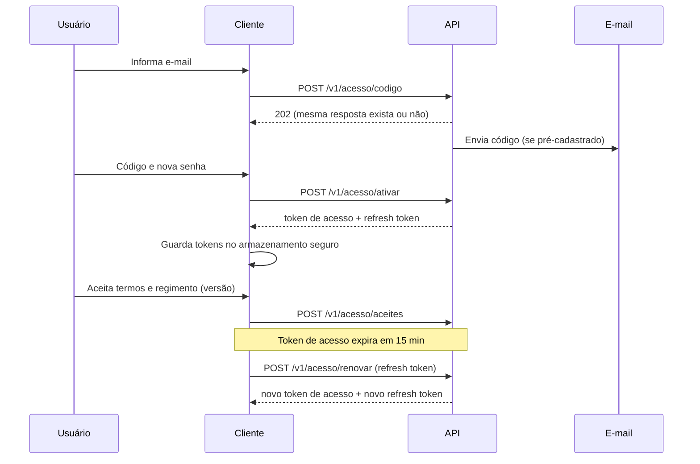
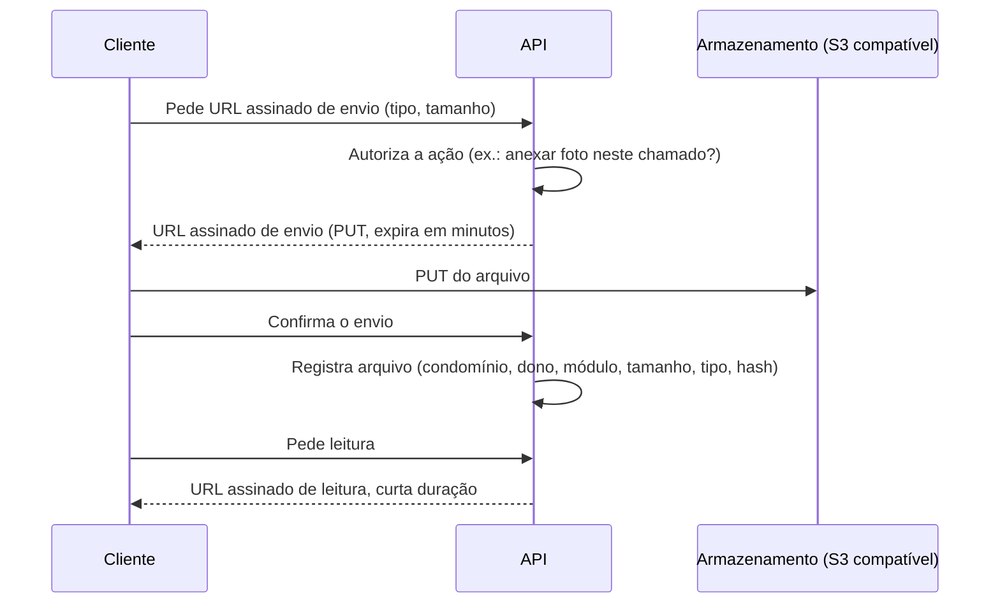

# Guia da API — CondomiFacil

**Estado:** Proposta de 10/11/2026, não aceita pelo Pedro. Este guia é a fonte única das convenções que os arquivos YAML de `openapi/` e `asyncapi/` seguem. Onde o texto diz **Proposta**, a escolha não vem de decisão do Pedro nem do PRD. Onde diz **Decisão do Pedro**, vem do pedido de 10/11/2026.

## Índice

1. [Estado e como ler](#1-estado-e-como-ler)
2. [Autenticação e sessão](#2-autenticação-e-sessão)
3. [Contexto e autorização](#3-contexto-e-autorização)
4. [Versionamento](#4-versionamento)
5. [Formatos](#5-formatos)
6. [Paginação](#6-paginação)
7. [Filtros e ordenação](#7-filtros-e-ordenação)
8. [Erros](#8-erros)
9. [Idempotência](#9-idempotência)
10. [Limite de taxa](#10-limite-de-taxa)
11. [Envio de arquivos](#11-envio-de-arquivos)
12. [Rastreabilidade](#12-rastreabilidade)

## 1. Estado e como ler

O contrato é escrito antes do código (design-first). Nada aqui existe em produção: não há backend, banco nem app (AGENTS.md).

| Item | Valor |
| --- | --- |
| Formato dos contratos | OpenAPI 3.1 (YAML) para HTTP; AsyncAPI 3.0 (YAML) para o Socket.IO |
| Um arquivo por quê | Um arquivo por pasta de interface do backend (`01-backend.md` 3.3), porque o DTO de resposta é por perfil (`01-backend.md` 3.4) |
| Componentes transversais | `openapi/componentes/comum.yaml` e `openapi/componentes/enums.yaml`, usados por `$ref` |
| Idioma | Português do Brasil em `summary`, `description`, nomes de campos e mensagens. Datas dd/mm/aaaa nos textos; ISO 8601 no corpo (seção 5) |
| Fontes | `01-backend.md` (3, 4, 5, 6), `01-arquitetura.md` (3.3 a 3.11), MER/DER (seção 4), PRD (RF, matriz da seção 3), regras de negócio, User Flows, seção 15 (UF 15), onde estão as mensagens de erro, e Design System, seção 13.4 (DS 13.4), de onde vêm os textos padrão, ADR-007 |

### Como escrever um arquivo de perfil

Quem escreve `openapi/<perfil>.yaml` segue as regras abaixo.

1. **Faça `$ref` para o que é transversal; não redefina.** Erro, paginação, cabeçalhos de contexto e respostas de erro vêm de `./componentes/comum.yaml`; estados vêm de `./componentes/enums.yaml`.

   ```yaml
   parameters:
     - $ref: './componentes/comum.yaml#/components/parameters/CondominioId'
     - $ref: './componentes/comum.yaml#/components/parameters/Limite'
   responses:
     '422':
       $ref: './componentes/comum.yaml#/components/responses/Erro422'
   components:
     securitySchemes:
       bearerJwt:
         $ref: './componentes/comum.yaml#/components/securitySchemes/bearerJwt'
   ```

2. **Componentes disponíveis** (nomes exatos):

   | Grupo | Nomes |
   | --- | --- |
   | `schemas` | `Erro`, `Paginacao`, `Uuid`, `DataHora`, `Data`, `Centavos` |
   | `parameters` | `CondominioId`, `UnidadeId`, `UnidadeIdObrigatorio`, `AppVersion`, `IdempotencyKey`, `Limite`, `Cursor`, `Ordenar` |
   | `headers` | `XRequestId`, `RetryAfter`, `Deprecation`, `Sunset` |
   | `responses` | `Erro400`, `Erro401`, `Erro403`, `Erro404`, `Erro409`, `Erro422`, `Erro426`, `Erro429`, `Erro500`, `Erro503` |
   | `securitySchemes` | `bearerJwt` |
   | `enums.yaml` | `EstadoReserva`, `EstadoVisita`, `EstadoEncomenda`, `EstadoEntregaEsperada`, `EstadoChamado`, `EstadoReclamacao`, `EstadoCobranca`, `EstadoLancamento`, `EstadoMesFinanceiro` |

   **Rotas de `comum/`.** Os prefixos sem perfil são `/v1/acesso/*`, `/v1/eu/*`, `/v1/arquivos/*`, `/v1/score`, `/v1/recursos`, `/v1/denuncias` e `/v1/notas-dos-setores` (seção 4). Todos, exceto `/v1/acesso/*` e `/v1/eu/*`, levam `X-Condominio-Id`. `/v1/sync` não é rota de `comum/`: fica em `openapi/sync.yaml`, interface própria (`01-backend.md` 3.3, decisão 6).

   **Qual cabeçalho de unidade usar.** `UnidadeIdObrigatorio` (`required: true`) nas operações de perfis com unidade (`morador`, `proprietario-nao-residente`) que dependem da unidade. `UnidadeId` (`required: false`) onde a unidade é opcional. Os dois são o mesmo cabeçalho `X-Unidade-Id`; não escreva "exige X-Unidade-Id" só na `description`, porque isso contradiz o `required: false` para geradores de cliente.

3. **`x-rastreabilidade` (por operação).** Extensão em cada operação: lista de IDs de origem, conferidos em `docs/01-produto/`. Operação sem ID de origem não entra no arquivo, com uma exceção: a operação cuja origem é um ADR ou a arquitetura (como renovar, sair, listar e encerrar sessões, em `comum.yaml`) fica com `x-rastreabilidade` vazia (`[]`), é marcada **Proposta** na `description` com a origem citada e entra em `x-lacunas`.

   ```yaml
   paths:
     /v1/morador/reservas:
       post:
         operationId: moradorCriarReserva
         x-rastreabilidade: [RF-RE-01, RN-RE-04, US-RE-01]
   ```

   Os prefixos aceitos são `RF-`, `RN-`, `US-` e `SEG-`. Não cite ID de memória: confira com busca em `docs/01-produto/`.

4. **`x-lacunas` (no nível raiz do documento).** Lista, no fim do arquivo, do que ficou sem fonte: limite, prazo, retenção ou campo que os docs não definem. A lacuna aparece como texto, nunca como número inventado.

   ```yaml
   x-lacunas:
     - Valor do limite de taxa por usuário: lacuna do guia (seção 10).
     - Retenção de arquivos de comprovante: lacuna (arquitetura 3.8).
   ```

5. **Nomes.** `operationId` em `camelCase` com prefixo do perfil (`moradorCriarReserva`, `portariaRegistrarEntrada`). Esquemas de DTO com sufixo do perfil (`ReservaMorador`, `ReclamacaoSindico`). Campos do corpo em `snake_case`, iguais às colunas do MER/DER quando houver (a API não renomeia).
6. **Exemplos só com dados fictícios.** Nenhum exemplo expõe identidade protegida: autor de reclamação, avaliador ou conteúdo de voto (ADR-009, ADR-010). A resposta de `/v1/acesso/codigo` é igual para e-mail cadastrado ou não (RN-CD-02).
7. **Dados de cartão nunca passam pela API** (SEG-12).
8. **Perfil Manutenção não ganha endpoints**: não está no PRD.

A validação roda a partir da raiz do repositório:

```
npx --yes @redocly/cli lint docs/05-backend/api/openapi/<arquivo>.yaml --config docs/05-backend/api/redocly.yaml
```

### Modelo de operação

Bloco de referência que os autores copiam e adaptam. Ele foi validado com o `lint` do `redocly.yaml`. O exemplo mostra uma lista (`GET`) e uma criação (`POST`); `ReservaMorador` e `CriarReservaMorador` são esquemas fictícios do próprio documento de perfil.

```yaml
openapi: 3.1.0
info:
  title: CondomiFacil API - interface do morador
  version: 0.1.0-proposta
tags:
  - name: reservas
    description: Áreas comuns, regras e reservas.
paths:
  /v1/morador/reservas:
    get:
      operationId: moradorListarReservas
      summary: Lista as reservas da unidade ativa
      description: Devolve as reservas da unidade, da mais recente para a mais antiga. Só a unidade ativa (RN-RE-03).
      tags: [reservas]
      security:
        - bearerJwt: []
      parameters:
        - $ref: './componentes/comum.yaml#/components/parameters/CondominioId'
        - $ref: './componentes/comum.yaml#/components/parameters/UnidadeId'
        - $ref: './componentes/comum.yaml#/components/parameters/AppVersion'
        - $ref: './componentes/comum.yaml#/components/parameters/Limite'
        - $ref: './componentes/comum.yaml#/components/parameters/Cursor'
        - name: estado
          in: query
          required: false
          description: Um ou mais estados, separados por vírgula.
          style: form
          explode: false
          schema:
            type: array
            items:
              $ref: './componentes/enums.yaml#/components/schemas/EstadoReserva'
          example: [confirmada, aguardando_pagamento]
        - name: de
          in: query
          required: false
          description: Data inicial, inclusive (aaaa-mm-dd).
          schema:
            $ref: './componentes/comum.yaml#/components/schemas/Data'
        - name: ate
          in: query
          required: false
          description: Data final, inclusive (aaaa-mm-dd).
          schema:
            $ref: './componentes/comum.yaml#/components/schemas/Data'
        - name: busca
          in: query
          required: false
          description: Texto livre, no nome da área.
          schema:
            type: string
        - name: ordenar
          in: query
          required: false
          description: Ordenação. Padrão `-criado_em`.
          schema:
            type: string
            enum: [criado_em, -criado_em, inicio, -inicio]
            default: -criado_em
      responses:
        '200':
          description: Página de reservas.
          headers:
            X-Request-Id:
              $ref: './componentes/comum.yaml#/components/headers/XRequestId'
          content:
            application/json:
              schema:
                type: object
                required: [dados, paginacao]
                properties:
                  dados:
                    type: array
                    items:
                      $ref: '#/components/schemas/ReservaMorador'
                  paginacao:
                    $ref: './componentes/comum.yaml#/components/schemas/Paginacao'
              example:
                dados:
                  - id: 3f6c1a52-8b1e-4d3a-9a0e-5c1d2b7e9f10
                    estado: confirmada
                paginacao:
                  proximo_cursor: null
                  tem_mais: false
        '400': {$ref: './componentes/comum.yaml#/components/responses/Erro400'}
        '401': {$ref: './componentes/comum.yaml#/components/responses/Erro401'}
        '403': {$ref: './componentes/comum.yaml#/components/responses/Erro403'}
        '426': {$ref: './componentes/comum.yaml#/components/responses/Erro426'}
        '429': {$ref: './componentes/comum.yaml#/components/responses/Erro429'}
        '500': {$ref: './componentes/comum.yaml#/components/responses/Erro500'}
        '503': {$ref: './componentes/comum.yaml#/components/responses/Erro503'}
      x-rastreabilidade: [RF-RE-01, RN-RE-03]
    post:
      operationId: moradorCriarReserva
      summary: Cria uma reserva
      description: Cria a reserva da área no horário pedido. Horário já ocupado responde 409 (RN-RE-04).
      tags: [reservas]
      security:
        - bearerJwt: []
      parameters:
        - $ref: './componentes/comum.yaml#/components/parameters/CondominioId'
        - $ref: './componentes/comum.yaml#/components/parameters/UnidadeId'
        - $ref: './componentes/comum.yaml#/components/parameters/AppVersion'
        - $ref: './componentes/comum.yaml#/components/parameters/IdempotencyKey'
      requestBody:
        required: true
        content:
          application/json:
            schema:
              $ref: '#/components/schemas/CriarReservaMorador'
            example:
              area_id: 7a1d3c55-0e2b-4c8f-b1a4-9d6e5f302b18
              inicio: '2026-11-20T18:00:00-03:00'
              fim: '2026-11-20T22:00:00-03:00'
      responses:
        '201':
          description: Reserva criada.
          headers:
            X-Request-Id:
              $ref: './componentes/comum.yaml#/components/headers/XRequestId'
          content:
            application/json:
              schema:
                $ref: '#/components/schemas/ReservaMorador'
              example:
                id: 3f6c1a52-8b1e-4d3a-9a0e-5c1d2b7e9f10
                estado: confirmada
        '400': {$ref: './componentes/comum.yaml#/components/responses/Erro400'}
        '401': {$ref: './componentes/comum.yaml#/components/responses/Erro401'}
        '403': {$ref: './componentes/comum.yaml#/components/responses/Erro403'}
        '409': {$ref: './componentes/comum.yaml#/components/responses/Erro409'}
        '422': {$ref: './componentes/comum.yaml#/components/responses/Erro422'}
        '426': {$ref: './componentes/comum.yaml#/components/responses/Erro426'}
        '429': {$ref: './componentes/comum.yaml#/components/responses/Erro429'}
        '500': {$ref: './componentes/comum.yaml#/components/responses/Erro500'}
        '503': {$ref: './componentes/comum.yaml#/components/responses/Erro503'}
      x-rastreabilidade: [RF-RE-01, RN-RE-04]
components:
  securitySchemes:
    bearerJwt:
      $ref: './componentes/comum.yaml#/components/securitySchemes/bearerJwt'
  schemas:
    ReservaMorador:
      type: object
      required: [id, estado]
      properties:
        id:
          $ref: './componentes/comum.yaml#/components/schemas/Uuid'
        estado:
          $ref: './componentes/enums.yaml#/components/schemas/EstadoReserva'
    CriarReservaMorador:
      type: object
      required: [area_id, inicio, fim]
      properties:
        area_id:
          $ref: './componentes/comum.yaml#/components/schemas/Uuid'
        inicio:
          $ref: './componentes/comum.yaml#/components/schemas/DataHora'
        fim:
          $ref: './componentes/comum.yaml#/components/schemas/DataHora'
x-lacunas:
  - Exemplo de lacuna: nada além do que as fontes dizem.
```

**Respostas de erro por operação.** Use o quadro para decidir quais `ErroNNN` referenciar.

| Resposta | Quando referenciar |
| --- | --- |
| `Erro401`, `Erro403`, `Erro426`, `Erro429`, `Erro500`, `Erro503` | Toda operação autenticada |
| `Erro400` | Quando a operação recebe entrada (corpo, parâmetro de consulta, filtro) |
| `Erro404` | Quando há identificador no caminho (`/{id}`) |
| `Erro409` e `Erro422` | Quando há regra de negócio ou conflito. Acrescente à resposta um exemplo com o código da regra do caso (seção 8) |

**Regras de forma.**

- Respostas `2xx` também declaram o cabeçalho `X-Request-Id` (`$ref` para `XRequestId`), como no modelo.
- Perfis usam só códigos de status explícitos (`'200'`, `'201'`, `'422'`). Nada de `2XX`, `4XX` nem `default`.
- A regra de lint de exemplo cobre só as respostas `200`, `201`, `202` e `203`. Outras `2xx` com corpo não são checadas pelo lint e devem ter exemplo mesmo assim.
- **Não use âncoras nem aliases YAML** (`&id001`, `*id001`). O reuso é só por `$ref` a `components`. Motivo: âncoras geradas por script fizeram a `description` de um campo vazar para dezenas de outros.
- O envelope de lista é `{ dados: array, paginacao: $ref Paginacao }`; recurso único vai sem envelope.

**Esquema de segurança.** O `security` de uma operação só enxerga esquemas declarados no próprio documento. Por isso cada arquivo de perfil declara `bearerJwt` em `components.securitySchemes` apontando para o comum:

```yaml
components:
  securitySchemes:
    bearerJwt:
      $ref: './componentes/comum.yaml#/components/securitySchemes/bearerJwt'
```

Essa forma foi conferida com o `lint` e valida; as operações usam `security: [{ bearerJwt: [] }]`.

## 2. Autenticação e sessão

**Decidido (PRD, regras de negócio):** ninguém se cadastra sozinho; o pré-cadastro é da administradora ou do suporte (RF-AD-01, RN-CD-01). Primeiro acesso por código de 6 dígitos enviado ao e-mail, válido por 15 minutos, 5 tentativas, reenvio após 60 segundos (o novo invalida o anterior), senha com no mínimo 8 caracteres, login pausado por 15 minutos após 5 senhas erradas (RF-AC-01, RN-CD-02, SEG-04). A resposta de `POST /v1/acesso/codigo` é a mesma para e-mail cadastrado ou não.

**Proposta (ADR-007, arquitetura 3.3.1):**

| Item | Convenção |
| --- | --- |
| Cabeçalho | `Authorization: Bearer <JWT>` |
| Token de acesso | JWT assinado, 15 min, só com `sub` (usuário) e `sid` (sessão). **Sem papéis nem condomínios** |
| Refresh token | Opaco, aleatório, guardado como hash no banco, rotativo (cada uso gera outro; reuso do antigo revoga a sessão), ligado ao aparelho. Renovação em `POST /v1/acesso/renovar` |
| Chaves | Identificador de chave (`kid`) para rotação sem derrubar sessões |
| App | Tokens no `expo-secure-store` |
| Web | Refresh token em cookie `httpOnly`, `Secure`, `SameSite=Lax`; token de acesso só em memória; exige proteção CSRF para o cookie de refresh |
| Revogação | Tabela de sessões; sair da conta, troca de senha e exclusão LGPD revogam |
| Sessão expirada | `401` com `SESSAO_EXPIRADA`; o cliente volta ao login e depois à tela onde estava (UF 15) |

Lacuna: a tolerância da rotação do refresh em rede instável (uma renovação perdida derruba a sessão legítima) está em aberto no ADR-007.



Os caminhos `/v1/acesso/codigo`, `/ativar`, `/aceites` e `/renovar` vêm da arquitetura 3.3.1 (`01-arquitetura.md`) e são Proposta. Os demais caminhos de `/v1/acesso/*` (login, recuperação, sair) são definidos em `openapi/comum.yaml`.

## 3. Contexto e autorização

Cadeia de guards do fluxo oficial de `01-backend.md` 4.1 (Proposta). A pasta organiza, não protege: a autorização é validada nos guards e na RLS, nunca pela pasta (`01-backend.md` 3.4).

| Etapa | O que faz | Resposta de recusa |
| --- | --- | --- |
| 1. Versão mínima | Compara `X-App-Version` com o mínimo | `426` |
| 2. Autenticação | JWT com `sub` e `sid`, sessão válida | `401` |
| 3. Contexto | Vínculo do usuário com `X-Condominio-Id` e `X-Unidade-Id` | `403` |
| 4. Perfil e papel por mandato | Papel efetivo naquele condomínio, hoje. A substituição do síndico é dado (RN-CD-12, RN-CD-28) | `403` |
| 5. Unidade | Dono do dado (por exemplo, situação financeira só a quem a SEG-17 permite) | `403` |
| 6. Validação | Esquema Zod de `shared-types` | `400` |
| 7. TenantContext | Transação com condomínio, usuário, unidade e papel; a RLS é a última barreira | `404` quando o recurso é de outro condomínio |

### Quais rotas levam cabeçalhos de contexto (Proposta)

| Grupo de rota | `Authorization` | `X-Condominio-Id` | `X-Unidade-Id` |
| --- | --- | --- | --- |
| `/v1/acesso/*` | Não, porque é antes do login (código, ativação, login, recuperação, renovação). Exceções conforme o caso: sair e aceites exigem sessão | Não | Não |
| `/v1/eu/*` (perfil próprio) | Sim | Não | Não |
| `/v1/arquivos/*`, `/v1/score`, `/v1/recursos`, `/v1/denuncias`, `/v1/notas-dos-setores`, `/v1/sync` | Sim | Sim | Conforme a operação |
| Perfis com unidade: `morador`, `proprietario-nao-residente`, e síndico, subsíndico e conselho fiscal quando agem como morador | Sim | Sim | Sim (`UnidadeIdObrigatorio`), nas operações de dono do dado por unidade |
| Demais perfis em funções de gestão (`sindico`, `conselho-fiscal`, `portaria`, `limpeza`, `administradora`, `plataforma`) | Sim | Sim (a `plataforma` e a administradora abrem contexto por condomínio, arquitetura 4.4) | Não |

Por isso o componente `CondominioId` é `required: true`: vale para as operações que o declaram, e as rotas dos dois primeiros grupos simplesmente não o referenciam. `UnidadeId` é a forma opcional (`required: false`); `UnidadeIdObrigatorio` é a forma obrigatória, para as operações que dependem da unidade. A operação escolhe um dos dois por `$ref`.

**Lacuna:** o comportamento quando `X-App-Version` falta não está definido (recusar com `426`, aceitar ou tratar como versão desconhecida). O componente `AppVersion` é opcional até o Pedro decidir.

Consequências para o contrato:

- O papel não vem no token. A mesma rota de `sindico` responde ou recusa conforme o papel efetivo: o subsíndico fora da substituição recebe `403` nas rotas que só valem em substituição, e cada operação diz isso na `description`.
- Recurso de outro condomínio responde `404`, indistinguível de "não existe", nunca `403` que confirme a existência (arquitetura 4.11).
- Esconder botão não é controle de acesso (UF 15): a API valida sempre.
- Webhooks e jobs não passam pelos guards de usuário; abrem o contexto a partir da cobrança referenciada ou do payload do job (`01-backend.md` 4.1). Por isso `/webhooks/...` fica fora do prefixo `/v1`.

## 4. Versionamento

**Proposta.**

| Tema | Convenção |
| --- | --- |
| Versão | Versão maior no caminho: `/v1`. Mudança compatível não cria versão |
| Rota obsoleta | Responde com os cabeçalhos `Deprecation` e `Sunset` (componentes `Deprecation` e `Sunset`) |
| Versão mínima do app | Cabeçalho `X-App-Version`; abaixo do mínimo, `426` com o texto "Atualize o app para continuar." |
| Webhooks | Fora do prefixo: `/webhooks/pagamentos/asaas` e `/webhooks/email/resend` |
| Caminhos | `/v1/<perfil>/<recurso>` com perfil igual à pasta de interface: `morador`, `sindico`, `conselho-fiscal`, `proprietario-nao-residente`, `portaria`, `limpeza`, `administradora`, `plataforma`. Sem prefixo de perfil para o que é de `comum/`: `/v1/acesso/*`, `/v1/eu/*`, `/v1/arquivos/*`, `/v1/score`, `/v1/recursos`, `/v1/denuncias`, `/v1/notas-dos-setores` (conforme `openapi/comum.yaml`) e `/v1/sync`. Todas, exceto `/v1/acesso/*` e `/v1/eu/*`, levam `X-Condominio-Id`. Recursos em `kebab-case`, no plural, sem acento |

Lacuna: a política de versão mínima do app (qual número, por quanto tempo, como o cliente é avisado antes do `426`) não está definida nos docs.

## 5. Formatos

**Proposta.**

| Tema | Convenção |
| --- | --- |
| Corpo | JSON, campos em `snake_case` |
| Identificadores | UUID (esquema `Uuid`) |
| Data e hora | ISO 8601 com deslocamento de fuso, por exemplo `2026-11-10T14:30:00-03:00` (esquema `DataHora`) |
| Data | ISO 8601 sem hora, `2026-11-10` (esquema `Data`). Nos textos de interface vale dd/mm/aaaa |
| Dinheiro | Inteiro em centavos, sufixo `_centavos` (esquema `Centavos`). R$ 150,00 é `15000` |
| Estados | Códigos de `enums.yaml`, sem acento, que correspondem aos nomes oficiais das regras de negócio; os códigos não são novos estados |
| Recurso único | Sem envelope |
| Lista | Com envelope `dados` e `paginacao` (seção 6) |
| Cabeçalhos de contexto | `X-Condominio-Id`, `X-Unidade-Id` (UUID) |
| Rastreio | `X-Request-Id` devolvido em toda resposta e repetido em `request_id` do erro |

Tempo real: Socket.IO, token no handshake, salas `c:{condominio_id}:portaria:{portaria_id}` definidas pelo servidor, eventos com dados mínimos. O contrato fica em `asyncapi/tempo-real.yaml`.

## 6. Paginação

**Proposta.** Por cursor opaco: `?limite=20&cursor=...`. Padrão 20, máximo 100 (parâmetros `Limite` e `Cursor`).

```json
{
  "dados": [ { "id": "3f6c1a52-8b1e-4d3a-9a0e-5c1d2b7e9f10" } ],
  "paginacao": { "proximo_cursor": "eyJpZCI6IjNmNmMxYTUyIn0", "tem_mais": true }
}
```

- O cursor é opaco: o cliente devolve o valor recebido sem interpretar nem montar.
- Na última página, `proximo_cursor` é nulo e `tem_mais` é `false`.
- `limite` acima de 100 responde `400` (Proposta).

## 7. Filtros e ordenação

**Proposta.** Parâmetros de consulta simples.

| Parâmetro | Uso |
| --- | --- |
| `estado=a,b` | Um ou mais estados, separados por vírgula, com os códigos de `enums.yaml` |
| `de=` e `ate=` | Datas (`aaaa-mm-dd`), intervalo inclusivo |
| `busca=` | Texto livre, nos campos que a operação declarar |
| `ordenar=campo` ou `ordenar=-campo` | Crescente ou decrescente, **só nos campos listados em cada operação** |

Cada operação de lista declara os filtros e os campos de `ordenar` que aceita. Campo fora da lista responde `400` com `REQUISICAO_INVALIDA`.

**Como declarar (regra para os arquivos de perfil).**

- `Limite` e `Cursor` vêm por `$ref` de `comum.yaml`.
- Os filtros (`estado`, `de`, `ate`, `busca`) são parâmetros declarados inline na operação, porque cada operação aceita os seus.
- Filtro de vários valores usa a forma fixa `style: form`, `explode: false` e `schema` do tipo `array` com `items` em `$ref` para o enum de `enums.yaml`. Assim `estado=confirmada,aguardando_pagamento` é um único parâmetro.
- `ordenar` é declarado **inline** com `enum` dos valores aceitos (por exemplo `criado_em` e `-criado_em`). O componente `Ordenar` de `comum.yaml` fica só para o caso sem restrição de campos.

```yaml
get:
  operationId: moradorListarReservas
  summary: Lista as reservas da unidade ativa
  tags: [reservas]
  security:
    - bearerJwt: []
  parameters:
    - $ref: './componentes/comum.yaml#/components/parameters/CondominioId'
    - $ref: './componentes/comum.yaml#/components/parameters/UnidadeId'
    - $ref: './componentes/comum.yaml#/components/parameters/Limite'
    - $ref: './componentes/comum.yaml#/components/parameters/Cursor'
    - name: estado
      in: query
      required: false
      description: Um ou mais estados, separados por vírgula.
      style: form
      explode: false
      schema:
        type: array
        items:
          $ref: './componentes/enums.yaml#/components/schemas/EstadoReserva'
    - name: de
      in: query
      required: false
      description: Data inicial, inclusive (aaaa-mm-dd).
      schema:
        $ref: './componentes/comum.yaml#/components/schemas/Data'
    - name: ate
      in: query
      required: false
      description: Data final, inclusive (aaaa-mm-dd).
      schema:
        $ref: './componentes/comum.yaml#/components/schemas/Data'
    - name: busca
      in: query
      required: false
      description: Texto livre, no nome da área.
      schema:
        type: string
    - name: ordenar
      in: query
      required: false
      description: Ordenação. Padrão `-criado_em`.
      schema:
        type: string
        enum: [criado_em, -criado_em, inicio, -inicio]
        default: -criado_em
```

A operação completa, com respostas, está no "Modelo de operação" da seção 1.

Listas com ordem definida pelas regras de negócio mantêm essa ordem como padrão (por exemplo, chamados: abertos antes dos concluídos, depois urgência alta, média e leve, depois o mais antigo, RN-CH-13).

## 8. Erros

Formato único (Proposta; `01-backend.md` 4.5):

```json
{
  "codigo": "SESSAO_EXPIRADA",
  "mensagem": "Por segurança, entre de novo na sua conta.",
  "detalhes": [],
  "request_id": "req_01JD9ZQ3K8M2T7V5W0X4Y6A1BC"
}
```

`detalhes` é opcional. O cliente decide por `codigo`, não por `mensagem`. O erro nunca devolve corpo de reclamação, avaliação ou voto (ADR-010).

### Códigos HTTP

| Situação | HTTP | Origem |
| --- | --- | --- |
| Entrada inválida | `400` | Validação Zod |
| Sessão expirada ou inválida | `401` | Guard de autenticação |
| Sem vínculo com o condomínio ou a unidade; sem permissão para o papel efetivo | `403` | Guards de contexto, papel e unidade |
| Recurso inexistente ou de outro condomínio | `404` | Indistinguíveis (arquitetura 4.11) |
| Conflito (horário já reservado, dado alterado por outra pessoa, voto repetido) | `409` | RN-RE-04, `EXCLUDE` no banco |
| Regra de negócio violada | `422` | Erro de domínio (código HTTP da regra: Proposta) |
| Versão do app abaixo do mínimo | `426` | Guard de versão |
| Limite de taxa excedido | `429` | Com `Retry-After` |
| Erro do servidor | `500` | Enviado ao Sentry com dados filtrados |
| Serviço indisponível | `503` | |

### Valores de `codigo` transversais (Proposta)

Em `SNAKE_MAIUSCULO`, definidos em `shared-types`. Textos de UF 15 são palavra por palavra; onde a coluna "Texto" diz Proposta, o texto não existe em UF 15 e precisa de validação do Pedro.

| `codigo` | HTTP | Texto | Origem do texto |
| --- | --- | --- | --- |
| `REQUISICAO_INVALIDA` | `400` | "Confira os campos destacados e tente de novo." | Proposta |
| `SESSAO_EXPIRADA` | `401` | "Por segurança, entre de novo na sua conta." | UF 15 |
| `SEM_PERMISSAO` | `403` | "Esta área é só para [perfil]." (por exemplo, "Esta área é só para síndico.") | UF 15 |
| `VINCULO_INVALIDO` | `403` | Sem texto em UF 15 para usuário sem vínculo com o condomínio ou a unidade; usa o de `SEM_PERMISSAO` até o Pedro definir outro | Proposta |
| `RECURSO_NAO_ENCONTRADO` | `404` | "Não encontramos o que você procurou." | Proposta |
| `CONFLITO_DADO_ALTERADO` | `409` | "Estas informações mudaram. Atualizamos a tela." | UF 15 |
| `REGRA_DE_NEGOCIO_VIOLADA` | `422` | Texto da regra no caso concreto (cada operação define o código específico, seção abaixo) | Proposta |
| `VERSAO_DO_APP_NAO_SUPORTADA` | `426` | "Atualize o app para continuar." | UF 15 |
| `LIMITE_DE_TAXA_EXCEDIDO` | `429` | "Muitas tentativas em pouco tempo. Aguarde um pouco e tente de novo." | Proposta |
| `ERRO_INTERNO` | `500` | "Algo deu errado do nosso lado. Tente de novo em alguns minutos." | UF 15 |
| `SERVICO_INDISPONIVEL` | `503` | "Algo deu errado do nosso lado. Tente de novo em alguns minutos." | UF 15 |
| `CHAVE_DE_IDEMPOTENCIA_REUTILIZADA` | `422` | Texto a definir: mesma `Idempotency-Key` com corpo diferente (seção 9) | Proposta |

A situação "Sem internet" de UF 15 não é erro da API: é do cliente (a requisição nem sai), e por isso não tem `codigo`.

### Códigos específicos de regra de negócio

Os arquivos de perfil acrescentam códigos de `422` e `409` próprios da regra do caso, no padrão `<MODULO>_<REGRA>` em `SNAKE_MAIUSCULO` (por exemplo, `RESERVA_HORARIO_INDISPONIVEL`, ligado a RN-RE-04). Cada código novo cita a RN de origem em `x-rastreabilidade` da operação. Código sem RN de origem vai para `x-lacunas`.

## 9. Idempotência

| Ponto | Mecanismo | Origem |
| --- | --- | --- |
| POST que cobra ou reserva | Cabeçalho `Idempotency-Key` opcional (componente `IdempotencyKey`), guardado por um tempo curto. Mesma chave e mesmo corpo devolvem a resposta original sem repetir o efeito | **Proposta técnica, fora das RN** (`01-backend.md` 4.6). A reserva já tem trava por `EXCLUDE` no banco |
| Sincronização offline | `op_id` único por condomínio; reenvio não duplica; carga diferente com o mesmo `op_id` é recusada | ADR-003, MER/DER 4.12 |
| Webhook | Unicidade por provedor e id do evento; repetição responde `200` sem reprocessar | `01-backend.md` 4.6, arquitetura 3.6, SEG-17 |
| Pagamento em duplicidade | Alerta à administradora, devolução ou abatimento auditados | RN-FI-19 |

Lacuna: o tempo de guarda da `Idempotency-Key` não está definido.

## 10. Limite de taxa

**Proposta.** Excesso responde `429` com o cabeçalho `Retry-After` (componente `RetryAfter`) e `codigo` `LIMITE_DE_TAXA_EXCEDIDO`. Ponto de partida sugerido pela arquitetura 3.3: limite por IP e por e-mail nos endpoints de acesso (SEG-04) e por usuário nos demais.

**Lacuna:** os valores dos limites (requisições, janela) não estão definidos em nenhum doc. Nenhum número aparece nos contratos.

## 11. Envio de arquivos

**Proposta (arquitetura 3.8).** O arquivo nunca trafega pela API de negócio. Bucket privado, sem acesso público; chave do objeto `c/{condominio_id}/{modulo}/{uuid}`.



- **Envio:** a API só emite o URL depois de autorizar a ação, com limites de tipo e tamanho. Depois do PUT, o cliente confirma e a API registra o arquivo.
- **Leitura:** nunca por URL permanente; a API checa a permissão e devolve URL assinado de curta duração. Documento do visitante só à portaria e ao morador que cadastrou, nunca em notificação (RN 8.4).
- **Limites já decididos:** comprovante de lançamento financeiro em foto ou PDF até 10 MB (RN-FI-24); até 5 fotos de conclusão de chamado (RN-CH-14).
- **Fila offline:** fotos sobem antes de a conclusão ser aplicada, com o mesmo `op_id` como chave de idempotência.
- **Lacunas:** tempo exato de expiração do URL ("minutos", sem número), verificação de vírus e retenção de arquivos.
- Dados de cartão nunca passam pela API (SEG-12).

Os caminhos ficam em `/v1/arquivos/*`, definidos em `openapi/comum.yaml`.

## 12. Rastreabilidade

| Mecanismo | Onde | Para quê |
| --- | --- | --- |
| `x-rastreabilidade` | Cada operação dos YAML | IDs `RF-*`, `RN-*`, `US-*`, `SEG-*` que motivam a operação |
| `x-lacunas` | Raiz de cada YAML | O que ficou sem fonte; vira pergunta ao Pedro |
| Tabela RF -> operação | `README.md` desta pasta | Cobertura dos 139 RF do PRD; preenchida ao fim do plano |

Documentos de origem:

| Documento | Seções usadas |
| --- | --- |
| `docs/05-backend/01-backend.md` | 3.3, 3.4, 4.1, 4.4, 4.5, 4.6 |
| `docs/03-arquitetura/01-arquitetura.md` | 3.3.1, 3.8, 4.11 |
| `docs/03-arquitetura/adr/007-autorizacao-jwt-sem-papeis.md` | Tokens, refresh rotativo, autorização em quatro camadas |
| `docs/04-banco-de-dados/01-mer-e-der.md` | Seção 2.2 (códigos de estado), seção 7 (ciclos de vida) |
| `docs/01-produto/03-regras-de-negocio.md` | Estados em 5.5, 7.4, 8.3, 9.1, 9.2, 12.2 e 12.4 |
| `docs/02-design/02-user-flows.md` | Seção 15 (mensagens de erro) |
