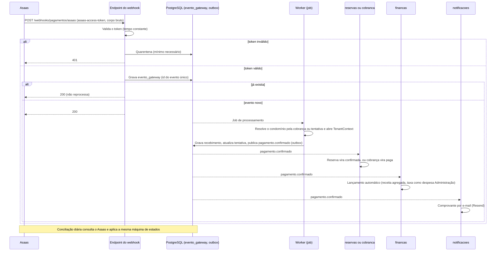

# Eventos e webhooks — CondomiFacil

**Estado:** Proposta de 10/11/2026, não aceita pelo Pedro. **Decisão do Pedro em 10/11/2026:** gateway Asaas e e-mail Resend. O que é decisão de produto vem das RN e do PRD, com o ID. O resto é Proposta. Nomes de eventos seguem `<entidade>.<fato no passado>` (`01-backend.md` 4.3); **só `visitante.cadastrado` e `pagamento.confirmado` aparecem nos docs com esse nome**. Os demais nomes abaixo são Proposta e estão marcados.

Contratos relacionados: `asyncapi/tempo-real.yaml` (Socket.IO), `openapi/webhooks.yaml` (webhooks recebidos) e `03-integracoes-externas.md` (chamadas aos provedores).

## Índice

1. [Como os eventos circulam](#1-como-os-eventos-circulam)
2. [Catálogo de eventos de domínio](#2-catálogo-de-eventos-de-domínio)
3. [Tempo real (WebSocket)](#3-tempo-real-websocket)
4. [Push: tipos, obrigatórios e horário](#4-push-tipos-obrigatórios-e-horário)
5. [Webhooks recebidos](#5-webhooks-recebidos)
6. [Evento do Asaas e transição de estado](#6-evento-do-asaas-e-transição-de-estado)
7. [Sequência do pagamento confirmado](#7-sequência-do-pagamento-confirmado)
8. [Lacunas](#8-lacunas)

## 1. Como os eventos circulam

Observer (GoF) com outbox transacional (`01-backend.md` 4.7, ADR-006, Proposta):

1. O caso de uso grava a mudança de domínio, a linha de `auditoria` e o `evento_saida` **na mesma transação** (`evento_saida`: `tipo`, `entidade_referencia`, `carga_minima_restrita`, `chave_idempotencia`, MER/DER 4.12).
2. O worker despacha o outbox (consulta com `FOR UPDATE SKIP LOCKED`; `NOTIFY` para o tempo real) a quem assina: `notificacoes` (push e e-mail), `tempo-real` (WebSocket) e outros módulos (por exemplo, `reservas` assina `pagamento.confirmado`).
3. A entrega é **ao menos uma vez**. Todo consumidor é idempotente, sem presumir "exatamente uma vez" (`chave_idempotencia` em `notificacao` e `evento_saida`).
4. A carga é **mínima**: identificadores e tipo. Nunca nome, documento, situação financeira, autor de reclamação, avaliador ou conteúdo de voto (ADR-009, ADR-010, SEG-17).

## 2. Catálogo de eventos de domínio

O catálogo tem 17 eventos: **2 nomes vêm dos docs** (`visitante.cadastrado` e `pagamento.confirmado`) e **15 são Proposta** a validar pelo Pedro. Coluna "Nome" marca **(docs)** quando o nome já existe nos documentos e **(Proposta)** quando é sugestão deste arquivo. Canais: WS (WebSocket), Push, E-mail, Interno (outro módulo).

| Nome | Publica | Consome | Canal | Origem |
| --- | --- | --- | --- | --- |
| `visitante.cadastrado` (docs) | `visitantes` | `tempo-real` | WS (portaria que atende o bloco), em até 5 s | RF-VI-04, RNF-05, arquitetura 3.3 |
| `visitante.editado` (Proposta) | `visitantes` | `tempo-real` | WS, na hora | RF-VI-03, RNF-05 |
| `visitante.cancelado` (Proposta) | `visitantes` | `tempo-real` | WS, na hora | RF-VI-03, RNF-05, RN-VI-15 |
| `visitante.entrada_registrada` (Proposta) | `visitantes` | `notificacoes` | Push ao morador: primeira chegada e, depois, resumo agrupado a cada 15 min na lista | RN-VI-17, RF-NO-01 |
| `entrega_esperada.editada` (Proposta) | `encomendas` | `tempo-real` | WS, na hora, **sem push** (cobre editar, cancelar e reagendar) | RN-EN-09, RF-EN-08 |
| `encomenda.registrada` (Proposta) | `encomendas` | `notificacoes` | Push imediato ao morador | RF-EN-02 |
| `pagamento.confirmado` (docs) | `pagamentos` | `reservas`, `cobranca`, `financas`, `notificacoes` | Interno; E-mail com comprovante (RF-PG-04) | RF-FI-09, RF-PG-04, RN-FI-13, RN-FI-23, arquitetura 3.6 |
| `pagamento.reembolsado` (Proposta) | `pagamentos` | `reservas`, `financas`, `notificacoes` | Interno; E-mail com comprovante (RN-PG-07) | RF-PG-03, RF-PG-04, RN-CA-04, RN-FI-23 |
| `pagamento.reembolso_falhou` (Proposta) | `pagamentos` | `notificacoes` | Push ao morador e alerta à administradora | arquitetura 3.6 (UF 5.2) |
| `pagamento.duplicado_detectado` (Proposta) | `pagamentos` | `notificacoes` | Alerta à administradora | RN-FI-19 |
| `sync.divergencia_aberta` (Proposta) | `sync` | `notificacoes` | Push **obrigatório** ao porteiro. Nunca ao síndico | RN-OF-04, RN-OF-05, US-NO-01 |
| `reclamacao.decidida` (Proposta) | `convivencia` | `notificacoes` | Push **obrigatório** ao alvo, sem a identidade do reclamante | RN-RC-10, US-NO-01 |
| `chamado.avaliacao_baixa` (Proposta) | `chamados` | `notificacoes` | Aviso ao síndico, com o comentário. Nunca ao funcionário nem à empresa | RN-CH-18 |
| `reserva.lembrete_devido` (Proposta) | `reservas` | `notificacoes` | Push opcional (ligado por padrão), envio único | RN-RE-14, RF-RE-10 |
| `score.alterado` (Proposta) | `convivencia` | `convivencia` (rotina 5), `reservas` | Interno | RN-SC-09, `01-backend.md` 5.2 |
| `acesso.codigo_solicitado` (Proposta) | `acesso` | `notificacoes` | E-mail com código de 6 dígitos | RF-AC-01, RN-CD-02 |
| `lgpd.copia_pronta` (Proposta) | `lgpd` | `notificacoes` | E-mail com link expirável | RF-LG-01 |

Eventos de comunicado, votação e demais tipos de push de RF-NO-01 seguem o mesmo padrão e **ainda não têm nome nem regra de gatilho nos docs**; entram na lista quando as histórias de usuário os detalharem (ver seção 8).

## 3. Tempo real (WebSocket)

Contrato em `asyncapi/tempo-real.yaml`. Resumo (arquitetura 3.4, Proposta):

| Item | Regra |
| --- | --- |
| Tecnologia | Socket.IO no mesmo processo da API |
| Autenticação | Token de acesso no handshake (`auth.token`). Renovação tratada na reconexão |
| Sala | `c:{condominio_id}:portaria:{portaria_id}`. O servidor decide; o cliente não escolhe sala |
| Mensagens | `visitante.cadastrado`, `visitante.editado`, `visitante.cancelado`, `entrega_esperada.editada` |
| Carga | Só identificadores. O app relê pela API (a RLS e os blocos atendidos continuam valendo) |
| Se o socket cair | `pull` incremental ao reconectar (`GET /v1/sync`); consulta periódica garante RNF-05 |
| Entre instâncias | `NOTIFY` do PostgreSQL (ADR-006) |

No Render gratuito o serviço dorme sem tráfego, inclusive mensagens de WebSocket (ADR-004): o tempo real só vale para desenvolvimento.

## 4. Push: tipos, obrigatórios e horário

**Tipos (RF-NO-01):** visitante, encomenda, reserva, chamado, comunicado, votação e reclamação. O usuário escolhe quais receber (US-NO-01), exceto os obrigatórios.

| Tipo obrigatório (fixo em código) | Origem |
| --- | --- |
| Decisão de reclamação contra a pessoa | US-NO-01, RN-RC-10 |
| Divergência de sincronização para o porteiro | US-NO-01, RN-OF-04 |

Cobrança em atraso como notificação obrigatória **não é regra**: é proposta fora das RN e pendência da UF 17 (`01-backend.md` 7). O lembrete de reserva é opcional, ligado por padrão (RN-RE-14).

**Regra do horário (decisão do Pedro em 09/11/2026, RN 14):**

| Origem do push | Quando sai |
| --- | --- |
| Rotina da madrugada: 4, 7, 12, 15, 16 e etapas de efeito das rotinas 10 e 20 | O evento sai do outbox na hora; o `notificacoes` agenda o envio para **09:00 locais** do condomínio |
| Rotinas 8, 11 e 17 e etapas de aviso das rotinas 10 e 20 | Já rodam às 09:00 locais |
| Evento disparado por pessoa (visitante, encomenda registrada, decisão de reclamação, divergência de sincronização etc.) | **Na hora** |
| Lembrete de reserva (rotina 21) | Regra própria: horário calculado entre 00:00 e 08:59 locais sai às 21:00 da noite anterior; fora da fila das 09:00 (RN-RE-14) |

Texto do push sem dado sensível: usa frase genérica ("Você tem uma atualização"); o detalhe abre no app autenticado (arquitetura 3.7). Recibos do Expo são consultados cerca de 15 minutos depois; `DeviceNotRegistered` remove o token (detalhes em `03-integracoes-externas.md`, seção 5).

## 5. Webhooks recebidos

Contrato em `openapi/webhooks.yaml`. Ficam fora de `/v1` e sem `Authorization`, `X-Condominio-Id` ou `X-Unidade-Id`.

| Webhook | Endereço | Autenticação do provedor | Idempotência | Estado |
| --- | --- | --- | --- | --- |
| Asaas | `POST /webhooks/pagamentos/asaas` | **Token** no cabeçalho `asaas-access-token`, comparado em tempo constante. **Não é assinatura HMAC** do corpo | `id` do evento (único por provedor) em `evento_gateway` | Decisão do Pedro (gateway); mecanismo Proposta |
| Resend | `POST /webhooks/email/resend` | Assinatura Svix (`svix-id`, `svix-timestamp`, `svix-signature`) sobre o corpo bruto | `svix-id` | **Proposta: nenhum doc o exige** |

**Fluxo do Asaas (SEG-17, Proposta):**

1. Recebe o **corpo bruto** e valida o token antes de qualquer outra coisa.
2. Grava `evento_gateway` com unicidade por provedor e id do evento. Se já existe, responde `200` sem reprocessar.
3. **Quarentena:** evento sem correlação válida (token inválido, conta ou transação desconhecida) vai para `evento_gateway_quarentena` (global, fora do RLS dos condomínios; motivo, estado Em quarentena, Correlacionado ou Descartado). Com token **válido**, responde `200` (para o Asaas não repetir); com token **inválido**, `401`. Ao correlacionar depois, cria o `evento_gateway` no condomínio certo, sem confiar no condomínio enviado no corpo (decisão do Pedro em 08/11/2026).
4. Responde `200` rápido e processa em job. O job resolve o condomínio pela cobrança, reserva ou tentativa referenciada e abre o `TenantContext` (a RLS vale).
5. Transições monotônicas: evento atrasado de "pendente" não desfaz "pago".
6. **Conciliação diária** compara o que o Asaas diz ter recebido com o que o sistema marcou como pago e abre alerta à administradora nas diferenças. Cobre webhook perdido e fila pausada (o Asaas pode interromper a fila após 15 falhas consecutivas de entrega).

A resposta `200` tem o mesmo corpo para evento novo, repetido ou em quarentena.

## 6. Evento do Asaas e transição de estado

Lista oficial de eventos de cobrança do Asaas (consulta de 10/11/2026). **As colunas "Tratamento" são Proposta**; os estados vêm de `enums.yaml` (RN 7.4 e 12.2). Estados de tentativa de pagamento e de devolução não têm ciclo completo nos docs (MER/DER 4.10: "estados do provedor são proposta"); os textos abaixo usam os nomes de arquitetura 3.6 (devolução: solicitado, em processamento, concluído, falhou). A mesma separação vale em `openapi/webhooks.yaml`: os **13 eventos tratados** têm exemplo de corpo; os **eventos recebidos, gravados e ignorados** só aparecem em lista. O webhook pede ao Asaas só os tratados (o Asaas recomenda listar apenas os necessários); se outro tipo chegar, é gravado e responde `200`.

### 6.1 Eventos tratados (13)

| Evento do Asaas | Significado (documentação) | Tratamento (Proposta) |
| --- | --- | --- |
| `PAYMENT_UPDATED` | Alteração no vencimento ou valor | Buscar de novo linha digitável e QR Pix da cobrança atualizada |
| `PAYMENT_CONFIRMED` | Pagamento efetuado, saldo ainda não disponível | **Confirma o pagamento** de cartão e de boleto (ver nota abaixo) |
| `PAYMENT_RECEIVED` | Cobrança recebida, valor disponível | **Confirma o pagamento** de Pix; para cartão e boleto, completa o recebimento |
| `PAYMENT_OVERDUE` | Cobrança vencida | Só registra. O atraso é marcado pela rotina 16 (RN-FI-06, RN-FI-09); a reserva expira pela rotina 1 (RN-RE-03) |
| `PAYMENT_CREDIT_CARD_CAPTURE_REFUSED` | Falha na captura do cartão | Tentativa recusada; reserva segue `aguardando_pagamento` até o prazo; o morador pode tentar de novo no prazo (RF-PG-01) |
| `PAYMENT_DELETED` | Cobrança removida | Registra; só ocorre por ação nossa. Divergência abre alerta |
| `PAYMENT_REFUND_IN_PROGRESS` | Estorno em processamento | Devolução "em processamento" |
| `PAYMENT_REFUNDED` | Cobrança estornada | Devolução "concluída"; comprovante por e-mail (RN-PG-07); estorno financeiro automático na mesma categoria (RN-FI-23) |
| `PAYMENT_PARTIALLY_REFUNDED` | Estornada parcialmente | Devolução parcial concluída; a soma devolvida não passa do recebido (MER/DER 4.10) |
| `PAYMENT_REFUND_DENIED` | Estorno negado (só boleto) | Devolução "falhou": push ao morador e alerta à administradora (arquitetura 3.6) |
| `PAYMENT_CHARGEBACK_REQUESTED` | Chargeback recebido | Registra e alerta a administradora. **Regra de chargeback é lacuna** (UF 17); nenhuma transição automática |
| `PAYMENT_CHARGEBACK_DISPUTE` | Chargeback em disputa | Idem |
| `PAYMENT_AWAITING_CHARGEBACK_REVERSAL` | Disputa vencida, aguardando repasse da adquirente | Idem |

### 6.2 Eventos recebidos, gravados e ignorados

Sem exemplo de corpo e sem transição de estado. Não são pedidos no webhook; se chegarem, entram em `evento_gateway` e a resposta é `200`.

| Evento do Asaas | Significado (documentação) | Observação |
| --- | --- | --- |
| `PAYMENT_CREATED` | Geração de nova cobrança | A criação é nossa |
| `PAYMENT_AUTHORIZED` | Cartão autorizado, precisa ser capturado | A confirmar se haverá pré-autorização |
| `PAYMENT_AWAITING_RISK_ANALYSIS`, `PAYMENT_APPROVED_BY_RISK_ANALYSIS`, `PAYMENT_REPROVED_BY_RISK_ANALYSIS` | Análise manual de risco do cartão | A confirmar se serão tratados |
| `PAYMENT_RESTORED` | Cobrança restaurada | |
| `PAYMENT_RECEIVED_IN_CASH_UNDONE` | Recebimento em dinheiro desfeito | A baixa manual é nossa (RF-FI-10) |
| `PAYMENT_ANTICIPATED`, `PAYMENT_DUNNING_REQUESTED`, `PAYMENT_DUNNING_RECEIVED` | Antecipação e negativação | Fora do escopo do MVP |
| `PAYMENT_BANK_SLIP_CANCELLED`, `PAYMENT_BANK_SLIP_VIEWED`, `PAYMENT_CHECKOUT_VIEWED` | Registro do boleto cancelado, boleto visto, fatura vista | `PAYMENT_BANK_SLIP_CANCELLED` cancela o registro do boleto, não a cobrança |
| `PAYMENT_SPLIT_CANCELLED`, `PAYMENT_SPLIT_DIVERGENCE_BLOCK`, `PAYMENT_SPLIT_DIVERGENCE_BLOCK_FINISHED`, `PAYMENT_SPLIT_DONE` | Eventos de split | Dependem da escolha entre subconta e split (a confirmar) |

**Nota sobre confirmação (Proposta, validar no sandbox).** Segundo o Asaas, o fluxo do **boleto** é `CREATED`, `CONFIRMED`, `RECEIVED`; o do **Pix** é `CREATED`, `RECEIVED` (sem `CONFIRMED`); o do **cartão de crédito** é `CREATED`, `CONFIRMED` e, 32 dias depois, `RECEIVED` (3 dias no débito). Esperar 32 dias para confirmar uma reserva seria absurdo, por isso o primeiro entre `PAYMENT_CONFIRMED` e `PAYMENT_RECEIVED` **confirma o pagamento**, uma única vez por tentativa (idempotente), e o segundo só completa o `recebimento` (valor líquido e taxa). Os prazos reais de compensação de boleto e Pix continuam lacuna (UF 17).

### 6.3 Transições de estado resultantes (Proposta)

| Origem | Estado antes | Evento que confirma | Estado depois | Efeitos |
| --- | --- | --- | --- | --- |
| Reserva | `aguardando_pagamento` | `pagamento.confirmado` | `confirmada` | Comprovante por e-mail; lançamento financeiro automático, agregado e sem unidade (RN-FI-13, RN-FI-23); sugestão de lista de visitantes (RN-RE-12) |
| Cobrança | `emitida` (ainda no prazo) | `pagamento.confirmado` | `paga` | Baixa automática (RF-FI-09) |
| Cobrança | `em_atraso` | `pagamento.confirmado` | `paga_com_atraso` | Baixa automática; valor com multa e juros do dia calculados no servidor (RN-FI-08) |
| Cobrança já `paga` | `paga` | Segundo pagamento real | Sem mudança de estado | Alerta à administradora, devolução ou abatimento auditados (RN-FI-19). Repetição do **mesmo** evento não conta (idempotência) |

**Casos sem regra nos docs (lacuna, nenhuma regra inventada aqui):**

- **Decisão de 12/11/2026 — reserva expirada/cancelada:** registrar recebimento real e pendência para administradora/suporte autorizado; sem recuperar horário, reativar reserva ou devolver automaticamente.
- **Decisão de 12/11/2026 — Emitida paga após vencimento:** classificar Paga com atraso pelo vencimento e instante efetivo, mesmo antes da rotina 16; multa/juros conforme RN-FI-06/08, evitando dupla cobrança com Asaas na PoC.
- **Decisão de 12/11/2026 — cobrança Cancelada:** registrar recebimento e pendência para administradora/suporte autorizado, sem reativação. Em acordo permanece V2.

## 7. Sequência do pagamento confirmado

## 8. Lacunas

- **Nomes de eventos:** só `visitante.cadastrado` e `pagamento.confirmado` estão nos docs; os outros são Proposta.
- **Gatilhos e texto dos push de comunicado, votação e demais tipos** de RF-NO-01 ainda não estão nas RN; ficam fora do catálogo até lá.
- **Cobrança em atraso como notificação obrigatória:** proposta fora das RN (UF 17); não entra nos obrigatórios.
- **Canal dos lembretes de cobrança (rotina 17):** não definido em RF-FI-11.
- **Recebimentos excepcionais:** regras de produto resolvidas em 12/11/2026 na seção 6.3; mapeamento de eventos e instante efetivo continuam dependentes da PoC Asaas, não realizada.
- **Multa e juros:** o cálculo é do servidor (RN-FI-08); se o Asaas também aplica multa e juros configurados na cobrança, e como evitar cobrança em dobro, é **a confirmar**.
- **Chargeback, prazos reais de confirmação, KYC da subconta:** lacunas do ADR-002 e da UF 17.
- **Webhook do Resend:** Proposta; precisa de aprovação do Pedro para existir.
- **Conteúdo exato dos eventos do Asaas, reenvio e fila pausada:** ver `openapi/webhooks.yaml` (`x-lacunas`) e `03-integracoes-externas.md`, seção 9.
- **Escala do WebSocket** (conexões por instância) e **retenção** de `evento_gateway_quarentena` e do outbox: lacunas (arquitetura 3.4 e 9.3, MER/DER P-09).
- **`01-backend.md` e SEG-17** ainda dizem "assinatura" para o webhook do Asaas; o correto, pela documentação do Asaas, é token no cabeçalho. A correção é de outra tarefa.

Complementação: [registro de 12/11/2026](../../01-produto/05-decisoes-de-complementacao.md). Moderação, atribuições e exportação não recebem nomes novos de evento de domínio nesta alteração; seus nomes/protocolo continuam proposta a definir quando necessário.

## Exportações gerenciais — 14/11/2026

RF-RL-10/11 e RN-RL-06/07. Eventos internos propostos: `relatorio.exportacao.solicitada` (id do pedido/tenant/solicitante/tipo/formato), `relatorio.exportacao.pronta` e `relatorio.exportacao.falhou` (id/tenant/solicitante/estado e código neutro). Não carregar linhas, dados pessoais, link assinado ou conteúdo financeiro na outbox/log. Worker revalida vínculo/função e gera arquivo privado; consulta/download revalidam novamente. A central usa consulta de andamento; não criar canal Socket.IO nem push obrigatório por consequência. Notificação de conclusão, se adotada posteriormente, deve ter texto genérico e destino autorizado, sem ampliar preferências atuais.
