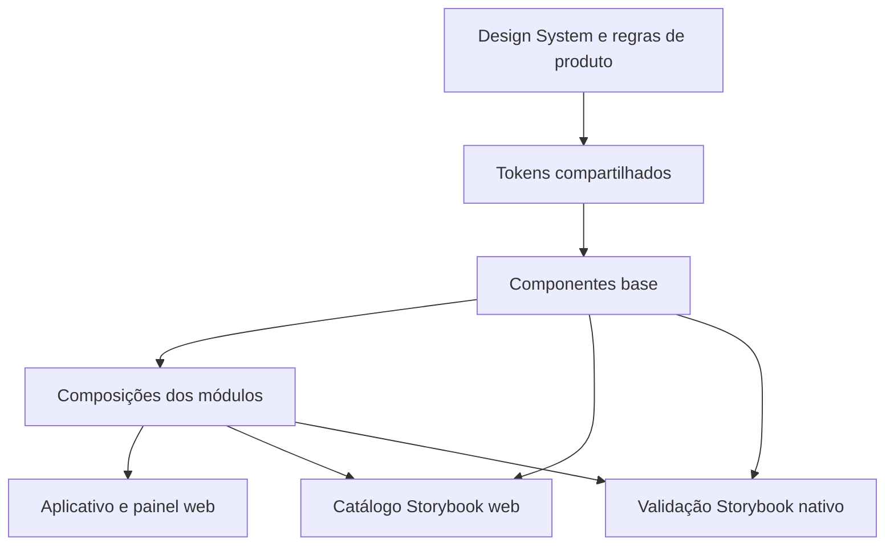

# Biblioteca de componentes — CondomiFacil

**Autor do produto:** Pedro Lemos

**Data:** 14/11/2026

**Estado:** documentação de planejamento. Não existe biblioteca React Native, aplicativo ou Storybook implementado neste repositório.

## 1. Objetivo e orientação aprovada

Este documento define o catálogo planejado de componentes reutilizáveis do CondomiFacil e sua ligação com o Design System. Atende ao aplicativo Android/iOS e ao painel web previstos em React Native, TypeScript, Expo e React Native Web.

Pedro autorizou em 14/11/2026 a documentação conforme a recomendação: **biblioteca própria**, tokens compartilhados e **Storybook como catálogo interativo**, com consulta principal pela web e validação complementar no ambiente nativo. O código dos componentes pertence à biblioteca; o Storybook apresenta exemplos e estados desse código. A aprovação dessa orientação não instala ferramentas, não fixa versões nem aceita os ADRs em aberto.

O catálogo documentado vem antes da implementação. O protótipo HTML continua como referência navegável para validar fluxos; não será substituído pelo Storybook nesta fase. Exemplos de um componente isolado também não demonstram integração, autorização do servidor ou sincronização real.

### 1.1 Fontes e precedência

| Fonte | Papel |
| --- | --- |
| [Design System](../02-design/01-design-system.md), seções 4 a 10 e 13 a 17 | Aparência, componentes, tokens, escrita, acessibilidade e privacidade |
| [Design System](../02-design/01-design-system.md), seções 11, 12, 18 e 19 | Composições de tela, navegação, decisões e rastreabilidade |
| [Frontend mobile](frontend.md), seções 2, 4 a 7 | Organização, dependências, estado, cache, offline e dispositivo |
| [Painel web](painel-web.md), seções 2 a 7 | Tabelas, filtros, gráficos e exportações da administradora |
| [PRD](../01-produto/02-prd.md), [Regras de Negócio](../01-produto/03-regras-de-negocio.md) e [Histórias](../01-produto/04-historias-de-usuario.md) | Funções, permissões, estados e critérios de negócio |
| [User Flows](../02-design/02-user-flows.md) | Uso dos componentes no percurso completo, inclusive falhas e retomada |
| [Protótipo](../../prototipo/README.md) | Simulações HTML/CSS/JS existentes; não equivale à futura biblioteca |

As regras de produto prevalecem sobre uma opção visual ou exemplo de story. O grafo foi consultado para localizar relações entre componentes, telas e fluxos; seu relatório de 12/11/2026 é anterior aos relatórios do MVP. Os documentos atualizados, incluindo DS 11.18 e RN-RL-01 a 08, foram consultados diretamente.

## 2. Arquitetura da biblioteca

### 2.1 Camadas e responsabilidades

| Camada | Conteúdo | Limite |
| --- | --- | --- |
| `packages/design-tokens` | Paleta, temas, tipografia, espaçamento, raios e movimento das seções 4 a 9 do DS | Sem React, API, sessão ou regras de negócio; valores centralizados |
| `packages/ui` | Componentes base, layout e apresentações puras reutilizáveis | Recebe propriedades e callbacks; não consulta API, banco local, cache, sessão ou SDK de pagamento |
| `apps/mobile/src/modulos/<dominio>/componentes` | Composições que conhecem a linguagem e a projeção autorizada do domínio | Reutiliza a base; casos de uso e camada de dados coordenam efeitos, prazos e permissões |
| `apps/mobile/src/compartilhado/componentes` | Composições usadas em vários módulos do app | Só promover para `packages/ui` quando a dependência de domínio puder ser removida |
| Catálogos Storybook | Stories, documentação de uso, fixtures e provedores de demonstração | Somente desenvolvimento/revisão; não constitui fonte de dados nem parte da navegação do produto |

Não criar uma cópia de cada componente por perfil. A mesma base atende aos perfis; a aplicação fornece apenas as ações e os dados autorizados naquele contexto. Esconder um botão não substitui a autorização da API.



SOLID se aplica à responsabilidade de cada componente e à separação de apresentação e efeitos. GRASP favorece alta coesão, baixo acoplamento e regras no módulo que conhece o dado. GoF Adapter é adequado para traduzir permissões de câmera, arquivos ou navegação em eventos usados pela interface; esses adaptadores ficam fora da base visual. Não criar classes, Strategy ou Factory apenas para renderizar variantes simples.

### 2.2 Estrutura proposta

Os caminhos abaixo são futuros e complementam a árvore de `frontend.md`; não representam arquivos já criados.

```text
packages/
  design-tokens/
    src/
      palette.ts
      themes.ts
      typography.ts
      spacing.ts
      radius.ts
      motion.ts
      index.ts
  ui/
    src/
      theme/
        ThemeProvider.tsx
      components/
        Button/
          Button.tsx
          Button.stories.tsx
          index.ts
        Dialog/
          Dialog.tsx
          Dialog.native.tsx      somente se a diferença justificar
          Dialog.stories.tsx
        DataTable/
          DataTable.web.tsx
          DataTable.stories.tsx
        ...
      index.ts
apps/
  mobile/
    src/
      modulos/<dominio>/componentes/
        <Composicao>/
          <Composicao>.tsx
          <Composicao>.stories.tsx
      compartilhado/componentes/
    .rnstorybook/                configuração do catálogo nativo
  catalogo-componentes/
    .storybook/                 configuração web, provedores e documentação
    fixtures/                   exemplos sintéticos comuns ao catálogo
```

O DS 17 usa `src/design/tokens.ts` e `src/design/components` para ilustrar tokens e componentes. Nesta proposta de monorepo, o primeiro papel é distribuído nos arquivos de `packages/design-tokens`, e o segundo fica em `packages/ui`. A separação em arquivos não cria fontes independentes de valores. Os nomes técnicos existentes no DS, como `Button`, `Card` e `StatusBadge`, são preservados; nomes de stories, rótulos e documentação permanecem em português do Brasil.

O catálogo web importa as mesmas exportações da biblioteca e, quando necessário, composições isoladas do app com dependências substituídas por fixtures. O aplicativo não importa o catálogo, stories ou suas configurações. O caminho exato de inicialização nativa deve ser validado com o SDK Expo e a versão Storybook escolhidos na implementação.

## 3. Catálogo vinculado ao Design System

Todos os itens abaixo estão **planejados para a biblioteca futura**. A referência de comportamento atual é o DS; componentes do protótipo são representações HTML, não implementações reutilizáveis React Native. A tabela cobre as 25 subseções principais de DS 10 e suas duas especializações 10.8.1/10.8.2.

As propriedades listadas são contratos de apresentação propostos, não uma API TypeScript já publicada. Os componentes interativos incluem normal, pressionado, foco e desabilitado, além de carregando quando aplicável. Estados adicionais e exemplos específicos aparecem em cada linha.

### 3.1 Ações, entrada e seleção

| Componente planejado | Função e contrato de apresentação | Variantes, estados e exemplos necessários | Ligação ao DS |
| --- | --- | --- | --- |
| `Button` | Ação com `label`, `variant`, `size`, `loading`, `disabled`, `disabledReason` e `onPress` | Primário, secundário, texto e destrutivo; tamanhos grande/médio/pequeno; carregando mantém rótulo e impede novo toque; motivo visível quando desabilitado. No máximo um primário por tela, verificado na composição | [10.1 Botão](../02-design/01-design-system.md#101-botão) |
| `Fab` | Ação frequente de criação; ícone, rótulo acessível, versão estendida e callback | Circular e estendido; posição com área segura; não cobre último item da lista; um por tela | [10.2 Botão flutuante](../02-design/01-design-system.md#102-botão-flutuante) |
| `TextField` | Campo controlado por `value`/`onChange`, com rótulo, ajuda, erro e tipo de entrada | Texto, e-mail, senha, dinheiro e multilinha conforme necessidade; normal, foco, erro, somente leitura e desabilitado. Validação ao sair/enviar; sem regra de negócio embutida no campo | [10.3 Campo de texto](../02-design/01-design-system.md#103-campo-de-texto) |
| `CodeInput` | Um campo lógico com apresentação em seis posições; valor, erro, validade/tentativas fornecidas e callbacks | Vazio, parcial, completo, incorreto, expirado e reenviando; colar/preenchimento automático. Limites e validação do código continuam no servidor (RF-AC-01/03) | [10.4 Código de verificação](../02-design/01-design-system.md#104-código-de-verificação) |
| `Select`, `RadioGroup`, `CheckboxGroup`, `FilterChip` | Seleção controlada, opções rotuladas e eventos de mudança | Única/múltipla, chips, busca em seleção com mais de 8 opções, dias da semana com nome completo acessível; sem seleção inicial quando o fluxo assim exige | [10.5 Seleção](../02-design/01-design-system.md#105-seleção-lista-opção-única-e-múltipla) |
| `Switch` | Alternância imediata com rótulo, valor e callback | Ligado/desligado, foco e indisponível com explicação; escolhas dependentes de Salvar usam seleção, não interruptor | [10.6 Interruptor](../02-design/01-design-system.md#106-interruptor) |
| `StarRating` | Nota controlada de 1 a 5 ou leitura de média; rótulo textual e evento de alteração | Ajustável, leitura e não respondido; texto de cada nota. Opção “Não conheço” pertence à composição da pesquisa, não é oferecida na avaliação do chamado | [10.17 Avaliação por estrelas](../02-design/01-design-system.md#1017-avaliação-por-estrelas) |
| `Calendar` | Mês/dia e horários apresentados a partir da disponibilidade recebida | Hoje, selecionado, livre/ocupado/indisponível; navegação por botões além do gesto; nenhuma confirmação de reserva calculada no componente | [10.19 Calendário](../02-design/01-design-system.md#1019-calendário), 4.6 e 11.4 |
| `PhotoPicker` | Controle visual de adicionar/remover e abrir anexos; miniaturas, progresso e callbacks | Vazio, selecionado, preparando, enviando, falha e pendente quando o módulo admite fila; captura/galeria executadas por adaptador. Fotos da conclusão são opcionais, até 5 (RN-CH-14) | [10.20 Envio de foto](../02-design/01-design-system.md#1020-envio-de-foto) |
| `EditablePeopleList` | Linhas controladas com identidade estável, erro/aviso e callbacks de inclusão/remoção | Rótulo “Nome da pessoa N”, foco na nova linha, contador, duplicidade, limite de 100 pessoas e Desfazer que restaura posição. Colar nomes e listas salvas são ações da composição de visitantes | [10.25 Lista editável de pessoas](../02-design/01-design-system.md#1025-lista-editável-de-pessoas), 11.13 |

### 3.2 Conteúdo, feedback e estados

| Componente planejado | Função e contrato de apresentação | Variantes, estados e exemplos necessários | Ligação ao DS |
| --- | --- | --- | --- |
| `Card` | Estrutura de título, apoio, estado, conteúdo e ações | Informativo ou com abertura de detalhe; ações internas independentes; texto extenso e fonte ampliada; não transformar todo conteúdo em vários alvos redundantes | [10.7 Cartão](../02-design/01-design-system.md#107-cartão) |
| `StatusBadge` | `module`, `status` e `perspectiva` para reclamação; mapa central de rótulo/tom/ícone | Estados exatos do domínio/DS 4.5; alvo, reclamante e julgador recebem apresentações próprias. Não aceitar cor arbitrária por tela nem renderizar dados de outra perspectiva | [10.8 Selo de estado](../02-design/01-design-system.md#108-selo-de-estado), 4.5 e 17 |
| `UrgencyBadge` | Urgência recebida como alta, média ou leve; somente apresentação | Texto+ícone em cada nível; sem toque para quem não ajusta urgência; alteração é ação do módulo com permissão (RN-CH-09 a 13) | [10.8.1 Selo de urgência](../02-design/01-design-system.md#1081-selo-de-urgência) |
| `DeadlineBadge` | Projeção de prazo recebida do módulo, com rótulo, data e situação | No prazo, se esgotando, amanhã, hoje e esgotado; só nas situações/perspectivas autorizadas por RN-RC-17 a 19; não recalcular prazo com `Date.now()` oculto dentro da base | [10.8.2 Selo de prazo](../02-design/01-design-system.md#1082-selo-de-prazo) |
| `ListItem` | Ícone/avatar, título, apoios, estado e ação | Uma/duas linhas, leitura/detalhe/ação; ordem dos chamados definida pelo módulo, sem alterar a lista recebida (RN-CH-13) | [10.9 Linha de lista](../02-design/01-design-system.md#109-linha-de-lista) |
| `Banner` | Aviso de tela com tipo semântico, mensagem e ação/fechamento permitido | Offline, sincronizando, treinamento, novos termos, bloqueio e dica; prioridade e máximo uma faixa conforme DS; não descartar aviso obrigatório por conveniência | [10.10 Faixa de aviso](../02-design/01-design-system.md#1010-faixa-de-aviso) |
| `Snackbar` | Confirmação breve, ação opcional e anúncio acessível | Normal por 5 s; com ação por 10 s; uma por vez. Desfazer é callback do caso de uso, não exclusão automática de registro confirmado; erro que exige ação não fica só aqui | [10.11 Mensagem rápida](../02-design/01-design-system.md#1011-mensagem-rápida-snackbar) |
| `ScoreMeter` | Número/barra e contexto visível recebidos, limite e informação de recuperação | Acima/no/abaixo do limite; unidade/vínculo ou condomínio funcional. Número/barra neutros ou warning, nunca verde/vermelho; histórico separado pode usar success/danger com sinal e ícone (RN-SC-02/13/14) | [10.18 Score](../02-design/01-design-system.md#1018-score) |
| `EmptyState`, `LoadingState`, `ErrorState` | Estado da região com título, mensagem e ação quando aplicável | Vazio com ação, esqueleto estático, erro com Tentar de novo; sem códigos técnicos, sem brilho animado; ausência não vira zero | [10.21 Estados vazios, carregando e erro](../02-design/01-design-system.md#1021-estados-vazios-carregando-e-erro) |
| `SyncIndicator` | Situação de rede/envio, horário e quantidade de pendências; callback de detalhes | Atualizado agora, enviando, offline e pendências; texto+ícone sempre visíveis na portaria/limpeza. Não é motor de sincronização nem promete confirmação do servidor (RN-OF-01 a 06) | [10.23 Indicador de sincronização](../02-design/01-design-system.md#1023-indicador-de-sincronização) |

### 3.3 Sobreposição, navegação e estrutura

| Componente planejado | Função e contrato de apresentação | Variantes, estados e exemplos necessários | Ligação ao DS |
| --- | --- | --- | --- |
| `BottomSheet` | Conteúdo curto, abertura/fechamento controlados e origem do foco | Escolha, filtro e formulário; Fechar sempre disponível, além de gesto; teclado aberto e fonte ampliada | [10.12 Folha inferior](../02-design/01-design-system.md#1012-folha-inferior) |
| `Dialog` | Título, consequência, ações explícitas e política de fechamento fornecida | Confirmação comum/destrutiva; bloqueante somente nos casos definidos (divergência e bloqueio de visitante). Captura/restaura foco; sem diálogo extra para entrada normal da portaria | [10.13 Diálogo](../02-design/01-design-system.md#1013-diálogo), 11.1 |
| `TopBar` | Título/contexto, voltar e até duas ações; respeita área segura | Início com seletor, detalhe com Voltar, texto longo e orientação; rótulo acessível nas ações de ícone | [10.14 Barra superior](../02-design/01-design-system.md#1014-barra-superior) |
| `TabBar`, `SideNavigation` | Itens autorizados, item ativo e evento de navegação | Celular com 3 a 5 abas; lateral expandida/recolhida no web; ícone e rótulo quando previstos. Rotas e guardas ficam no app, mapa por perfil em DS 12 | [10.15 Navegação](../02-design/01-design-system.md#1015-navegação) |
| `UnitSwitcher` | Unidade ativa, opções agrupadas por condomínio e evento de seleção | Uma unidade sem toque; várias com folha e seleção; mudança executada pela aplicação limpa contexto/cache antes de exibir novo dado (RF-AC-04) | [10.16 Seletor de unidade](../02-design/01-design-system.md#1016-seletor-de-unidade) |
| `DataTable` | Colunas e linhas autorizadas, ordenação/filtros/seleção e paginação controlados | Expandida e apresentação em cartões na faixa compacta; cabeçalhos semânticos, números à direita, valores anulados com selo além do risco, vazio/erro/carregando. Página não representa total exportável | [10.22 Tabela](../02-design/01-design-system.md#1022-tabela-web), 11.9 e 11.15 |
| `Onboarding` | Sequência recebida de 3 a 5 etapas, índice, Continuar/Pular e callbacks | Por perfil, etapa em texto, primeira/última e revisão pela ajuda; persistência da conclusão fica no módulo acesso (RF-AC-08) | [10.24 Onboarding](../02-design/01-design-system.md#1024-onboarding) |

`StatusBadge`, `ScoreMeter`, `SyncIndicator` e similares podem ter uma apresentação pura em `packages/ui`; a seleção da projeção, dos estados permitidos e das ações pertence ao módulo. Mapas de estados compartilhados devem ter uma única definição tipada, coerente com DS 4.5/17 e contratos, sem copiar regras entre stories, telas e perfis.

## 4. Composições reutilizáveis por domínio

Uma composição combina os componentes anteriores em uma tarefa reconhecível. Ela não precisa virar pacote compartilhado quando só um módulo a usa. Os nomes são propostos; cada composição continua recebendo a projeção autorizada, sem buscar um objeto completo para depois ocultar campos.

| Composição / módulo | Reutiliza | Regras que preserva e referência de design |
| --- | --- | --- |
| `VisitorAccessItem` / visitantes | `ListItem`, `StatusBadge`, `Button`, `Snackbar` | Entrada em até 2 toques, sem confirmação comum, com Desfazer; treinamento destacado; divergência/bloqueio seguem diálogo próprio. DS 11.1; RN-OF-01 a 06; RF-VI-06/12 |
| `VisitorGroup` e editor de lista / visitantes | `Card`, `EditablePeopleList`, seleção e campos | Lista agrupada, progresso de chegadas, foco/contador e erros por pessoa; não expõe documento em notificação. DS 11.13; RF-VI-15 |
| `ExpectedDeliveryCard` / encomendas | `Card`, `StatusBadge`, campos e seleção | Data/faixa e vínculo de entrega esperado, sem registrar comida como encomenda; operação online conforme frontend. DS 11.14 |
| `ReservationCard` e resumo de pagamento / reservas | `Card`, `Calendar`, `StatusBadge`, `Button` | Privacidade do calendário (“Ocupado”), estados de pagamento confirmados pela API e marcações de uso/vistoria online. DS 11.4; RN-RE-09/13/14 |
| `ServiceTicketCard` e fotos da conclusão / chamados | `Card`, urgência, fotos e ações | Ordenação por urgência/antiguidade; fotos opcionais; fila offline somente nas conclusões de limpeza permitidas; nova conclusão efetiva não transfere avaliação. DS 11.2/11.12; RN-CH-04/09 a 17 |
| `ServiceRatingForm` / chamados | `StarRating`, seleção, campo e botão | Nota/base obrigatórias, comentário opcional; base “Vi as fotos” só quando há fotos. DS 11.12; RN-CH-15 a 20 |
| `ComplaintCaseSummary` / reclamações | `StatusBadge`, prazo, cartão e diálogo | Projeções distintas para alvo/reclamante/julgador; identidade e score só onde autorizados. Prazo não aparece para o alvo. DS 11.5/15; RN-RC-17 a 19 |
| `PersonalScorePanel` / score | `ScoreMeter`, histórico e aviso | Vínculo de moradia separado por unidade, novo vínculo em 100; funcional por condomínio quando aplicável; público do síndico só referência do mandato. DS 10.18/11.6; RN-SC-02/13/14 |
| `VotingOptionGroup` / reuniões | Seleção, cartões, aviso e botões | Sigilo, impedimentos e resultado só após encerramento; condução eleitoral não concede gestão geral. DS 11.7; RN-VO-13 |
| `MonthlySurveyItem` / pesquisa | `StarRating`, cartão e ação Não conheço | Não confundir pesquisa mensal com avaliação de chamado; permissões e anonimato seguem produto. DS 10.17/11.6; RN-PE-03 |
| `FinancialSummary`, linha de lançamento e fechamento / finanças | Cartão, tabela, estados e diálogo | Receitas agregadas sem unidade/responsável; mês fechado só estorno; leitura/edição/comentário por função. DS 11.15; RN-FI-27 a 31 |
| `ReportFilterBar`, `ReportChart`, `ExportFormatSelector`, `ExportJobCard` / relatórios | Seleção, tabela, cartão, aviso e estados | Nove tipos só administradora; gráfico com alternativa tabular; PDF/CSV/XLSX para tabela, PNG/SVG para agregados; solicitada/processando/pronta/falhou/expirada; download revalida acesso. DS 11.18; RN-RL-01 a 08; RF-RL-01 a 11 |
| `InheritedParameterField` / administração | `TextField`, seleção, ajuda e aviso | Padrão, valor herdado, faixa permitida e origem; sem conceder execução local ainda pendente na autogestão. DS 11.9/11.17 |

Gráficos e paginação podem ganhar primitivas visuais genéricas quando o primeiro uso real comprovar uma interface comum. A geração de PDF/planilha/imagem é responsabilidade do backend e seus adaptadores, não de `ReportChart` ou `DataTable`. Story de “arquivo pronto” não gera arquivo real.

## 5. Contratos, tokens e plataformas

### 5.1 Contratos de componentes

- Preferir propriedades tipadas e explícitas. O evento descreve a intenção (`onPress`, `onSelect`, `onRetry`); o caso de uso executa a operação e devolve o novo estado.
- Componentes controlados recebem valor/seleção e mudança por callback. Estado interno fica restrito à interação efêmera, como foco e expansão, sem criar segunda fonte de dados de domínio.
- Não receber JWT, objeto de sessão, cliente HTTP, acesso ao banco ou vínculo inteiro numa propriedade visual. Não fazer checagem de perfil espalhada em componentes base.
- Desabilitado inclui motivo compreensível; carregando evita repetição de toque. O componente não transforma um pedido enviado em sucesso confirmado.
- Propriedades de texto livre não definem HTML arbitrário. Não renderizar campo protegido num nó oculto ou atributo acessível.
- Dados de apresentação, estados e rótulos são os do produto em português; datas e dinheiro seguem DS 13.2. Cálculo de prazo/limite permanece testável no domínio, com referência temporal explícita.

### 5.2 Tokens e temas

| Fonte do DS | Aplicação na biblioteca |
| --- | --- |
| 4.1/4.2 e 17 | Paleta central e tokens semânticos; componente usa `color.action.primary`, `color.text.primary`, `color.border.control` e equivalentes, sem hex local |
| 4.4/4.5 | Estados mapeados por módulo e perspectiva; nunca uma cor livre escolhida em cada tela |
| 5 e 8 | Inter nos pesos previstos, escala tipográfica e ícones Lucide do mapa; nomes acessíveis para ícones com ação |
| 6 e 7 | Espaçamento, áreas de toque, raios e elevação; sem tamanhos repetidos arbitrariamente em telas |
| 9 | Movimento e preferência de movimento reduzido; esqueleto estático conforme 10.21 |
| 12 e 17 | Claro, Escuro e Igual ao aparelho; mesmo contrato de tema nos catálogos e consumidores |

Stories precisam cobrir os dois temas; a preferência Igual ao aparelho pode ser simulada pelo provedor, sem modificar configurações do dispositivo. Os recursos necessários ao offline ficam disponíveis localmente no app futuro. O catálogo não deve depender da CDN usada pelo protótipo para provar funcionamento offline.

### 5.3 Compartilhamento entre web e nativo

Reutilizar primeiro contrato, tokens e lógica de apresentação. Diferenças pequenas cabem numa adaptação de plataforma; diferenças grandes justificam arquivos específicos, conforme os [mecanismos do React Native](https://reactnative.dev/docs/platform-specific-code). Validar resolução dos arquivos e tipos no Metro e no catálogo web.

| Caso | Diretriz |
| --- | --- |
| Botão, texto, selo e cartão | Base compartilhada; estados de teclado/mouse no web e toque no nativo, preservando semântica |
| Diálogo e folha inferior | Mesmo contrato; adaptar foco, teclado, gesto, área segura e comportamento nativo sem perder Fechar/retorno do foco |
| Tabela administrativa | Implementação web com cabeçalhos e teclado; versão compacta usa cartões conforme DS 10.22. Não impor tabela de desktop à operação da portaria |
| Navegação | Barra inferior e lateral são componentes distintos com identidade visual comum; roteador e guardas pertencem ao app |
| Câmera e seleção de arquivo | UI desacoplada de adaptador do dispositivo; stories simulam autorização/negativa/cancelamento, sem pedir permissões reais por padrão |

A aparência num navegador não comprova comportamento do teclado, área segura, gestos ou leitor de tela em Android/iOS. As plataformas devem ser verificadas no ambiente em que o componente será usado.

## 6. Storybook web e nativo

### 6.1 Papel de cada ambiente

| Ambiente | Uso recomendado | Limite |
| --- | --- | --- |
| Web, com `@storybook/react-native-web-vite` | Catálogo principal para navegar, documentar variantes e revisar estados do código compartilhado/painel | Renderiza pelo ambiente web; integrações nativas precisam de substitutos ou histórias específicas |
| Nativo, com `@storybook/react-native` | Revisão complementar em Android/iOS de toque, teclado, sobreposições e recursos da plataforma | A integração/recursos de addons diferem da versão web; não presumir paridade de todos os recursos |

A documentação oficial permite manter os dois ambientes: [framework web](https://storybook.js.org/docs/get-started/frameworks/react-native-web-vite) e [comparação nativa/web](https://storybookjs.github.io/react-native/docs/intro/). Na implementação, escolher versões compatíveis com Expo, React Native, React Native Web e os dois runtimes; validar com uma pequena PoC antes de expandir o catálogo. Essa verificação não foi executada nesta fase documental.

Stories devem ficar próximas do componente e usar CSF, conforme a [documentação de stories](https://storybook.js.org/docs/writing-stories). Configurações e registro de stories ficam separados por ambiente. Compartilhar os cenários compatíveis; variantes exclusivas devem ser identificadas, sem tentar importar SDK nativo no navegador ou DOM no app.

O catálogo nativo usa entrada/configuração de desenvolvimento própria. O build de produção deve excluir inicialização Storybook, stories, fixtures e dependências exclusivas do catálogo; validar o artefato, sem confiar apenas em esconder uma rota. Não adicionar Storybook ao menu dos moradores ou aos painéis administrativos.

### 6.2 Organização e modelo de story

Categorias propostas: Fundamentos, Ações, Formulários, Conteúdo, Feedback, Navegação, Dados e Composições por domínio. O nome legível usa português; a ficha de cada componente liga à seção exata deste catálogo e ao DS Markdown do repositório. Não há dependência do Figma para documentar o design.

Uma ficha de componente deve registrar:

| Campo | Conteúdo |
| --- | --- |
| Identidade | Nome técnico, propósito, pacote/módulo e plataformas atendidas |
| Fonte | Link DS, RN/RF pertinentes e stories de referência |
| Contrato | Propriedades/eventos, valores aceitos e o que fica com o consumidor |
| Uso | Quando usar, composição esperada, limites e exemplo com texto realista fictício |
| Estados | Variantes, carregamento, vazio, erro, desabilitado, limites e conteúdo longo |
| Acessibilidade | Papel, nome, ordem/foco, anúncio, teclado e toque |
| Situação | Planejado, em implementação ou validado; evidência por plataforma, sem confundir existência de story com validação |

Exemplo conceitual de CSF para a API proposta de `Button`; os nomes/propriedades serão confirmados na implementação. Não é um arquivo criado por este documento.

```tsx
import { Button } from './Button';

export default {
  title: 'Ações/Botão',
  component: Button,
  args: {
    label: 'Reservar',
    variant: 'primary',
    size: 'medium',
    onPress: () => {},
  },
};

export const Padrao = {};
export const Carregando = { args: { loading: true } };
export const Desabilitado = {
  args: {
    disabled: true,
    disabledReason: 'Escolha um horário para continuar.',
  },
};
```

Provedores/decorators de demonstração fornecem tema, área segura e contexto sintético necessário, sem efetuar login. Uma story deve ser reproduzível: fixar datas, horário de referência, dados e retorno dos callbacks; não fazer consulta real a API, gateway, push ou arquivos privados. Cenário de revogação simula uma projeção indisponível, sem conter o dado proibido em memória para apenas ocultá-lo.

### 6.3 Cenários mínimos relevantes ao CondomiFacil

| Grupo | Cenários de referência |
| --- | --- |
| Componentes interativos | Normal, pressionado, foco, desabilitado com motivo, carregando sem duplo acionamento; rótulo longo e fonte ampliada |
| Portaria e limpeza | Alvo de 56 dp na portaria; offline/pendências; dados salvos com horário; confirmação não exibida na entrada normal; divergência com ação obrigatória |
| Score e reclamações | Score 100/60/abaixo do limite; contexto unidade/funcional/mandato; perspectivas sem vazamento; prazo hoje/esgotado; histórico com sinais explícitos |
| Fotos e avaliação | Sem foto, cinco fotos opcionais, falha/reenvio permitido, permissão negada/cancelada; avaliação sem fotos exige base Conferi pessoalmente |
| Administração/finanças | Coluna monetária, texto longo, linha estornada, somente leitura/comentário/edição separados; dados agregados sem unidade |
| Relatórios/exportações | Nove tipos, ausência de dados, filtros, gráfico com tabela equivalente; formato incompatível indisponível; cinco estados do job; acesso revogado sem link |

No caso de fotos, apresentar “Pendente” só nos módulos em que a operação offline está autorizada. DS 10.20 não amplia esse escopo: o frontend restringe anexos offline à conclusão de limpeza prevista. Reservas/vistorias, registro de encomendas, pagamentos e relatórios exigem internet nos seus fluxos atuais.

## 7. Acessibilidade, privacidade e critérios de conclusão

DS 14 é o critério comum: WCAG 2.2 AA, ambos os temas, texto ampliado a 200%, contraste, foco e leitor de tela. Alvos têm pelo menos 48 × 48 dp e 56 dp na portaria, com espaçamento adequado. Componentes menores visualmente preservam a área acionável. Estados significativos usam texto e ícone além da cor; gesto tem alternativa por botão.

Um componente só será considerado validado para a plataforma quando houver evidência aplicável:

- [ ] Link para o DS correto e contrato tipado coerente com variantes e eventos.
- [ ] Tokens compartilhados; sem cor, fonte ou medida arbitrária nas telas consumidoras.
- [ ] Stories representando estados relevantes, conteúdo longo, limites e os dois temas.
- [ ] Teclado/foco no web e toque/área segura/teclado nativo quando aplicável; TalkBack/VoiceOver nos comportamentos nativos relevantes.
- [ ] Rótulos e mensagens conforme DS 13; erro anunciado, ação indisponível explicada e foco devolvido ao fechar sobreposição.
- [ ] Projeção mínima autorizada: nada protegido em campo oculto, tooltip, nome acessível, fixture, URL ou metadado de gráfico.
- [ ] Teste de comportamento quando há lógica real de interação; teste visual como complemento, sem presumir que imagem aprovada comprova acessibilidade.
- [ ] Verificação no consumidor que compõe o fluxo; story isolada não comprova pagamento, voto, permissão ou fila offline.
- [ ] Storybook e exemplos excluídos do artefato de produção; nenhuma credencial, dado real de condomínio ou arquivo privado no catálogo.

Testes devem verificar comportamentos relevantes, como seleção, foco, Desfazer e prevenção de reenvio; evitar testes que só repetem a implementação. Ferramentas automáticas web não substituem leitura manual e validação nativa. Serviços opcionais de hospedagem/teste visual e bibliotecas de implementação serão avaliados separadamente, sem contratação implícita.

## 8. Evolução e rastreabilidade

O Design System continua a referência de aparência e interação; esta biblioteca traduz seus contratos para código. Uma mudança de regra segue RN → RF/PRD → história → fluxo → DS → protótipo e componentes/stories afetados. Mudança visual aprovada deve entrar na seção 18 do DS. Este documento cataloga os padrões existentes e a orientação de biblioteca autorizada; não altera o DS ou outras fontes nesta tarefa.

| Assunto | Ligação principal |
| --- | --- |
| Catálogo base | DS 10.1 a 10.25, incluindo 10.8.1/10.8.2; estrutura DS 17 e frontend, seção 2 |
| Tokens, tema e escrita | DS 4 a 9, 12, 13 e 17; RF-AC-05 |
| Acesso, unidade e onboarding | RF-AC-01/03/04/08; DS 10.4/10.16/10.24 e frontend, seções 3/4 |
| Portaria/offline | RN-OF-01 a 06; RNF-06/08; DS 10.10/10.11/10.13/10.23 e 11.1; frontend, seção 5 |
| Chamados, fotos e avaliação | RN-CH-04/09 a 20; DS 10.8.1/10.17/10.20 e 11.2/11.12; frontend, seção 7 |
| Score/reclamações | RN-SC-02/13/14; RN-RC-17 a 19; DS 10.8.2/10.18, 11.5 e 15 |
| Finanças e relatórios | RN-FI-27 a 31; RN-RL-01 a 08; RF-RL-01 a 11; DS 11.15/11.18; painel-web, seções 4/5 |
| Acessibilidade e privacidade | RNF-12; DS 14/15; permissões do PRD e frontend/painel-web |

Ordem de implementação recomendada: tokens/provedor e ações/campos; feedback/sobreposições; conteúdo/navegação; composições dos fluxos prioritários; tabelas/gráficos/relatórios. Criar stories junto com cada componente, validando primeiro um conjunto pequeno no web e no nativo antes de ampliar. Essa sequência não altera o roadmap nem dispensa validação do protótipo.

Permanecem para a implementação: matriz de versões compatíveis, configuração de build/resolução de arquivos, seleção de dependências para sobreposições/tabelas/gráficos, integração de testes e estratégia de publicação interna do catálogo. A distribuição fina da autogestão e as pendências de privacidade/retenção dos relatórios continuam nas suas fontes; a biblioteca não as resolve por consequência.

## 9. Referências técnicas oficiais

Consultadas em 14/11/2026. Revalidar compatibilidade quando a implementação começar; não inferir uma versão contratada pelo endereço da documentação.

- [Storybook para React Native Web](https://storybook.js.org/docs/get-started/frameworks/react-native-web-vite): catálogo web e distinção entre ambientes.
- [React Native Storybook](https://storybookjs.github.io/react-native/docs/intro/): execução no ambiente nativo e comparação de recursos.
- [Escrita de stories](https://storybook.js.org/docs/writing-stories): CSF, argumentos e localização junto ao componente.
- [Código específico de plataforma no React Native](https://reactnative.dev/docs/platform-specific-code): adaptações e separação por arquivos quando necessária.
