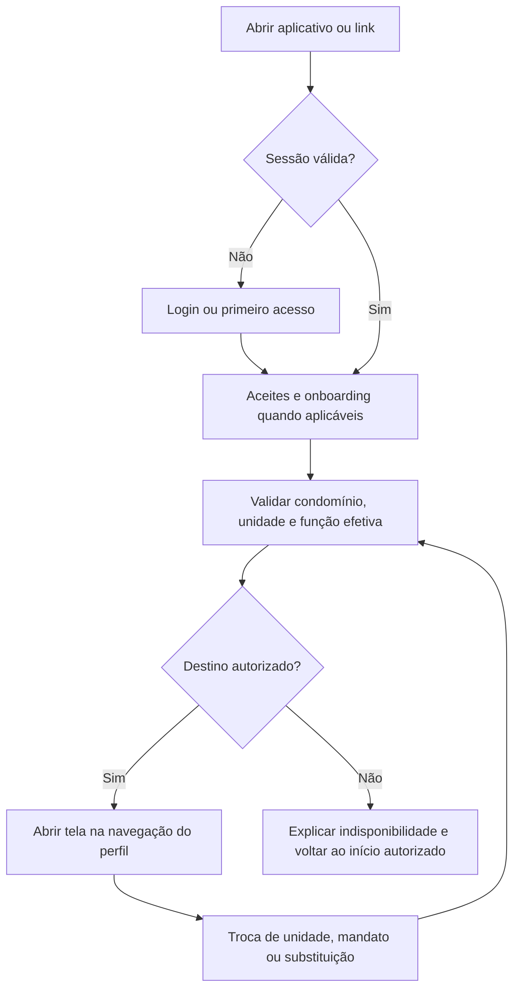
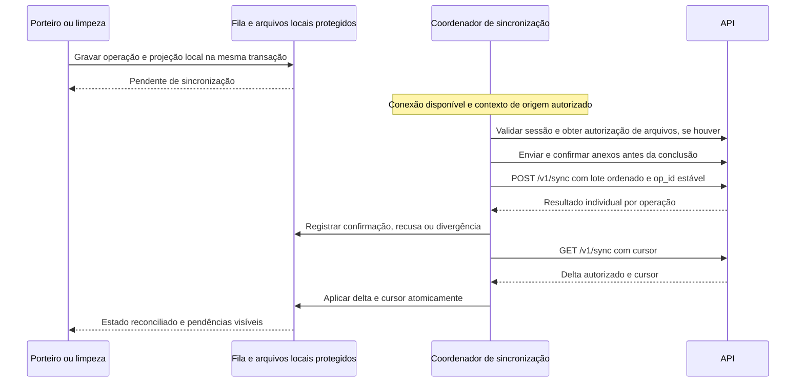

# Frontend mobile — CondomiFacil

**Autor do produto:** Pedro Lemos  
**Data:** 14/11/2026  
**Estado:** proposta técnica para revisão do Pedro; não aceita. O projeto está em Design, sem aplicativo implementado.

## 1. Objetivo, escopo e fontes

Este documento orienta a construção do aplicativo Android e iOS do CondomiFacil em React Native, TypeScript e Expo: organização de pastas, navegação por perfil, estado e cache, operação offline, sincronização, push, deep links e permissões do aparelho. A versão web continua no mesmo projeto Expo, via React Native Web, mas seus painéis administrativos não são transformados em telas mobile por esta proposta.

As regras de negócio e os fluxos existentes prevalecem sobre as recomendações técnicas deste documento. Bibliotecas, organização de código e políticas técnicas ainda não aprovadas são **propostas**, sem fixação de versões. Sua adoção depende da revisão e das provas de conceito já previstas nos ADRs. Não há mudança de regra, Design System ou protótipo nesta documentação.

| Fonte | Uso neste documento |
| --- | --- |
| [PRD](../01-produto/02-prd.md), seções 3, 4, 7, 8 e 10 | Perfis, permissões, funcionalidades, requisitos e stack planejada |
| [Regras de Negócio](../01-produto/03-regras-de-negocio.md) | Unidade ativa, mandatos, offline, reservas, reclamações, score, pagamentos e notificações |
| [Histórias de Usuário](../01-produto/04-historias-de-usuario.md) | Comportamentos e critérios de aceite |
| [Decisões de complementação](../01-produto/05-decisoes-de-complementacao.md) e [Autogestão e condução eleitoral](../01-produto/06-autogestao-e-conducao-eleitoral.md) | Atualizações de 12/11/2026 e 13/11/2026, incluindo preservação da fila pendente e precedência eleitoral |
| [Design System](../02-design/01-design-system.md), seções 10 a 17 | Componentes, padrões de tela, navegação, escrita, acessibilidade e privacidade |
| [User Flows](../02-design/02-user-flows.md), seções 3 a 15 e 17 | Percursos, falhas, retomada e pendências de produto |
| [Arquitetura](../03-arquitetura/01-arquitetura.md), seções 3.1, 3.4, 3.7, 3.8, 4.8 e 5.3 | Fronteiras do cliente, banco local, integrações e monorepo |
| [ADRs](../03-arquitetura/adr/README.md), especialmente 003, 007, 011, 012 e 014 | Banco local, sessão, builds, fuso e conflitos de conclusão; continuam propostos |
| [Guia da API](../05-backend/api/01-guia-da-api.md), [eventos](../05-backend/api/02-eventos-e-webhooks.md), [integrações](../05-backend/api/03-integracoes-externas.md) e [índice do contrato](../05-backend/api/README.md) | Contratos de transporte, contexto, arquivos, push e erros; proposta, ainda sem backend |
| [Protótipo](../../prototipo/README.md) | Referência navegável dos percursos, sem equivaler a implementação real |

O grafo de conhecimento foi consultado para localizar relações entre fontes; seu relatório é de 12/11/2026. As revisões posteriores foram conferidas nos documentos originais. Em particular, RN-OF-06 separa a fila pendente do cache apagável; trechos anteriores sobre apagar o banco inteiro não autorizam apagar operações pendentes.

## 2. Estrutura de pastas e responsabilidades

### 2.1 Organização proposta

A arquitetura já propõe `apps/mobile` e pacotes compartilhados. Recomenda-se organizar a borda de navegação por perfil e o código funcional por domínio, evitando copiar a mesma reserva ou chamado para cada perfil. Os nomes abaixo são uma proposta de implementação futura, não pastas já existentes.

```text
apps/mobile/
  app.config.ts                 configuração Expo por ambiente, links e permissões
  src/
    app/                        rotas e layouts; sem regras de negócio
      _layout.tsx               provedores e inicialização
      (acesso)/                 login, código, senha, recuperação e aceites
      (autenticado)/
        _layout.tsx             sessão, contexto e guardas de navegação
        morador/                abas do morador e do conselho fiscal
        sindico/                abas do síndico morador e do subsíndico
        sindico-profissional/   navegação sem funções de morador
        portaria/               visitantes, encomendas, áreas e menu
        limpeza/                chamados, áreas e menu
        proprietario/           unidade, cobranças, assembleias e menu
        conta/                  notificações, aparência, ajuda e privacidade
      (web)/                    layouts dos painéis web, protegidos por perfil
    modulos/
      acesso/                   ativação, sessão, aceites e onboarding
      contexto/                 condomínio, unidade, vínculo e função efetiva
      reservas/                 áreas, calendário, reserva e vistoria
      visitantes/               visitas, recorrência, listas e registros de acesso
      encomendas/               recebimento, retirada e entregas esperadas
      chamados/                 abertura, atendimento, conclusão e avaliação
      reclamacoes/              defesa, julgamento, recursos e denúncias
      score/                    saldo e histórico por vínculo; transparência
      comunicacao/              comunicados, respostas e sugestões
      reunioes/                 pautas, assembleias, voto, procuração e eleições
      pesquisa/                 pesquisa mensal de funcionários
      cobranca/                 cobranças, Pix, boleto e cartão
      financas/                 resumo, lançamentos, comentários e exportação
      administracao/            cadastros e configurações autorizados
      notificacoes/             central, preferências e destinos
      privacidade/              direitos do titular e solicitações
    compartilhado/
      componentes/              composições específicas do aplicativo
      navegacao/                destinos tipados, resolução de links e guardas
      provedores/               composição de sessão, cache e tema
      contratos/                portas para HTTP, banco, arquivos, push e permissões
      utilitarios/              datas, moeda e apresentação, sem regras de domínio
    infraestrutura/
      api/                      cliente HTTP, erros, renovação e contexto
      persistencia/             banco local, migrações locais e repositórios
      sincronizacao/            fila protegida, envio, delta e conflitos
      dispositivo/              câmera, seleção de arquivos e permissões
      notificacoes/             integração Expo e respostas aos pushes
      seguranca/                armazenamento seguro e limpeza de contexto
      observabilidade/          erros sem conteúdo pessoal ou tokens
  assets/                       fontes e recursos locais
packages/
  design-tokens/                paleta, temas, tipografia, espaço e movimento
  ui/                           componentes base do Design System
  shared-types/                 DTOs, esquemas e estados compartilhados
  config/                       configuração de ferramentas
```

Dentro de cada módulo, separar `telas/`, `componentes/`, `aplicacao/` (casos de uso e hooks), `dominio/` (tipos e políticas locais) e `dados/` (consultas, mutações e mapeamento de DTOs), conforme houver necessidade. Não criar camadas vazias apenas para cumprir a árvore. Testes futuros ficam junto ao comportamento ou na suíte de integração do app.

**Proposta de navegação:** Expo Router, por integrar rotas por arquivos aos clientes nativos e web. Os grupos entre parênteses organizam layouts; não representam permissões nem precisam aparecer no endereço. A tabela da seção 3 define as abas visíveis. Telas de detalhe são empilhadas sobre a aba de origem. Ver [documentação oficial do Expo Router](https://docs.expo.dev/router/introduction/).

### 2.2 Dependências e padrões

| Responsabilidade | Direção e padrão propostos |
| --- | --- |
| Tela e rota | A rota escolhe a tela; a tela chama um caso de uso. Não monta SQL nem chama SDK do dispositivo diretamente. GRASP Controller e alta coesão |
| Domínio | Não importa Expo, React Native ou SDK de gateway. As regras obrigatórias continuam revalidadas pelo servidor. SOLID: responsabilidade única e inversão de dependência |
| HTTP, banco, câmera e push | Portas pequenas com adaptadores de infraestrutura; permite substituir bibliotecas e simular falhas. GoF Adapter |
| Operações offline | Política específica por tipo de operação, com fila única de coordenação. Strategy somente onde visitante e conclusão exigem comportamentos diferentes |
| Mudança de contexto e eventos | Observadores invalidam consultas e atualizam projeções; não concedem permissão por evento. Observer |
| Compartilhamento | `apps/*` dependem de `packages/*`; pacotes não dependem dos apps. `shared-types` não importa NestJS ou React Native |

Os componentes usam tokens do Design System, Inter e Lucide, temas claro/escuro e a preferência “Igual ao aparelho”. Estado usa texto e ícone, com toque mínimo de 48 dp e 56 dp na portaria. Score não usa verde/vermelho. Fontes e recursos necessários à operação offline devem estar disponíveis no binário, sem depender de CDN.

## 3. Navegação e mapa de telas por perfil

### 3.1 Entrada, contexto e retorno



O acesso contém primeiro acesso por e-mail pré-cadastrado, código, criação de senha, login, recuperação, aceites e onboarding por perfil. Não há cadastro público livre. Código, tentativas e prazos seguem RF-AC-01 e RN-CD-02; o servidor é a autoridade dos limites. Novo aceite impede continuar até a confirmação exigida (RN-CD-03).

A sessão identifica a pessoa; o contexto identifica condomínio, unidade quando aplicável e função efetiva. O mesmo usuário pode ter funções diferentes entre condomínios. O seletor troca dados e painéis, não soma métricas entre unidades. Sessão expirada leva ao login e preserva apenas a intenção de destino para retorno após nova autorização, sem reenviar automaticamente uma ação sensível.

### 3.2 Mapa principal

O mapa cobre os 11 perfis do PRD. Conselho e subsíndico reutilizam telas existentes com permissões específicas; não se tornam aplicativos separados. Os itens abaixo são sujeitos à matriz de permissões e às condições da unidade, vínculo e mandato.

| Perfil | Navegação principal | Telas e percursos |
| --- | --- | --- |
| Morador | Início · Reservas · Visitantes · Chamados · Menu | Início com unidade e notificações; áreas → calendário → reserva → detalhe/pagamento/cancelamento; visitantes avulsos e recorrentes → detalhe/edição → listas; chamados → abertura/detalhe → avaliação ou reabertura; Menu com encomendas e entregas esperadas, reclamações/defesa/recurso, Meu score, comunicados, reuniões/votações/procurações, pesquisa e cobranças conforme responsabilidade |
| Síndico morador | Início · Gestão · Reservas · Visitantes · Menu | Funções de morador; Gestão com julgamento autorizado, manutenção, avaliações de atendimento, comunicados e sugestões recebidas, reuniões/eleições, cadastros/solicitações, inadimplência, finanças, encomendas vencidas e substituição; Meus chamados no Menu |
| Síndico profissional | Início · Gestão · Comunicados · Chamados · Menu | Gestão do síndico sem reserva, visitantes, voto ou cobrança pessoal de unidade; chamados que pode abrir/acompanhar, score funcional, reclamação contra si/defesa/recurso e transparência conforme permissão; sem inventar vínculo residencial |
| Subsíndico | Início · Gestão · Reservas · Visitantes · Menu | Morador + Gestão limitada: reclamações contra o síndico, manutenção para acompanhar, sugestões de comunicado, votos presenciais e encomendas vencidas; substituição ativa libera funções do síndico, exceto impedimentos pessoais; acesso direto também verifica substituição |
| Funcionário de portaria | Visitantes · Encomendas · Áreas · Menu | Esperados hoje → entrada/saída, listas agrupadas, busca, entrada sem cadastro, bloqueios e divergências; encomendas → registro/retirada e entregas esperadas; Áreas → reservas de hoje → Em andamento/vistoria/Cumprida/Não comparecimento; Menu com Abrir chamado, Modo treinamento e funções comuns autorizadas |
| Funcionário de limpeza | Chamados · Áreas · Menu | Fila do setor por urgência e antiguidade → detalhe/iniciar atendimento/concluir com fotos opcionais; Áreas → vistoria e faltas, sem marcar Em andamento; Menu com Minhas avaliações sem identidade do avaliador e funções comuns autorizadas |
| Conselho fiscal | Abas do morador | Cartão Para julgar e Menu > Reclamações para atribuições de RN-RC-03/RN-RC-07/RN-RC-14; Menu > Finanças do condomínio para leitura, comentário e exportação; condução eleitoral quando couber, sem edição administrativa geral |
| Proprietário não residente | Unidade · Cobranças · Assembleias · Menu | Unidade → contrato e solicitações de cadastro/renovação/encerramento do inquilino → multas e reclamações validadas contra a unidade; cobranças de sua responsabilidade → detalhe/pagamento; assembleias → pauta/voto/procuração; Menu com Comunicados, Solicitações e conta/ajuda. Sem rotina do inquilino, reservas, chamados, reclamação nova ou pesquisa |
| Administradora | Painel web com navegação lateral | Cadastros, unidades/locação, funcionários, mandatos, áreas/regras, cobrança, finanças, solicitações, reclamações autorizadas e configurações; sem navegação mobile própria nesta proposta |
| Suporte da plataforma | Painel web com navegação lateral | Atuação administrativa no condomínio conforme plano e autorização; nunca vê reclamações nem scores e não julga reclamações/recursos; condução eleitoral autorizada não amplia esses acessos |
| Admin da plataforma | Painel web com navegação lateral | Condomínios, planos e acessos de suporte; sem funções residenciais ou acesso automático ao conteúdo dos condomínios |

**Telas comuns, quando autorizadas:** central de notificações e preferências, comunicados e respostas, Meu score/histórico e recurso próprio para quem tem score, Transparência, Como funciona, Como usar o app, Aparência, Privacidade e dados, solicitações de exportação/exclusão e Sair. Compartilhar a tela não significa conceder a função a todos os perfis.

**Eleição:** condução segue síndico → subsíndico, se o síndico estiver ausente/cargo vago → conselho, sem ambos → proprietário designado, sem os demais. Administradora/suporte autorizados também podem conduzir quando presentes. A permissão temporária do proprietário só cobre a eleição; não concede gestão nem acesso a votos individuais. Resultados somente após encerramento, com voto secreto (RN-VO-13). Esta revisão prevalece sobre restrições eleitorais antigas nas telas do subsíndico.

**Autogestão:** Gestão > Administração do condomínio contempla a modalidade Essencial sem administradora. A distribuição fina de execução local continua proposta no registro 06: síndico ou subsíndico em substituição executa; conselho fiscaliza. Não liberar esses poderes só por detectar ausência de administradora. API e permissões precisam refletir a decisão final antes da implementação.

**Manutenção:** não consta dos 11 perfis aceitos no PRD. Empresas são acompanhadas pela gestão; o perfil experimental do protótipo não cria grupo de navegação em produção.

## 4. Gerenciamento de estado e cache

### 4.1 Separação de responsabilidades

| Tipo de estado | Local proposto | Política |
| --- | --- | --- |
| Dados do servidor | TanStack Query, em memória | Listas, detalhes, paginação por cursor e mutações; API como autoridade. Não persistir todo o cache por padrão |
| Sessão e contexto | Provedor pequeno de sessão/contexto | Identidade, condomínio, unidade, função efetiva e situação de substituição; tokens no armazenamento seguro, fora de estado serializável/logs |
| Estado de tela | Estado local/hooks | Filtros, seleção, formulário e diálogo; não duplicar listas do servidor em um estado global |
| Preferência visual | Persistência local de valor simples | Tema “Igual ao aparelho”, Claro ou Escuro; não guardar conteúdo sensível junto |
| Consulta offline autorizada | Repositório local criptografado | Só dados mínimos de portaria e limpeza; período, contexto e última sincronização explícitos |
| Operações pendentes | Outbox local protegida e separada do cache | Fonte durável de fatos ainda sem confirmação; não usar a fila automática de mutações da biblioteca como segunda fila de negócio |
| Fotos pendentes | Arquivos privados protegidos, referenciados pela operação | Preservar junto da operação até confirmação ou tratamento explícito |

TanStack Query já é uma proposta da arquitetura 5.2. A integração nativa deve considerar conectividade e retorno ao primeiro plano, em vez de depender de eventos exclusivos do navegador. Ver [guia oficial para React Native](https://tanstack.com/query/latest/docs/framework/react/react-native).

### 4.2 Identidade do cache e mudança de contexto

Uma chave de consulta deve incluir usuário, condomínio, unidade quando aplicável, recorte de função/permissão e identidade do vínculo quando o dado depender dele, além do recurso, filtros e cursor. Exemplo conceitual: `[usuarioId, condominioId, unidadeId, vinculoId, escopoPermissao, 'reservas', filtros]`. Para função sem unidade, usar explicitamente o escopo do condomínio; portaria também limita pelos blocos/portaria atendidos.

Score exige o vínculo/episódio de moradia da unidade, não apenas pessoa ou imóvel. Vínculo novo começa com score próprio sem herdar o ocupante anterior. O score público do síndico morador corresponde à unidade vinculada ao mandato. Funcionários e síndico profissional sem unidade usam o score funcional do condomínio.

Ao trocar unidade, condomínio, usuário ou função: cancelar consultas em voo, fechar assinaturas do contexto anterior, limpar dados sensíveis em memória, remover a pilha de detalhes anterior e carregar o contexto autorizado. Respostas atrasadas só podem atualizar o contexto em que foram iniciadas. A fila anterior não migra para o novo usuário/condomínio; fica protegida no contexto de origem.

Fim de mandato, substituição desativada ou revogação invalidam acesso também na tela já aberta. Atualizar o contexto ao retornar ao app e antes de confirmar ações de gestão, eleição, julgamento ou finanças. A API revalida a cada chamada: esconder botão não protege recurso. Offline não permite descobrir imediatamente uma revogação; a política de validade da autorização local precisa da revisão da seção 9.

### 4.3 Atualização, mutações e erros

| Situação | Comportamento proposto |
| --- | --- |
| Abrir tela/voltar ao primeiro plano | Revalidar dados relevantes; deduplicar requisições. Dados anteriores não autorizam executar ação baseada em saldo, disponibilidade ou permissão antiga |
| Retorno de mutação | Aplicar a representação confirmada e invalidar listas/resumos relacionados; consultar antes de repetir uma ação cujo resultado ficou desconhecido |
| Pagamento e reserva | Não confirmar otimisticamente nem pela volta do navegador do gateway. Mostrar Aguardando pagamento até a API confirmar; QR Code vencido exige nova consulta |
| Entrada/saída e conclusão offline | Atualização local somente após gravação durável da operação; selo Pendente de sincronização até resposta individual |
| Evento Socket.IO | Receber identificador, reconsultar API e respeitar contexto. Não considerar o socket fonte durável. Sala é escolhida pelo servidor |
| Queda do socket | Reconexão e delta; consulta periódica conforme contrato para a portaria. RNF-05 exige até 5 s em ambiente apto; Render gratuito não valida esse requisito para o piloto |
| `401` | Coordenar uma renovação por vez; se sessão inválida, login com destino de retorno. Tolerância de retry de refresh ainda depende do ADR-007 |
| `403`/`404` | Atualizar permissões/contexto e explicar indisponibilidade sem confirmar a existência de recurso de outro condomínio |
| `409`/erro de regra | Recarregar estado e apresentar mensagem do domínio, sem sobrescrever silenciosamente |
| `429`, indisponibilidade ou timeout | Respeitar `Retry-After` e recuo; consulta pode tentar novamente. Ação financeira, voto ou julgamento não é repetida cegamente |
| `426` | Informar necessidade de atualização conforme contrato; não apagar operações locais pendentes |

O cliente envia `Authorization`, `X-Condominio-Id`, `X-Unidade-Id` e `X-App-Version` somente conforme a operação do contrato. Não acessa PostgreSQL/Supabase diretamente para contornar a API. Duração de cache, retenção de chaves de idempotência e intervalo de consulta periódica continuam sujeitos a validação; não são novas regras de negócio.

## 5. Estratégia offline e sincronização

### 5.1 Matriz do que funciona sem internet

| Perfil/ação | Sem internet | Ao reconectar |
| --- | --- | --- |
| Portaria: lista do dia dos blocos atendidos | Consulta da cópia já sincronizada, com data/hora da última atualização; não promete novos visitantes ou cancelamentos recebidos durante a queda | Atualiza por delta ou nova carga autorizada |
| Portaria: entrada e saída | Grava fatos na fila; entrada em até 2 toques, sem confirmação adicional, com Desfazer conforme DS 11.1 | Envia automaticamente e trata cada resultado/divergência |
| Portaria: registro sem cadastro e decisão de bloqueio | Fazem parte do fluxo de entrada; dependem do fechamento dos tipos/cargas de sync para esses casos e da lista de bloqueio local. Não liberar em produção sem esse contrato | Registra autorização por interfone e motivo de exceção conforme regras; servidor audita |
| Portaria: encomendas e entregas esperadas | Registro, edição, retirada e vínculo exigem internet. Consulta local de encomendas pendentes aparece como proposta na arquitetura, não como funcionalidade offline decidida | Reconsulta as listas; sem replay automático de formulário |
| Portaria/limpeza: Áreas e reservas | Consulta atualizada, Em andamento, vistoria, Cumprida e Não comparecimento exigem internet; nenhuma marcação entra na fila offline, inclusive reserva paga | Reconsulta e revalida o estado antes de registrar |
| Limpeza: chamados abertos do setor | Consulta da cópia autorizada e conclusão com até 5 fotos opcionais protegidas no aparelho | Envia fotos e conclusão; servidor define conclusão efetiva do ciclo |
| Limpeza: iniciar atendimento | Não ampliar a fila além da conclusão prevista sem contrato e decisão; manter online nesta proposta | Reconsulta o chamado antes de alterar |
| Demais perfis e módulos | Operações exigem internet; manter rascunho de texto conforme UF 15, sem chamar de registro concluído | Revalidar permissão, prazo e estado antes de envio explícito |
| Login inicial, voto, pagamento, julgamento, gestão e eleição | Exigem internet. Sem fila offline para ação sensível | Retomar a intenção de tela, nunca efetuar a ação automaticamente |

Ausência de cache utilizável exige estado claro: “Conecte-se para carregar os dados”. No novo dia, a cópia do dia anterior não vira lista atual. Sem internet, a consulta é potencialmente desatualizada; a faixa e a hora da última sincronização permanecem visíveis. Rascunho de texto é estado temporário do formulário; sua persistência após encerrar o app não está aprovada, especialmente para reclamações.

### 5.2 Banco local, fila e proteção

O ADR-003 recomenda **expo-sqlite com SQLCipher e fila própria**, ainda sujeito a PoC e aprovação; WatermelonDB segue alternativa. Separar cache de consulta, outbox e arquivos pendentes tanto no ciclo de vida quanto no acesso. O particionamento é por usuário/condomínio e recorte autorizado; não basta filtrar uma lista global depois de ler.

SQLCipher precisa de build nativa própria, não Expo Go. Verificar efetivamente a disponibilidade da criptografia antes de gravar dados, pois abrir SQLite e configurar uma chave sem suporte compilado não garante criptografia. Validar na PoC a proteção dos anexos e a guarda de chaves no armazenamento seguro. Ver [Expo SQLite/SQLCipher](https://docs.expo.dev/versions/latest/sdk/sqlite/) e [Expo SecureStore](https://docs.expo.dev/versions/latest/sdk/securestore/).

**Cache apagável:** criptografado, mínimo e apagado ao fim do dia e ao sair da conta (RN-OF-06). Verificar validade também localmente, sem depender de receber uma rotina do servidor. Troca de condomínio retira a cópia anterior do contexto acessível.

**Fila protegida:** operações pendentes e anexos necessários são preservados até sincronização ou tratamento explícito. Não apagar a fila na virada do dia, logout, atualização, expiração de sessão ou limpeza do cache. Não enviar com credenciais do próximo funcionário de um aparelho compartilhado. Após logout/revogação, bloquear acesso pela nova sessão; mecanismo de recuperação, retenção e custódia da chave da fila dependem de revisão de segurança. Não definir retenção ilimitada nem prazo arbitrário. A implementação desse ciclo depende da decisão pendente do ADR-003/RN-OF-06.

Cada operação conserva `op_id`, contexto de origem, `dispositivo_id`, sequência, tipo, carga imutável, horário registrado pelo aparelho, estado e referências locais dos anexos. Quando houver ciclo de chamado, preservar sua identidade. Uma transação local grava a operação e a projeção pendente; erro de armazenamento não pode mostrar sucesso. Não copiar JWT ou refresh token para a operação.

### 5.3 Protocolo proposto

Usar **`POST /v1/sync` e `GET /v1/sync`** de [sync.yaml](../05-backend/api/openapi/sync.yaml), não os caminhos ilustrativos antigos `/sync/push` e `/sync/pull`. Os nomes, cargas, cursores e resultados ainda integram um contrato proposto.



1. Disparar sincronização ao detectar retorno da rede, abrir/retomar o app e por tentativa manual. A disponibilidade de rede é sinal para tentar; só a resposta da API prova comunicação. Tarefas em segundo plano são complemento sujeito ao sistema operacional, sem promessa de sincronização imediata com app encerrado.
2. Coordenar um envio por fila/contexto, com lotes ordenados. Resolver dependências, incluindo anexos, antes da operação que as exige. Preservar sequência mesmo depois de reinício.
3. Reutilizar `op_id` e carga nos reenvios. Timeout após envio não prova falha: reenviar o mesmo identificador. Não gerar outra operação para “tentar de novo”. `Idempotency-Key` de cobrança/reserva não substitui `op_id`.
4. Processar `aplicada`, `repetida`, `divergente` ou `recusada` por item. HTTP 200 não significa que todas foram aplicadas. Recusa de uma operação não elimina as demais; item recusado exige motivo e tratamento, sem loop cego.
5. Em falha de transporte, conservar operações, aplicar recuo com variação e tentar novamente. Em sessão inválida ou permissão revogada, suspender envio até reautenticação/tratamento do contexto de origem.
6. No delta, atualizar dados e cursor juntos. Não avançar cursor se a gravação falhar. Remoções e invalidação de acesso retiram cópias consultáveis; nunca sobrescrever uma operação local ainda sem resposta.
7. Se o cursor não puder ser retomado, recarregar a cópia autorizada preservando a fila. Formato de expiração do cursor e recuperação de carga parcial precisam ser fechados no contrato antes de implementar.

Estados locais propostos: Pendente, Enviando, Aguardando nova tentativa, Sincronizado, Divergência a confirmar e Recusado. Mostrar contagem e última sincronização sem confundir “gravado no aparelho” com “confirmado no servidor”. Desfazer precisa respeitar se a operação ainda está local ou já foi aplicada, sem apagar registro confirmado nem reutilizar `op_id` com outra carga; o protocolo de compensação ainda precisa ser fechado.

### 5.4 Conflitos de negócio

| Caso | Tratamento obrigatório ou pendente |
| --- | --- |
| Entrada offline de visitante cancelado/editado | Servidor aplica o fato e cria divergência. Porteiro confirma por interfone com o morador que cadastrou; diálogo sem fechar até confirmação. Registrar a confirmação pela operação prevista no contrato. Não avisar o síndico (RN-OF-04/05) |
| Duas conclusões no mesmo ciclo | Vale o menor horário registrado pelo celular, mesmo enviado depois. Guardar ambas no histórico e avisar os envolvidos. Não trocar pelo critério de chegada ao servidor (RN-CH-04) |
| Conclusão efetiva corrigida após avaliação | Nota superada fica só no histórico autorizado, fora das médias e sem transferência. Nova avaliação da efetiva na janela configurada desde sua disponibilização; não reiniciar as 48h de reabertura. Não mostrar comentário antigo ao novo atendente (RN-CH-15/17) |
| Mesmo `op_id`, carga diferente | Recusar e apresentar tratamento; nunca aceitar como edição de operação |
| Empate exato de horário ou relógio incorreto | Pendência do ADR-014; não inventar tolerância nem alterar horário original |
| Visitante removido ou saída já encerrada | Tratamentos técnicos sugeridos nos ADRs/arquitetura ainda não aceitos; validar antes de implementar |

## 6. Notificações push e deep links

### 6.1 Registro e recebimento

Proposta: adaptador de `expo-notifications`, integrado ao backend de notificações e Expo Push/FCM conforme arquitetura; no iOS o transporte nativo envolve APNs. Push remoto deve ser validado em development build e aparelhos de teste. Ver [referência oficial de notificações](https://docs.expo.dev/versions/latest/sdk/notifications/).

| Etapa | Responsabilidade |
| --- | --- |
| Solicitar permissão | App explica a utilidade no contexto, depois pede autorização ao sistema. Preferência do produto e permissão do sistema são controles distintos |
| Registrar aparelho | App obtém token e registra pela interface `/v1/eu/dispositivos`, vinculada ao usuário autenticado e ambiente; nunca colocar credenciais de envio no binário |
| Renovar registro | Atualizar quando o token mudar ou o usuário voltar a ter autorização; tratar reinstalação e troca de conta sem herdar o dono anterior |
| Preferências | Consultar/gravar `/v1/eu/preferencias-notificacao`; central em `/v1/eu/notificacoes`, conforme `comum.yaml` |
| Receber em primeiro plano | Atualizar/invalidate a lista e mostrar aviso genérico pertinente, evitando duplicar aviso já apresentado pelo sistema |
| Tocar com app aberto ou encerrado | Mesmo resolvedor de destinos, após sessão, aceites e contexto; processar a resposta inicial e os eventos posteriores sem abrir duas telas |
| Logout | Desvincular registro do aparelho pelo contrato quando possível e limpar notificações locais apresentadas. Sem rede, revogação/desvinculação remota e registro pendente precisam de reconciliação; texto genérico reduz exposição, sem garantir retirada de push já em trânsito |
| Falha de entrega | Backend trata recibos e tokens inválidos (`DeviceNotRegistered`). App não presume que todos receberam e não depende do push para atualizar dados |

Texto na tela bloqueada é genérico, sem nome/documento de visitante, unidade, dívida, score, relato, identidade protegida ou voto. Carga contém só identificadores necessários e destino permitido; detalhes são buscados autenticados. Segredos, dados de cartão e URLs assinadas de arquivos não entram na carga.

### 6.2 Tipos, preferências e horário

Tipos de RF-NO-01: visitante, encomenda, reserva, chamado, comunicado, votação e reclamação. Decisão de reclamação contra a pessoa e divergência de sincronização para o porteiro são obrigatórias no produto (US-NO-01). Isso não supera uma negativa de permissão do sistema: manter central interna e avisos no app. Cobrança em atraso como obrigatória continua pendência; não criar esse comportamento.

O servidor decide os destinatários e horários. Eventos de pessoas saem na hora; efeitos das rotinas da madrugada são encaminhados às 09:00 locais nos casos definidos no catálogo de eventos. Lembrete de reserva é opcional, ligado por padrão, somente para Confirmada, e segue RN-RE-14: antecedência padrão de 24h, configurável de 1 a 72h; horário calculado entre 00:00 e 08:59 é antecipado para 21:00 da noite anterior. Confirmação posterior ao horário de envio não gera lembrete retroativo. Não duplicar essa rotina com agendamento local no celular.

### 6.3 Destinos e validação

Proposta: destinos internos tipados, resolvidos a partir de uma lista permitida. Usar links HTTPS associados ao domínio futuro com Android App Links/iOS Universal Links; esquema próprio apenas para desenvolvimento ou necessidade validada. Domínio, scheme e identificadores dos apps ainda serão definidos. Não publicar endereços inventados. Ver [guia oficial de links do Expo](https://docs.expo.dev/linking/overview/).

| Evento/destino lógico | Tela após autorização |
| --- | --- |
| Visitante/lista | Detalhe permitido da visita/lista; na portaria, contexto dos blocos atendidos |
| Encomenda/entrega esperada | Detalhe permitido da encomenda ou entrega |
| Reserva e lembrete | Detalhe da reserva; atalho de cancelar executa o fluxo normal com regras e confirmação necessárias |
| Chamado | Detalhe do chamado; avaliação só na janela e para quem pode avaliar |
| Comunicado | Detalhe/resposta autorizada; conteúdo ocultado mostra o estado vigente |
| Reunião/votação/eleição | Pauta ou eleição autorizada; não votar nem encerrar pelo simples link |
| Reclamação/decisão/recurso | Projeção do caso para o titular/julgador atual, sem expor identidade proibida |
| Divergência de portaria | Divergência atribuída à portaria; confirmação por interfone permanece obrigatória |
| Cobrança, quando houver notificação prevista | Detalhe somente ao responsável financeiro; sem dados financeiros no link |

Na abertura: validar formato e tipo, autenticar, cumprir aceites, validar vínculo no condomínio/unidade e reconsultar o recurso. O identificador recebido não autoriza troca silenciosa de contexto ou acesso. Se o usuário tiver vínculo válido em outro contexto, explicar a troca antes de abrir conforme o seletor existente. Recurso expirado, removido ou sem acesso resulta em mensagem neutra e retorno seguro.

Com internet indisponível, destinos online mostram a limitação e permitem nova tentativa; só usar cópia offline nos módulos autorizados. Pagamento externo retorna ao detalhe e consulta a API; parâmetros de URL não provam quitação. Links não executam mutações, carregam tokens de sessão, concedem mandato ou contornam restrições de plano/função.

## 7. Permissões do dispositivo e arquivos

### 7.1 Matriz de permissões

Solicitar somente quando a pessoa acionar uma função que precise do recurso. O diálogo do sistema não substitui explicação da finalidade, nem constitui autorização de negócio. Negar câmera ou push não bloqueia login e recursos independentes.

| Recurso | Uso no CondomiFacil | Quando pedir e alternativa |
| --- | --- | --- |
| Câmera | Fotos de chamado, conclusão da limpeza, vistoria, etiqueta de encomenda e comprovante financeiro quando autorizado | Ao tocar Tirar foto. Explicar “Usamos a câmera para anexar uma foto a este registro”. Oferecer seleção de arquivo/foto quando aplicável; fotos opcionais podem ser omitidas |
| Seleção de fotos | Anexo escolhido pela pessoa | Preferir seletor do sistema com acesso às imagens escolhidas. Pedir acesso adicional à biblioteca apenas se necessário no fluxo/versão do sistema; não exigir acesso amplo preventivamente |
| Seleção de documento | PDF de comprovante financeiro autorizado, além de imagens | Seletor do sistema, restrito aos tipos aceitos; não solicitar acesso geral ao armazenamento |
| Notificações | Avisos e lembretes | Explicar após conhecer o perfil e antes de ativar push; se negado, manter central interna e indicar como habilitar nos ajustes |
| Rede | API, upload, sync e tempo real | Estado de conexão e falhas tratados na UI; não prometer envio só porque o aparelho está conectado ao Wi-Fi |
| Microfone | Sem função prevista no MVP documentado | Não solicitar nem manter permissão introduzida por dependência de captura de vídeo/áudio |
| Localização, contatos, Bluetooth, telefone e SMS | Sem necessidade definida nos fluxos | Não solicitar. Confirmar por interfone é ação operacional do porteiro; não exige gravar ligação ou acessar contatos |
| Biometria | Não é requisito definido para este MVP | Não criar obrigatoriedade ou fluxo novo sem decisão |

Proposta para captura/seleção de foto: [Expo ImagePicker](https://docs.expo.dev/versions/latest/sdk/imagepicker/). Para documentos: [Expo DocumentPicker](https://docs.expo.dev/versions/latest/sdk/document-picker/). Não há necessidade definida de visualização contínua de câmera ou leitura de QR por câmera; exibir QR Code Pix não implica pedir câmera. Revisar a configuração nativa das bibliotecas: ImagePicker pode adicionar permissão de áudio por padrão no Android; desabilitá-la no uso apenas de fotos.

### 7.2 Negativa, cancelamento e retorno dos ajustes

Tratar separadamente: ainda não solicitado, autorizado, acesso limitado, negado e bloqueado para nova solicitação, quando o sistema distinguir esses estados. Negativa temporária permite nova tentativa por iniciativa da pessoa; bloqueio oferece Abrir ajustes. Ao retornar ao app, reconsultar a permissão sem presumir que foi concedida. Cancelar a captura/seleção mantém o formulário e não é erro.

Não insistir em diálogos repetidos. Se a foto for opcional, continuar sem foto; se checklist/foto forem exigidos na vistoria com uso, explicar o impedimento e oferecer a alternativa permitida, sem enviar vistoria incompleta como concluída. Não exigir foto de área não utilizada (RN-RE-09).

Mensagens nativas e textos de finalidade devem estar em português do Brasil no Android/iOS. Declarações de permissões em build, manifestos e descrições das lojas devem corresponder ao uso real; testar no binário que será distribuído, sem depender apenas de Expo Go.

### 7.3 Ciclo de vida das fotos e anexos

1. Selecionar ou capturar somente imagem/documento necessário ao registro. Não salvar automaticamente na galeria nem enviar arquivo antes da confirmação da pessoa.
2. Validar tipo, tamanho e quantidade no cliente para boa experiência; servidor repete validação. Conclusão aceita até 5 fotos opcionais (RN-CH-14); comprovante financeiro aceita foto/PDF até 10 MB (RN-FI-24). Outros limites seguem contrato, sem inventar valores.
3. Preparar a imagem, corrigir orientação e reduzir tamanho conforme Design System/arquitetura; parâmetros de compressão são propostas a validar com legibilidade. Não comprimir PDF como se fosse imagem. Minimizar metadados desnecessários, inclusive localização, na preparação.
4. Arquivo pendente fica em área privada protegida, com referência estável; não depender de URI temporária do seletor para uma conclusão offline futura. SQLCipher não criptografa automaticamente o arquivo de foto externo ao banco; sua proteção precisa de solução validada.
5. Online, pedir autorização em `/v1/arquivos/*`, enviar por URL assinada, confirmar upload e associar o identificador à operação. URL expirada exige nova autorização; não guardar URL assinada como endereço permanente.
6. Offline, apenas anexos da conclusão de limpeza seguem a fila autorizada. Fotos de encomenda, reclamação ou vistoria não criam novos módulos offline.
7. Após confirmação e reconciliação, remover cópias temporárias dispensáveis conforme política; em falha, preservar anexos de operação pendente. Limpeza do cache não pode deixar uma conclusão pendente sem suas fotos.

## 8. Critérios para validar a implementação futura

Esta seção orienta a revisão e as PoCs; não afirma execução de testes de um app que ainda não existe.

| Cenário | Evidência esperada |
| --- | --- |
| Navegação por perfil | Cada um dos 11 perfis alcança só o mapa autorizado; administrativos permanecem no cliente web; papel de manutenção não aparece como aceito |
| Unidade e mandato | Trocar unidade não mistura dados; resposta atrasada não preenche outro contexto; substituição encerrada e mandato revogado bloqueiam detalhes e ações já abertos |
| Portaria | Entrada em até 2 toques, Desfazer, acesso por bloco, lista do dia e bloqueio; queda no meio do envio/reenvio não duplica; divergência exige confirmação e não avisa síndico |
| Limpeza | Conclusão anterior pelo horário do celular prevalece mesmo enviada depois; avaliação superada sai dos agregados; até 5 fotos persistem até envio; reabertura não reinicia |
| Cache e fila | Criptografia real no build; cache apagado na data/logout; fila e fotos preservadas e inacessíveis a outra conta; reinício, disco cheio e migração interrompida sem sucesso falso |
| Offline limitado | Áreas/vistorias, encomendas, pagamentos, voto, reclamações e gestão não passam a aceitar mutação offline |
| Push e links | App aberto, em segundo plano e encerrado; sessão expirada, unidade diferente, vínculo removido e recurso expirado; sem execução automática de ação e sem conteúdo sensível na tela bloqueada |
| Permissões | Primeira solicitação, negativa, bloqueio, acesso limitado, cancelamento e retorno dos ajustes em Android/iOS; foto opcional não impede concluir sem anexo |
| Arquivos | URL expirada, envio interrompido, confirmação perdida e arquivo recusado; retomada sem duplicar conclusão nem perder referência |
| Acessibilidade e desempenho | Leitor de tela, fonte ampliada, contraste/tema, texto+ícone, toque 48/56 dp; abertura utilizável conforme RNF-02 e PoC da fila com 10.000 operações em aparelho de 3 GB conforme ADR-003 |

A estratégia geral de qualidade será detalhada em `docs/08-qualidade/` em trabalho próprio. Builds, notificações, permissões nativas e criptografia precisam de validação em Android/iOS; simulações do protótipo HTML não comprovam esses comportamentos.

## 9. Pendências e rastreabilidade

### 9.1 Decisões ainda necessárias

| Pendência | Origem/impacto |
| --- | --- |
| Aceitar organização por domínio e Expo Router | Proposta deste documento; validar navegação nativa/web e links sem copiar regras por perfil |
| Aceitar TanStack Query e políticas de cache | Arquitetura 5.2; calibrar revalidação e consulta periódica para RNF-05 sem dados excessivos |
| Escolher banco local e confirmar criptografia de banco/anexos | ADR-003; PoC SQLCipher/EAS, volume, desempenho e proteção de arquivos |
| Retenção e tratamento da fila após logout/revogação | RN-OF-06 e decisão de 12/11/2026; definir custódia de chaves e retomada no aparelho compartilhado sem perda de fatos ou acesso indevido |
| Limite da autorização offline | ADR-007/SEG-09; conciliar turno sem internet, sessão expirada e revogação, sem inventar duração de acesso offline |
| Fechar protocolo de sync | Entrada sem cadastro, exceção de bloqueio, Desfazer/compensação, cursor expirado e recuperação; não basta a existência de telas no protótipo |
| Desempate exato e relógio incorreto | ADR-014; preservar a regra de menor horário do celular |
| Domínio, scheme, identificadores e configuração dos links | Vinculados à publicação e ambientes; separar desenvolvimento/staging/produção e validar associações de domínio |
| Renovação de sessão com resposta perdida | ADR-007; mecanismo/janela de tolerância e proteção contra replay antes de implementar |
| Permissões finas da autogestão e concessão eleitoral temporária | Registro 06 e RN-VO-13; não converter precedência eleitoral em poder administrativo geral |
| Pendências de produto que afetam telas | UF 17: parecer jurídico, gateway/sandbox, finanças e perfil Manutenção; este documento não resolve essas escolhas |

Não iniciar piloto com dados reais baseado apenas nesta proposta. Continuam os marcos de validação de protótipo, parecer jurídico e revisão da infraestrutura definidos pelo produto e ADR-004.

### 9.2 Matriz de rastreabilidade

| Tema deste documento | Produto e histórias | Design e contrato |
| --- | --- | --- |
| Acesso, unidade e tema | RF-AC-01 a RF-AC-08; RN-CD-02/03/19 a 28; US-AC-01 a US-AC-06 | UF 3; DS 10.16, 10.24 e 12; `openapi/comum.yaml`; ADR-007 |
| Perfis e navegação | PRD 3; RN-CD-27/28; RN-PL-08; RN-VO-13; registro 06 | DS 11 e 12; UF 4 e 11; interfaces por perfil no índice da API |
| Portaria e sincronização | RF-VI-06/09/11/15; RN-OF-01 a 06; RN-VI-17; RNF-05/06/08; US-VI-03/04/08 | UF 6.2/6.3/6.5; DS 10.23 e 11.1; `openapi/sync.yaml`; `asyncapi/tempo-real.yaml`; ADR-003 |
| Limpeza e fotos | RF-CH-03; RN-CH-04/14/15/17; RNF-07/08; US-CH-02/04/05 | UF 8.2/8.4/8.5; DS 10.20 e 11.2/11.12; `openapi/limpeza.yaml`; ADR-014 |
| Reservas e restrição offline | RF-RE-08/09; RN-RE-09/10/13/14 | UF 5.3; DS 11.1/11.2; `openapi/portaria.yaml` e `openapi/limpeza.yaml` |
| Isolamento e privacidade | RF-AC-04; RN-SC-02/13/14; SEG-09/12; PRD 3 e 8 | DS 15; arquitetura 4.8; guia da API 3 e 11; ADR-001/010 |
| Push e destinos | RF-NO-01; US-NO-01; RN-OF-04/05; RN-RE-14 | UF 14.1; DS 13.5; catálogo de eventos 4; `openapi/comum.yaml` |
| Permissões e anexos | RN-CH-14; RN-RE-09; RN-FI-24; US-EN-01 | DS 10.20; guia da API 11; integrações de arquivos; contratos de portaria, limpeza e finanças |

### 9.3 Referências técnicas oficiais

Consultadas em 14/11/2026. Confirmar compatibilidade das bibliotecas com o SDK escolhido quando a implementação começar, sem assumir versão pelo endereço `latest`.

- [Expo Router](https://docs.expo.dev/router/introduction/): rotas e navegação do projeto universal.
- [TanStack Query em React Native](https://tanstack.com/query/latest/docs/framework/react/react-native): conectividade e foco no cliente nativo.
- [Expo SQLite e SQLCipher](https://docs.expo.dev/versions/latest/sdk/sqlite/): persistência e suporte nativo à criptografia.
- [Expo SecureStore](https://docs.expo.dev/versions/latest/sdk/securestore/): armazenamento seguro de pequenos valores.
- [Expo Notifications](https://docs.expo.dev/versions/latest/sdk/notifications/): tokens, permissões e interação com notificações.
- [Links no Expo](https://docs.expo.dev/linking/overview/): deep links, Android App Links e iOS Universal Links.
- [Expo ImagePicker](https://docs.expo.dev/versions/latest/sdk/imagepicker/): captura, seletor e permissões nativas de mídia.
- [Expo DocumentPicker](https://docs.expo.dev/versions/latest/sdk/document-picker/): seleção de documentos pelo sistema.

## Relatórios no painel web — decisão de 14/11/2026

Relatórios antecipados para MVP e alinhamento autorizado pelo Pedro: [painel-web.md](painel-web.md), RN-RL-01 a 08, RF-RL-01 a 11, US-RL-01 a 03. O novo catálogo é da administradora no cliente web; não cria aba mobile nem amplia exportações de outros perfis. Preservar as exportações financeiras anteriores e o limite de operação offline. Dados, cache e links privados continuam sujeitos ao contexto autorizado.
