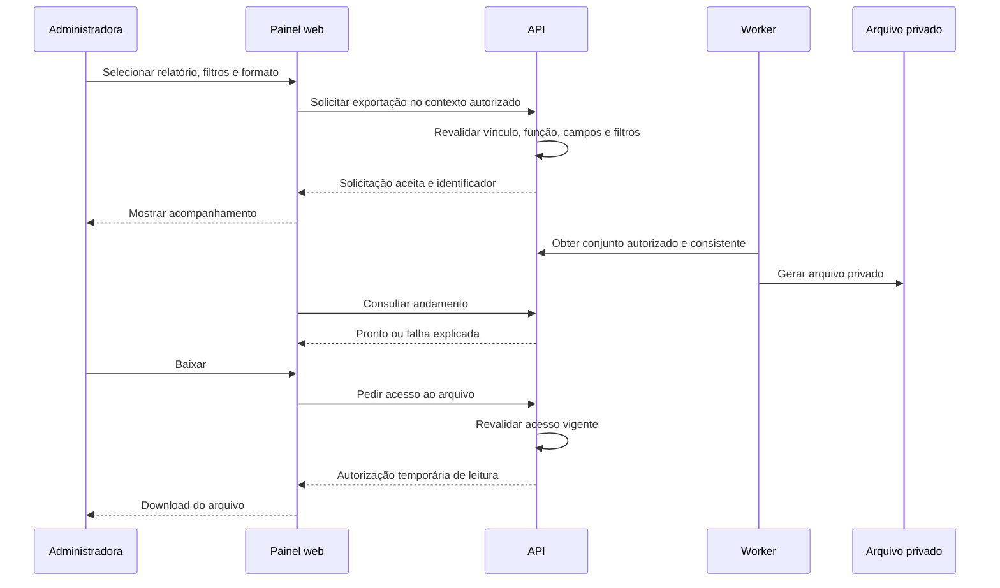

# Painel web — CondomiFacil

**Autor do produto:** Pedro Lemos  
**Data:** 14/11/2026  
**Estado:** proposta de documentação para revisão; painel ainda não implementado.

## 1. Objetivo e decisões de escopo

Este documento descreve o painel web usado pelas administradoras para consultar e administrar os condomínios aos quais estão vinculadas. Define páginas, rotas de navegação, controle de acesso, relatórios gerenciais e exportações. Complementa o [frontend mobile](frontend.md), mantendo React Native Web no projeto Expo planejado, com componentes e tokens compartilhados.

**Decisão do Pedro em 14/11/2026:** antecipar os relatórios para o MVP. O catálogo e os formatos foram incluídos no alinhamento autorizado pelo Pedro nesta data. Rotas e desenho técnico continuam propostas antes da implementação. Essa decisão não concede novos acessos a dados nem transforma relatórios gerenciais em contabilidade oficial.

**Alinhamento autorizado em 14/11/2026:** produto, design, protótipo e contratos refletem o catálogo no MVP (RN-RL-01 a 08; RF-RL-01 a 11; US-RL-01 a 03). Permanecem vigentes as restrições de acesso e as ressalvas sobre autogestão.

Já constam no MVP a exportação de cobranças e pagamentos em CSV pela administradora (RF-FI-15) e a exportação financeira em CSV/PDF pelos perfis autorizados (RF-FI-22). Antecipar o módulo geral não elimina a separação entre esses dois conjuntos de dados.

### 1.1 Fontes

| Fonte | O que orienta |
| --- | --- |
| [Visão de Produto](../01-produto/01-visao-de-produto.md), seção de roadmap | Entregas e limites do produto; replanejamento dos relatórios pendente |
| [PRD](../01-produto/02-prd.md), seções 2, 3, 4 e 8 | Escopo, matriz de permissões, RF-AD, RF-FI, RF-CH e SEG-17 |
| [Regras de Negócio](../01-produto/03-regras-de-negocio.md) | Configuração, reclamações, locação, finanças, privacidade e funções por plano |
| [Histórias de Usuário](../01-produto/04-historias-de-usuario.md) | Critérios de aceite administrativos e financeiros |
| [Complementação](../01-produto/05-decisoes-de-complementacao.md) e [autogestão e eleições](../01-produto/06-autogestao-e-conducao-eleitoral.md) | Decisões de 12/11/2026 e revisão de 13/11/2026 |
| [Design System](../02-design/01-design-system.md), seções 10.22, 11.9, 11.15, 12 e 15 | Painel expandido, tabelas, finanças, navegação e dados protegidos |
| [User Flows](../02-design/02-user-flows.md), seções 4, 9, 11 e 13 | Administração, julgamento, reuniões e finanças |
| [Arquitetura](../03-arquitetura/01-arquitetura.md) e [backend](../05-backend/01-backend.md) | API intermediária, isolamento, autorização, worker e arquivos privados |
| [Guia da API](../05-backend/api/01-guia-da-api.md) e [índice do contrato](../05-backend/api/README.md) | Sessão, contexto, erros e operações documentadas |
| [Interface da administradora](../05-backend/api/openapi/administradora.yaml), [comum](../05-backend/api/openapi/comum.yaml) e [síndico](../05-backend/api/openapi/sindico.yaml) | Contratos propostos existentes, sem backend implementado |

O grafo de conhecimento foi consultado para localizar relações; as fontes originais prevalecem, especialmente sobre revisões posteriores ao relatório do grafo de 12/11/2026.

## 2. Organização do painel

O painel começa pela seleção de um condomínio autorizado. O cabeçalho mantém seu nome visível, a função efetiva, notificações e a conta; a lateral reúne os módulos. Selecionar um condomínio não concede acesso a outro. Não há consolidação de dados pessoais ou financeiros de toda a carteira nesta proposta.

Na faixa expandida, listas usam tabelas com busca, filtros, ordenação e paginação; formulários seguem o limite de largura do Design System. Em telas menores, a navegação lateral pode ser recolhida e as tabelas adaptadas, mantendo as mesmas permissões. O painel administrativo exige internet; não herda a fila offline da portaria ou limpeza.

Componentes compartilhados incluem tabela, filtros, paginação, indicador de estado, resumo financeiro, gráfico com tabela equivalente, seletor de formato e acompanhamento da exportação. Tokens, temas, escrita e acessibilidade seguem o Design System; estado não é comunicado somente por cor.

### 2.1 Rotas e páginas propostas

As rotas abaixo são **endereços do frontend**, distintos dos endpoints `/v1`. A base de condomínio é `/condominios/:condominioId`. Identificadores representam recursos; nomes, documentos, dívidas, relatos e tokens não entram na URL.

| Rota web | Página e conteúdo | Acesso principal |
| --- | --- | --- |
| `/acesso` | Login, recuperação e retorno ao destino autorizado | Acesso à conta |
| `/primeiro-acesso` e `/aceites` | Ativação e documentos obrigatórios | Conforme situação da conta |
| `/condominios` | Lista dos condomínios acessíveis e seletor | Vínculos autorizados |
| `/:base/visao-geral` | Resumos e pendências dos módulos permitidos | Contexto autorizado; cada cartão tem permissão própria |
| `/:base/unidades` | Unidades, blocos, ocupação e busca | Administradora e equivalentes autorizados |
| `/:base/unidades/:unidadeId` | Proprietário, morador habilitado, locação, solicitações e responsáveis financeiros | Conforme campo e ação; sem expor rotina privada do morador |
| `/:base/unidades/importacao` | Prévia da planilha, erros por linha e confirmação | Cadastro autorizado; formato de entrada depende do contrato |
| `/:base/funcionarios` | Funcionários ativos/desligados, setor e empresa | Cadastro autorizado |
| `/:base/empresas-de-manutencao` | Empresas, serviço e contato; sem criar login para empresa | Cadastro autorizado |
| `/:base/areas-e-regras` | Áreas, disponibilidade cadastral, regras e herança de parâmetros | Configuração autorizada |
| `/:base/bloqueios-de-entrada` | Pessoas com entrada bloqueada e motivo | Apenas funções já autorizadas |
| `/:base/mandatos` | Mandatos, contratação profissional e substituição | Operações específicas por função, sem autovalidação |
| `/:base/reclamacoes` e `/:base/reclamacoes/:reclamacaoId` | Lista, projeção do caso, conversa e decisão quando atribuída | Administradora; outros julgadores somente nos casos permitidos |
| `/:base/cobranca` | Configuração, valores e formas de pagamento | Execução administrativa autorizada |
| `/:base/cobranca/cobrancas` e `/:base/cobranca/cobrancas/:cobrancaId` | Cobranças, pagamento confirmado, extras e baixa manual | Dados individuais restritos por SEG-17 |
| `/:base/cobranca/inadimplencia` | Unidades, valores e dias de atraso | Administradora e gestão autorizada; conselho não herda acesso |
| `/:base/cobranca/conciliacao` | Duplicidades, devoluções e divergências documentadas | Operador autorizado; ações auditadas |
| `/:base/financas` e `/:base/financas/lancamentos/:lancamentoId` | Resumo, categorias, evolução, lançamentos e comentários | Leitura e edição separadas conforme RN-FI-29 |
| `/:base/financas/fechamentos` | Meses abertos/fechados, fechamento e estorno | Leitura ou execução conforme função |
| `/:base/avaliacoes-atendimento` | Agregados por funcionário de limpeza e empresa | Administradora vê somente agregado |
| `/:base/comunicados` | Página compartilhada do módulo, quando houver permissão de conteúdo | Não concede à administradora o direito de publicar comunicado |
| `/:base/reunioes` | Reuniões e pautas conforme permissão | Não concede convocação/voto por ser painel administrativo |
| `/:base/eleicoes` e `/:base/eleicoes/:eleicaoId` | Condução eleitoral e resultado autorizado após encerramento | RN-VO-13, inclusive autorização temporária restrita |
| `/:base/solicitacoes` e `/:base/solicitacoes/:solicitacaoId` | Cadastro, alteração e locação; atendimento ou recusa com motivo | Solicitante e operador recebem projeções diferentes |
| `/:base/configuracoes` | Blocos/portarias, parâmetros, documentos e conta recebedora | Seções e ações autorizadas separadamente |
| `/:base/relatorios` e `/:base/relatorios/:tipo` | Catálogo autorizado, filtros, tabela e gráficos | Módulo do MVP; seção 4 |
| `/:base/exportacoes` e `/:base/exportacoes/:exportacaoId` | Solicitações de arquivo, estado e download privado | Exportações próprias ainda autorizadas; sem acesso automático às de outro usuário |
| `/conta/notificacoes`, `/conta/aparencia` e `/conta/privacidade` | Preferências e direitos do titular | Própria conta |

Na tabela, `/:base` abrevia `/condominios/:condominioId`; não é um segmento literal nem uma segunda forma de URL. Rotas de detalhe e ações de criar/editar devem reutilizar a permissão do recurso e validar a ação específica. Um link direto passa pelos mesmos controles do menu.

**Menu por capacidade:** a lateral do Design System contém Visão geral, Unidades e moradores, Funcionários, Áreas e regras, Reclamações, Cobrança, Finanças, Comunicados, Reuniões, Solicitações e Configurações. Esta proposta acrescenta Relatórios e Exportações. Itens sem função autorizada não aparecem; sua presença na estrutura compartilhada não amplia a matriz do PRD.

## 3. Controle de acesso por perfil

### 3.1 Matriz do painel

| Perfil | Escopo no painel | Limites |
| --- | --- | --- |
| Administradora | Condomínios aos quais está vinculada; cadastros, regras, cobrança, finanças, solicitações e reclamações conforme PRD | Consultar reclamação não significa poder julgar todos os casos. Não ganha acesso à rotina de visitantes/encomendas ou voto individual |
| Suporte da plataforma | Atuação administrativa autorizada no Gestão + Suporte | Nunca consulta reclamações nem scores; relatórios não podem contornar essa vedação. Ausência de administradora no Essencial não concede acesso ao suporte |
| Síndico morador ou profissional | Painel web permitido por RF-AC-06, com funções próprias de gestão | Com administradora/Gestão + Suporte, finanças em leitura e comentários; sem editar, fechar ou estornar. Dados individuais de cobrança seguem SEG-17 |
| Subsíndico | Funções próprias e ampliação durante substituição formal | Fora da substituição, não herda todo o painel do síndico. Substituição não autoriza julgar contra si nem ativar/desativar a própria substituição |
| Conselho fiscal | Projeções já permitidas: finanças em leitura, comentários/exportação e casos atribuídos de julgamento | Não recebe edição financeira, cobrança individual ou acesso geral ao painel da administradora. Não se cria novo portal próprio por esta proposta |
| Admin da plataforma | Seu painel de condomínios, planos e acessos de suporte | Não herda conteúdo do condomínio, relatórios administrativos nem finanças individuais |
| Morador, proprietário não residente, portaria e limpeza | Seus percursos próprios do produto | Sem acesso ao painel administrativo por conhecer uma URL. Proprietário não residente continua sem acesso à rotina do inquilino |

No Essencial com autogestão, a distribuição fina dos poderes locais continua em revisão no registro 06. O desenho atual propõe execução pelo síndico/subsíndico em substituição e fiscalização pelo conselho; não liberar automaticamente todas as permissões da administradora ao detectar essa modalidade.

O catálogo de relatórios novos da seção 4 é dirigido à administradora. Outros perfis mantêm os recortes de consulta e exportação já autorizados pelo produto. Um novo formato não concede a um perfil o direito de exportar um conjunto que antes só podia consultar. O suporte mantém os recursos existentes autorizados, sem receber automaticamente os novos relatórios deste catálogo; sua habilitação, assim como a de outros perfis, precisa de definição explícita.

### 3.2 Validação em cada camada

1. A sessão é validada antes da entrada no painel. Aceites pendentes seguem o fluxo obrigatório.
2. O contexto vem dos vínculos autorizados, conforme `/v1/eu/contextos`; a URL não é prova de vínculo.
3. O frontend controla menu, campos e ações para orientar o usuário; a API revalida pessoa, condomínio, função efetiva, unidade quando aplicável e ação.
4. O servidor consulta o papel vigente; mandato, substituição e autorização eleitoral não são inferidos de estado antigo do navegador. A RLS permanece a barreira de isolamento no banco.
5. Consultar relatório, gerar arquivo, acompanhar job e baixar arquivo repetem a autorização. Ter solicitado antes não mantém acesso após revogação.

Cache e consultas em voo são separados por usuário, condomínio e escopo de permissão. Trocar contexto cancela requisições anteriores, limpa conteúdo sensível em memória e fecha detalhes do condomínio anterior. Não persistir relatórios, arquivos ou tokens em armazenamento comum do navegador. A proposta de sessão web do ADR-007 mantém refresh em cookie `httpOnly`, `Secure`, `SameSite=Lax`, token de acesso em memória e proteção CSRF; continua sujeita à revisão desse ADR.

## 4. Relatórios do MVP

### 4.1 Catálogo do MVP

Todos os relatórios permitem consulta na tela por tabela; gráficos complementam dados que admitam agregação. Campos, filtros e formatos abaixo correspondem ao catálogo alinhado a RF-RL-01 a 11; o desenho técnico do contrato continua proposta. O servidor entrega uma projeção mínima autorizada, sem exportar o objeto de domínio inteiro.

| Relatório | Conteúdo | Filtros propostos | Arquivos propostos |
| --- | --- | --- | --- |
| Financeiro do condomínio | Receitas, despesas, saldo, comparação mensal, categorias, evolução e lançamentos | Período, categoria, tipo e texto, conforme RF-FI-21 | PDF/CSV já previstos; XLSX; PNG/SVG dos gráficos |
| Cobranças e pagamentos | Unidade, competência, natureza ordinária/extraordinária, vencimento, estado, valores e data de pagamento confirmado | Competência/período, bloco/unidade, estado e natureza | CSV já previsto em RF-FI-15; PDF/XLSX |
| Inadimplência | Unidade, total devido, vencimentos e dias de atraso; totais do recorte | Data de referência, bloco/unidade e faixa de atraso | PDF/CSV/XLSX; PNG/SVG de totais por faixa |
| Unidades, ocupação e locação | Bloco/unidade, ocupada/desocupada, tipo de ocupação e vigência de contrato | Bloco, estado de ocupação e término de contrato | PDF/CSV/XLSX; PNG/SVG de ocupação agregada |
| Funcionários e empresas | Nome, setor/serviço, vínculo próprio/terceirizado, empresa e situação cadastral | Setor/serviço, empresa e situação | PDF/CSV/XLSX |
| Solicitações administrativas | Identificador, tipo, data, estado e tempo de tramitação | Período de abertura/conclusão, tipo e estado | PDF/CSV/XLSX; PNG/SVG das quantidades por estado |
| Avaliações de atendimento | Média, quantidade e distribuição por estrelas por funcionário de limpeza/empresa | Funcionário/empresa e ordenação; período somente após definição contratual | PDF/CSV/XLSX; PNG/SVG dos agregados autorizados |
| Reclamações gerenciais | Quantidades por categoria, estado e situação de prazo, sem conteúdo de casos | Período, categoria e estado | PDF/CSV/XLSX; PNG/SVG dos totais |
| Reservas gerenciais | Quantidade por área/estado de reserva e uso; valores agregados quando autorizados | Período, área, estado e paga/gratuita | PDF/CSV/XLSX; PNG/SVG dos totais |

**Financeiro:** receitas de cobranças aparecem agregadas por categoria e quantidade, sem unidade ou responsável financeiro. Nenhum dado pessoal além do nome do fornecedor entra na exportação financeira; descrição e anexos não podem reintroduzir dados proibidos. Folha aparece só pelo total do mês, sem salário ou nome de funcionário. Fechamento do mês não equivale a aprovação contábil. RN-FI-30 e SEG-17 prevalecem em todos os formatos.

**Cobranças e inadimplência:** constituem conjuntos separados do financeiro agregado. O CSV de cobranças por unidade continua exclusivo da administradora conforme RF-FI-15; acesso do síndico à inadimplência não implica autorização automática para esse arquivo nem para seus novos formatos. Nome do responsável e outros campos pessoais só entram se forem necessários e expressamente autorizados no detalhamento final; não incluir CPF, e-mail ou telefone por conveniência.

**Cadastros:** não exportar documentos, credenciais, anexos de contrato, contatos privados, dependentes ou histórico completo de moradores. O relatório de funcionários não inclui salário, score nem notas individuais da pesquisa mensal. Consultar um cadastro no painel não exige copiar todos os seus campos para uma planilha.

**Avaliações:** somente os agregados de RF-CH-10/RN-CH-19. Sem comentário, identidade de quem avaliou, unidade, chamado ou local. RN-CH-20 define a exibição das próprias avaliações ao funcionário, incluindo o mínimo de 3; sua extensão aos agregados da administradora aparece como proposta técnica no contrato atual e precisa de validação específica, sem ser aceita por esta documentação. Não definir novo limiar nem transformar essa ressalva em acesso a dados individuais. Conclusão superada offline não entra na média vigente.

**Reclamações:** o relatório gerencial não é um dossiê. Não inclui nomes, unidades, score, relatos, conversas, fotos ou sequência que identifique pessoas. O detalhe autorizado continua no módulo de reclamações. Filtros que permitam reidentificação por grupos pequenos precisam de revisão de privacidade antes da implementação. O suporte não acessa esse relatório.

**Reservas:** relatório agregado, sem identificar quem reservou, unidade ou rotina pessoal; calendário continua mostrando apenas Ocupado conforme o Design System. Consultas de cancelamento do contrato atual não representam o histórico completo de reservas. Esse relatório precisa de projeção própria autorizada; não buscar dados usando credenciais de morador/portaria.

### 4.2 Critérios de cálculo e apresentação

| Aspecto | Comportamento proposto |
| --- | --- |
| Data | Explicitar a data que o filtro usa: vencimento, pagamento confirmado, abertura ou período da reserva. Usar o fuso do condomínio e mostrar referência temporal |
| Financeiro | Receita automática pelo pagamento confirmado, taxas como despesa e estornos conforme as RN; não somar novamente cobrança paga como receita avulsa |
| Data de referência | Informar data/hora de geração e filtros; não chamar de saldo histórico um valor calculado apenas com o estado atual |
| Paginação | Totais consideram todo o conjunto filtrado; “20 linhas na página” não significa “20 registros no relatório” |
| Meses abertos | Identificar que podem mudar após geração. Mês fechado continua sujeito ao mecanismo de estorno, sem alterar arquivo já gerado |
| Dados ausentes | Diferenciar zero, não informado, não aplicável e indisponível por permissão; não converter ausência em zero |
| Comparação | Comparar períodos equivalentes e informar os intervalos; não produzir variação percentual enganosa quando a base for zero |
| Gráficos | Título, período, unidade de medida, legenda textual e tabela equivalente. Não usar imagem como única forma de consultar valores |
| Conjunto vazio | Mostrar estado vazio; a política de gerar arquivo sem registros deve ser explícita na confirmação |

O painel não promete balancete oficial, demonstração contábil, parecer, ata ou arquivo fiscal. Exportar para o trabalho da contabilidade não produz a contabilidade formal. Acordos de parcelamento continuam na V2; a decisão sobre relatórios não os antecipa.

## 5. Formatos e exportações

### 5.1 Uso de cada formato

| Formato | Finalidade | Regras de conteúdo |
| --- | --- | --- |
| PDF | Documento paginado para leitura e impressão | Cabeçalho do condomínio, título, filtros, geração, totais e páginas. Texto selecionável e estrutura acessível a validar; tabelas longas com cabeçalho repetido e sem cortes |
| CSV | Dados tabulares para processamento e contabilidade | UTF-8; colunas estáveis; separador e representação de datas/decimais documentados no arquivo ou ajuda. Sem células mescladas, gráficos ou macros |
| XLSX | Planilha com tipos de dados, filtros e abas organizadas | Valores numéricos permanecem numéricos; identificadores preservam zeros. Sem macros, vínculos externos ou fórmulas recebidas de texto livre |
| PNG | Imagem de gráfico ou resumo agregado para apresentação | Exportar somente a visualização autorizada, com título, período, legenda e totais legíveis; não capturar toda a tela com dados pessoais ao redor |
| SVG | Gráfico vetorial agregado para redimensionar | Gerar com elementos gráficos controlados, sem scripts, links externos ou conteúdo arbitrário do usuário; mesmas restrições de dados do PNG |

PDF/CSV financeiros e CSV de cobranças são os formatos já documentados. XLSX, PNG/SVG e os demais usos de PDF/CSV deste catálogo integram a ampliação do MVP de 14/11/2026, restrita à administradora. Não oferecer PNG/SVG para tabelas nominais ou para tentar contornar uma exportação tabular vedada. Não há necessidade de JSON, backup do banco ou pacote com anexos neste escopo.

Os botões devem deixar claro o objeto: “Exportar tabela”, “Exportar relatório em PDF” ou “Exportar gráfico”. Escolher imagem não substitui a versão tabular acessível. Gráficos exportados incluem somente seus dados agregados, sem dados de origem ocultos ou metadados pessoais.

### 5.2 Fluxo de geração

O fluxo assíncrono já foi decidido para a exportação financeira; sua aplicação ao catálogo geral consta de RN-RL-06, com implementação técnica ainda proposta. Evita usar a página atualmente carregada como fonte do relatório completo. A consulta de andamento deve usar recuo e parar em estado final; não é necessário criar conexão WebSocket somente para isso.

1. Revisar relatório, filtros e formato antes de solicitar. Mostrar o condomínio e avisar quando houver dados individuais de cobrança.
2. O servidor valida a autorização e registra solicitante, contexto, tipo, versão do formato e filtros normalizados. Não aceitar lista de campos arbitrários enviada pelo navegador.
3. Definir uma referência consistente para geração; uma lista que muda entre páginas não pode criar arquivo com duplicações, omissões ou totais de outra referência. A técnica de consistência fica para o desenho de backend.
4. Gerar o arquivo em tarefa controlada, com operações repetíveis sem criar múltiplos arquivos acessíveis por uma falha de tentativa. Documento concluído não muda quando a tela é atualizada.
5. Disponibilizar em armazenamento privado. O job não fornece URL pública permanente; o download usa autorização temporária após nova checagem.
6. Se a permissão tiver sido revogada, impedir consulta/download mesmo que o arquivo já esteja pronto. Atualizar a interface com mensagem neutra.

Estados de interface propostos: Solicitada, Em processamento, Pronta, Falhou e Expirada. O contrato de relatórios mapeia esses estados para solicitada, em_processamento, pronta, falhou e expirada, mantendo contratos financeiros legados separados. Falha permite tentar novamente; não indicar sucesso porque a API aceitou o job. Expiração exige nova geração, sem reutilizar link antigo. Prazo de retenção, duração do link, limite de tamanho, limite de período e concorrência ainda precisam ser dimensionados; não são definidos arbitrariamente aqui.

### 5.3 Proteção dos arquivos

- Aplicar os mesmos filtros de segurança na tela, na tarefa e no arquivo. Coluna oculta por permissão não pode continuar no CSV, nas abas ocultas do XLSX, nos metadados ou nos dados embutidos do gráfico.
- Restringir jobs ao usuário/contexto autorizado. Acesso de outro operador da mesma administradora não decorre de conhecer o identificador do job.
- Registrar geração e acesso para auditoria sem copiar o conteúdo do relatório para logs. Nome de arquivo usa tipo, período e identificador permitido, sem CPF, dívida ou nome de morador.
- Tratar texto livre como dado; impedir que células de CSV/XLSX sejam interpretadas como fórmulas injetadas. Gerar SVG somente com conteúdo controlado.
- Mensagens e notificações de conclusão usam texto genérico. Links privados não são enviados como endereços permanentes nem armazenados em histórico analítico.
- O navegador baixa arquivo somente por iniciativa do usuário. A interface informa que o arquivo passa a ficar sob sua guarda; logout não apaga uma cópia já baixada fora do aplicativo.

## 6. Relação com os contratos da API

Todos os contratos atuais ainda são propostas. A tabela distingue uma operação já escrita de uma necessidade nova deste documento; nenhuma rota frontend implica endpoint automaticamente disponível.

| Área | Contrato escrito atualmente | Lacuna para esta proposta |
| --- | --- | --- |
| Contexto e conta | `/v1/eu`, `/v1/eu/contextos` e operações de acesso em `comum.yaml` | Confirmar seleção e projeção da carteira sem expor outros condomínios |
| Cadastros/configurações | Rotas `/v1/administradora/unidades`, `/funcionarios`, `/areas`, `/parametros`, `/mandatos`, `/contratos-de-locacao` e demais operações documentadas | Relatórios precisam de projeções mínimas, sem exportar todos os campos dessas entidades |
| Cobrança/inadimplência | `/v1/administradora/cobrancas`, `/inadimplencia` e `/cobrancas/exportacao` | Exportação legada é CSV; novos formatos em /relatorios; consistência histórica depende de validação |
| Finanças | `/v1/administradora/financas/painel`, `/lancamentos`, `/meses`, `/exportacoes` e `/exportacoes/{exportacao_id}` | Entrada atual de exportação cobre CSV/PDF; XLSX e gráficos no catálogo /relatorios; endpoints legados mantêm formatos/permissões anteriores |
| Atendimento | `/v1/administradora/avaliacoes-atendimento/funcionarios` e `/empresas` | Consulta/exportação em /relatorios; período de cálculo segue pendência específica |
| Reclamações | Lista/detalhe de `/v1/administradora/reclamacoes` | Projeção agregada no contrato de relatórios; proibição de suporte preservada |
| Reservas | Operações específicas de cancelamento, incluindo `/v1/administradora/reservas-cancelaveis` | Não representa o histórico completo; usar contrato agregado de relatórios, sem rotina pessoal |
| Comunicados/reuniões | Interfaces por perfil, especialmente `sindico.yaml` e operações eleitorais autorizadas | Não usar rotas do síndico para conceder à administradora funções ausentes na matriz |
| Catálogo e acompanhamento geral | Exportações financeiras específicas já escritas | Catálogo, consulta por tipo e jobs gerais constam de /v1/administradora/relatorios e /relatorios/exportacoes; validar limites pendentes |
| Arquivos | `/v1/arquivos/envios`, confirmação e leitura privada em `comum.yaml` | Validar a integração das novas exportações e a autorização no download |

Para o desenho futuro, recomenda-se manter a interface HTTP por perfil e o núcleo por domínio, conforme o backend. Tela/Controller coordena consulta; o domínio conhece as regras; adaptadores cuidam de API e arquivos (SOLID, GRASP Controller/Information Expert e GoF Adapter). Geradores PDF, CSV, XLSX e imagem podem implementar uma Strategy comum, apenas onde evita duplicar cálculo e autorização. A troca do formato não troca a política de acesso.

Caminhos e esquemas de relatórios estão propostos em administradora.yaml; RF-RL-01 a 11 e US-RL-01 a 03 identificam a entrega. Não apresentar rotas inventadas como operações cobertas pelo contrato existente.

## 7. Estados, limites e critérios de validação

| Cenário | Comportamento esperado |
| --- | --- |
| Sem vínculo ou recurso de outro condomínio | Bloquear, sem confirmar existência de dado de outro condomínio |
| Sessão expirada | Login e retorno ao destino autorizado; sem repetir baixa manual, estorno ou geração sensível automaticamente |
| Sem internet | Mostrar indisponibilidade e permitir tentar novamente; sem confirmação local de alteração administrativa |
| Filtro inválido ou amplo demais | Explicar o ajuste necessário; limite precisa ser informado e aplicado no servidor |
| Troca de condomínio durante consulta | Ignorar resposta atrasada do contexto anterior; exportação permanece associada ao contexto original |
| Página parcial | Exportação inclui o conjunto filtrado completo autorizado ou informa limitação explícita, sem truncar silenciosamente |
| Dados mudaram durante geração | Arquivo identifica a referência usada e mantém totais coerentes com suas linhas |
| Revogação durante processamento | Não disponibilizar arquivo a usuário sem acesso vigente |
| Falha de geração ou armazenamento | Preservar o estado correto e oferecer nova tentativa; não disponibilizar arquivo parcial como pronto |
| Exportação financeira | Não contém unidade, responsável, salário individual ou dado pessoal além do permitido; resultados iguais entre PDF/CSV/XLSX para o mesmo recorte |
| Reclamação/avaliação | Arquivo não revela identidade protegida, comentário, score individual ou dado suprimido por quantidade insuficiente |
| Acessibilidade | Tabelas navegáveis por teclado, títulos/legendas, foco após erro, leitor de tela e gráfico com alternativa tabular |
| Arquivo baixado | Extensão, tipo e conteúdo correspondem; caracteres em português, zeros de identificadores e valores monetários são preservados |

Relatórios extensos precisam de paginação na tela e execução controlada no servidor, sem carregar tudo na memória do navegador. Limites e capacidade do worker dependem de PoC; o Render gratuito que dorme não garante geração contínua nem prazo de entrega ao piloto. Não fixar SLA novo a partir desta proposta.

## 8. Pendências e consolidação rastreável

| Ponto | Situação |
| --- | --- |
| Entrega dos relatórios no MVP | Decidida e alinhada nas fontes em 14/11/2026 |
| Catálogo, campos, filtros e formatos adicionais | Incluídos em RN-RL-01 a 08 e RF-RL-01 a 11; desenho técnico ainda sujeito a validação |
| Acesso de outros perfis a relatórios novos | Não concedido automaticamente; manter permissões atuais e definir cada recorte explicitamente |
| Contratos de relatório agregado e exportação geral | Contrato proposto em administradora.yaml; validar desenho, paginação e erros antes de implementar |
| Consistência temporal e referência de cálculo | Desenhar por tipo, especialmente inadimplência e meses abertos |
| Privacidade de pequenos grupos | Revisar agregados de reclamações/atendimento, sem inventar novo limiar |
| Retenção e capacidade | Definir validade de arquivo/link, limites, concorrência e tratamento de falhas |
| Autogestão | Distribuição fina continua pendente no registro 06; não resolver por consequência do painel |

Alinhamento de 14/11/2026: RN → PRD/RF → histórias → fluxos → Design System (seção 18) → protótipo, além de Visão/roadmap, AGENTS.md, arquitetura, dados, backend e contrato da API. A estimativa do MVP precisa ser revista, sem assumir que relatórios adicionais cabem no prazo anterior.

Este documento não altera nem aceita ADRs, não implementa endpoints e não substitui a validação do protótipo ou os demais marcos do produto.
