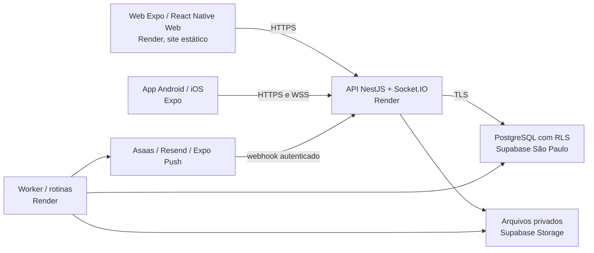
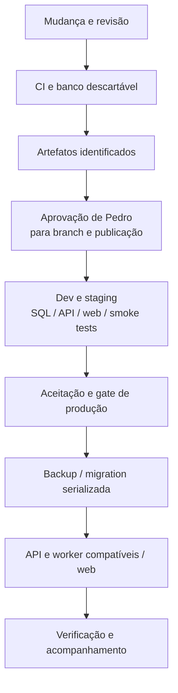

# Infra e DevOps — CondomiFacil

**Data:** 14/11/2026. **Atualizado em:** 20/11/2026. **Autor do produto e responsável pelas aprovações:** Pedro Lemos.

**Estado:** documentação de planejamento, antes do código. A hospedagem do painel web está no [ADR-016](../03-arquitetura/adr/016-hospedagem-do-painel-web.md), aceito com ressalvas por Pedro em 16/11/2026: site estático do Render, plano gratuito, em dev e staging, com revisão obrigatória antes do piloto com dados reais, junto com o ADR-004 (Vercel Pro rejeitada por custo recorrente; Vercel Hobby fora por ser de uso não comercial). Para os demais componentes, este documento escolhe manter **Render para API, WebSocket e processamento de jobs, e Supabase para PostgreSQL e arquivos**, conforme o ADR-004, aceito com ressalvas apenas para construir o MVP em dev e staging. A hospedagem do piloto com dados reais continua sujeita à revisão obrigatória desse ADR. As políticas operacionais abaixo detalham uma proposta; não declaram infraestrutura provisionada nem aceitam os ADRs ainda propostos.

## Índice

1. [Escopo e referências](#1-escopo-e-referências)
2. [Hospedagem e justificativa](#2-hospedagem-e-justificativa)
3. [Ambientes e isolamento](#3-ambientes-e-isolamento)
4. [Domínios, DNS e HTTPS](#4-domínios-dns-e-https)
5. [Pipeline de CI/CD](#5-pipeline-de-cicd)
6. [Variáveis de ambiente e segredos](#6-variáveis-de-ambiente-e-segredos)
7. [Backup](#7-backup)
8. [Restauração e recuperação](#8-restauração-e-recuperação)
9. [Operação, observabilidade e custos](#9-operação-observabilidade-e-custos)
10. [Condições para o piloto e rastreabilidade](#10-condições-para-o-piloto-e-rastreabilidade)

## 1. Escopo e referências

O repositório contém documentação e protótipo HTML; não há aplicação, banco, migrations executáveis, workflows ou recursos de nuvem implementados. Este documento descreve como preparar a operação futura, sem criar contas, contratar planos, registrar domínios ou publicar serviços. O protótipo continua uma simulação e não se torna o aplicativo de produção por ser hospedado.

| Fonte do projeto | O que orienta este documento |
| --- | --- |
| [PRD](../01-produto/02-prd.md), seção 10 e RNF | Expo/React Native Web, NestJS, PostgreSQL/RLS, disponibilidade, desempenho, backup e orçamento |
| [Arquitetura](../03-arquitetura/01-arquitetura.md), seções 5 a 9 | Monorepo, processos, ambientes, segredos, publicação e recuperação |
| [ADR-004](../03-arquitetura/adr/004-nuvem-regiao-residencia-dados.md) | Supabase e Render gratuitos apenas na construção; revisão antes dos dados reais |
| [ADR-011](../03-arquitetura/adr/011-ambientes-branches-eas-ota.md) | Proposta de branches, promoção, EAS e OTA |
| [ADR-013](../03-arquitetura/adr/013-rpo-rto-backup-pitr.md) | Backup diário, retenção de sete dias, restauração mensal; RPO/RTO ainda propostos |
| [Migrations e seeds](../04-banco-de-dados/03-estrategia-de-migrations-e-seeds.md) | SQL versionado, Flyway como executor proposto, publicação separada da API, fixtures fictícias |
| [Integrações](../05-backend/api/03-integracoes-externas.md) | Asaas, Resend, Storage, push e Sentry; credenciais por ambiente |
| [Painel web](../06-frontend/painel-web.md) | Web da administradora e relatórios com jobs privados e acesso revalidado |
| [Segurança](../07-seguranca/seguranca.md) e [LGPD](../07-seguranca/lgpd.md) | Acessos, isolamento, retenção, exclusões, revogações, logs e incidentes |
| [Plano de testes](../08-qualidade/01-plano-de-testes.md) | Verificações por camada e evidências para publicação |

O grafo de conhecimento de 12/11/2026 foi consultado para localizar relações entre nuvem, ambientes, RLS e requisitos. Por ser anterior a parte das revisões, os documentos atuais prevalecem.

## 2. Hospedagem e justificativa

### 2.1 Distribuição escolhida

| Componente | Hospedagem planejada | Motivo e limites |
| --- | --- | --- |
| Web, incluindo painel da administradora | **Render, site estático (plano gratuito)** | [ADR-016](../03-arquitetura/adr/016-hospedagem-do-painel-web.md), aceito com ressalvas em 16/11/2026, só para dev e staging: um site estático por ambiente, sem custo; o site estático não dorme. Mantém React Native Web/Expo do PRD; não pressupõe Next.js. Produção/piloto a definir na revisão antes do piloto |
| API HTTP NestJS e Socket.IO da portaria | **Render, serviço web** | Mantém a decisão existente e um processo de longa duração para HTTP e WebSocket |
| Worker e rotinas | **Render** | Reutiliza o mesmo código de domínio e integrações da API. No gratuito, executa junto ao serviço web; serviço dedicado pago é candidato na revisão do piloto |
| Banco | **Supabase PostgreSQL, São Paulo** | PostgreSQL gerenciado com RLS e menor esforço operacional. Só o backend acessa o banco |
| Arquivos privados | **Supabase Storage por API S3 compatível** | Já escolhido para construção; autorização na API e URLs temporárias, sem buckets públicos de documentos pessoais |
| E-mail, pagamento, push e erros | Resend, Asaas, Expo Push/FCM e Sentry | Preserva as escolhas e interfaces já documentadas |
| Builds Android/iOS | EAS como proposta do ADR-011 | Distribuição de binários é distinta da hospedagem web; depende de validação de custo, equipe e compatibilidade |

**Por que Render para o backend:** o projeto precisa de API, conexão persistente da portaria e execução assíncrona de pagamentos, notificações e relatórios. Concentrar esses processos no Render mantém o desenho NestJS, reduz a operação inicial e aproveita a escolha já aceita para o MVP. O Render documenta [suporte a WebSocket](https://render.com/docs/websocket). Esta escolha não exige refazer o backend para o ambiente de execução do frontend.

**Por que Supabase para banco e arquivos:** já é a decisão do ADR-004 e disponibiliza [região São Paulo](https://supabase.com/docs/guides/platform/regions). A aplicação mantém portas e adaptadores para arquivos e serviços externos, com responsabilidade única e baixo acoplamento (SOLID/GRASP; Adapter do GoF). Não se acrescentam Supabase Auth, Realtime, Edge Functions, Queues ou outro produto: autenticação e autorização continuam no backend; Data API desligada ou schemas fora da exposição, conforme ADR-004.

No gratuito, o bloco do worker compartilha o serviço da API. Cliente só envia/lê arquivo diretamente por URL temporária depois de autorização da API; o desenho não concede acesso ao banco.

### 2.2 Restrições dos planos e do piloto

O [Render gratuito](https://render.com/docs/free) suspende serviços web após 15 minutos sem tráfego de entrada; a retomada pode levar cerca de um minuto. O sistema de arquivos é efêmero e não há instância gratuita de background worker. Quando a API dorme, o worker acoplado também para: não há garantia de horários de rotina, recebimento contínuo de eventos ou prazo de relatórios. Banco, fila durável e arquivos ficam fora do disco da API. Não usar o PostgreSQL gratuito do Render.

O Render não lista região brasileira; as [regiões publicadas](https://render.com/docs/regions) exigem tráfego internacional entre API e banco em São Paulo. A região da API deve ser registrada no provisionamento e aferida por latência real, sem presumir que estar nos EUA atende RNF-01/RNF-05. A cadeia Render/Supabase/Resend/Sentry/Expo também entra na avaliação de subprocessadores e transferência internacional dos documentos de segurança.

O [Supabase gratuito pode pausar projetos de baixa atividade em sete dias](https://supabase.com/docs/guides/platform/free-project-pausing). Seus limites devem ser conferidos antes de criar dois projetos independentes para dev e staging; não compartilhar o mesmo banco entre esses ambientes para contornar quota. Backup automático de plano pago não deve ser presumido no gratuito (seção 7).

**Painel web sem custo no MVP.** O [ADR-016](../03-arquitetura/adr/016-hospedagem-do-painel-web.md) (aceito com ressalvas em 16/11/2026) publica o painel como site estático do Render no plano gratuito, coerente com o custo zero do ADR-004. A Vercel foi descartada: o Hobby é restrito a uso pessoal não comercial e o Pro gera custo recorrente. O site estático não dorme, mas a API no serviço web gratuito continua dormindo; a primeira chamada após inatividade pode esperar o serviço acordar. Limites do site estático gratuito (banda, minutos de build, pré-visualização, redirecionamento de rotas da SPA): **a confirmar** na documentação oficial do Render. Não há contratação autorizada por este documento.

Para o piloto, manter Render e Supabase em planos adequados é o primeiro candidato por continuidade operacional, mas **não é aprovação de produção**. São bloqueadores: serviço sem suspensão, processamento contínuo, recuperação demonstrada, desempenho, custo e análise de residência de dados. Se os resultados não atenderem, a revisão do ADR-004 deve comparar alternativas com região brasileira antes de receber dados reais.

## 3. Ambientes e isolamento

| Aspecto | Local | Dev | Staging | Produção / piloto real |
| --- | --- | --- | --- | --- |
| Finalidade | Desenvolvimento individual | Integração e testes iniciais | Aceitação e ensaios com dados fictícios | Operação com usuários reais |
| Branch de referência proposta | Branch da tarefa | `develop` | `staging` | `main` |
| Web | Servidor local | Site estático do Render próprio (gratuito) | Site estático do Render próprio (gratuito) | A definir na revisão antes do piloto (ADR-016 e ADR-004) |
| API/worker | Processos locais | Render gratuito, compartilhados | Render gratuito, compartilhados | Provedor/plano após revisão |
| Banco | PostgreSQL descartável | Projeto Supabase dev | Projeto Supabase staging | Projeto exclusivo após revisão |
| Arquivos | Emulador S3 | Buckets exclusivos dev | Buckets exclusivos staging | Buckets exclusivos de produção |
| Pagamento | Asaas sandbox | Asaas sandbox | Asaas sandbox | Asaas produção |
| E-mail | Captura local | Caixa de saída falsa | Caixa de saída falsa | Resend real |
| Push | Desligado ou teste | Aparelhos de teste autorizados | Aparelhos de teste autorizados | Destinatários reais autorizados |
| Dados | Fictícios | Fictícios | Fictícios | Reais, somente após os gates |

Um site estático separado por ambiente (dev e staging) mantém a separação do ADR-011. Cada site precisa de vínculo explícito com a branch e com a API do seu ambiente, sem implantação de branches arbitrárias nos endereços estáveis. Preview por PR no site estático gratuito: **a confirmar**; se existir, é opcional, protegido, usa só dados fictícios e API de teste e não cria backend ou banco de produção por PR.

Não copiar dump de produção para local, CI, dev ou staging, mesmo sob rótulo de anonimização. Ensaio de desastre com dados reais ocorre em **recinto isolado de produção**, com os mesmos controles e acesso restrito, sem ser o staging comum. Testes de restauração em staging utilizam backups fictícios.

As versões de PostgreSQL, extensões, Node.js, ferramentas e configuração de RLS devem ser reproduzíveis e registradas. O staging gratuito não tem capacidade idêntica à produção: carga e recuperação exigem ambiente dimensionado para o ensaio. Não usar resultado de serviço suspenso para declarar RNF atendido.

## 4. Domínios, DNS e HTTPS

Nenhum domínio do produto foi informado ou verificado como registrado. A tabela usa `<dominio-do-produto>` como marcador de documentação, sem afirmar disponibilidade ou titularidade.

| Nome planejado | Destino | Finalidade |
| --- | --- | --- |
| `app.<dominio-do-produto>` | Web de produção (hospedagem a definir na revisão antes do piloto) | Web e painel autenticado |
| `dev.app.<dominio-do-produto>` | Render, site estático dev | Integração fictícia |
| `staging.app.<dominio-do-produto>` | Render, site estático staging | Aceitação fictícia |
| `api.<dominio-do-produto>` | API de produção | HTTP `/v1`, WSS e endpoints de webhook previstos no contrato |
| `dev.api.<dominio-do-produto>` | Render dev | API e webhook sandbox |
| `staging.api.<dominio-do-produto>` | Render staging | API e webhook sandbox |
| Subdomínio de envio de e-mail | Resend | Identidade de envio com SPF, DKIM e DMARC, conforme ADR-005 |
| Domínio raiz e `www` | A definir se houver site institucional | Não acrescenta site ao escopo do MVP |

Na construção, podem ser usados endereços fornecidos pelos provedores até haver domínio próprio e orçamento. URLs públicas precisam continuar identificadas por ambiente. Worker e banco não recebem domínio público de aplicação; a conexão PostgreSQL é exclusiva dos processos autorizados.

Procedimento futuro de configuração:

1. Pedro define e registra o domínio na conta do produto, com MFA, recuperação e renovação acompanhada. Registrar responsáveis por registrador, DNS e cobrança.
2. Adicionar cada domínio ao projeto/serviço correto e obter os registros de verificação e roteamento no painel do provedor. Não copiar IP fixo de exemplo. Domínio próprio no site estático gratuito do Render: **a confirmar** na documentação oficial.
3. Publicar os registros indicados, preservar registros de e-mail existentes e validar propagação, certificado HTTPS e conexão WSS. Redirecionar HTTP para HTTPS.
4. Configurar origem exata de cada web na lista de CORS da sua API, callbacks e links de acesso/recuperação; não aceitar qualquer subdomínio de preview nem usar curinga com credenciais.
5. Registrar os webhooks do Asaas no ambiente correspondente, com autenticação própria. O caminho segue o contrato de webhooks; domínio é roteamento, não autenticação.
6. Verificar SPF/DKIM/DMARC no subdomínio de envio antes do envio real. Mudanças de DNS precisam de registro do estado anterior e plano de retorno.

## 5. Pipeline de CI/CD

### 5.1 Estado e responsabilidade

**Ferramenta escolhida para a proposta: GitHub Actions**, integrando repositório, verificações e publicação. O Render faz o build e a entrega do site estático web e recebe a versão da API/worker; a publicação parte da branch vinculada a cada ambiente (detalhes do deploy automático do site estático gratuito: **a confirmar**). Isso centraliza evidências e evita manter um servidor de CI. Não há workflow criado por este documento, e recursos de proteção/aprovação precisam ser conferidos no plano do repositório antes da implementação.

A regra do projeto permanece: **antes de cada commit/push, Pedro aprova o conjunto e as branches de destino**. CI verde ou autorização de um commit anterior não substitui essa aprovação. Promoções entre branches não são feitas autonomamente; o mapeamento do ADR-011 continua proposto. Nenhum recurso deve publicar em produção só porque foi conectado ao Git.

Hoje, uma alteração documental pode ter verificação de links, Markdown e contratos afetados, mas não aciona publicação da futura aplicação. Mudança do protótipo segue validação própria; não dispara migrations ou lançamento mobile.

### 5.2 Etapas futuras

| Etapa | Verificações e resultado esperado |
| --- | --- |
| PR | Revisão de escopo e rastreabilidade; varredura de segredos; lint/tipos; validação OpenAPI/AsyncAPI quando afetados |
| Banco descartável no CI | Aplicar SQL versionado com Flyway proposto; validar histórico/checksum; testar RLS como papel da aplicação, isolamento por condomínio/unidade/função e integridade. Não usar superusuário para comprovar RLS |
| Testes da aplicação | Suítes adequadas à mudança: domínio, API, integrações com sandbox/fakes, idempotência, concorrência, sync offline e acessibilidade web; critérios no plano de testes |
| Empacotamento | Versões fixadas e lockfile; imagem API/worker por digest, pacote de migrations com manifesto/hash, build web e metadados de versão |
| Dev | Após mudança aprovada para `develop`, validar alvo e configuração; migrar uma vez em runner externo; publicar versão e executar smoke tests |
| Staging | Promoção aprovada para `staging`; mesmas imagens/SQL; E2E, pagamento sandbox, jobs, WebSocket, offline e ensaios aplicáveis de recuperação/carga |
| Produção | Gate manual de Pedro, evidências de staging, revisão de nuvem aprovada, backup verificável e plano de retorno; migrar e publicar de modo controlado |

### 5.3 Publicação e retorno

- O job de migration usa credencial própria, conexão direta ou pooler de sessão e exclusão mútua por ambiente; não roda no bootstrap da API nem do worker. Seguir o procedimento de [migrations e seeds](../04-banco-de-dados/03-estrategia-de-migrations-e-seeds.md), inclusive mudanças aditivas e correções para frente.
- O backend usa papel de aplicação sem `BYPASSRLS`; migrador, jobs e backup têm acessos próprios delimitados. A PoC verifica pg-boss e `LISTEN/NOTIFY` com conexão direta/sessão, sem presumir compatibilidade com pooler de transação.
- Publicar API compatível com clientes antigos, concluir verificações de saúde e só então disponibilizar web compatível. Drenar jobs/conexões no encerramento e garantir reconexão de Socket.IO; não prometer deploy sem queda só por usar um PaaS.
- No site estático do Render, cada ambiente publica a partir da sua branch vinculada; impedir publicação que contorne o gate de aprovação. Publicação por Git e por CI não devem competir pelo mesmo site. A hospedagem web de produção é definida na revisão antes do piloto.
- URLs públicas do Expo entram no build: manter o mesmo commit e dependências, mas gerar e testar o artefato web específico de cada ambiente. Não afirmar que um bundle de staging com URL embutida é idêntico ao de produção. O Expo documenta os [alvos de exportação web](https://docs.expo.dev/guides/publishing-websites); validar SPA/estático e rotas profundas (redirecionamento de rotas no site estático do Render: **a confirmar**).
- Retorno de código seleciona imagem anterior da API/worker e deployment web anterior compatíveis. Isso não desfaz migrations nem recupera dados perdidos. Corrigir esquema para frente sempre que possível; restauração só pelo procedimento de incidente.
- EAS/OTA segue o ADR-011, ainda proposto: canais separados, `runtimeVersion` compatível, teste de retorno e novo binário para mudança nativa. Aprovação do web não equivale a aprovação de lançamento nas lojas.

PR de origem não confiável não recebe segredos nem permissão de publicação. Jobs usam permissões mínimas, ferramentas/actions fixadas e proteção dos ambientes; logs e artefatos de CI não contêm dumps, arquivos pessoais ou credenciais. A implementação registrará commit, digest, migrations, ambiente, aprovador, horário e resultado de cada publicação.

## 6. Variáveis de ambiente e segredos

### 6.1 Política

O catálogo contém **nomes e finalidades, sem valores**. Os nomes são convenções propostas para a implementação; não significam que uma variável já exista. O futuro `.env.example` deve conter apenas nomes vazios e instruções. Não versionar `.env` real, certificados privados, tokens, exports de painéis ou arquivo de credencial de serviço.

Separar ambientes e consumidores. Segredos do backend ficam no cofre/configuração protegida do Render; tokens de publicação em segredos protegidos do CI; configuração pública web no site estático do Render do ambiente correto. Variáveis são fornecidas em tempo de build ou execução conforme o consumidor. No site estático, a configuração pública entra no build: mudar uma variável exige novo build para ter efeito.

Tudo que vai ao navegador/app pode ser inspecionado, inclusive `EXPO_PUBLIC_*`. Nenhuma chave privada de Supabase/S3, Asaas, Resend, banco, JWT ou publicação pode ser prefixada assim ou entrar no bundle. A escolha de variáveis protegidas no painel não torna segredo um valor compilado no frontend.

### 6.2 Catálogo proposto

| Nome | Consumidor | Classificação e finalidade |
| --- | --- | --- |
| `APP_ENV` | API, worker e tarefas operacionais | Configuração: identidade lógica do ambiente; validar contra recurso real |
| `NODE_ENV` | Processo Node.js | Configuração de runtime; não determina sozinho se dados são de produção |
| `PORT` | API | Configuração de escuta fornecida pelo ambiente |
| `API_PUBLIC_URL` | API/worker | Configuração: links e callbacks do ambiente |
| `WEB_PUBLIC_URL` | API/worker | Configuração: links do frontend correspondente |
| `CORS_ALLOWED_ORIGINS` | API | Configuração: lista explícita de origens permitidas |
| `EXPO_PUBLIC_API_URL` | Web/mobile no build | Pública: base HTTPS da API do ambiente |
| `EXPO_PUBLIC_SOCKET_URL` | Web/mobile no build | Pública: endereço de tempo real do ambiente |
| `EXPO_PUBLIC_SENTRY_DSN` | Web/mobile no build | Pública: identificação de ingestão; sem token administrativo |
| `DATABASE_URL` | API | Segredo: conexão do papel restrito da aplicação |
| `WORKER_DATABASE_URL` | Worker | Segredo: conexão de jobs com privilégios mínimos e modo compatível com a fila |
| `FLYWAY_URL`, `FLYWAY_USER`, `FLYWAY_PASSWORD` | Job de migration | Segredos/configuração reservados ao migrador; nunca disponíveis no frontend ou runtime da API |
| `JWT_SIGNING_KEY_REF`, `JWT_VERIFICATION_KEYS_REF` | API | Referências ao material de assinatura/verificação no cofre; algoritmo e rotação seguem validação do ADR-007 |
| `IDENTITY_HMAC_KEY_REF` | Serviço restrito de identidade | Referência secreta para desenho de anonimato do ADR-010, ainda proposto; não confundir com chave JWT |
| `ASAAS_API_BASE_URL` | API/worker | Configuração: sandbox ou produção; validar cruzamento com credencial |
| `ASAAS_API_KEY` | Adaptador Asaas | Segredo: conta principal do ambiente |
| `ASAAS_WEBHOOK_TOKEN_REF` | Endpoint de webhook | Referência secreta; token global ou por subconta continua pendente no contrato |
| `STORAGE_S3_ENDPOINT`, `STORAGE_S3_REGION` | API/worker | Configuração da API S3 compatível |
| `STORAGE_S3_ACCESS_KEY_ID`, `STORAGE_S3_SECRET_ACCESS_KEY` | Adaptador de arquivos | Segredos de servidor; credenciais S3 privilegiadas não substituem autorização de negócio |
| `STORAGE_PRIVATE_BUCKET` | API/worker | Configuração: bucket privado do ambiente |
| `MAILER_MODE` | API/worker | Configuração: captura/falso/real conforme matriz de ambientes |
| `RESEND_API_KEY`, `MAIL_FROM` | Adaptador Resend | Segredo de envio e configuração de remetente; somente envio real autorizado |
| `EXPO_ACCESS_TOKEN` | Envio push, quando exigido pelo desenho | Segredo; separar escopo do token utilizado por builds/publicação |
| `FCM_CREDENTIALS_REF` | Adaptador push, se acesso direto for necessário | Referência secreta; não adicionar credencial direta se Expo Push já cobrir o fluxo |
| `SENTRY_DSN`, `SENTRY_ENVIRONMENT`, `RELEASE_ID` | API/worker | Configuração de ingestão, ambiente e correlação de versão |
| `SENTRY_AUTH_TOKEN` | CI de sourcemaps/releases | Segredo de publicação; não é DSN e não vai ao cliente |
| `RENDER_DEPLOY_HOOK_URL` | CI, se deploy hook for adotado (API/worker; site estático web: a confirmar) | Segredo: URL autoriza publicação; não expor em logs |
| `BACKUP_DATABASE_URL` | Executor de backup | Segredo com permissão específica; não reutilizar migrador ou API |
| `BACKUP_DESTINATION_REF`, `BACKUP_ENCRYPTION_KEY_REF` | Executor de backup/restauro | Referências privadas de destino e cifragem, separadas do recurso de origem |
| `RESTORE_MODE` | Recinto de recuperação | Configuração proposta para bloquear efeitos externos; deve ser reforçada por isolamento de rede e credenciais |

Chaves de subconta Asaas são segredos dinâmicos por condomínio: manter no cofre com referência persistida, sem criar uma variável de ambiente por condomínio e sem guardar chave em texto no banco. Credenciais de criptografia de dados/votos seguem decisões ainda pendentes; não escolher algoritmo ou provedor de chaves por consequência desta tabela. `RESTORE_MODE` sozinho não é barreira suficiente.

Na inicialização, validar presença, formato e coerência sem imprimir valores: ambiente/projeto, domínio, credencial de sandbox, bucket e modo de envio. Recusar configuração cruzada. Rotação requer inventário de consumidores, período de compatibilidade quando aplicável, publicação/teste e revogação da chave anterior. Guardar recuperação do cofre com acesso separado para que perder o projeto não torne o backup indecifrável.

## 7. Backup

### 7.1 Requisitos e limites

**Já exigido pelo RNF-13:** backup diário, retenção de sete dias e teste de restauração mensal. **Ainda pendente:** RPO (perda máxima de dados) e RTO (tempo máximo de recuperação). O ADR-013 propõe RPO de até 15 minutos e RTO de até quatro horas, sem compromisso aprovado. Backup diário pode perder até um dia de escritas; não deve ser apresentado como equivalente a PITR.

O [Supabase documenta backups automáticos diários nos planos Pro, Team e Enterprise](https://supabase.com/docs/guides/platform/backups), com sete dias disponíveis no Pro; recomenda exportações e cópias externas para o gratuito. PITR é adicional dos planos pagos. A mesma documentação esclarece que backup do banco **não inclui o conteúdo dos objetos do Storage** e que senhas de papéis customizados precisam de tratamento após restauração. Não presumir que restaurar PostgreSQL recupera fotos, anexos e exportações.

| Conjunto | Política planejada | Verificação |
| --- | --- | --- |
| PostgreSQL | Diário, sete dias; recuperação pontual conforme revisão ADR-013; cópia externa cifrada conforme risco e orçamento | Integridade, esquema, RLS, extensões, filas/outbox e capacidade de restaurar |
| Arquivos privados necessários ao negócio | Cópia diária independente dos objetos, com manifesto associado ao backup do banco e retenção de sete dias para recuperação | Comparar inventário, tamanho e hash calculado no processo; testar leitura autorizada após restauro |
| Código, SQL e configuração sem segredos | Git e artefatos de release identificados; cópia de recuperação independente das credenciais cotidianas | Recuperar versão compatível com esquema e registrar digest/hash |
| Segredos e chaves | Recuperação pelo cofre, com acesso restrito e procedimento próprio | Acesso de emergência e decifragem ensaiados; não incluir valores em manifests/Git |
| Pedidos LGPD e revogações posteriores ao ponto restaurado | Registro protegido que sobreviva à perda do banco primário | Reaplicação comprovada antes da retomada, conforme segurança/LGPD |

A cópia de arquivos é proposta operacional, não autorização para conservar dados indefinidamente. Respeitar expiração de relatórios, exclusões, retenções legais e o catálogo de retenção; sete dias de backup não define a retenção operacional de cada categoria. Relatórios são privados e dependem de permissão revalidada, inclusive após restauro.

### 7.2 Execução e guarda

Em dev/staging, usar dados fictícios e programar exportação/cópia diária com retenção de sete dias quando os recursos forem implementados. A execução deve ocorrer fora do serviço Render que dorme; um runner agendado é candidato, com alarme de execução perdida. A falta de PITR e de garantia operacional continua impedindo usar o gratuito como produção.

Antes do piloto, contratar/validar o mecanismo adequado e comprovar a política com evidências. O destino independente, provedor e preço da cópia externa serão fechados na revisão da nuvem: não há backup implementado enquanto isso não estiver resolvido. Cópia sob a mesma conta destruída junto ao projeto não cobre perda dessa conta.

Cada execução futura deve registrar horário e fuso, ponto consistente do banco, versão PostgreSQL/esquema, referência dos objetos e chaves, tamanho, integridade, resultado e prazo de expiração. Não registrar valores de segredo nem dados pessoais no manifesto. A cópia usa TLS e cifragem em repouso, credencial exclusiva e acesso auditado. Confirmar sucesso e alertar falha/atraso; um job marcado como executado sem arquivo restaurável não é sucesso.

Banco e objetos não têm transação global automática. O procedimento de cópia precisa preservar relação entre metadados e conteúdo por manifesto/ponto de corte e controlar remoções durante a captura; demonstrar isso no ensaio. Verificar também permissões, papéis, extensões e mecanismos de acesso que não sejam reconstruídos pelo backup selecionado. Não depender de filesystem efêmero, snapshots de computador pessoal ou cópia do OneDrive como backup do sistema.

## 8. Restauração e recuperação

### 8.1 Procedimento de incidente

1. **Identificar e conter:** registrar incidente, responsável, escopo, último ponto íntegro e impacto. Suspender mutações quando necessário e preservar evidências restritas. Não sobrescrever o único banco disponível antes de preservar o estado do incidente.
2. **Preparar recinto isolado:** escolher destino do ambiente correto, acesso restrito e sem exposição ao público. Para dados reais, recinto de produção; para exercício fictício, ambiente de teste. Bloquear saída para Asaas, Resend e push; manter worker, rotinas e replay automático desligados. Recebimento de webhook fica pausado ou preservado duravelmente de forma controlada, conforme plano do incidente.
3. **Selecionar ponto e conjunto:** conferir backup, versão compatível de esquema/código, manifesto de objetos, chaves e integridade. Registrar explicitamente a janela de escritas potencialmente perdidas e o ponto de restauração escolhido. Validar PITR contratado quando aplicável.
4. **Restaurar banco e arquivos:** executar pelo mecanismo do provedor validado na PoC; reconstruir permissões, extensões e credenciais que não forem restauradas. Recuperar objetos com correspondência ao manifesto, mantendo acesso privado. Não executar seeds de teste em dados reais.
5. **Reaplicar proteções posteriores:** recuperar registro protegido de exclusões/anonimizações e revogações, executar antes da liberação, invalidar sessões e acessos antigos quando necessário. Conferir vínculos, permissões temporárias de eleição e URLs de relatórios, evitando ressuscitar acesso.
6. **Validar integridade e isolamento:** rodar verificações como papel real da aplicação, sem `BYPASSRLS`; testar separação de condomínios/unidades/funções, sigilo de voto, identidade separada e acesso a arquivos. Conferir cobranças/pagamentos, reservas, mês fechado, estornos, saldo e relacionamentos. Informar fatos irrecuperáveis, incluindo votos e escritas manuais perdidas.
7. **Conciliar efeitos externos:** comparar estado local com Asaas por referências e IDs; tratar eventos posteriores ao ponto restaurado e chaves de idempotência. Classificar filas/outbox em concluídas, pendentes e incertas. Não reenviar automaticamente cobrança, reembolso, e-mail ou push só porque uma marca de conclusão regrediu no backup.
8. **Tratar sincronização offline:** validar cursores, IDs de eventos, deduplicação e conflitos contra o ponto restaurado antes de aceitar reenvios. Preservar filas pendentes dos dispositivos; não mandar apagá-las para esconder divergência. Regras RN-OF-04/RN-CH-04 e pendências do ADR-014 continuam valendo.
9. **Retomar por etapas:** Pedro/responsável designado aprova o resultado registrado; direcionar API e web para a versão compatível, conferir TLS/WSS e reabrir tráfego. Ativar gradualmente integrações, worker e rotinas após conciliação. Monitorar erros, atrasos e duplicidades.
10. **Encerrar com evidências:** registrar tempos efetivos, perda de dados, pontos não recuperados, efeitos conciliados, decisão de retomada e correções. Aplicar o plano de incidentes e LGPD já documentado; não declarar recuperação integral sem verificação.

Restauração de um único condomínio em banco multi-tenant exige extrair do destino isolado e reintegrar apenas os registros autorizados, com integridade e RLS verificadas. Não substituir o banco compartilhado por um backup antigo de um tenant, pois isso regride todos os outros.

### 8.2 Exercício mensal e aceitação

O teste mensal precisa provar abertura do backup, restauração de banco **e objetos**, acesso às chaves, inicialização da API compatível e bloqueio de efeitos externos. Medir tempo de detecção/preparo/restauro/validação e diferença temporal do ponto recuperado; esses números alimentam a decisão de RPO/RTO do ADR-013.

Incluir cenário de exclusão e revogação após o backup, pagamento já processado externamente, job em estado incerto e evento offline reenviado. Guardar relatório restrito com versões, duração, verificações e falhas; nunca anexar dump real ao Git ou aos artefatos comuns do CI. A aprovação do exercício não substitui a análise de capacidade/latência do piloto.

## 9. Operação, observabilidade e custos

| Controle futuro | Aplicação |
| --- | --- |
| Saúde e prontidão | Endpoint mínimo sem detalhes sensíveis; distinguir processo vivo de dependências prontas; validar rotas exatas na implementação |
| API e tempo real | Erros/latência p95, desconexões e retomadas, disponibilidade RNF-09; medir região e cold start separadamente |
| Worker | Atraso da fila, falhas, tentativas, jobs travados, última execução de cada rotina e backlog após suspensão |
| Integrações | Falha/atraso de webhook, conciliação Asaas, notificações, geração privada de relatórios |
| Banco e Storage | Conexões, espaço, erros, quotas, acesso indevido e falhas de cópia |
| Recuperação | Idade do último backup íntegro, expiração, resultado do teste mensal e acesso às chaves |
| Logs e Sentry | Correlação por requisição/release, mascaramento e minimização; sem tokens, dados de cartão, votos, textos privados ou anexos pessoais |
| Custo | Orçamento consolidado e por serviço/ambiente; alertas em 80% e 100%, conforme RNF-18 |

No MVP (dev e staging), o painel web não tem custo de hospedagem (site estático gratuito do Render, ADR-016). O orçamento inclui Render computação/worker, a hospedagem web definida na revisão antes do piloto, Supabase banco/Storage/PITR, transferência entre regiões, cópia externa, Resend, Sentry, EAS, registrador e lojas. Valores serão estimados na contratação; não há cotação nem compromisso de custo neste documento. Alertas não equivalem a teto rígido: validar os mecanismos de limite e cobrança de cada provedor. Produção não deve ser desligada automaticamente como resposta genérica ao limite de gasto.

Contas e recursos ficam sob controle do produto, com MFA, menor privilégio e inventário de proprietários/recuperação. Pedro aprova publicações; execução técnica, resposta a incidente e substitutos ainda precisam ser designados antes do piloto. Provisionamento futuro deve ser reproduzível em `infra/`, com configuração versionada sem segredos; não é necessário introduzir Kubernetes ou outra plataforma para o escopo atual.

## 10. Condições para o piloto e rastreabilidade

| Item | Situação / condição de saída |
| --- | --- |
| Web (site estático do Render) | ADR-016 aceito com ressalvas em 16/11/2026 para dev e staging; confirmar limites do plano gratuito, exportação Expo, rotas da SPA, domínios e proteção de publicação; revisão obrigatória da hospedagem antes do piloto, junto com o ADR-004 |
| API/worker e dados | Render + Supabase mantidos para construção; revisão do ADR-004 obrigatória antes de dados reais |
| Continuidade e desempenho | Demonstrar processo contínuo, reconexão, jobs e metas RNF-01/02/05/09; gratuito não comprova |
| Backup e arquivos | Diário/sete dias/mensal; destino independente, consistência banco/objetos e recuperação comprovados |
| RPO/RTO/PITR | ADR-013 segue proposto; fechar metas, plano e orçamento antes do piloto |
| CI/CD e mobile | ADR-011 segue proposto; validar responsáveis, proteção das branches, gates, artefatos, EAS e rollback |
| Banco/fila/identidade | Validar decisões ainda propostas, privilégios e PoCs, sem aceitar ADR-006/010/014 por consequência (001, 007 e 008 foram aceitos com ressalvas por Pedro em 20/11/2026) |
| LGPD | Inventário de subprocessadores (Render, Supabase, Resend, Sentry, Expo, Asaas), regiões, acessos de suporte, transferências, retenção e exclusões/restauro revisados |
| Domínios e contas | Nome, titularidade, DNS, renovação, MFA e recuperação confirmados |

Este documento cobre ambientes e promoção (arquitetura §6, ADR-011), hospedagem (ADR-004), segredos (SEG-02), isolamento (RNF-11), backup/recuperação (RNF-13, ADR-013), desempenho/disponibilidade (RNF-01/02/05/09), validação offline/carga (RNF-16/17), orçamento (RNF-18) e privacidade/financeiro (SEG-11/17/18). Jobs de relatórios seguem RN-RL-01 a 08, sem ampliar acesso de perfis.

**Reconciliação futura:** a hospedagem web do ADR-016 (site estático do Render, 16/11/2026) já está refletida na arquitetura; os detalhes operacionais aqui propostos precisam ser refletidos no ADR-004/ADR-011 e no inventário de subprocessadores quando Pedro autorizar essa revisão. Este pedido cria somente o documento de Infra e DevOps; não altera fontes anteriores, regras de produto, contratos ou protótipo. As páginas oficiais dos provedores vinculadas ao longo do texto foram consultadas em 14/11/2026; condições e ferramentas devem ser revalidadas no provisionamento. O [changelog do Supabase](https://supabase.com/changelog.md) também foi consultado; fixar versões de CLI/ferramentas antes de automatizar, sem copiar comandos antigos como garantia de compatibilidade.
