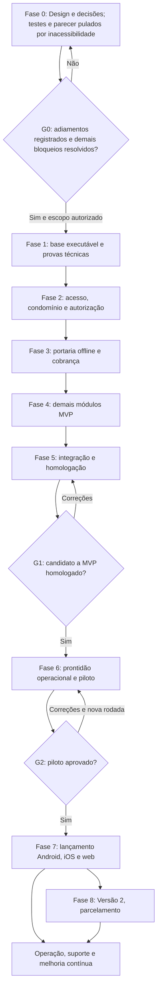

# Roadmap de desenvolvimento do CondomiFacil

**Data de elaboração:** 15/11/2026. **Atualizado em:** 20/11/2026. **Referência das decisões e do diagnóstico:** 14/11/2026, com atualizações registradas de 16/11/2026 e 17/11/2026. **Autor e responsável pelas decisões de produto:** Pedro Lemos.

**Estado:** plano detalhado para revisão e acompanhamento. Design fechado e fase 1 em andamento: RM-10 a RM-15 executados em 18 e 19/11/2026 (base do monorepo, API NestJS só com `GET /v1/saude`, app Expo com a tela de saúde, tokens e componentes da tela de saúde com Storybook, tipos gerados do contrato e CI de PR); RM-16 (PoCs P2 a P5) não liberado. Não há funcionalidade de negócio, banco, integrações nem infraestrutura operacional implementados. Criar este roadmap não autoriza iniciar o MVP, contratar serviços, executar PoCs, publicar, commitar ou enviar alterações.

Este documento organiza o caminho até a entrega do MVP, o piloto, o lançamento e a Versão 2 já prevista. Manutenção e operação continuam depois dessas entregas. A ordem de trabalho e os critérios operacionais aqui propostos dependem da validação de Pedro; decisões de produto já aprovadas conservam seus limites e suas fontes.

## Índice

1. [Como usar e atualizar este roadmap](#1-como-usar-e-atualizar-este-roadmap)
2. [Situação atual e decisões confirmadas](#2-situação-atual-e-decisões-confirmadas)
3. [Fases, dependências e marcos de passagem](#3-fases-dependências-e-marcos-de-passagem)
4. [Fase 0 — concluir Design e remover bloqueios de início](#4-fase-0--concluir-design-e-remover-bloqueios-de-início)
5. [Manual para resolver as pendências](#5-manual-para-resolver-as-pendências)
6. [Fase 1 — preparar a base executável](#6-fase-1--preparar-a-base-executável)
7. [Fase 2 — implementar acesso, condomínio e permissões](#7-fase-2--implementar-acesso-condomínio-e-permissões)
8. [Fase 3 — entregar os módulos de maior risco](#8-fase-3--entregar-os-módulos-de-maior-risco)
9. [Fase 4 — completar o escopo funcional do MVP](#9-fase-4--completar-o-escopo-funcional-do-mvp)
10. [Fase 5 — integrar e homologar o MVP](#10-fase-5--integrar-e-homologar-o-mvp)
11. [Fase 6 — preparar e executar o piloto](#11-fase-6--preparar-e-executar-o-piloto)
12. [Fase 7 — lançar Android, iOS e web](#12-fase-7--lançar-android-ios-e-web)
13. [Fase 8 — concluir a Versão 2 prevista](#13-fase-8--concluir-a-versão-2-prevista)
14. [Gestão do trabalho, evidências e mudanças](#14-gestão-do-trabalho-evidências-e-mudanças)
15. [Riscos, caminho crítico e replanejamento](#15-riscos-caminho-crítico-e-replanejamento)
16. [Próximas ações em ordem de execução](#16-próximas-ações-em-ordem-de-execução)
17. [Fontes e registro de elaboração](#17-fontes-e-registro-de-elaboração)

## 1. Como usar e atualizar este roadmap

### 1.1 Significado dos estados

| Estado | Quando usar |
| --- | --- |
| Documentado | Existe descrição verificável; não significa aprovação nem implementação |
| Aprovado com limites | Pedro decidiu o tema; registrar exatamente o que foi aceito e as ressalvas |
| Preparado | Existe estrutura, roteiro ou arquivo de apoio sem execução funcional comprovada |
| Pendente | Falta decisão, ação, evidência ou entrega |
| Bloqueado | Há dependência identificada que impede iniciar ou concluir aquele item |
| Pulado — Inacessível | Pedro decidiu pular a etapa enquanto não há acesso aos participantes ou ao profissional necessário; não foi realizada nem aprovada e não bloqueia o avanço por essa ausência |
| Em execução | Trabalho autorizado em andamento, com responsável e escopo definidos |
| Em revisão | Entrega produzida aguardando verificação ou aceite |
| Concluído | Critérios de saída satisfeitos, evidência registrada e aceite aplicável obtido |

Os identificadores `RM-*` deste documento servem somente ao planejamento. Não são novos RF, RN, US, permissões ou compromissos comerciais. Referenciar os IDs originais ao detalhar uma tarefa. Ausência de evidência significa **não comprovado**, sem presumir que uma atividade nunca aconteceu fora do repositório.

### 1.2 Autoridade, prazo e escopo

- Pedro decide produto, escopo, orçamento e aceites. Jurídico emite o parecer; engenharia e segurança demonstram viabilidade e controles. Os papéis abaixo são responsabilidades propostas, sem designar pessoas ou fornecedores já contratados.
- Planejar não permite executar automaticamente. Antes de cada pacote, confirmar que o marco anterior foi atingido e que há autorização para o escopo. Uma pergunta sem resposta pausa desenvolvimento e alterações, inclusive nos subagentes, conforme [AGENTS.md](../AGENTS.md).
- Datas deste documento são registros, não datas prometidas de entrega. O cronograma original M1–M11 é estimativa histórica: Descoberta M1, Design M2, MVP M3–M6, Piloto M7, Lançamento M8 e V2 M9–M11. Como o Design ainda tem bloqueios, esses meses não indicam o calendário atual nem tempo restante. Relatórios acrescentados ao MVP também exigem reestimativa.
- Estimar cada fase depois de conhecer capacidade da equipe, decisões, PoCs, volume e critérios de aceite. Registrar intervalo estimado, hipóteses e dependências externas; recalcular quando uma hipótese mudar. Não atribuir percentual de conclusão ao produto a partir da quantidade de documentos ou pastas.
- Este pedido cria somente `docs/roadmap.md`. Divergências de outras fontes ficam identificadas aqui; sua correção posterior exige autorização de escopo, inclusive quando houver rastreabilidade.

## 2. Situação atual e decisões confirmadas

### 2.1 Confirmações de Pedro nesta conversa — histórico e decisão vigente

| Tema | Informação confirmada | Consequência para o andamento |
| --- | --- | --- |
| Retorno dos moradores — 14/11/2026 | O protótipo foi testado somente com moradores; eles gostaram e aprovaram a ideia. Não foram informados data das sessões, quantidade de participantes, tarefas, dificuldades ou resultados por fluxo | Preservar como aceitação inicial positiva da ideia, sem comprovação de validação completa de usabilidade e operação |
| Parecer jurídico — 14/11/2026 | Pedro determinou naquela data exigir parecer jurídico antes de iniciar o MVP | Exigência de passagem substituída pela decisão de 17/11/2026 abaixo |
| Etapas inacessíveis — 17/11/2026 | Pedro informou não ter acesso a moradores, funcionários ou advogados e mandou pular os testes com usuários e o parecer jurídico por estarem inacessíveis no momento | RM-02 e RM-03 ficam **Pulado — Inacessível**, abrangendo também os testes com síndicos já indisponíveis. Não bloqueiam G0 nem a passagem às próximas fases por essa ausência enquanto estiverem assim adiados; não foram realizados nem aprovados. Não há data de retomada. Demais condições e autorizações permanecem |
| Organização e prioridade — 17/11/2026 | Pedro confirmou: ele decide produto e valida entregas; subagentes preparam análises e executam alterações autorizadas; orquestrador coordena e revisa. Começar por autogestão e implantação, depois revisão técnica | Etapa 1 da seção 16 confirmada. [Pacote de decisões](decisoes-para-iniciar-o-desenvolvimento.md) preparado em lotes; demais respostas, detalhamento e liberação de implementação ainda pendentes; direções do lote 1 alinhadas nas fontes autorizadas de produto/design e descrição do protótipo |
| Lote 1 de decisões — 17/11/2026 | Pedro autorizou seguir as recomendações apresentadas: AG-01 A (síndico executa, sub substitui, conselho fiscaliza), AG-02 A (Admin da plataforma verifica primeira identidade/representação com capacidade restrita) e AG-07 C (resultado/posse eleitoral com validação independente em exceções/conflitos) | Direções aceitas e alinhadas, com autorização de Pedro, no registro 06, RN, PRD, histórias, User Flows, Design System e descrição do protótipo. Operador de implantação não nomeado e provas/validadores/exceções pendentes; dados/API/arquitetura/ADRs e código do protótipo preservados. Não encerra G0 nem libera implementação |
| Lote 2 de decisões — 17/11/2026 | Pedro aprovou AG-03 C (combinar procedimento regular A e exceção colegiada B, sem autodeclaração), AG-04 A (designação documentada e verificada do proprietário), AG-05 A (representante e substituto do conselho), AG-06 A (manter exigência de composição e registrar ausência sem bloquear eleição) e AG-12 B (somente rotinas automáticas e eleição até a posse, com tarefas administrativas manuais sem executor) | Direções registradas no pacote de decisões e no registro 06. Alinhamento transversal e detalhes de provas, validadores, contestação, designação, prazos e revogação pendentes de escopo próprio autorizado. Lote 4 respondido em 17/11/2026 (ver registro abaixo); complementos/lote 3 aprovados conforme registro abaixo. Não encerra G0 nem libera implementação |
| Roadmap | Pedro solicitou este planejamento detalhado dentro de `docs` | Autoriza documentar o plano; não constitui aceite de todas as propostas nem autorização para começar o MVP |

**Histórico de referências anteriores:** [AGENTS.md](../AGENTS.md), [Visão de Produto, roadmap](01-produto/01-visao-de-produto.md), [Arquitetura, seção 1](03-arquitetura/01-arquitetura.md) e o [pacote jurídico](07-seguranca/pacote-para-validacao-juridica.md) mantêm referências anteriores aos marcos de validação e jurídico. Para a sequência deste roadmap, vale a decisão mais recente de Pedro, de 17/11/2026. Esta atualização se limita ao planejamento: não atesta conformidade jurídica, não altera SEG-16 nem as regras do produto e não modifica as demais fontes.

**Complementos e lote 3 — decisão posterior de 17/11/2026:** Pedro autorizou 1C, 2A, 3A, 4A, 5A, 6A, 7A, 8B, 9A, 10A, 11A, 12A, 13A e 14A. O [registro 06, seção 2.1](01-produto/06-autogestao-e-conducao-eleitoral.md) prevalece sobre os estados históricos dos lotes acima: procedimentos de produto aceitos, alinhamento autorizado nesta revisão; operador somente antes do primeiro condomínio oficial, sem designar Pedro. Pessoas/canal reais pendentes; dados fictícios agora. **Lote 4 — 17/11/2026:** Pedro respondeu IN-01 A (primeiro pacote após G0: base local reproduzível; depois acesso/condomínio/permissões, portaria/offline e cobrança) e IN-02 A (comparação curta e PoCs com critérios; desenho aceito condicionado à prova antes do uso dependente), registradas no [pacote de decisões](decisoes-para-iniciar-o-desenvolvimento.md), seção 6. Contratos técnicos, PoCs (só após G0 e autorização de escopo) e liberação de implementação continuam abertos; aceite condicionado não é PoC concluída.

### 2.2 O que já existe

| Frente | Entrega existente | Situação real / o que falta |
| --- | --- | --- |
| Produto | [Visão](01-produto/01-visao-de-produto.md), [PRD](01-produto/02-prd.md), [RN](01-produto/03-regras-de-negocio.md), [histórias](01-produto/04-historias-de-usuario.md) e registros de decisões | Documentados, com pendências e revisões. As contagens antigas não substituem o inventário atual após relatórios e autogestão |
| Design | [Design System](02-design/01-design-system.md) e [User Flows](02-design/02-user-flows.md) | Referências completas para desenho; validação com usuários pulada por inacessibilidade atual; tratar as demais pendências da seção 17 dos fluxos |
| Protótipo | [HTML navegável e simulações](../prototipo/README.md), incluindo finanças, portaria, autogestão, eleições e relatórios | Funciona como simulação em memória. Pagamentos, persistência, offline, autorização, exportações e segurança reais não estão demonstrados |
| Arquitetura | [Arquitetura](03-arquitetura/01-arquitetura.md), [C4](03-arquitetura/02-diagramas-de-arquitetura.md) e ADRs | Base técnica documentada. Separar decisões já aceitas das propostas e dos critérios ainda não demonstrados |
| Dados | [MER/DER](04-banco-de-dados/01-mer-e-der.md), [política de acesso](04-banco-de-dados/02-politica-de-acesso-a-dados.md) e [migrations/seeds](04-banco-de-dados/03-estrategia-de-migrations-e-seeds.md) | Propostas documentais, sem banco ou migração aplicada; validar modelo físico, acesso e executor |
| Backend/API | [Backend](05-backend/01-backend.md), [sequências e estados](05-backend/02-diagramas-de-sequencia-e-estados.md), [OpenAPI/AsyncAPI e guia](05-backend/api/README.md) | Contrato escrito antes do código, ainda proposto. Validação de YAML não demonstra implementação ou conformidade real |
| Frontend | [Mobile](06-frontend/frontend.md), [painel web](06-frontend/painel-web.md) e [biblioteca](06-frontend/biblioteca-de-componentes.md) | Planejamento disponível; não há app, componentes ou Storybook executáveis |
| Segurança e LGPD | [Segurança](07-seguranca/seguranca.md), [inventário, RIPD preliminar, minutas e procedimentos LGPD](07-seguranca/lgpd.md) | Existem documentos; faltam decisões, pareceres, implementação e exercícios. Não são controles já operantes nem parecer jurídico |
| Qualidade | [Plano de testes](08-qualidade/01-plano-de-testes.md) com casos críticos e critérios de homologação | Documentado; suítes, ambientes e execuções do produto ainda pendentes |
| Infraestrutura | [Infra/DevOps](09-infra/infra-e-devops.md), [monitoramento/runbook](09-infra/monitoramento-e-runbook.md) e [publicação nas lojas](09-infra/guia-de-publicacao-para-as-lojas.md) | Planejamento disponível; não comprova contas, serviços provisionados, pipelines ou aplicação publicada |
| Estruturas do código | [Backend](../backend/README.md), [frontend](../frontend/README.md), manifesto e workspace na raiz, pacotes compartilhados | Preparados com comentários/metadados. Sem dependências, versões fixadas, scripts, lockfile real ou aplicações funcionais |

As pastas `07-seguranca`, `08-qualidade` e `09-infra` **já têm documentos**. As referências antigas a pastas vazias e Figma não representam o estado atual. O protótipo HTML é a referência navegável vigente.

### 2.3 Decisões aprovadas e limites preservados

| Decisão | Fonte | O que ainda não está encerrado |
| --- | --- | --- |
| Asaas | [ADR-002](03-arquitetura/adr/002-gateway-de-pagamento.md), aceito com ressalvas em 10/11/2026 | PoC, KYC, conta principal, confirmação, devolução, chargeback, eventos e conciliação |
| Supabase PostgreSQL/Storage + Render API/WebSocket/jobs para construir em dev/staging | [ADR-004](03-arquitetura/adr/004-nuvem-regiao-residencia-dados.md), aceito com ressalvas | Revisão obrigatória antes do piloto real; custo, residência/transferências, disponibilidade, backup/PITR e recuperação. No Render gratuito jobs param quando o serviço dorme |
| Resend | [ADR-005](03-arquitetura/adr/005-email-transacional.md), aceito com ressalvas | Entregabilidade, transferências de dados e condições de operação |
| Site estático do Render para web, plano gratuito, em dev e staging (hospedagem do painel web: [ADR-016](03-arquitetura/adr/016-hospedagem-do-painel-web.md), aceito com ressalvas em 16/11/2026; revisão obrigatória antes do piloto) | [Infra, estado](09-infra/infra-e-devops.md) | Provisionamento, ambientes, domínio, acesso, publicação e verificação efetiva |
| Biblioteca própria, tokens compartilhados e Storybook principal web/complementar nativo | [Biblioteca, seção 1](06-frontend/biblioteca-de-componentes.md) | Implementação, versões e configuração; Storybook não substitui validação do fluxo integrado |
| Workspace pnpm único; `shared-types` e `config` na raiz; OpenAPI/AsyncAPI como fontes canônicas; Turborepo quando houver tarefas executáveis | [ADR-015](03-arquitetura/adr/015-workspaces-e-contratos-compartilhados.md), aceito quanto à organização e às fontes | Fixar Node/pnpm e `packageManager`, gerar lockfile real, provar geração/validação determinística e consumo Expo/Node, definir ferramentas/versões |
| Complementações de 12/11/2026 | [19 escolhas](01-produto/05-decisoes-de-complementacao.md) | Desenhos técnicos e validações externas mantêm seus estados; a antiga restrição eleitoral da escolha 12A foi substituída em 13/11 |
| Essencial com autogestão e condução eleitoral escalonada em qualquer plano | [Registro de 13/11](01-produto/06-autogestao-e-conducao-eleitoral.md) | Matriz fina de poderes, primeira habilitação, provas de representação, exceções e transições AG-01 a AG-12 |
| Nove relatórios gerenciais antecipados ao MVP; PDF/CSV/XLSX e PNG/SVG somente de gráficos agregados | [Painel web](06-frontend/painel-web.md), RN-RL-01 a 08 / RF-RL-01 a 11 | Desenho técnico, limites operacionais, pequenos grupos, referência temporal, retenção e acesso aos arquivos |

Os demais ADRs do índice continuam propostos. A stack-base do PRD orienta o planejamento; não aceitar por consequência cada detalhe de arquitetura, banco, API ou operação.

## 3. Fases, dependências e marcos de passagem

### 3.1 Visão do percurso

O desenho mostra dependências principais, não obriga esperar todo um módulo para iniciar qualquer outro. Depois de G0, tarefas só podem andar em paralelo quando tiverem regras, contratos e dependências definidos e não disputarem arquivos. Relatórios dependem dos dados dos módulos; offline depende da autorização; pagamentos não podem ser fechados apenas com simulação. Segurança, qualidade, acessibilidade e observabilidade acompanham todas as entregas, com consolidação na fase 5.

### 3.2 Quadro das fases

| Fase | Estado atualizado em 17/11/2026 | Entrada | Saída verificável |
| --- | --- | --- | --- |
| Descoberta e documentação inicial | Artefatos disponíveis; não declarar pesquisa de mercado concluída sem evidência | Necessidade do produto | Visão, escopo e decisões registrados; revisar hipóteses com validação |
| 0 — fechamento do Design | G0 satisfeito em 18/11/2026 (liberação de Pedro para a fase 1); testes com usuários e parecer jurídico pulados por inacessibilidade | Fontes e protótipo existentes | G0 satisfeito e liberação explícita de Pedro para o pacote de implementação |
| 1 — base executável | Em andamento desde 18/11/2026 (RM-10 a RM-15 executados em 18 e 19/11/2026; RM-16 não liberado; pendências na seção 6) | Marcos e escopo autorizados | Workspace instala/reproduz; app e API iniciam; geração e verificações demonstradas |
| 2 — fundação funcional | Não iniciada | Base e decisões de acesso/dados validadas | Fluxo completo de acesso/contexto com isolamento e revogação demonstrados |
| 3 — riscos centrais | Não iniciada | Fundação, decisões e PoCs específicas | Portaria/offline e cobrança funcionam com falhas e recuperação verificadas |
| 4 — restante do MVP | Não iniciada | Dependências de cada módulo satisfeitas | Critérios de aceite do escopo MVP implementados, testados e rastreados |
| 5 — homologação | Não iniciada | Candidato integrado | G1: produto homologado, sem bloqueadores e com evidências |
| 6 — piloto | Não iniciada | G1 + prontidão para dados reais aprovada | Uso em 1 a 3 condomínios, correções retestadas e G2 aprovado |
| 7 — lançamento | Não iniciada | G2 + lojas/web/operação prontos | Versões publicadas e verificadas; responsáveis e suporte operando |
| 8 — V2 | Não iniciada | Escopo V2 refinado e autorizado; base estável | Parcelamento entregue/homologado/publicado com critérios próprios |

### 3.3 Três classes de bloqueio

| Classe | Exemplos | Regra de encaminhamento |
| --- | --- | --- |
| Geral de início | Questões de governança necessárias à implantação inicial e demais decisões impeditivas não adiadas | Testes com usuários e parecer jurídico estão Pulado — Inacessível por decisão de 17/11/2026 e não bloqueiam o avanço por essa ausência; demais condições de G0 continuam exigidas. Não iniciar MVP funcional enquanto houver bloqueio geral vigente |
| Da parte dependente | Sigilo/substituição de voto, retenção de fila, fuso, política de expurgo, gerador dos contratos, estados do gateway | Marcar o pacote correspondente como bloqueado e resolver antes de implementar o comportamento afetado. Não transformar uma proposta em resultado padrão |
| Pré-piloto / pré-publicação | Nuvem com dados reais, backup/restauração, canais e responsáveis, contratos finais, credenciais e revisão das lojas | Construção em dev/staging não libera piloto/produção. Exigir passagem específica antes de usar dados reais ou publicar |

PoCs executáveis são trabalho futuro condicionado aos demais marcos e à autorização do respectivo escopo. O parecer jurídico pulado por inacessibilidade não é condição prévia para essas PoCs enquanto vigorar a decisão de 17/11/2026. Enquanto os demais itens de G0 estiverem abertos, preparar perguntas, cenários, critérios e pacotes de revisão documentais.

## 4. Fase 0 — concluir Design e remover bloqueios de início

### 4.1 Backlog imediato

| ID | Ação | Estado atual | Responsável proposto | Entrega / evidência de saída |
| --- | --- | --- | --- | --- |
| RM-01 | Consolidar o retorno já recebido de moradores | Parcial: relato positivo confirmado | Pedro / pesquisa | Registro com informações conhecidas e lacunas explícitas, sem inventar métricas |
| RM-02 | Validar tarefas no protótipo com moradores, síndicos e porteiros; ampliar para outros perfis conforme fluxo | Pulado — Inacessível por decisão de Pedro em 17/11/2026; sem acesso atual aos participantes | Pedro / design / representantes convidados | Adiamento e limites registrados; não realizado nem aprovado. Retomar quando houver acesso e escopo autorizado, sem bloquear o avanço por essa ausência; manual 5.1 |
| RM-03 | Obter parecer jurídico sobre reclamações/score, locação e demais pontos do pacote | Pulado — Inacessível por decisão de Pedro em 17/11/2026; sem acesso atual a advogado | Pedro / jurídico | Pacote preparado em 16/11/2026; parecer não emitido nem aprovado. Não bloqueia o avanço por essa ausência; retomar quando houver acesso e encaminhamento autorizado; manual 5.2 |
| RM-04 | Decidir AG-01 a AG-12 e a implantação inicial | Decisões de produto e complementos/lote 3 aprovados em 17/11/2026; alinhamento autorizado nesta revisão | Pedro / produto | Procedimentos no registro 06, seção 2.1; desenho técnico/evidências dependentes pendentes. Operador antes do primeiro condomínio oficial; Pedro não assume Admin; somente dados fictícios até lá |
| RM-05 | Classificar pendências de produto/API/MER | Decisão 14A aceita: extensões antes do módulo afetado, mantendo escopo atual | Pedro / produto | Identidade/representação antes do acesso persistido; recorte técnico definido no lote 4 (IN-01 A, IN-02 A, 17/11/2026), pacote concreto apresentado em 18/11/2026 ([pacote técnico](09-infra/pacote-tecnico-fase-1.md), D1 a D8 aceitas, G0 não liberado); nenhuma extensão implicitamente aceita |
| RM-06 | Revisar os desenhos e ADRs necessários à primeira entrega | Propostas disponíveis | Pedro / engenharia / segurança | Aceites com limites e critérios de PoC pendentes identificados; manual 5.4. Resultado restrito à fase 1 aceito por Pedro em 18/11/2026 (R6-01 a R6-06, [decisões, seção 6.2](decisoes-para-iniciar-o-desenvolvimento.md)); critérios das PoCs em [criterios-de-poc.md](03-arquitetura/criterios-de-poc.md); os demais ADRs seguem para antes das fases 2 e 3 |
| RM-07 | Retirar perfil de acesso Manutenção do protótipo | Decisão 13A aprovada e alinhada nesta revisão | Pedro | Preservar empresas e chamados acompanhados pelo síndico; sem 12º perfil |
| RM-08 | Reconciliar divergências de estado e preparar baseline de escopo | Concluído: baseline preparada em 17/11/2026 em [baseline-de-escopo-mvp.md](baseline-de-escopo-mvp.md) e aceita por Pedro em 18/11/2026, com o recorte da primeira entrega; demais correções fora dela seguem a Q-15 e dependem de autorização | Pedro / documentação | Lista de fontes/revisões, marcos, RF/US MVP e divergências; alterações fora deste arquivo só com autorização |
| RM-09 | Revisar G0 e autorizar o primeiro pacote de implementação | Concluído: G0 liberado por Pedro em 18/11/2026 para a fase 1 (RM-10 a RM-15); RM-02 e RM-03 pulados por inacessibilidade | Pedro | Registro dos adiamentos, aceite dos demais marcos e escopo concreto da fase 1. Em 18/11/2026 o [pacote técnico da fase 1](09-infra/pacote-tecnico-fase-1.md) foi apresentado e Pedro aceitou D1 a D8; versões do D1 confirmadas e aprovadas (Node 26.13.1, pnpm 12.21.0); comparação e critérios de PoC do IN-02 A (PC-01 a PC-09) apresentados e aceitos em 18/11/2026, sem executar PoC. **G0 liberado por Pedro em 18/11/2026 para a fase 1 (RM-10 a RM-15).** Limite: só a fase 1 (RM-10 a RM-15), incluindo a prova do gerador (P1) dentro do RM-12, conforme o pacote técnico (D1 a D8), R6-01 a R6-06 e PC-01 a PC-09. Continuam bloqueados: PoCs do RM-16 (P2 a P5), banco e acesso (fase 2), deploy no Render ou no Supabase, dados reais e qualquer commit, merge ou push sem aprovação específica do Pedro. O código vai numa branch de tarefa a partir de `develop`, com nome a indicar por Pedro (D7) |

### 4.2 Checklist G0 — pronto para iniciar o MVP

- **Pulado — Inacessível:** testes com moradores, funcionários e síndicos, por decisão de Pedro em 17/11/2026. Preservar o retorno inicial conhecido e suas limitações; não contar a etapa como executada ou aprovada. A ausência de novas sessões não bloqueia G0.
- **Pulado — Inacessível:** parecer jurídico, por decisão de Pedro em 17/11/2026. Não emitido nem aprovado; sua ausência não bloqueia G0. O roteiro de retomada permanece na seção 5.2.
- [x] Decisões de produto de implantação, primeira autoridade, mandatos, substituições e autogestão registradas no registro 06, seção 2.1, sem autoconcessão. Operador adiado até antes do primeiro condomínio oficial; somente dados fictícios até lá. Desenho técnico/evidências de acesso persistido continuam pendentes.
- [x] Cada pendência relevante tem dono por papel, evidência esperada, próxima ação e classificação de bloqueio. Item de piloto ou módulo não é declarado resolvido para liberar outro. *Evidência (18/11/2026): [baseline de escopo](baseline-de-escopo-mvp.md), seção 9.*
- [x] Recorte da primeira entrega, contratos, dados e decisões técnicas revisados; o que depende de PoC está delimitado e impede a implementação dependente até validação. *Evidência (18/11/2026): baseline aceita, D1 a D8 ([pacote técnico](09-infra/pacote-tecnico-fase-1.md)), R6-01 a R6-06 e PC-01 a PC-09 ([critérios das PoCs](03-arquitetura/criterios-de-poc.md)), com a P1 condicionando o gerador.*
- [x] Pedro confirmou a liberação do pacote. Aprovar o roadmap ou criar pastas não atende este item. *Evidência: Pedro liberou o G0 para a fase 1 em 18/11/2026. Limite: só a fase 1 (RM-10 a RM-15), incluindo a prova do gerador (P1) dentro do RM-12, conforme o pacote técnico (D1 a D8), R6-01 a R6-06 e PC-01 a PC-09. Continuam bloqueados: PoCs do RM-16 (P2 a P5), banco e acesso (fase 2), deploy no Render ou no Supabase, dados reais e qualquer commit, merge ou push sem aprovação específica do Pedro. O código vai numa branch de tarefa a partir de `develop`, com nome a indicar por Pedro (D7).*

## 5. Manual para resolver as pendências

### 5.1 Validação do protótipo com usuários — RM-01 e RM-02

**Objetivo:** verificar se os perfis conseguem concluir tarefas e compreender estados, limites e responsabilidades. O retorno positivo dos moradores é ponto de partida; não equivale a comprovação de operação da portaria ou gestão.

**Decisão vigente de Pedro em 17/11/2026:** os testes com moradores, funcionários e síndicos ficam **Pulado — Inacessível**, pois não há acesso atual aos participantes. Esta decisão amplia o adiamento dos testes com funcionários e síndicos registrado em 16/11/2026. Não há data de retomada; a ausência desses testes não bloqueia o avanço enquanto estiverem assim adiados. O retorno positivo já conhecido dos moradores continua como histórico, sem novas sessões ou comprovação de usabilidade. O risco de retrabalho permanece registrado. Os demais itens de G0 e a autorização de implementação continuam exigidos.

O roteiro abaixo fica reservado à retomada quando houver participantes acessíveis e escopo autorizado. RM-01 pode consolidar somente as informações já disponíveis, registrando lacunas sem exigir novo contato com moradores.

1. Pedro reúne o que já sabe da rodada com moradores: perfis, tarefas apresentadas, comentários e problemas. Se não houver dados sobre um campo, registrar “não informado”. Não fabricar retrospectivamente uma sessão formal.
2. Definir a rodada: participantes por perfil, cenários, dispositivo, acessibilidade relevante e o que precisa ser observado. Quantidade e recrutamento ficam a combinar; não existe amostra mínima nova aprovada neste roadmap.
3. Usar dados fictícios e explicar que pagamentos, sincronização e permissões são simulados. Abrir `prototipo/index.html` ou usar o comando já documentado em [prototipo/README.md](../prototipo/README.md). Não testar dados sensíveis reais.
4. Entregar uma tarefa com contexto, sem narrar os cliques. Observar conclusão, erros, pedidos de ajuda e compreensão. Registrar o caminho realmente seguido e o resultado esperado das fontes.
5. Separar dificuldade de interface, regra incompreensível, funcionalidade faltante no protótipo e falha técnica simulada. O protótipo não comprova criptografia, RLS, integridade financeira ou funcionamento offline real.
6. Apresentar problemas a Pedro com consequência, opções e recomendação. Obter resposta antes de alterar regra, escopo ou documentos dependentes.
7. Fazer os ajustes autorizados e repetir as tarefas afetadas. Registrar aceite do marco com os resultados e limitações.

| Perfil / cenário | Tarefa de validação | O que observar |
| --- | --- | --- |
| Morador | Primeiro acesso, trocar unidade e reconhecer o contexto ativo | Entender por qual unidade age; não confundir conta, condomínio e score por vínculo |
| Morador | Cadastrar visitante/lista, consultar encomenda e entrega esperada | Entender agrupamento, prazo e retirada; não presumir comida por app |
| Morador | Reservar área, pagar simulado, cancelar e reconhecer reembolso solicitado | Identificar preço, prazo, estados e diferença entre pedido e dinheiro devolvido |
| Morador | Abrir/avaliar chamado e entender reclamação, defesa/recurso e score | Compreender os prazos e limites sem desanonimização ou julgamento público |
| Porteiro | Localizar visitante, registrar entrada/saída e usar Desfazer | Confirmar percurso de até 2 toques quando aplicável, sem confirmação extra; observar legibilidade e alvos de toque |
| Porteiro | Alternar cenário sem internet, fila e divergência; consultar reserva do dia | Entender o que fica pendente, limite da vistoria online e estados de uso |
| Síndico | Tratar chamados, manutenção, comunicados e reclamação atribuída | Identificar responsabilidades e ações permitidas, inclusive falta de julgador |
| Síndico / sub / conselho | Simular substituição, condução eleitoral e ausência de órgãos | Entender hierarquia eleitoral, permissão temporária e limites que ainda dependem de AG-01 a AG-12 |
| Administradora | Cadastros, cobrança, finanças, fechamento/estorno e relatórios | Identificar contexto, permissão e estado do job; arquivo privado e ausência de dados indevidos |
| Limpeza | Fila de chamados, conclusão offline e avaliação superada | Entender estado efetivo/histórico e o que a simulação não prova |
| Proprietário não residente | Locação, responsabilidade de cobrança, voto e hóspede de temporada | Não receber acesso geral ao morador/unidade atual além do permitido |
| Suporte / admin da plataforma | Exercitar somente os acessos aprovados | Suporte não vê reclamações/scores; admin da plataforma não ganha acesso irrestrito por conveniência |

**Modelo de registro:** identificador da rodada; data; perfil anonimizado; cenário/RN/RF/US; dispositivo; tarefa; resultado esperado/observado; conclusão com/sem ajuda ou bloqueada; dificuldade; evidência autorizada em local restrito; severidade; decisão de Pedro; ajuste; reteste; resultado final. Evitar dados pessoais nas evidências versionadas.

**Saída quando a etapa for retomada:** Pedro recebe os percursos testados, problemas resolvidos e limitações restantes e decide o aceite do marco. Até lá, a etapa permanece Pulado — Inacessível, sem exigir testes como condição de passagem. Se uma tarefa essencial já testada permanecer impossível ou uma regra indefinida determinar seu resultado, registrar o impedimento correspondente; o adiamento não resolve defeitos conhecidos ou decisões de negócio.

### 5.2 Parecer jurídico e privacidade — RM-03

Este é um roteiro para solicitar e aplicar análise profissional, sem antecipar conclusão jurídica.

**Decisão vigente de Pedro em 17/11/2026:** o parecer fica **Pulado — Inacessível**, pois não há acesso atual a advogado. O [pacote para validação jurídica](07-seguranca/pacote-para-validacao-juridica.md) foi preparado em 16/11/2026, mas nenhum parecer foi emitido ou aprovado. A etapa deixa de bloquear G0 e o avanço por essa ausência enquanto estiver assim adiada, substituindo no planejamento a exigência pré-MVP anterior. Não há prazo de retomada nem profissional designado. Quando houver acesso, revisar as versões do pacote e definir encaminhamento autorizado. O roteiro abaixo fica reservado à retomada; não é uma tarefa executável agora.

| Passo | Execução documental | Resultado esperado |
| --- | --- | --- |
| 1 — preparar o pacote | Entregar visão/PRD, RN de reclamações/score/locação/voto, histórias, fluxos 4.5/9/11/14, telas relevantes, LGPD/minutas e ADRs009/010 | Conjunto de versões identificadas; perguntas ligadas aos fluxos reais |
| 2 — delimitar perguntas | Pedir avaliação de reclamações nominais, anonimato/limites, defesa/recurso, penalidades/score, transparência, direitos após desligamento, poderes de julgamento e conflitos | Itens avaliáveis com efeito esperado sobre produto e dados |
| 3 — revisar locação e voto | Verificar responsabilidades proprietário/inquilino, cobrança/despesas, convenção/contrato, elegibilidade e substituição do voto mantendo sigilo | Condições e mudanças necessárias, sem presumir solução técnica aprovada |
| 4 — revisar governança/LGPD | Identificar agentes, bases por finalidade, menores/sensíveis, transferências, retenções, contratos, termos e operador de exceções | Orientação para as pendências do inventário/RIPD, sem fixar prazo arbitrário |
| 5 — receber parecer | Registrar responsável profissional, data, escopo, versões, conclusões, condições e limitações em acesso adequado | Parecer disponível e identificado; este roadmap não atesta sua emissão |
| 6 — aplicar condições | Pedro decide mudanças de produto; solicitar autorização para os arquivos afetados e atualizar a cadeia de rastreabilidade | Pendências impeditivas resolvidas; regras/textos/contratos coerentes |
| 7 — fechar a análise retomada | Conferir o parecer e suas condições, registrar decisão de Pedro | Análise profissional identificada e condições encaminhadas; não libera automaticamente uso real de dados ou lojas |

Se o parecer futuro exigir redesenhar um fluxo, apresentar o impacto a Pedro e atualizar os artefatos sob escopo autorizado. Retenções, contratos e transferências com fornecedores precisam refletir o serviço efetivo, inclusive antes do piloto. Pular o parecer por inacessibilidade não comprova conformidade jurídica nem dispensa os demais critérios de uso real de dados e publicação.

### 5.3 Autogestão e continuidade administrativa — RM-04

Usar o [registro AG-01 a AG-12, seção 2.1](01-produto/06-autogestao-e-conducao-eleitoral.md). Lotes 1 e 2 e complementos operacionais/lote 3 estão aprovados, com alinhamento autorizado nesta revisão. O quadro abaixo serve de roteiro de verificação do desenho técnico e das evidências dependentes; não reabre as decisões de produto. Nomeação do operador antes do primeiro condomínio oficial; somente dados fictícios até lá. O lote 4 foi respondido em 17/11/2026 (IN-01 A, IN-02 A).

| Pendência | Trabalho necessário para encerrá-la | Evidência de decisão |
| --- | --- | --- |
| AG-01 — distribuição local | Revisar por operação quem executa, substitui, fiscaliza e delega, nas modalidades com administradora, autogestão e Gestão + Suporte | Matriz de ações/contextos e negações; não conceder tudo ao conselho |
| AG-02 — primeira gestão | Escolher como comprovar identidade, vínculo e mandato quando ninguém autorizado está cadastrado | Procedimento com verificador, prova, recusa, contestação e recuperação; sem administrador fictício |
| AG-03 — ausência/vacância | Definir quem declara e comprova o fato, exceções e como evitar tomada unilateral da eleição | Fluxo de validação e auditoria, inclusive sem titular com acesso |
| AG-04 — proprietário designado | Definir concessão, escopo da eleição, validade e revogação | Autoridade de concessão, documento/consenso conforme decisão e testes de perda de acesso |
| AG-05 — representante do conselho | Decidir quem age, substituição e concorrência | Representação identificada e tratamento de comandos simultâneos |
| AG-06 — composição do conselho | Rever obrigatoriedade/ausência e compatibilidade com continuidade da eleição | Regra coerente sem bloquear eleição pela ausência factual de órgão |
| AG-07 — mandatos e autovalidação | Definir validação independente de posse, contratação e alterações sensíveis | Registro com prova, responsável e impedimentos por interesse |
| AG-08 — dinheiro e conflitos | Detalhar operações bancárias, devoluções, baixas e salvaguardas com órgão ausente | Matriz financeira e evidências sem condicionar correção ao suporte pago |
| AG-09 — julgamento imparcial | Definir encaminhamento quando não há julgador elegível | Fluxo sem autojulgamento e sem abrir conteúdo vedado ao suporte |
| AG-10 — mudança de modalidade | Definir vigência, transferência das filas, arquivos e revogação do acesso antigo | Procedimento de transição e testes de antes/depois |
| AG-11 — atendimento do Essencial | Separar incidente técnico/comercial de execução administrativa paga | Oferta, canal e limites claros, sem cobrança avulsa inventada |
| AG-12 — período sem gestor | Decidir continuidade mínima enquanto não há posse ou a eleição é inconclusiva | Capacidade explicitamente decidida ou limitação operacional; não herdar gestão da permissão eleitoral |

**Método:** revisar com Pedro em grupos coerentes (implantação; execução/fiscalização; eleições; finanças/julgamento; transições). Para cada resposta, registrar opção, consequência, motivo, RN/RF/US afetados e cenários permitidos/negados. Só atualizar fontes e protótipo após autorização de escopo; retestar as mudanças.

### 5.4 Aprovar desenhos técnicos e ADRs — RM-06

1. Ler contexto, opções, recomendação e critérios de validação do ADR correspondente, junto ao recorte de produto.
2. Separar decisão já aprovada, escolha proposta e evidência técnica ausente. Aceite de fornecedor não aprova seu adaptador.
3. Apresentar a Pedro alternativas, consequências, recomendação e condições. Se uma PoC for necessária, planejar seu pacote sem executá-lo por consequência deste documento.
4. Depois dos marcos e da autorização específica, executar a PoC (critérios P1 a P5 em [criterios-de-poc.md](03-arquitetura/criterios-de-poc.md)) com versões fixadas, dados fictícios, cenários positivos/negativos e resultados reproduzíveis.
5. Apresentar resultado e limites. Se não satisfizer o critério, rever a proposta; não enfraquecer RLS, sigilo ou integridade para fazer passar.
6. Somente Pedro aceita, rejeita ou pede ajuste do ADR. Atualizar documento/índice/rastreabilidade dentro do escopo autorizado.

| ADR / tema | Momento de resolução | Prova ou decisão necessária |
| --- | --- | --- |
| 001 — multi-tenant/RLS | Antes do acesso persistido | Isolamento por contexto e papel, carga e ausência de bypass operacional |
| 002 — Asaas | Fornecedor já aceito; detalhes antes do pagamento | Manual 5.7; observar os limites do sandbox e o que só o piloto poderá medir |
| 003 — banco local/sync | Antes da portaria/limpeza offline | Criptografia, fila durável, logout/revogação, reenvio e recuperação no aparelho |
| 004 — nuvem | Construção já delimitada; revisar antes de piloto | Custo real, região/transferências, continuidade, backup/PITR e restauração |
| 005 — e-mail | Antes do acesso por e-mail e operação real | Entregabilidade, falhas/reenvio, proteção de código e LGPD |
| 006 — fila/agendador/eventos | Antes dos jobs e efeitos assíncronos | Carga esperada, execução concorrente, reprocessamento, falha/reinício e custo |
| 007 — sessões/autorização | Antes do acesso/contexto | Tokens, refresh rotativo, retry legítimo/replay, revogação, armazenamento web/nativo e revisão de segurança |
| 008 — persistência/migrations | Antes das primeiras migrações funcionais | Provar query builder/transações e o executor da estratégia documental; não confundir escolher executor SQL com escolher acesso a dados |
| 009 — voto/sigilo | Antes de implementar votos | Protocolo para substituição do voto, sigilo, auditoria sem conteúdo e análise jurídica |
| 010 — identidade separada/anonimato | Antes de pesquisa/reclamações/projeções dependentes | Limites de correlação, HMAC/rotação quando aplicável, direitos e pequenos grupos |
| 011 — ambientes/branches/EAS/OTA | Antes do pipeline/publicação dependente | Política revisada e testada, compatibilidade de clientes e aprovação de promoção |
| 012 — fuso | Antes das rotinas com data/hora | Referência civil/instante, competência, vencimento, virada do dia e cenários de teste |
| 013 — recuperação | Antes do piloto | Metas e custo aprovados; banco, objetos e chaves restaurados em ensaio |
| 014 — conclusões offline | Antes da conclusão concorrente real | Empate exato e relógio incorreto, preservando menor horário do celular como critério aprovado |
| 015 — workspace/contratos | Organização aceita; detalhes antes da base dependente | Geradores OpenAPI/AsyncAPI, validação em execução, determinismo, consumo Expo/Node e instalação limpa |

### 5.5 Banco de dados, acesso e migrations

Revisar [MER seção 9](04-banco-de-dados/01-mer-e-der.md), [política de acesso](04-banco-de-dados/02-politica-de-acesso-a-dados.md) e [estratégia de migrations/seeds](04-banco-de-dados/03-estrategia-de-migrations-e-seeds.md). A estrutura não é banco físico aprovado.

| Pendência do MER | Estado / ação necessária | Parte bloqueada |
| --- | --- | --- |
| P-01 / P-02 | Score por vínculo e uso de reserva pagos já decididos; conferir representação física sem reabrir o produto | Implementação física ainda requer validação |
| P-03 | Definir como substituir voto preservando sigilo; associação oculta não é decisão aceita | Votos |
| P-04 | Definir empate e relógio incorreto sem substituir o critério principal aprovado | Conclusão concorrente offline |
| P-05 | Decidir fuso e testar fronteiras civis/instantes | Execução de rotinas |
| P-06 | Provar integração Asaas e fechar campos/estados reais | Pagamentos/conciliação |
| P-07 | Fila separada aprovada; fechar retenção, acesso pós-logout e tratamento | Fila offline real |
| P-08 | Projeção diária por categoria aprovada; validar armazenamento, índices e retenção | Projeções financeiras |
| P-09 | Definir retenções por finalidade e interação com backup/restauração | Expurgo/anonimização física |
| P-10 | Decidir cardinalidades de blocos, administradora, listas, reentrada e procuração | Restrições físicas correspondentes |
| P-11 | Episódio/reversão/reatribuição decididos em parte; fechar acesso histórico privado e crédito após mudança do responsável | Casos históricos e créditos |
| P-12 | Validar identificador da pesquisa, rotação e direitos | Pesquisa anônima |
| P-13 / P-14 / P-15 | Quarentena global, fonte da locação e relações obrigatórias já decididas | Conferência técnica, sem reabrir decisão de produto |
| P-16 | Decidir nomenclatura de verificação do webhook preservando a semântica de autenticação por token | Modelo físico/contrato do campo |

**Sequência operacional após os marcos e a autorização:**

1. Aprovar recorte lógico e política por entidade/ação; detalhar colunas, constraints, chaves compostas, estados e índices necessários.
2. Definir identidades técnicas de provisionamento, migrations, API/worker e fixtures; demonstrar privilégios mínimos, tenant por transação e RLS efetivo. Não usar credencial dona no aplicativo.
3. Resolver autoria técnica da primeira carga dos catálogos antes da migration correspondente; não inventar administrador humano ou senha global para satisfazer FK.
4. Validar a proposta Flyway Community SQL-first com versão/distribuição fixada, conexão adequada, histórico/checksum, lock, concorrência e arquivo não transacional. A escolha descrita é proposta técnica; sua existência não comprova PoC nem aceite geral.
5. Gerar migrações versionadas, com recuperação planejada, compatibilidade entre versões e dados fictícios determinísticos. Não aplicar segunda cadeia de migrations ao mesmo esquema nem sincronizar automaticamente pelo ORM.
6. Demonstrar instalação limpa e atualização anterior equivalentes, testes negativos como usuário real da aplicação e cenários concorrentes com conexões independentes.
7. Registrar pacote, hashes, versão do banco/extensões, saída e falhas. Seeds de teste não entram em piloto/produção.

### 5.6 API e decisões de produto ainda abertas

Usar [API — pendências para Pedro](05-backend/api/README.md), suas atualizações de 12/11, 13/11 e 14/11 e os `x-lacunas` dos YAML. O quadro original tem itens parcialmente resolvidos; não copiá-lo como lista toda aberta nem toda concluída.

| Grupo / itens do catálogo | Ação de resolução | Evidência mínima |
| --- | --- | --- |
| Produto 1–4 | Decidir notificação obrigatória de atraso; fechar projeção privada de moderação, implantação eleitoral e cadastro/lista de administradoras, preservando decisões já tomadas | Resposta de Pedro e contrato alinhado às RN/RF/US autorizadas |
| Produto 5–10 | Revisar ações sem RF/RN, voto presencial em atraso/quórum/ciclos, meios de pagamento/dados enviados, catálogos/checklists/fotos/motivos, valor da extra e comunicação de preço | Cada comportamento tem fonte ou é explicitamente rejeitado/adiado; não implementar ampliação por conveniência |
| Integrações 11–15 | Confirmar gateway, KYC, chargeback/eventos, nuvem real e transferências Resend | Relatório de PoC/diligência e decisões dos ADRs com limites |
| Offline 16–18 | Fechar protocolo de fila, operações admitidas, compensação Desfazer, lote/cursor, relógio, treino e reentradas | Matriz de operações/estados e prova de reenvio sem duplicidade/perda |
| Técnicos 19–22 | Definir rate limiting, guarda de idempotência, versão mínima, retenções, arquivos/URLs/antivírus e tolerância segura do refresh | Parâmetros fundamentados, contrato revisado e testes de fronteira/abuso |
| Técnicos 23–25 | Fechar exportações, ciclos/estados faltantes, importação de planilha, dados bancários e faixa comercial sob consulta | Esquemas, validações, limites e decisões de produto onde exigidas |
| Complementares 26–30 | Decidir horários reserváveis, consulta da quarentena, categoria fundo de reserva avulsa, cobertura visitantes do proprietário não residente e denúncia pela administradora | Resolver cada divergência na fonte competente com autorização e atualizar dependentes |
| Relatórios de 14/11 | Dimensionar período/volume/concorrência, retenção/links, consistência temporal e pequenos grupos; distinguir contratos legados e gerais | Contrato validado sem exportar dado individual ou ampliar acesso dos demais perfis |

**Outras pendências dos User Flows seção 17:** orçamento anual previsto, transparência financeira aos moradores, saldos separados de fundos/obras e plano de contas por administradora exigem decisões de produto e, conforme o tema, jurídico/contabilidade. Não adicionar essas funcionalidades por este roadmap. Registrar se serão resolvidas para o MVP ou adiadas expressamente, preservando o escopo vigente. O prazo de cinco dias de resposta do alvo fica para validação no piloto; não é uma confirmação de resultado antecipada.

### 5.7 PoC Asaas e integração financeira

**Momento:** após G0 e autorização específica; antes de fechar contratos/código dependentes. Fonte: [ADR-002](03-arquitetura/adr/002-gateway-de-pagamento.md) e [integrações](05-backend/api/03-integracoes-externas.md).

| Cenário | O que executar e observar futuramente | Saída |
| --- | --- | --- |
| Conta/subconta e KYC | Percorrer cadastro/recusa/pendência, titular PF/CNPJ e termo SEG-15; identificar campos e dados transmitidos | Estados, erros, responsáveis e condições reais de habilitação |
| Pix/boleto/cartão | Criar tentativas, medir/confimar timestamps e validade, expirar QR, falhar e tentar novamente | Mapeamento de eventos, prazos observados e incertezas não verificáveis no sandbox |
| Webhooks | Validar autenticação por token, reenvio, duplicação, ordem invertida, evento sem correlação e indisponibilidade temporária | Idempotência, quarentena e recuperação sem baixa indevida |
| Dinheiro tardio | Receber em reserva expirada/cancelada e cobrança cancelada | Dinheiro registrado e resolução assistida, sem reativação automática |
| Devolução/chargeback | Executar casos disponíveis, falhas e estados incertos; separar pedido de confirmação | Transições e conciliação sem promessa de prazo não comprovado |
| Receitas e saldos | Correlacionar tentativa/recebimento, registrar auditoria/outbox e projeção agregada | Sem duplicidade, sem unidade nas projeções que devem ser agregadas |

Guardar logs sanitizados, versões, eventos e payloads fictícios; não guardar segredos, cartões ou documentos reais no Git. Declarar claramente o que depende de confirmação do fornecedor ou do piloto, com decisão explícita antes de habilitar o fluxo real.

### 5.8 Segurança, LGPD, limites e prontidão operacional

| Frente | Procedimento de resolução | Critério para fechar |
| --- | --- | --- |
| Sessões e privilégios | Revisar ADR-007, replay/retry, revogação, reautenticação e canais web/nativo | Modelo aprovado e testes positivos/negativos, incluindo perda do vínculo |
| Criptografia e segredos | Inventariar campos/cópias, custódia e recuperação de chaves, cofre, distribuição e rotação | Responsáveis e procedimentos definidos; recuperação demonstrada sem expor segredos |
| Retenção e direitos | Revisar finalidade por dado, exceções, bloqueios, operador LGPD e canais para pessoas sem conta | Decisões jurídicas/produto e exclusão/restauração coerentes, sem prazo novo arbitrário |
| Sigilo e agregação | Analisar correlação residual de reclamações, pesquisa, voto e pequenos grupos em relatórios | Limites documentados; identidade/conteúdo não expostos por projeção ou arquivo |
| Rate limiting/arquivos/jobs | Medir cenários, selecionar cotas e tratar falhas do limitador, tamanho/formatos e concorrência | Critérios mensuráveis e rejeições claras; política de URL/job/arquivo aprovada |
| Nuvem e recuperação | Revisar ADR-004/013 com custo, dados reais, banco, objetos e chaves | Restauração ensaiada e metas aceitas; gratuito de construção não vira piloto automaticamente |
| Incidentes e suporte | Nomear titulares/substitutos, contatos restritos, canais e escalonamento | Simulação usando runbook, comunicação e retorno seguro demonstrados |
| Lojas | Definir titularidade, identificadores, credenciais, materiais e declarações coerentes | Contas/acessos preparados e exigências atuais revalidadas antes da submissão |

Fontes operacionais: [Segurança](07-seguranca/seguranca.md), [LGPD](07-seguranca/lgpd.md), [Infra](09-infra/infra-e-devops.md), [Runbook](09-infra/monitoramento-e-runbook.md) e [Lojas](09-infra/guia-de-publicacao-para-as-lojas.md). Custos e regras externas devem ser verificados na execução futura; o roadmap não congela preços nem políticas de fornecedores/lojas.

## 6. Fase 1 — preparar a base executável

**Entrada:** G0 satisfeito, escopo autorizado e decisões de base revisadas. **G0 satisfeito em 18/11/2026. Estado:** em andamento desde 18/11/2026. RM-10 a RM-15 executados em 18 e 19/11/2026, com resultados no [pacote técnico](09-infra/pacote-tecnico-fase-1.md), seção 3: app alcança a API na web, no emulador Android e no iPhone; Storybook nativo aberto no emulador Android e no iPhone (20/11/2026); CI passou no GitHub em 19/11/2026. Pendente para a saída: decisão sobre `test:a11y` no CI; reprodução da instalação e da execução por outra pessoa a partir das instruções; RM-16 (PoCs P2 a P5), ainda não liberado.

| ID | Pacote | Dependência | Entrega verificável |
| --- | --- | --- | --- |
| RM-10 | Fixar ambiente de desenvolvimento | G0, ADR-015 | Versões compatíveis de Node/pnpm, `packageManager`, um lockfile real raiz e instruções reproduzíveis |
| RM-11 | Configurar workspace e tarefas reais | RM-10 | Dependências no consumidor, exports/build dos pacotes, TypeScript, lint/formatação e Turborepo somente com tarefas executáveis |
| RM-12 | Provar geração de contratos | Contratos do recorte revisados, ADR-015 | Tipos e esquemas estruturais originados de OpenAPI/AsyncAPI, determinismo, validação em execução e detecção de artefato desatualizado |
| RM-13 | Inicializar API e app | RM-10/11, desenhos do recorte | API NestJS com configuração/health e app Expo Android/iOS/web; comunicação em ambiente local demonstrada |
| RM-14 | Iniciar tokens/UI e catálogo | Orientação de biblioteca aprovada, RM-11 | Componentes necessários ao primeiro fluxo, estados acessíveis e exemplos web/nativo correspondentes |
| RM-15 | Preparar verificação contínua e dados fictícios | Ferramentas/ambientes revisados | Instalação limpa, checks pertinentes, segredos fora do Git e massa isolada; CI sem promoção automática não autorizada |
| RM-16 | Executar PoCs de fundação autorizadas | G0, critérios do manual 5.4 | Relatórios de RLS/sessões/persistência/migrations/geração com falhas e decisões |

Os comandos reais testados estão nos READMEs dos pacotes e no pacote técnico (por exemplo `pnpm check`, `pnpm dev:api` e `pnpm dev:app`). Ao acrescentar pacotes, documentar ali os comandos testados, dentro do escopo autorizado.

**Saída:** outra pessoa consegue reproduzir instalação e execução a partir das instruções; app alcança API; nenhuma configuração pública contém segredo; pacotes compartilhados não duplicam contratos manuais; checks executáveis passam. Simples tela inicial e health não significam acesso, tenant ou segurança implementados.

## 7. Fase 2 — implementar acesso, condomínio e permissões

**Entrada:** base demonstrada; decisões de primeira implantação, ADR-001/007/008 e dados/contrato do recorte validados. Entregar jornadas completas entre tela, API e banco, com estados de erro e acesso negado.

| ID | Pacote | Conteúdo e verificações |
| --- | --- | --- |
| RM-20 | Conta, acesso e aceites | Primeiro acesso, código, senha, login/recuperação, limites, sessão e novo aceite conforme RN/RF/US vigentes; falha de e-mail sem revelar conta indevidamente |
| RM-21 | Condomínios, unidades e vínculos | Contexto ativo, morador habilitado, proprietário/inquilino/dependente, funcionários, mandato e histórico; sem herdar score/acessos do ocupante anterior |
| RM-22 | Implantação e administração por modalidade | Primeiro responsável comprovado, matriz decidida de autogestão, administradora e suporte; solicitações e transições sem autoconcessão |
| RM-23 | Autorização em todos os canais | Servidor/RLS, arquivos, WebSocket, jobs/exportações e cache; revogar função/vínculo/tenant retira capacidade, inclusive por rota direta |
| RM-24 | Fundação transversal | Erros, idempotência, transações, auditoria/outbox, observabilidade mínima e portas para integrações segundo recorte aprovado |
| RM-25 | Dados e cenários de verificação | Migrações/fixtures, isolamento entre dois condomínios/unidades/funções, atualização concorrente e restauração de cenário de teste |

**Critérios de saída:** fluxo de acesso até a tela permitida funciona com persistência; mudança/revogação de contexto não conserva acesso antigo; testes usam privilégios reais da aplicação; dados de outro condomínio/unidade não aparecem em resposta, arquivo ou cache. Aprovação visual sozinha não fecha o pacote.

Aplicar SOLID, GRASP e GoF onde resolvam necessidades: portas/adaptadores para provedores; domínio como Information Expert; controllers na borda; Strategy para autorização contextual decidida; Observer/outbox para efeitos; Factory para cenários; Template Method para rotinas quando pertinente. Registrar escolhas relevantes, evitando camadas sem comportamento.

## 8. Fase 3 — entregar os módulos de maior risco

### 8.1 Portaria, visitantes e offline

| ID | Pacote | Dependências / aceite |
| --- | --- | --- |
| RM-30 | Cadastro de visitantes e listas | Fundação de pessoas/unidades e permissões; visitante avulso, recorrente, hóspede e lista conforme fontes |
| RM-31 | Entrada/saída online e tempo real | Consulta mínima autorizada, até 2 toques no percurso previsto, Desfazer e tratamento de bloqueio com motivo/auditoria |
| RM-32 | Fila e cache offline reais | ADR-003 e protocolo de sync definidos; persistir operação, reiniciar app, perder rede e reenviar sem perda ou duplicidade; fila separada e protegida |
| RM-33 | Divergências e revogação | Resolver cancelamento/conflito, troca de vínculo, logout, desvio de relógio e compensações segundo decisões, sem inventar prioridade |
| RM-34 | Uso das áreas pela portaria | Consultar reservas do dia, registrar Em andamento/Cumprida/Não comparecimento conforme RN-RE-13; vistoria exige internet |

**Saída:** provar em aparelho e servidor a continuidade offline e a reconciliação, inclusive falha após persistir e antes de responder. Vistoria de paga não usada não gera pontos perdidos nem reembolso automático. Cache limpo não descarta fila pendente. Modo de treinamento não produz efeitos reais.

### 8.2 Cobrança, pagamentos e reservas

| ID | Pacote | Dependências / aceite |
| --- | --- | --- |
| RM-35 | Cobrança condominial | Responsável da cobrança, emissão/extra, vencimento, juros/multa e estados conforme decisão; sem parcelamento V2 antecipado |
| RM-36 | Adaptador Asaas e webhooks | PoC validada, segredos por ambiente, idempotência, autenticação, correlação/quarentena e conciliação |
| RM-37 | Reserva gratuita/paga e disponibilidade | Configuração de áreas/horários e conta habilitada; conflito concorrente não duplica reserva do mesmo período |
| RM-38 | Expiração, cancelamento e devolução | Fronteira exata do prazo, QR expirado, dinheiro tardio, cancelamento condominial e acompanhamento sem prometer devolução concluída |
| RM-39 | Efeitos financeiros e automações | Recebimentos geram efeitos indivisíveis, projeção autorizada agregada, jobs retomáveis e notificações corretas, sem repetição do dinheiro |

**Saída:** testes de conflito de reserva, QR expirado e webhook duplicado/invertido aprovados; divergência financeira detectável e conciliável; falha/reprocessamento não duplica receita. Cobrança por unidade permanece restrita aos responsáveis autorizados.

**Decisão de sequência:** portaria e cobrança são prioridades de risco do projeto. A equipe poderá dividir pacotes independentes depois da fundação; dependências de área/reserva/uso ficam explícitas. Não liberar pagamento real apenas porque a tela simulada foi aprovada, nem liberar offline sem prova de armazenamento/sync.

## 9. Fase 4 — completar o escopo funcional do MVP

### 9.1 Entregas por domínio

| ID | Domínio | Entrega planejada e dependências |
| --- | --- | --- |
| RM-40 | Encomendas e entregas esperadas | Registro, aviso, retirada, prazos e responsáveis conforme RF/RN; sem entrega de comida por app; permissões por unidade e função |
| RM-41 | Chamados de limpeza e manutenção | Abertura, urgência/ordenação, atendimento, conclusão, reabertura, empresa e avaliação; manutenção acompanhada pelo síndico, sem novo perfil aprovado |
| RM-42 | Limpeza offline | Aplicar menor horário do celular por ciclo, corrigir conclusão efetiva, manter avaliação superada no histórico e janela/reabertura conforme RN-CH-04; ADR-014 nos casos pendentes |
| RM-43 | Reclamações, defesa, julgamento, recursos e score | Parecer aplicado, julgador imparcial/reatribuição, episódio original, perda efetiva/reversão, prazos e transparência permitida; suporte excluído do conteúdo vedado |
| RM-44 | Comunicados, sugestões e moderação | Destinatários/conversas autorizados, denúncia, ocultação com motivo/histórico e projeção que não revela identidade protegida |
| RM-45 | Reuniões, assembleias e eleições | Convocação, elegibilidade, procuração, quórum, voto secreto, substituição validada, presença/voto presencial conforme decisões; condução escalonada e resultado após encerramento |
| RM-46 | Pesquisa mensal e avaliação de funcionários | Formulário/janela/edição e divulgação autorizada; anonimato e mínimos conforme fontes/decisões, sem inventar limiar para relatórios |
| RM-47 | Finanças gerenciais | Receita automática agregada, despesas, comentários, fechamento e estorno; executor por modalidade conforme matriz aprovada; não gerar contabilidade oficial |
| RM-48 | Relatórios e exportações | Nove relatórios do catálogo, formatos permitidos, consulta paginada, jobs privados, arquivo/link controlados e acesso revalidado; contrato técnico validado antes |
| RM-49 | Notificações e rotinas | Push/e-mail/tempo real por finalidade, preferências e obrigações existentes; implementar as rotinas documentadas e decidir fuso/janelas antes da execução |
| RM-50 | Plataforma, planos e suporte | Implantação, planos/modalidade, solicitações e assinatura assistida/manual separada do dinheiro condominial; não conceder suporte administrativo no Essencial |
| RM-51 | Direitos do titular e ciclo de vida | Aceites, exportação pessoal, correção/exclusão/análise de exceções, canal sem conta, desligamento e retenção aprovada; operação LGPD definida |

Cada pacote inclui contrato, persistência, autorização, UI, erros, acessibilidade, auditoria e verificações pertinentes. Um menu acessível sem comportamento não representa entrega do domínio. Os relatórios entram no MVP e afetam o esforço; não devem ser omitidos para manter a estimativa antiga.

### 9.2 Cobertura dos perfis

Conferir os 11 perfis do PRD, sem transformar categorias internas de morador em perfis novos:

| Perfil | Homologação necessária |
| --- | --- |
| Morador | Vínculo/unidade, funções habilitadas, situações de proprietário/inquilino/dependente e dados pessoais corretos |
| Síndico morador | Funções de morador + gestão conforme mandato/modalidade; score público pela unidade do mandato |
| Síndico profissional | Gestão sem unidade fictícia nem funções de morador; score funcional quando aplicável |
| Subsíndico | Gestão limitada no cotidiano e funções de substituição somente quando vigentes |
| Limpeza | Fila e offline de chamados, vistoria e próprias avaliações autorizadas |
| Portaria | Visitantes, encomendas e reservas nas condições do perfil; operação offline delimitada |
| Administradora | Ações por condomínio autorizado, finanças e relatórios sem consolidação indevida de dados pessoais |
| Suporte da plataforma | Atuação contextual no Gestão + Suporte autorizado; sem reclamações/scores e sem herança administrativa no Essencial |
| Admin da plataforma | Plataforma, planos e acessos de suporte; sem poder universal inventado sobre dados dos condomínios |
| Conselho fiscal | Fiscalização/leitura/comentários e julgamento atribuído; capacidade eleitoral contextual sem edição geral presumida |
| Proprietário não residente | Propriedade, locação, voto, cobranças de sua responsabilidade e acompanhamento restrito, inclusive hóspede conforme regras |

O perfil de acesso **Manutenção** foi retirado do protótipo por decisão de 17/11/2026. Empresas e chamados acompanhados pelo síndico permanecem; não existe 12º perfil aprovado.

### 9.3 Saída da fase funcional

- [ ] Todo RF do escopo MVP vigente está ligado a história, critério de aceite, contrato quando aplicável, implementação e verificação; reconciliar tabelas antigas após adições.
- [ ] Nenhuma pendência foi convertida silenciosamente em funcionalidade, permissão ou valor de parâmetro.
- [ ] Fluxos de erro, autorização negada, ausência de órgão, revogação, concorrência e estados assíncronos têm comportamento definido e testado.
- [ ] Android, iOS e web compartilham regras e contratos; diferenças de plataforma são demonstradas e documentadas.
- [ ] Pendências restantes têm destino explícito: impeditivas voltam ao pacote; adiamentos de escopo dependem de Pedro.

## 10. Fase 5 — integrar e homologar o MVP

**Referência:** [Plano de testes](08-qualidade/01-plano-de-testes.md). Os critérios abaixo organizam o trabalho; executar e revisar o plano na implementação, sem declarar seus resultados satisfeitos hoje.

| ID | Frente | Execução e evidência |
| --- | --- | --- |
| RM-60 | Aceitação ponta a ponta | Executar jornadas por perfil, modalidade e contexto; rastrear critério → build → teste → resultado → defeito/reteste |
| RM-61 | Isolamento e privacidade | Dois condomínios/unidades, acesso direto, função perdida, arquivo/job, cache, tempo real e logs; provar ausência de campos vedados |
| RM-62 | Offline e resiliência | Queda/reinício/reenvio, conflito, logout e revogação; medições no aparelho e servidor, sem confundir simulação com execução |
| RM-63 | Integridade financeira e concorrência | Reservas simultâneas, QR expirado, webhooks fora de ordem, chargeback/devolução e mês fechado/estorno |
| RM-64 | Sigilo e governança | Voto/substituição, resultado antes/depois do encerramento, candidatos condutores, julgador interessado e casos históricos |
| RM-65 | Acessibilidade e plataformas | Temas, texto/ícone sem cor exclusiva, leitor de tela, foco/teclado web, alvos mínimos do DS, dispositivos/SOs/navegadores definidos |
| RM-66 | Desempenho e capacidade | Medir os RNF no ambiente adequado, volume de condomínio, relatórios e filas; registrar limites do ambiente gratuito |
| RM-67 | Integração e segurança | Contratos reais, geração, autenticação/abuso, arquivos, tokens, segredos, dependências e tratamento de falhas dos provedores |
| RM-68 | Operação e recuperação | Migração de atualização, rollback de aplicação compatível, restauração de banco/objetos/chaves, alertas/runbooks e exercício de incidente |
| RM-69 | Homologação de produto | Pedro revisa cobertura, evidências, limitações e pendências; representantes validam tarefas reais no candidato |

### Checklist G1 — MVP homologado

- [ ] Critérios de aceite do MVP implementados e evidenciados; P0/P1 aplicáveis do plano executados/aprovados.
- [ ] Nenhum defeito aberto de vazamento, perda de fatos, corrupção financeira, voto inválido ou fluxo essencial bloqueado.
- [ ] Isolamento, offline, concorrência, pagamentos e sigilo demonstrados nos cenários reais de teste.
- [ ] Metas e acessibilidade verificadas na matriz acordada; “passou no protótipo” não é evidência suficiente.
- [ ] Migrações, recuperação, alertas e runbooks ensaiados; limites remanescentes explicitados.
- [ ] Homologação de Pedro registrada. Resultado técnico de testes não substitui aceite de produto ou prontidão de piloto.

Falhas voltam ao pacote responsável, com reteste e regressão proporcional. Não repetir todas as verificações sem motivo; ampliar quando houver mudança, falha ou risco não resolvido.

## 11. Fase 6 — preparar e executar o piloto

### 11.1 Antes de qualquer dado real

| ID | Preparação | Critério de prontidão |
| --- | --- | --- |
| RM-70 | Revisar nuvem/custo/continuidade | ADR-004 revisado para piloto real; ADR-013 e metas de recuperação aceitos; não presumir que o gratuito cobre operação |
| RM-71 | Finalizar governança LGPD | Contratos/minutas preenchidos, agentes/canais definidos, fornecedores/transferências e retenções revisados, aceites versionados |
| RM-72 | Preparar operação e suporte | Titular/substituto por incidente, publicação/backup/pagamento, escalonamento e canais restritos definidos e exercitados |
| RM-73 | Preparar condomínio piloto | Selecionar 1 a 3 com condições/representantes acordados, modalidade definida, dados mínimos verificados e implantação legítima |
| RM-74 | Preparar treinamento e distribuição | Materiais por perfil, contingência de portaria, builds internos/TestFlight/Play conforme guia e disponibilidade web controlada |
| RM-75 | Aprovar roteiro/saída do piloto | Pedro define período de observação, cenários essenciais, indicadores e critérios de interrupção/sucesso antes de começar |

**Checklist pré-piloto:** G1 aprovado; revisão de nuvem concluída; backup restaurável e ensaio comprovado; credenciais/contas por ambiente; dados reais sem seeds de teste; autorização e contratos; suporte/contingência prontos; responsáveis e decisão de início registrados; parecer jurídico SEG-16 emitido (hoje Pulado — Inacessível desde 17/11/2026; obrigatório antes do primeiro dado real); texto revisado do RF-AC-07 aprovado pelo parecer antes do primeiro uso real. Sem essas condições, manter testes fictícios em dev/staging.

Complementar RM-72 com o [runbook, seção 8](09-infra/monitoramento-e-runbook.md):

- [ ] Designar nominalmente titular/substituto em inventário restrito e testar reconhecimento/escalonamento por canal independente da API.
- [ ] Selecionar sonda/métricas/notificações dentro do orçamento, com acessos e localização/retenção definidos; provar que o alerta chega durante queda da aplicação.
- [ ] Medir baseline em carga/ensaios e calibrar janelas, amostra, tolerâncias, severidade, recuperação e ruído dos alertas, sem esconder descumprimento dos RNF.
- [ ] Aprovar pontos de medição, cadência e cálculo de disponibilidade mensal, mantendo incidentes e manutenção visíveis.
- [ ] Demonstrar capacidade e continuidade de web/API/worker/filas sem suspensão incompatível com o piloto, conforme revisão do ADR-004.
- [ ] Demonstrar prazos/retomada de webhook, conciliação, KYC/chargeback e devolução dentro das condições verificadas; declarar limites do sandbox.
- [ ] Validar credenciais/projetos push e entrega em Android/iOS, além da entregabilidade do e-mail; webhook Resend continua dependente de aprovação própria.
- [ ] Revisar retenção/acesso de telemetria e evidências, subprocessadores e descarte; testar fila offline e autorização/expiração/recuperação de exportações.

### 11.2 Execução e aprendizagem

1. Implantar com representação comprovada e habilitar perfis mínimos necessários; não importar dados amplos por conveniência.
2. Acompanhar acesso, portaria, fila offline, recebimentos, reserva, atendimento e relatórios com métricas sem conteúdo sensível indevido.
3. Validar as hipóteses marcadas para o piloto, incluindo cinco dias de resposta do alvo e prazos observados de pagamento, sem alterar automaticamente a regra durante uso.
4. Registrar incidentes, dificuldade, defeito e pedido de melhoria separadamente. Falha crítica segue o runbook; interromper/limitar a parte afetada conforme procedimento aprovado.
5. Corrigir sob escopo autorizado, testar em ambiente adequado e publicar pelo processo aprovado; migração real nunca usa fixture de teste.
6. Executar nova rodada nos fluxos corrigidos, avaliar os indicadores acordados e apresentar conclusão a Pedro.

### Checklist G2 — piloto aprovado

- [ ] Cenários e indicadores acordados foram observados; lacunas de amostra/tempo declaradas.
- [ ] Problemas impeditivos corrigidos e retestados; integridade e privacidade preservadas.
- [ ] Portaria/limpeza conseguem lidar com rede instável e contingência; pagamentos e filas não têm pendência sem responsável.
- [ ] Operação, suporte, recuperação e custo comportam o lançamento previsto; capacidade reavaliada com dados observados.
- [ ] Parecer jurídico SEG-16 emitido antes do primeiro dado real (hoje Pulado — Inacessível desde 17/11/2026) e texto revisado do RF-AC-07 aprovado pelo parecer antes do primeiro uso real.
- [ ] Feedback dos perfis foi consolidado, com mudanças decididas e rastreadas.
- [ ] Pedro aprovou o piloto e o escopo de lançamento. O simples fim do período de observação não equivale a aprovação.

## 12. Fase 7 — lançar Android, iOS e web

| ID | Trabalho | Entrega |
| --- | --- | --- |
| RM-80 | Preparar identidade e contas | Titularidade escolhida, contas de desenvolvedor, identificadores Android/iOS, certificados/chaves e acessos por privilégio mínimo |
| RM-81 | Preparar conteúdo e privacidade | Nome, textos, imagens reais da versão, classificação, política/termos, exclusão de conta, permissões e declarações de dados coerentes |
| RM-82 | Validar candidato final | Build/revisão, ambiente e API compatíveis, migrations testadas, contas fictícias de revisão isoladas e instruções para avaliadores |
| RM-83 | Submeter às lojas | Executar checklists atuais do guia, responder exigências e corrigir sem prometer data de aprovação |
| RM-84 | Publicar web e apps | Publicação autorizada, domínio/HTTPS, assets/rotas, deep links quando aplicáveis e verificação após disponibilização |
| RM-85 | Acompanhar lançamento | Monitorar acesso, erros, filas, pagamentos, custos e suporte; tratar incidentes e compatibilidade com clientes já distribuídos |
| RM-86 | Encerrar a entrega de lançamento | Aceite de Pedro, notas da versão, limitações conhecidas, manuais e responsáveis de operação disponíveis |

O [guia de publicação](09-infra/guia-de-publicacao-para-as-lojas.md) orienta contas, assinatura, materiais e submissão. Revalidar políticas, preços e requisitos oficiais na execução; não usar datas/valores históricos como garantia. Preparar conteúdo não autoriza criar conta paga ou publicar.

**Definição de concluído do lançamento:** versões pretendidas disponíveis e verificadas nos canais aprovados; jornadas essenciais funcionando contra o ambiente correto; monitoramento/suporte/recuperação ativos; pendências aceitas com responsável. Aprovação da loja não comprova isolamento, legalidade ou qualidade do produto.

## 13. Fase 8 — concluir a Versão 2 prevista

O escopo V2 atualmente previsto é **acordos de parcelamento**. A versão inicial não deve simular que já oferece acordos completos nem adiar relatório MVP para esta fase sem decisão de Pedro.

| ID | Etapa | Entrega / dependência |
| --- | --- | --- |
| RM-90 | Refinar parcelamento | Definir elegibilidade, proposta/aceite, parcelas, vencimentos, encargos, quebra/cancelamento e permissões; opções e consequências apresentadas a Pedro |
| RM-91 | Revisar jurídico e integração | Condições legais/comerciais, disponibilidade do Asaas e impacto de recebimentos tardios/chargeback/renegociação demonstrados |
| RM-92 | Atualizar o desenho rastreável | RN/RF/US, fluxos/DS/protótipo, dados/contratos, finanças/relatórios e notificações coerentes, com autorização de escopo |
| RM-93 | Implementar e migrar | Funcionalidade completa, compatível com cobrança existente e clientes distribuídos; preservar histórico sem duplicar dívida/receita |
| RM-94 | Homologar, pilotar quando necessário e publicar | Casos de erro, concorrência, pagamentos, acordo rompido e recuperação; aceites de Pedro e publicação autorizada |

**Fim do desenvolvimento previsto neste roadmap:** MVP entregue, piloto/lançamento aceitos e V2 de parcelamento concluída. Operação, correções, atualização de dependências/lojas, segurança, acessibilidade e melhorias continuam. Novos módulos, contabilidade formal, catracas/interfones e comida por app não entram por este planejamento; futuras propostas exigem decisão própria.

## 14. Gestão do trabalho, evidências e mudanças

### 14.1 Ficha de tarefa

Usar esta ficha ao desdobrar qualquer `RM-*`; a ferramenta de acompanhamento será escolhida por Pedro, sem criar serviço externo por este documento.

| Campo | Preenchimento |
| --- | --- |
| ID e objetivo | RM de origem + resultado observável para o usuário/operação |
| Estado | Um dos estados da seção 1, sem confundir documentado com concluído |
| Fontes | RN/RF/US/SEG/RNF, seção de fluxo/DS, contrato/ADR e versões |
| Responsável / decisor | Papel executor, pessoa designada quando houver, revisor e Pedro para produto |
| Dependências | Marco, decisão, tarefa, fornecedor ou evidência que falta |
| Escopo autorizado | Arquivos/módulos, limites e o que precisa voltar a Pedro |
| Passos e saída | Execução prevista e critérios mensuráveis de conclusão |
| Verificação | Casos aplicáveis, ambiente/build e dados fictícios necessários |
| Evidências | Resultado real, local restrito quando sensível, limitações e falhas |
| Decisão / reteste | Resposta de Pedro, ajustes, data e confirmação do resultado |

### 14.2 Ciclo proposto de acompanhamento

1. No início do ciclo, revisar os bloqueios e selecionar o menor conjunto de tarefas que produza entrega verificável. Não atribuir data fixa sem capacidade confirmada.
2. Desdobrar dependências e critérios; apresentar perguntas de produto antes de implementar a interpretação.
3. Delegar conforme AGENTS: um subagente por tarefa, com fontes, escopo, arquivos e verificações; paralelizar somente trabalho independente. O orquestrador revisa entregas/diffs e pede correções quando necessário.
4. Executar verificações proporcionais; revisar permissões, privacidade, offline, pagamentos e acessibilidade conforme o pacote.
5. Demonstrar a entrega a Pedro, atualizar estado/evidência e registrar bloqueios. Entrega do subagente não é aceite automático.
6. Preparar commit coerente somente após mostrar o conteúdo e obter aprovação específica, com branches indicadas por Pedro. A regra vale para cada commit/push; não presumir merge, promoção ou destino `main`.

### 14.3 Como encerrar uma pendência

Uma pendência só sai de “Pendente/Bloqueado” quando houver resposta de quem decide, entregável e evidência requeridos. Texto “resolvido” sem referência não basta.

**Se muda regra:** apresentar opções/consequências e obter resposta; confirmar autorização para arquivos dependentes; atualizar RN → PRD/RF → US → User Flows → Design System → protótipo, além de contratos/dados/arquitetura/testes quando afetados. Mudança de design entra na seção 18 do DS com data e motivo. Se o escopo ainda não permitir essas alterações, registrar necessidade e manter a parte dependente bloqueada.

**Se muda somente desenho técnico:** revisar ADR/contrato/dados e impactos, sem reescrever produto que não mudou. Preservar estados de propostas não aceitas. Não promover ADR por consequência de um documento novo.

**Se depende de terceiro:** registrar pergunta enviada pelo responsável autorizado, protocolo/retorno, limites e próxima ação. A equipe não inventa prazo ou resposta. Envio de mensagens, contratação e criação de conta dependem de autorização específica.

### 14.4 Evidências seguras e progresso

- Guardar decisão com data, decisor, escopo, opção escolhida, motivo e ressalvas. Dados reais, tokens, documentos pessoais, identidade de reclamante e conteúdo do voto não entram no Git.
- Registro de teste contém requisito/critério, build, ambiente, plataforma, pré-condições, passos, esperado/obtido, resultado, defeito e reteste. Distinguir Aprovado, Falhou, Bloqueado, Não executado e Não aplicável justificado.
- Acompanhar entregas aceitas, critérios exercitados, bloqueios abertos, tempo de espera externo e riscos concretos. Contar pastas, telas ou linhas não mede conclusão funcional.
- Reestimar após G0, PoCs, primeiro módulo completo, acréscimo de escopo e piloto. Uma decisão de adiamento explicita impacto no MVP e precisa de Pedro; não mudar a meta apenas para marcar etapa como concluída.

## 15. Riscos, caminho crítico e replanejamento

| Risco atual | Sinal / consequência | Resposta planejada |
| --- | --- | --- |
| Aprovação da ideia confundida com usabilidade; testes com usuários inacessíveis | Rotinas reais podem exigir ajustes e retrabalho apesar do retorno inicial positivo dos moradores | RM-02 pulado por decisão de 17/11/2026; registrar limitações e retomar quando houver acesso, sem declarar usabilidade validada |
| Parecer inacessível e análise futura exigir redesenho | Reclamações/score/locação/voto podem exigir mudanças após trabalho já realizado | RM-03 pulado por decisão de 17/11/2026; preservar questões e limites conhecidos, sem presumir conformidade, e tratar condições quando a análise puder ser retomada |
| Poderes da autogestão indefinidos | Autoconcessão, ausência de executor ou conflito de fiscalização | Aplicar decisões aprovadas no registro 06, seção 2.1; provar implantação com dados fictícios e nomear operador antes do primeiro condomínio oficial |
| Aceitação de fornecedor confundida com PoC | Contrato financeiro promete estados/prazos não comprovados | Planejar e executar RM-16/36 conforme autorização; registrar limites do sandbox |
| Perda/duplicidade offline | Fila apagada, relógio incorreto, reenvio repetido | Provar armazenamento e sincronização em aparelho; decisões ADR-003/014 antes do fluxo real |
| Vazamento de contexto ou pequenos grupos | Resposta/arquivo/cache permite inferência ou acesso vedado | Isolamento em todos os canais e revisão das projeções/relatórios |
| Inconsistência financeira | Dinheiro duplicado, tardio ou cancelado reativa entidade | Transações/idempotência/conciliação e casos de fronteira do plano de testes |
| Serviço gratuito tratado como produção pronta | API dorme, jobs atrasam, recuperação inadequada | Revisar nuvem/continuidade/custo antes do piloto real |
| Propostas e contagens históricas desatualizadas | Trabalho omite relatórios ou assume permissões abertas | Baseline vigente e matriz RF/US/contrato/implementação/teste reconciliada |
| Cronograma sem capacidade comprovada | Datas viram promessa antes das decisões | Estimativas condicionadas a marcos e revisão após entregas demonstradas |
| Publicação/credenciais sem titularidade | Retrabalho e dependência de conta pessoal | Definir titular e custódia antes de criar identificadores/submeter |

**Caminho crítico atual:** decisões de implantação/autogestão + revisão do recorte de dados/contratos/ADRs e demais bloqueios vigentes → G0 e autorização de escopo → base e PoCs de fundação → acesso/isolamento → offline e pagamentos → restante MVP/relatórios → homologação → prontidão de dados reais → piloto → lançamento. Testes com moradores, funcionários e síndicos e parecer jurídico estão **Pulado — Inacessível** por decisão de Pedro em 17/11/2026 e não integram o caminho crítico por essa ausência enquanto assim adiados. A V2 tem refinamento e aceites próprios depois.

Replanejar quando: parecer altera regra; PoC falha; fornecedor não oferece capacidade necessária; novos RF entram; equipe/capacidade muda; evidência de piloto invalida hipótese; incidente revela falha de controle. Apresentar efeito sobre escopo, sequência, custo e prazo a Pedro antes de assumir a mudança.

## 16. Próximas ações em ordem de execução

| Ordem | Ação que pode ser preparada agora | Quando passa para execução posterior |
| --- | --- | --- |
| 1 | Confirmado por Pedro em 17/11/2026: organização por decisor/subagentes/orquestrador e prioridade autogestão/implantação → revisão técnica | Etapa de responsáveis e prioridades confirmada; não libera código nem terceiros automaticamente |
| 2 | [Pacote de decisões](decisoes-para-iniciar-o-desenvolvimento.md): complementos e lote 3 aprovados; lote 4 respondido (IN-01 A, IN-02 A) | Aplicar registro 06, seção 2.1; operador e canal antes do primeiro condomínio oficial, dados fictícios até lá. Pacote técnico concreto (IN-01 A) apresentado em 18/11/2026, D1 a D8 aceitas; versões do D1 aprovadas (Node 26.13.1, pnpm 12.21.0); comparação e critérios de PoC (IN-02 A) apresentados e aceitos em 18/11/2026 ([criterios-de-poc.md](03-arquitetura/criterios-de-poc.md)); G0 liberado por Pedro em 18/11/2026 só para a fase 1 (limite no RM-09); a base executável ainda não foi iniciada |
| 3 | Preparar revisão de dados/contratos/ADRs e roteiros de PoC, preservando escolhas já aceitas. Critérios das PoCs P1 a P5 aceitos em 18/11/2026 ([criterios-de-poc.md](03-arquitetura/criterios-de-poc.md)); RM-06 restrito à fase 1 aceito (R6-01 a R6-06) | PoCs executáveis somente após autorização específica: com o G0 liberado em 18/11/2026, só a P1 (dentro do RM-12) está autorizada; P2 a P5 (RM-16) seguem bloqueadas |
| 4 | Consolidar somente o relato de moradores já disponível, registrar lacunas, decisões impeditivas e baseline | Revisar os demais itens de G0 com Pedro, sem exigir novos participantes ou parecer inacessíveis |
| 5 | Pacote concreto da base executável, arquivos e verificações: [apresentado em 18/11/2026](09-infra/pacote-tecnico-fase-1.md), com D1 a D8 aceitas por Pedro | G0 liberado por Pedro em 18/11/2026 para a fase 1. Próximo passo: RM-10, na branch de tarefa a partir de `develop` com nome a indicar por Pedro (D7); sem commit, merge ou push sem aprovação específica |

**Etapas puladas, fora da sequência atual:** testes com moradores, funcionários e síndicos (RM-02) e parecer jurídico (RM-03), por inacessibilidade informada por Pedro em 17/11/2026. Retomar somente quando houver acesso aos participantes/profissional e escopo autorizado, sem prazo presumido. O pacote jurídico já preparado permanece disponível para essa retomada.

**Não há tarefa de implementação liberada por este arquivo.** A primeira meta operacional é concluir os marcos pendentes do Design e tornar as decisões revisáveis, com evidência suficiente para Pedro autorizar a próxima fase.

## 17. Fontes e registro de elaboração

### 17.1 Fontes de referência

| Fonte | Uso neste plano |
| --- | --- |
| [AGENTS.md](../AGENTS.md) | Governança, marcos, delegação, autorização, escopo, rastreabilidade e Git |
| [Visão de Produto](01-produto/01-visao-de-produto.md), [PRD](01-produto/02-prd.md), [RN](01-produto/03-regras-de-negocio.md), [US](01-produto/04-historias-de-usuario.md) | Escopo, fases históricas, perfis, critérios e módulos |
| [Complementação de 12/11](01-produto/05-decisoes-de-complementacao.md), [autogestão de 13/11](01-produto/06-autogestao-e-conducao-eleitoral.md) | Aprovações limitadas e pendências AG |
| [DS](02-design/01-design-system.md), [fluxos](02-design/02-user-flows.md), [protótipo](../prototipo/README.md) | Validação, acessibilidade, linguagem, simulações e limites |
| [Arquitetura](03-arquitetura/01-arquitetura.md), [diagramas C4](03-arquitetura/02-diagramas-de-arquitetura.md), [índice ADR](03-arquitetura/adr/README.md), [ADR-015](03-arquitetura/adr/015-workspaces-e-contratos-compartilhados.md) | Dependências técnicas, estados, workspace e decisões ainda por comprovar |
| [MER/DER](04-banco-de-dados/01-mer-e-der.md), [política de acesso](04-banco-de-dados/02-politica-de-acesso-a-dados.md), [migrations/seeds](04-banco-de-dados/03-estrategia-de-migrations-e-seeds.md) | Dados, autorização, pendências físicas e critérios de execução |
| [Backend](05-backend/01-backend.md), [sequências/estados](05-backend/02-diagramas-de-sequencia-e-estados.md), [API](05-backend/api/README.md), [integrações](05-backend/api/03-integracoes-externas.md) | Contratos propostos, PoCs, módulos, estados e lacunas |
| [Frontend](06-frontend/frontend.md), [painel web](06-frontend/painel-web.md), [componentes](06-frontend/biblioteca-de-componentes.md) | Plataformas, biblioteca, relatórios e limites |
| [Segurança](07-seguranca/seguranca.md), [LGPD](07-seguranca/lgpd.md), [testes](08-qualidade/01-plano-de-testes.md) | Pendências de controle, parecer, privacidade e homologação |
| [Infra](09-infra/infra-e-devops.md), [runbook](09-infra/monitoramento-e-runbook.md), [lojas](09-infra/guia-de-publicacao-para-as-lojas.md) | Prontidão, piloto, operação e lançamento |
| [Backend preparado](../backend/README.md), [frontend preparado](../frontend/README.md) | Estado real das estruturas sem execução |

### 17.2 Limites da elaboração em 15/11/2026

O grafo foi consultado para localizar relações; seu relatório é de 12/11/2026 e não substitui as fontes atuais. Os documentos e as estruturas foram consultados por seção, inclusive o ADR-015 e as alterações preparatórias já presentes no workspace. Este arquivo não altera nem aceita esses outros artefatos.

O retorno inicial dos moradores e a exigência jurídica histórica vieram das respostas de Pedro de 14/11/2026. Em 17/11/2026, Pedro determinou pular os testes com usuários e o parecer jurídico por inacessibilidade atual; esta atualização registra essa decisão e retira essas etapas das condições de passagem enquanto assim adiadas. Nenhuma nova sessão de usuário, parecer, PoC, teste do aplicativo, provisionamento ou publicação foi executado para elaborar ou atualizar este plano. Os demais roteiros e checklists descrevem trabalho futuro; suas caixas permanecem abertas até evidência e aceite aplicáveis. A atualização das etapas puladas limitou-se a `docs/roadmap.md`; o [pacote de decisões](decisoes-para-iniciar-o-desenvolvimento.md) registra a organização confirmada e as direções dos lotes 1 e 2 aceitas em 17/11/2026, preservando os detalhes e demais escolhas pendentes. O aceite do lote 2 foi registrado somente neste roadmap, no pacote e no registro 06; seu alinhamento transversal permanece pendente de escopo próprio autorizado.
